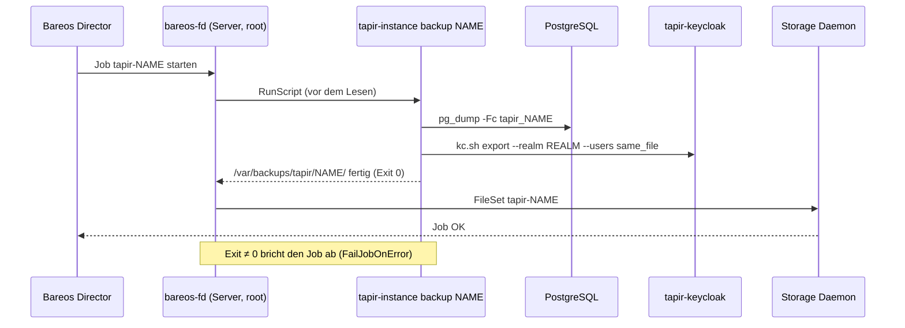
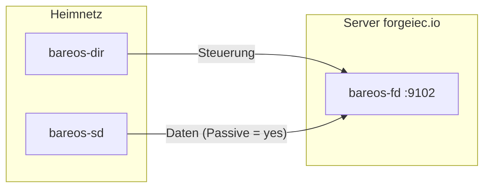
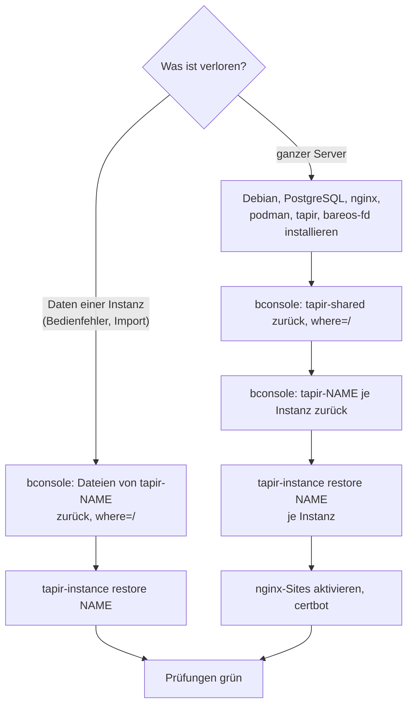

# Datensicherung mit Bareos

> **Abstract:** Jede Instanz bekommt eine **eigene Bareos-Sicherung**, den Job `tapir-<name>`
> mit gleichnamigem FileSet. Bevor Bareos Dateien liest, ruft der Job auf dem Server
> `tapir-instance backup <name>` auf. Das schreibt nach `/var/backups/tapir/<name>/` einen Dump der
> Datenbank (`pg_dump -Fc`) und einen Export des Keycloak-Realms mit Benutzern, Passwort-Hashes,
> Rollen und Clients. Bareos sichert dann dieses Verzeichnis, die env-Datei, `/var/lib/tapir/<name>`
> und die nginx-Site. Einmal je Server sichert der Job `tapir-shared` die gemeinsamen Teile:
> die ganze Keycloak-Datenbank, `/etc/tapir` und die lizenzierten Schriften.
> `tapir-instance bareos` erzeugt die Director-Konfiguration (Bareos, auch
> [baReos-dird](https://github.com/Beerlesklopfer/baReos-dird)); den Überblick über Pools, Jobs und Clients gibt
> [Onesimus](https://github.com/Beerlesklopfer/Onesimus). Läuft der Director auf demselben
> Rechner, legen `create`, `adopt` und `remove` die Jobs selbst an und entfernen sie wieder.
> `tapir-instance restore <name>` spielt eine Sicherung zurück: eine Instanz allein, ohne die
> anderen anzufassen.

## Was gesichert wird

| Job | Inhalt | Zweck |
|---|---|---|
| `tapir-<name>` | `/var/backups/tapir/<name>/tapir.dump` | Datenbank der Instanz (Mitglieder, Verträge, Zahlungen, Parameter, …) |
| | `/var/backups/tapir/<name>/realm.json` | Keycloak-Realm der Instanz: Logins mit Passwort-Hashes, Rollen, Gruppen, Clients, SMTP, Theme |
| | `/var/backups/tapir/<name>/backup.info` | Zeitpunkt, Domain, Realm, Image und dessen Digest |
| | `/etc/tapir/instances/<name>.env` | Konfiguration der Instanz |
| | `/var/lib/tapir/<name>/` | Uploads, Medien, Fehlerprotokolle, beat-Zeitplan |
| | `/etc/nginx/sites-available/tapir-<name>` | nginx-Site |
| `tapir-shared` | `/var/backups/tapir/_shared/keycloak.dump` | ganze Keycloak-Datenbank (alle Realms und `master`) |
| | `/etc/tapir/` ohne `instances/` und `initial-passwords/` | `keycloak.env` (Admin- und DB-Passwort), `bareos.env` |
| | `/var/lib/tapir/keycloak/`, `/var/lib/tapir/theme-fonts/` | Keycloak-Themes, lizenzierte Schriften (nicht im Paket) |
| | `/etc/nginx/snippets/tapir-keycloak.conf`, Quadlets `tapir-keycloak` und `tapir-redis` | gemeinsame Einrichtung |

Nicht gesichert werden der Inhalt von Redis (Warteschlange und Cache, wird neu aufgebaut), die
Container-Images (liegen in ghcr.io, `backup.info` nennt den Digest), die Zertifikate unter
`/etc/letsencrypt` (certbot stellt sie neu aus) und die Startpasswörter in `/etc/tapir/initial-passwords/`.

## Ablauf eines Jobs



- Der Export des Realms läuft neben dem laufenden Keycloak (Profil `nonserver`, liest direkt die
  Datenbank). Anmeldungen laufen während der Sicherung weiter.
- Ein Job dauert für eine kleine Solawi wenige Sekunden; die Hälfte davon braucht der Start der
  Java-Laufzeit für den Export.
- Die Dateien werden erst unter `*.tmp` geschrieben und nach Erfolg umbenannt. Schlägt ein Schritt
  fehl, bleibt die vorige Sicherung stehen und der Job meldet den Fehler.
- `/var/backups/tapir/` gehört root mit `0700`, jede Datei hat `0600`. Die Dumps enthalten
  Passwort-Hashes, Client-Secrets und das SMTP-Passwort.

## Einrichtung

### 1. File Daemon auf dem Tapir-Server

```sh
sudo apt install bareos-filedaemon
```

`bareos-fd` läuft unter Debian als root; das ist nötig, weil `tapir-instance` nur für root ist.
Den Director, der sichern darf, legt das Paket schon an:
`/etc/bareos/bareos-fd.d/director/bareos-dir.conf` mit einem zufällig erzeugten Passwort.

```
Director {
  Name = bareos-dir                 # Name des Directors
  Password = "<Passwort des Clients>"
}
```

`Name` muss der Name des Directors sein (steht dort in `bareos-dir.d/director/*.conf`). Das
Passwort aus dieser Datei kommt in den Client-Eintrag des Directors; es gehört nicht in Tickets
oder Chats.

Auf dem Director der passende Client (`/etc/bareos/bareos-dir.d/client/forgeiec-fd.conf`):

```
Client {
  Name = forgeiec-fd
  Address = forgeiec.io
  Password = "<Passwort aus bareos-fd.d/director/bareos-dir.conf>"
  Passive = yes          # Director im Heimnetz: alle Verbindungen gehen von dort aus
}
```

#### Director im Heimnetz: `Passive = yes`

Ohne `Passive` baut der File Daemon auf dem Server selbst eine Verbindung zum Storage Daemon auf
(Port 9103). Steht der Storage Daemon im Heimnetz hinter einem Router, kommt diese Verbindung
nicht an und der Job wartet, bis er abbricht. Mit `Passive = yes` verbinden sich Director **und**
Storage Daemon zum File Daemon; der Server muss das Heimnetz nie erreichen.



Nötig ist dann nur: Port 9102 auf dem Server ist vom Anschluss des Heimnetzes aus erreichbar
(Firewall des Servers, am besten nur für dessen Adresse). Im Heimnetz wird kein Port freigegeben.

#### Verschlüsselung

Bareos verschlüsselt jede Verbindung ab Werk mit **TLS-PSK** (TLS 1.3, AES-256): Schlüssel ist
das Passwort des jeweiligen Eintrags, beide Seiten weisen sich damit gegenseitig aus. Eine
CA oder Zertifikate braucht es dafür nicht.

X.509-Zertifikate (auch von Let's Encrypt) lassen sich in Bareos eintragen (`TLS Certificate`,
`TLS Key`, `TLS Verify Peer`), werden aber zwischen Bareos-Diensten **nicht** benutzt, solange
beide Seiten das Passwort kennen: Bareos bevorzugt dann immer TLS-PSK. Getestet mit Bareos 25.1.2
(Director, Storage und File Daemon mit Zertifikat und `TLS Require`, `TLS Verify Peer = yes`):
alle Verbindungen liefen über PSK, ein falscher `TLS Allowed CN` blieb ohne Wirkung. Zertifikate
von Let's Encrypt eignen sich außerdem nicht als Client-Zertifikate; sie enthalten seit 2026 nur
noch „TLS Web Server Authentication“.

Darum gilt für die Tapir-Sicherung:

- lange, zufällige Passwörter (die Pakete erzeugen sie so) und `TLS Require = yes` in den
  Einträgen, damit nie unverschlüsselt übertragen wird;
- für vertrauliche Daten auf fremdem Speicher zusätzlich die Verschlüsselung auf dem Client
  (`PKI Signatures`, `PKI Encryption`, eigener Schlüssel im File Daemon): dann liegen die Dumps
  auch auf den Volumes nur verschlüsselt.

### 2. Einstellungen

```sh
sudo cp /usr/share/tapir/bareos.env.example /etc/tapir/bareos.env
sudo editor /etc/tapir/bareos.env
```

| Variable | Vorgabe | Bedeutung |
|---|---|---|
| `BAREOS_CLIENT` | `<kurzer Hostname>-fd` | Name des Clients im Director |
| `BAREOS_JOBDEFS` | `DefaultJob` | JobDefs mit Zeitplan, Pools, Storage und Messages |
| `BAREOS_SCHEDULE` | – (aus JobDefs) | eigener Zeitplan, z. B. `WeeklyCycle` |
| `BAREOS_POOL` | – (aus JobDefs) | eigener Pool |
| `BAREOS_STORAGE` | – (aus JobDefs) | eigenes Storage |
| `BAREOS_SIGNATURE` | `XXH128` | Prüfsumme; Bareos älter als 22 braucht `MD5` |
| `BAREOS_CONFIG_DIR` | – | Director auf diesem Rechner: dort pflegt `tapir-instance` die Jobs selbst |
| `BAREOS_RELOAD` | `bconsole` | Befehl, der nach Änderungen `reload` liest; `none` = selbst neu laden |

### 3. Jobs anlegen

**Director auf einem anderen Rechner:** die Konfiguration erzeugen und dorthin kopieren.

```sh
sudo tapir-instance bareos --all > tapir-bareos.conf     # alle Instanzen und tapir-shared
sudo tapir-instance bareos ackervielfalt                 # nur eine Instanz
```

Auf dem Director den Inhalt in `bareos-dir.d/fileset/` und `bareos-dir.d/job/` ablegen (oder als
eine Datei z. B. `bareos-dir.d/job/tapir-forgeiec.conf`), prüfen und neu laden:

```sh
sudo -u bareos bareos-dir -t && echo reload | sudo bconsole
```

**Director auf demselben Rechner:**

```sh
sudo tapir-instance bareos --all --write /etc/bareos/bareos-dir.d
```

Mit `BAREOS_CONFIG_DIR=/etc/bareos/bareos-dir.d` in `bareos.env` geschieht das danach von selbst:
`create` und `adopt` legen `tapir-<name>` an (und einmalig `tapir-shared`), `remove` löscht den
Job. Es werden nur Dateien gelöscht, die mit `# Written by tapir-instance` beginnen.

### 4. Erster Lauf

```sh
sudo bconsole
*run job=tapir-ackervielfalt yes
*wait
*messages
*list files jobid=<id>
```

Ohne Bareos lässt sich der vorbereitende Schritt allein prüfen:

```sh
sudo tapir-instance backup ackervielfalt
sudo ls -l /var/backups/tapir/ackervielfalt/
```

## Erzeugte Konfiguration

Beispiel für die Instanz `ackervielfalt` mit `BAREOS_CLIENT=forgeiec-fd`:

```
# Written by tapir-instance bareos - Tapir ackervielfalt (https://ackervielfalt.forgeiec.io): database, Keycloak realm, files
FileSet {
  Name = "tapir-ackervielfalt"
  Description = "Tapir ackervielfalt (https://ackervielfalt.forgeiec.io): database, Keycloak realm, files"
  Include {
    Options {
      Signature = XXH128
      Compression = LZ4
    }
    File = "/var/backups/tapir/ackervielfalt"
    File = "/etc/tapir/instances/ackervielfalt.env"
    File = "/var/lib/tapir/ackervielfalt"
    File = "/etc/nginx/sites-available/tapir-ackervielfalt"
  }
}
Job {
  Name = "tapir-ackervielfalt"
  Description = "Tapir ackervielfalt (https://ackervielfalt.forgeiec.io): database, Keycloak realm, files"
  JobDefs = "DefaultJob"
  Client = "forgeiec-fd"
  FileSet = "tapir-ackervielfalt"
  # One bootstrap file per job: the default (%c.bsr) would be shared by all jobs of the client
  Write Bootstrap = "/var/lib/bareos/%c-%n.bsr"
  RunScript {
    RunsWhen = Before
    RunsOnClient = yes
    FailJobOnError = yes
    Command = "/usr/sbin/tapir-instance backup ackervielfalt"
  }
}
```

`Write Bootstrap` ist je Job eigen, weil `DefaultJob` `%c.bsr` setzt und sich sonst alle Jobs
eines Clients eine Bootstrap-Datei teilen würden. Inkrementelle Läufe enthalten die Dumps immer
vollständig, weil sie bei jedem Lauf neu geschrieben werden; die übrigen Dateien nur, wenn sie
sich geändert haben.

## Wiederherstellen



### Eine Instanz zurücksetzen

1. Dateien mit Bareos zurückholen. Mit `where=/` landen sie an ihrem Platz, die laufende Instanz
   bleibt davon unberührt, bis `restore` läuft:

   ```sh
   sudo bconsole
   *restore client=forgeiec-fd fileset=tapir-ackervielfalt where=/ select current all done yes
   ```

   Ein älterer Stand: statt `current` z. B. `before="2026-10-01 00:00:00"`. Vorsichtiger ist ein
   eigenes Ziel (`where=/tmp/bareos-restores`), dann im nächsten Schritt `--from` angeben.

2. Zurückspielen:

   ```sh
   sudo tapir-instance restore ackervielfalt
   # oder aus dem Ziel des Restores:
   sudo tapir-instance restore ackervielfalt --from /tmp/bareos-restores/var/backups/tapir/ackervielfalt
   ```

`restore` fragt nach dem Namen der Instanz (ohne Terminal: `--yes`) und dann:

| Schritt | Wirkung |
|---|---|
| Instanz anhalten | Web, Worker und Beat stoppen |
| Datenbank | lokal: Datenbank löschen und neu anlegen, Rolle mit dem Passwort aus der env-Datei, `pg_restore`; entfernt: `pg_restore --clean` |
| Realm | Realm löschen und aus `realm.json` neu anlegen (alle Logins mit ihren Passwörtern), danach URLs, Secret, SMTP und Theme wie bei `keycloak` setzen; fehlt Keycloak ganz, wird er aus `keycloak.env` neu eingerichtet |
| Redis | Datenbanknummer sicherstellen, Cache der Instanz leeren |
| Image, Migration | Image ziehen, `migrate` (eine ältere Sicherung wird auf den Stand des Images gehoben) |
| Start | Units schreiben, starten; nginx-Site schreiben, falls sie fehlt |
| Prüfungen | wie `status` |

| Option | Bedeutung |
|---|---|
| `--from <dir>` | Verzeichnis mit `tapir.dump` (und `realm.json`), Vorgabe `/var/backups/tapir/<name>` |
| `--no-realm` | nur die Datenbank, der Realm bleibt wie er ist (z. B. wenn nur ein Import schiefging) |
| `--yes` | ohne Rückfrage |

Andere Instanzen laufen währenddessen weiter. Wer mit `--no-realm` eine ältere Datenbank
zurückholt, behält die heutigen Logins; Mitglieder, die es nur in der alten Datenbank gibt,
haben dann noch ihren Login, Mitglieder, die seitdem dazukamen, einen Login ohne Tapir-Benutzer.

`restore` kann eine Sicherung nicht in ein **älteres** Image einspielen als das, mit dem sie
entstand. `backup.info` nennt den Digest; zurück auf genau diesen Stand:

```sh
sudo tapir-instance upgrade ackervielfalt --image ghcr.io/beerlesklopfer/wirgarten-tapir@sha256:<digest>
```

### Ganzer Server

1. Debian 13, PostgreSQL, nginx und das Paket `tapir` aus dem APT-Repository installieren
   ([Installation](Betrieb#installation)), dazu `bareos-filedaemon` mit demselben Client-Namen und
   Passwort wie vorher.
2. `tapir-shared` zurückholen (`where=/`): bringt `keycloak.env`, die Themes und die Schriften.
3. Für jede Instanz `tapir-<name>` zurückholen und `tapir-instance restore <name> --yes` aufrufen.
   Der erste Aufruf richtet Redis und Keycloak ein; jede Instanz bekommt ihren Realm aus der
   eigenen Sicherung.
4. nginx-Sites aktivieren, Zertifikate neu ausstellen ([erste Schritte](Betrieb#erste-schritte)).

Alternativ zu den Realm-Exporten lässt sich die ganze Keycloak-Datenbank zurückspielen, etwa wenn
der Realm `master` mit weiteren Admins gebraucht wird. Danach die Instanzen mit `--no-realm`
zurückspielen:

```sh
sudo systemctl stop tapir-keycloak
sudo runuser -u postgres -- psql -c 'DROP DATABASE IF EXISTS keycloak WITH (FORCE)' -c 'CREATE DATABASE keycloak OWNER keycloak'
sudo runuser -u postgres -- pg_restore --no-owner --role=keycloak -d keycloak < /var/backups/tapir/_shared/keycloak.dump
sudo systemctl start tapir-keycloak
```

## Werkzeuge rund um Bareos

| Projekt | Was es ist | Nutzen für die Tapir-Sicherung |
|---|---|---|
| [Onesimus](https://github.com/Beerlesklopfer/Onesimus) ([onesimus.io](https://onesimus.io)) | Qt-Desktop-Oberfläche für Bareos und Bacula; spricht den Director über die bconsole-Schnittstelle an, nie direkt die Datenbank (GPL-3.0, Alpha) | Belegung der Pools, Wachstum und Prognosen, Verbrauch je Job und Client (also je Tapir-Instanz), wiederverwendbare Volumes – vom Arbeitsplatz aus, ohne Web-Oberfläche auf dem Backup-Server |
| [baReos-dird](https://github.com/Beerlesklopfer/baReos-dird) (`onesimusd`, nicht öffentlich) | Director-Nachbau in Rust, als Ersatz für `bareos-dir`; liest dasselbe Verzeichnis `bareos-dir.d`, arbeitet mit den C++-Daemons (File und Storage Daemon) und TLS-PSK | Die von `tapir-instance bareos` erzeugten FileSets und Jobs sind gewöhnliche Bareos-Konfiguration; mit `onesimusd` sind sie noch nicht getestet (vor allem `RunScript` vor dem Job) |

Beide Projekte sind in Entwicklung (Onesimus: Alpha). Für die Sicherung der Solawi-Daten ist der
Director von Bareos selbst der getestete Weg; baReos-dird ist nur mit Zugang zum Repository sichtbar.

## Hinweise

- `remove` löscht den Bareos-Job (mit `BAREOS_CONFIG_DIR`); die Sicherungen im Bareos-Katalog
  bleiben, bis ihre Aufbewahrungszeit abläuft. `/var/backups/tapir/<name>/` bleibt auch nach
  `remove --purge` stehen und ist von Hand zu löschen.
- Der Job läuft als root auf dem Server. In der Konsole des Directors darf daher nur, wer auch
  root auf dem Tapir-Server sein darf.
- Ein Job, der nur mit `FAIL` endet, steht in `messages` mit der Meldung von `tapir-instance`,
  z. B. `dump of the database of <name> failed`. Häufige Ursachen und Abhilfe:
  [Fehlersuche](Betrieb-Fehlersuche#sicherung-schlägt-fehl).

## Datenschutz und Löschung

Die Sicherungen enthalten auch Daten gelöschter Mitglieder. Wie lange, warum es Betriebs-Backup und Archiv in getrennten Pools geben soll und wie ein Restore als Merge aussieht, steht in [Datenschutz und Löschung](Betrieb-Datenschutz#datensicherung-archiv-und-restore).
