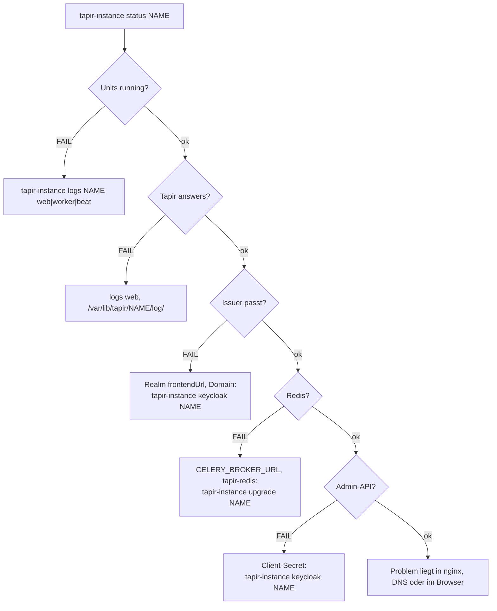

# Fehlersuche

> **Abstract:** Erster Schritt ist immer `tapir-instance status <name>`. Die Prüfungen gehen die
> Kette von außen nach innen durch: Units, gunicorn, Keycloak-Aussteller, Redis, Keycloak-Admin-API.
> Die erste `FAIL`-Zeile zeigt meist schon die Ursache. Danach helfen die Journale
> (`tapir-instance logs`), die Fehlerprotokolle in `/var/lib/tapir/<name>/log/` und die Tabelle
> der bekannten Fehler unten. Fast jede Reparatur endet mit einem wiederholten
> `tapir-instance upgrade <name>` oder `keycloak <name>`; beide sind gefahrlos wiederholbar.



## Prüfungen

| FAIL-Zeile | wahrscheinliche Ursache | Abhilfe |
|---|---|---|
| `tapir-<name>-web running` | Container startet nicht: Image fehlt, env-Datei fehlerhaft, Port belegt | `tapir-instance logs <name> web`; `podman image exists …`; `ss -ltnp 'sport = :<port>'` |
| `…-worker running`, `…-beat running` | Redis nicht erreichbar, Fehler in einer Aufgabe | `tapir-instance logs <name> worker` |
| `Tapir answers on 127.0.0.1:<port>` | gunicorn startet noch, Python-Fehler, `ALLOWED_HOSTS` passt nicht zur Domain | Log `web`; `/var/lib/tapir/<name>/log/` |
| `Keycloak realm …, issuer …` | Keycloak läuft nicht, Realm fehlt, `frontendUrl` passt nicht zur Domain | `systemctl status tapir-keycloak`; `tapir-instance keycloak <name>` |
| `Tapir reaches redis` | `tapir-redis` gestoppt, `CELERY_BROKER_URL` zeigt woandershin | `systemctl status tapir-redis`; `tapir-instance upgrade <name>` |
| `Tapir reaches the Keycloak admin API` | Client-Secret in env-Datei und Realm verschieden, Service-Account ohne Rechte | `tapir-instance keycloak <name>` |
| `https://<domain>/… through nginx` | Site nicht aktiv, Zertifikat fehlt, fremde Site leitet woandershin | `nginx -t`; `tapir-instance nginx <name>` |

## Bekannte Fehler

### Interner Fehler (500) nach der Anmeldung, im Log `redis.exceptions.ConnectionError … localhost:6379`

Tapir nutzt `CELERY_BROKER_URL` auch als Django-Cache. Steht dort noch die Adresse eines
früheren Redis (Host-Redis oder Vorlage `redis://localhost:6379`), schlägt jeder Seitenaufruf
mit Cache fehl, die Anmeldung zuerst.

```sh
sudo grep CELERY_ /etc/tapir/instances/<name>.env     # erwartet: redis://127.0.0.1:6380/<nr>
sudo tapir-instance upgrade <name>                    # setzt die URL und zieht ältere Einrichtungen um
```

### `ModuleNotFoundError: No module named 'factory'` beim Upgrade oder Start

Das Produktions-Image enthält keine Entwicklungspakete (factory_boy und andere). Lädt ein
Modul, das Produktions-URLs importieren, Testdaten-Code, startet Django nicht. Das ist ein Fehler
im Image, kein Fehler der Einrichtung. Abhilfe auf dem Server: auf das letzte funktionierende
Image zurück.

```sh
sudo tapir-instance upgrade <name> --image ghcr.io/beerlesklopfer/wirgarten-tapir:sha-<commit>
```

Seit dem Fix prüft der Workflow jedes Image mit `manage check`, bevor er es veröffentlicht.

### `ERROR: port <port> is already in use`

`create` prüft den Port nur bei einer neuen Instanz; Keycloak (8800) und Redis (6380) nur, wenn
ihr Container noch nicht existiert. Belegt ist er von einem anderen Dienst:

```sh
sudo ss -ltnp 'sport = :8800'
```

Anderen Port wählen (`--port`, `--keycloak-port`, `REDIS_PORT=…` vor dem ersten `create`) oder
den Dienst verlegen.

### `ERROR: a container named … exists that tapir-instance did not create`

Ein gleichnamiger Container (z. B. ein Entwicklungs-Keycloak `tapir-keycloak`) würde von der Unit
ersetzt und beim Stoppen gelöscht. `tapir-instance` bricht deshalb ab. Den fremden Container
umbenennen (`podman rename tapir-keycloak tapir-keycloak-dev`) oder entfernen.

### `ERROR: Keycloak does not answer` / `login to Keycloak failed`

```sh
sudo journalctl -u tapir-keycloak -n 100
sudo systemctl status postgresql
```

Häufig: PostgreSQL läuft nicht oder nimmt das Passwort der Rolle `keycloak` nicht an. Ein erneutes
`tapir-instance keycloak <name>` setzt das Passwort aus `keycloak.env` wieder. Der erste Start
eines neuen Keycloak-Images dauert einige Minuten.

### `ERROR: the database does not accept DATABASE_CONNECTION` (adopt)

Die alte Installation hatte eine Verbindung, deren Passwort nicht (mehr) stimmt. Mit `psql` prüfen
und das Passwort der Rolle setzen, dann `adopt` wiederholen. Die Meldung nennt beide Befehle.

### Anmeldeseite in Englisch oder im falschen Theme

`internationalizationEnabled` oder das Theme des Realms sind nicht gesetzt (ältere Realms) oder
Keycloak hat alte Themes im Cache.

```sh
sudo tapir-instance theme <name> <theme>
sudo systemctl restart tapir-keycloak
```

### Keine Mails

| Symptom | Ursache |
|---|---|
| Tapir-Mails fehlen, Dateien in `/var/lib/tapir/<name>/emails_from_celery/` | `EMAIL_ENV=dev` – auf `prod` stellen und `EMAIL_*` setzen |
| Tapir startet nach `EMAIL_ENV=prod` nicht | eine Pflichtvariable fehlt (`EMAIL_BOUNCE_ADDRESS` wird oft vergessen) |
| Passwort- und Bestätigungs-Mails fehlen | Keycloak kennt den Mailserver nicht: `tapir-instance keycloak <name>` |
| Mails kommen erst Minuten später | Worker hängt: `tapir-instance logs <name> worker` |

Ein Test aus Keycloak: `tapir-kcadm --realm <realm> user verify-mail <mail>`. Fehler dabei stehen
in `journalctl -u tapir-keycloak`.

### Anmeldung klappt, aber Tapir zeigt „keine Berechtigung“ oder nur den Mitgliederbereich

Dem Login fehlen Rollen. Rechte kommen nur aus Keycloak.

```sh
sudo tapir-kcadm --realm <realm> user show <mail>             # Rollen und Gruppen
sudo tapir-kcadm --realm <realm> user group <mail> superuser  # alle Rechte
```

### Anmeldung bei Keycloak klappt, Tapir zeigt danach „Registrierung geschlossen“ (Sign Up Closed)

Der Login existiert nur in Keycloak (z. B. mit `tapir-kcadm user add` angelegt), Tapir kennt die
Adresse nicht und legt Benutzer bei der Anmeldung nie selbst an. Mit `tapir-instance user-add <name> <mail>` den Tapir-Benutzer ergänzen.

### nginx: `nginx -t` schlägt nach einer Änderung fehl

`tapir-instance` stellt eine selbst veränderte fremde Site automatisch wieder her (Sicherung in
`/var/lib/tapir/backup/`). Schlägt `nginx -t` schon vorher fehl, liegt der Fehler in einer anderen
Site. Ein toter Link in `sites-enabled` (z. B. nach dem Löschen einer Site) ist eine häufige
Ursache: `find /etc/nginx/sites-enabled -xtype l`.

### Sicherung schlägt fehl

Bareos zeigt in `messages` die Meldung von `tapir-instance backup`. Von Hand nachvollziehen:
`sudo tapir-instance backup <name>`.

| Meldung | Ursache und Abhilfe |
|---|---|
| `dump of the database of <name> failed` | Datenbank läuft nicht oder das Passwort in `DATABASE_CONNECTION` stimmt nicht: `systemctl status postgresql` |
| `pg_dump: … server version mismatch` | `pg_dump` des Hosts ist älter als der Server (entfernte Datenbank): passendes `postgresql-client-<version>` installieren |
| `export of the Keycloak realm … failed` | `tapir-keycloak` läuft nicht; Details in `/var/backups/tapir/<name>/realm-export.log` |
| `… does not use the shared Keycloak` (Warnung) | Instanz hängt an einem externen Keycloak; dessen Realm dort sichern oder `tapir-instance keycloak <name>` |
| Job endet „OK -- with warnings“, `Could not stat` | Datei fehlt, z. B. die nginx-Site bei `--no-nginx`; harmlos, oder FileSet anpassen |
| Bareos: `Command not found` / `permission denied` | `bareos-fd` läuft nicht als root, oder `Allowed Script Dirs` im Client verbietet `/usr/sbin` |

## Nützliche Befehle

```sh
sudo tapir-instance list
sudo tapir-instance status <name>
sudo tapir-instance logs <name> web
sudo journalctl -fu tapir-<name>-web                       # fortlaufend
sudo ls -lt /var/lib/tapir/<name>/log/ | head              # Python-Fehlerprotokolle
sudo podman ps --filter name=tapir-                        # laufende Container
sudo podman exec tapir-redis redis-cli -p 6380 info keyspace
sudo tapir-manage <name> shell                             # Django-Shell
sudo tapir-manage <name> showmigrations | grep '\[ \]'     # offene Migrationen
```

Bei Fragen im Chat oder Ticket nur Ausgaben von `status` und Logs teilen, nie die env-Dateien,
`keycloak.env`, Startpasswörter oder Links aus Passwort-Mails.
