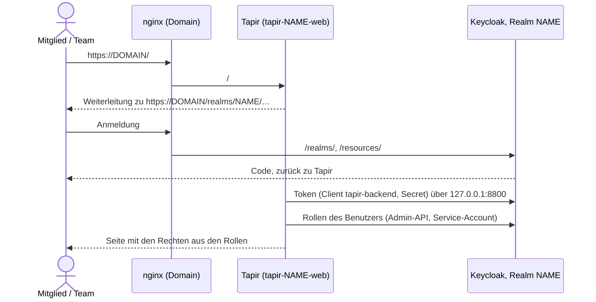
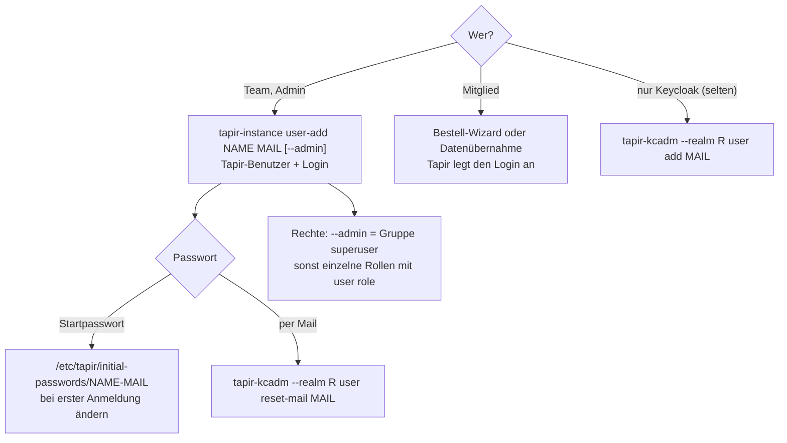

> ⚠️ **Nicht maßgeblich.** Dieses Wiki gehört zu einem abgeschlossenen Proof of Concept für den
> Eigenbetrieb von Tapir und wird nicht gepflegt. Maßgeblich ist die Dokumentation im
> Hauptprojekt: [FoodCoopX/wirgarten-tapir – docs](https://github.com/FoodCoopX/wirgarten-tapir/tree/master/docs),
> Aufbau in Issue [#1300](https://github.com/FoodCoopX/wirgarten-tapir/issues/1300).

# Keycloak und Benutzer

> **Abstract:** Alle Instanzen eines Servers teilen sich den Container `tapir-keycloak`
> (`127.0.0.1:8800`). Jede Instanz hat darin einen eigenen **Realm**: eigene Benutzer, Rollen,
> Mailserver, Theme. Tapir nimmt die Anmeldung (OIDC) und die **Rechte** aus Keycloak: Eine
> Realm-Rolle wie `coop.manage` ist ein Recht in Tapir. `tapir-kcadm` verwaltet Keycloak auf der
> Kommandozeile, nur als root, und verlangt den Realm immer ausdrücklich, damit nie versehentlich
> die falsche Solawi getroffen wird. Team-Konten legt man mit `tapir-instance user-add` an, denn
> ein Konto braucht beides: einen Tapir-Benutzer und einen Keycloak-Login.

## Zusammenspiel



- Tapir spricht Keycloak intern über `KEYCLOAK_ADMIN_SERVER_URL` (`http://127.0.0.1:8800`) an;
  Browser sehen nur `https://<domain>/realms/<realm>`.
- Der Client `tapir-backend` hat einen Service-Account mit Admin-Rechten im Realm. Damit legt
  Tapir Logins an (Bestell-Wizard, Datenübernahme), ändert Namen und Adressen und liest Rollen.
- Selbstregistrierung in Keycloak ist aus (`registrationAllowed=false`). Neue Mitglieder kommen
  über den Bestell-Wizard; Tapir legt dabei den Login an und schickt die Bestätigungs-Mail.

## tapir-kcadm

`/usr/sbin/tapir-kcadm`, Rechte `rwxrwx---` root:root. Meldet sich mit dem Admin aus
`/etc/tapir/keycloak.env` am Master-Realm an und ruft `kcadm.sh` im Container auf.

```sh
tapir-kcadm realms                                         # alle Realms (ohne master)
tapir-kcadm --realm <realm> <befehl> …                     # alles andere: Realm ist Pflicht
```

| Befehl | Wirkung |
|---|---|
| `user list [<suche>]` | Benutzer (Benutzername, Name, aktiv, Mail bestätigt), höchstens 1000 |
| `user show <mail>` | Details, ausstehende Aktionen, Rollen (auch über Gruppen), Gruppen |
| `user add <mail> [--first <vorname>] [--last <nachname>] [--password <pw>] [--superuser]` | nur Keycloak-Login; ohne `--password` mit erzeugtem Einmal-Passwort |
| `user passwd <mail> [--password <pw>] [--temporary]` | Passwort setzen; ohne `--password` erzeugt und vorläufig |
| `user role <mail> <rolle> [--remove]` | Realm-Rolle geben oder nehmen |
| `user group <mail> <gruppe> [--remove]` | in Gruppe aufnehmen oder entfernen, z. B. `superuser` |
| `user enable <mail>` / `user disable <mail>` | Login sperren oder freigeben |
| `user delete <mail>` | Keycloak-Login löschen (der Tapir-Benutzer bleibt) |
| `user logout <mail>` | alle Sitzungen beenden |
| `user verify-mail <mail>` | Bestätigungs-Mail schicken |
| `user reset-mail <mail>` | Mail „Passwort festlegen“ schicken |
| `roles` / `groups` | Rollen bzw. Gruppen des Realms |
| `raw <kcadm.sh-argumente>` | beliebiger `kcadm.sh`-Befehl, `-r <realm>` wird angehängt |

Beispiele:

```sh
sudo tapir-kcadm realms
sudo tapir-kcadm --realm ackervielfalt user list
sudo tapir-kcadm --realm ackervielfalt user show erika@example.org
sudo tapir-kcadm --realm ackervielfalt user role erika@example.org farming.view
sudo tapir-kcadm --realm ackervielfalt user reset-mail erika@example.org
sudo tapir-kcadm --realm ackervielfalt raw get clients --fields clientId
```

## Konten anlegen



Beispiel für zwei Team-Konten mit allen Rechten, die ihr Passwort selbst per Mail festlegen:

```sh
sudo tapir-instance user-add ackervielfalt erika@example.org --admin --first Erika --last Musterfrau
sudo tapir-kcadm --realm ackervielfalt user reset-mail erika@example.org
sudo rm /etc/tapir/initial-passwords/ackervielfalt-erika@example.org
```

Links aus Passwort- und Bestätigungs-Mails sind persönliche Schlüssel (12 Stunden gültig, wenn
der Admin sie auslöst). Nicht weiterleiten und nicht in Tickets oder Chats kopieren.

## Rollen

| Rolle | Recht in Tapir |
|---|---|
| `coop.view` / `coop.manage` | Admin-Bereich sehen / Mitglieder, Verträge, Konfiguration bearbeiten, Datenübernahme |
| `accounts.view` / `accounts.manage` | Benutzerkonten |
| `payments.view` / `payments.manage` | Zahlungen, SEPA-Exporte |
| `products.view` / `products.manage` | Produkte, Preise, Kapazitäten |
| `email.manage` | Mail-Oberfläche `/tapirmail` |
| `farming.view` / `farming.manage` | Anbau-App sehen / planen und Stammdaten pflegen |

Die Gruppe `superuser` hat alle diese Rollen. Tapir liest die Rollen bei jeder Anfrage über die
Admin-API; eine geänderte Rolle wirkt deshalb ab dem nächsten Seitenaufruf, ohne neue Anmeldung.
Entwicklersicht: [Rechte und Anmeldung](Development-Rechte-und-Anmeldung).

## Realm-Einstellungen

Der Realm entsteht aus `/usr/share/tapir/keycloak/tapir-realm.json.in`. Wichtige Vorgaben:

| Einstellung | Wert |
|---|---|
| Anmeldung mit E-Mail, E-Mail als Benutzername | ja |
| Selbstregistrierung | aus |
| Passwort vergessen | an |
| Angemeldet bleiben | an |
| E-Mail bestätigen | an |
| Sitzung | 30 min Leerlauf, höchstens 10 h |
| SSL | `external` (nginx macht TLS) |
| Login- und Mail-Theme | aus `TAPIR_THEME`, sonst `wirgarten` |
| Sprache | nur Deutsch |

`tapir-instance create`, `adopt` und `keycloak` setzen URLs, Secret, Mailserver und Theme bei jedem
Lauf neu (Liste: [tapir-instance keycloak](Betrieb-tapir-instance#keycloak)). Andere Änderungen
in der Admin-Konsole bleiben erhalten.

## Admin-Konsole

Die Konsole ist nicht öffentlich: nginx leitet nur `/realms/` und `/resources/` weiter, `/admin`
gehört Tapir. Zugang über einen SSH-Tunnel:

```sh
ssh -L 8800:127.0.0.1:8800 root@<server>
# Browser: http://localhost:8800/admin  –  Benutzer admin
sudo sed -n 's/^KC_BOOTSTRAP_ADMIN_PASSWORD=//p' /etc/tapir/keycloak.env    # Passwort
```

## Keycloak-Container

| | |
|---|---|
| Unit | `tapir-keycloak.service` (Quadlet `/etc/containers/systemd/tapir-keycloak.container`) |
| Image | `quay.io/keycloak/keycloak:26.8.0` (`KEYCLOAK_IMAGE`) |
| Datenbank | PostgreSQL auf dem Host, Datenbank und Rolle `keycloak` |
| Themes | `/var/lib/tapir/keycloak/themes` → `/opt/keycloak/themes` (nur lesend) |
| Logs | `journalctl -u tapir-keycloak` |
| Neustart | `systemctl restart tapir-keycloak` (alle Instanzen sind kurz ohne Anmeldung) |

Ein Wechsel der Keycloak-Version geschieht über ein neues `tapir`-Paket (neuer Standardwert
`KEYCLOAK_IMAGE`) und `tapir-instance keycloak <name>`: Die Unit wird nur dann neu geschrieben
und Keycloak neu gestartet, wenn sich ihr Inhalt ändert.
