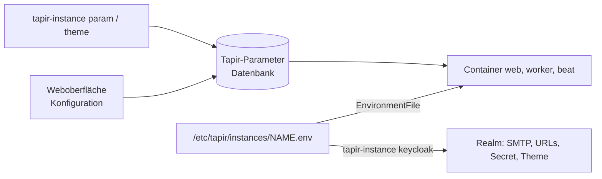

# Konfiguration einer Instanz

> **Abstract:** Eine Instanz wird an drei Stellen konfiguriert. **Die env-Datei**
> `/etc/tapir/instances/<name>.env` ist die Umgebung der Container: Domain, Datenbank, Redis,
> Keycloak, Mailserver. `tapir-instance` füllt sie größtenteils selbst; von Hand gehören nur Mail
> und Sonderfälle hinein. **Die Tapir-Parameter** (in der Datenbank) steuern das Fachliche und
> werden in der Weboberfläche gepflegt. Ein paar Grundeinstellungen sind dort gesperrt und
> werden mit `tapir-instance param` gesetzt. **Theme und Schriften** setzt
> `tapir-instance theme` für Tapir und Keycloak gemeinsam.



## Die env-Datei

Nach jeder Änderung: `sudo tapir-instance restart <name>`. Betrifft die Änderung Mail oder
Domain, stattdessen `sudo tapir-instance keycloak <name>` (das startet auch neu).

### Von tapir-instance verwaltet

Diese Werte schreibt `tapir-instance` bei `create`, `adopt`, `keycloak` oder `upgrade` und
überschreibt Handänderungen.

| Variable | Wert | gesetzt von |
|---|---|---|
| `TAPIR_DOMAIN` | öffentlicher Hostname | `create --domain`, `adopt` |
| `TAPIR_IMAGE` | Container-Image | `create --image`, `upgrade --image` |
| `SITE_URL` | `https://<domain>` | `create`, `adopt` |
| `ALLOWED_HOSTS` | `<domain>` | `create`, `adopt` |
| `GUNICORN_BIND` | `127.0.0.1:<port>` | `create --port` (bei `adopt` bleibt der alte) |
| `ERROR_LOG_DIR` | `/data/log` | `create`, `adopt` |
| `DATABASE_CONNECTION` | `postgresql://tapir_<name>:<pw>@127.0.0.1:5432/tapir_<name>` | `create` (nur solange `CHANGE_ME` darin steht) oder `--db-url` |
| `TAPIR_REDIS_DB` | Datenbanknummer im gemeinsamen Redis (0–63) | einmal vergeben, dann fest |
| `CELERY_BROKER_URL`, `CELERY_RESULT_BACKEND` | `redis://127.0.0.1:6380/<TAPIR_REDIS_DB>` | jeder Lauf; **auch der Django-Cache** nutzt diese URL |
| `KEYCLOAK_ADMIN_SERVER_URL` | `http://127.0.0.1:8800` | `ensure_realm` |
| `KEYCLOAK_PUBLIC_URL` | `https://<domain>` | `ensure_realm` |
| `KEYCLOAK_REALM_NAME` | Realm der Instanz | `ensure_realm` |
| `KEYCLOAK_CLIENT_ID` | `tapir-backend` | `ensure_realm` |
| `KEYCLOAK_ADMIN_CLIENT_SECRET_KEY` | Secret des Clients `tapir-backend` | einmal erzeugt, dann in den Realm übertragen |
| `TAPIR_THEME` | Theme-Code, z. B. `akv` | `tapir-instance theme` |

### Von Hand zu pflegen

| Variable | Vorgabe | Bedeutung |
|---|---|---|
| `SECRET_KEY` | zufällig (64 Zeichen) | Django-Schlüssel; nie ändern, sonst sind alle Sitzungen und signierten Links ungültig |
| `DEBUG` | `False` | **nie** `True` im Betrieb – schaltet Debug-Seiten frei und entsperrt die gesperrten Parameter |
| `GUNICORN_WORKERS` | `3` | Anzahl der Web-Prozesse |
| `EMAIL_ENV` | `dev` | `dev`: Mails nur als Dateien in `/var/lib/tapir/<name>/emails_from_celery`; `prod`: Versand per SMTP |
| `EMAIL_HOST` | – | SMTP-Server (Pflicht bei `prod`) |
| `EMAIL_PORT` | `587` | |
| `EMAIL_USE_TLS` / `EMAIL_USE_SSL` | `True` / `False` | STARTTLS bzw. SMTPS; nur eins von beiden |
| `EMAIL_HOST_USER`, `EMAIL_HOST_PASSWORD` | – | SMTP-Anmeldung (Pflicht bei `prod`) |
| `EMAIL_HOST_SENDER` | – | Absenderadresse, die Mitglieder sehen (Pflicht bei `prod`) |
| `EMAIL_HOST_SENDER_NAME` | – | Absendername, z. B. `Solawi Ackervielfalt` (Pflicht bei `prod`); auch Anzeigename des Realms |
| `EMAIL_BOUNCE_ADDRESS` | – | Umschlag-Absender für Rückläufer (Pflicht bei `prod`) |
| `EMAIL_BOUNCE_HOST`, `EMAIL_BOUNCE_USER`, `EMAIL_BOUNCE_PASSWORD`, `EMAIL_PORT_IMAP` | – / – / – / `993` | IMAP-Postfach der Rückläufer |
| `EMAIL_AUTO_BCC`, `EMAIL_REPLY_TO` | – | Blindkopie aller Mails, Antwortadresse |
| `SERVER_EMAIL`, `EMAIL_ADDRESS_ERRORS` | – | Absender und Empfänger der Fehler-Mails von Django |
| `KEYCLOAK_SKIP_VERIFICATION_EMAIL` | `False` | `True`: neue Logins ohne Bestätigungs-Mail |
| `MAILING_LISTS_ENABLED`, `MAILMAN_URL`, `MAILMAN_ADMIN_USER`, `MAILMAN_ADMIN_PASSWORD` | `False` | Anbindung an Mailman 3 |
| `PHONENUMBER_DEFAULT_REGION` | `DE` | Ländervorwahl für Telefonnummern ohne `+` |
| `TAPIR_TLS_CERTIFICATE`, `TAPIR_TLS_CERTIFICATE_KEY` | Let's-Encrypt-Pfade | Zertifikat für die nginx-Site |

Mit `EMAIL_ENV=prod` startet Tapir nicht, solange eine der Pflichtvariablen fehlt. Fehlt
`EMAIL_HOST`, warnt `tapir-instance`, dass Keycloak für diesen Realm noch keine Mails verschicken
kann.

### Mailserver einrichten

```sh
sudo editor /etc/tapir/instances/ackervielfalt.env
#   EMAIL_ENV=prod
#   EMAIL_HOST=smtp.example.org
#   EMAIL_HOST_USER=info@example.org
#   EMAIL_HOST_PASSWORD=…
#   EMAIL_HOST_SENDER=info@example.org
#   EMAIL_HOST_SENDER_NAME=Solawi Ackervielfalt
#   EMAIL_BOUNCE_ADDRESS=info@example.org
sudo tapir-instance keycloak ackervielfalt
sudo tapir-kcadm --realm ackervielfalt user verify-mail team@example.org   # Testmail aus Keycloak
```

Die env-Datei enthält Passwörter. Sie gehört root (`0640`) und wird nicht in Tickets oder Chats
kopiert.

### Gemeinsamer Keycloak: /etc/tapir/keycloak.env

| Variable | Bedeutung |
|---|---|
| `KC_HTTP_PORT` | Port des Keycloak (Vorgabe 8800, beim ersten `create` festgelegt) |
| `KC_DB_PASSWORD` | Passwort der PostgreSQL-Rolle `keycloak` |
| `KC_BOOTSTRAP_ADMIN_USERNAME`, `KC_BOOTSTRAP_ADMIN_PASSWORD` | Admin des Master-Realms (`admin`, zufälliges Passwort) |
| `KC_DB`, `KC_DB_URL`, `KC_DB_USERNAME`, `KC_HOSTNAME_STRICT=false`, `KC_PROXY_HEADERS=xforwarded`, `KC_HTTP_ENABLED`, `KC_HTTP_HOST=127.0.0.1` | feste Werte, bei jedem Lauf neu geschrieben |

Die Datei ist nur für root lesbar (`0600`).

## Gesperrte Parameter

Außerhalb von Debug-Instanzen (`DEBUG=False`) sperrt Tapir diese Grundeinstellungen in der
Weboberfläche. Sie ändern Verträge und Zahlungen grundlegend und werden deshalb auf dem Server
gesetzt:

| Schlüssel | Bezeichnung | Typ | Vorgabe | Werte |
|---|---|---|---|---|
| `wirgarten.coop.share_price` | Preis für einen Anteil | Ganzzahl (€) | 50 | |
| `wirgarten.subscriptions.automatic_renewal` | Automatische Verlängerung der Verträge | Wahrheitswert | false | `true`, `false` |
| `wirgarten.subscriptions.default_notice_period` | Kündigungsfrist | Ganzzahl | 2 | |
| `wirgarten.subscriptions.default_notice_period_unit` | Einheit der Kündigungsfrist | Text | `months` | `months`, `weeks` |
| `wirgarten.trial_period.enabled` | Probezeit einschalten | Wahrheitswert | true | `true`, `false` |
| `wirgarten.trial_period.duration` | Probezeit in Wochen | Ganzzahl | 4 | |
| `wirgarten.organisation.legal_status` | Rechtsform der Organisation | Text | `coop` | `association` (Verein), `coop` (Genossenschaft), `company` (Einzelunternehmen) |
| `wirgarten.picking.picking_mode` | Kommissionierungsmodus | Text | `picking_mode_share` | `picking_mode_basket` (nach Kisten), `picking_mode_share` (nach Ernteanteilen) |

```sh
sudo tapir-instance param ackervielfalt                                   # Liste mit aktuellen Werten
sudo tapir-instance param ackervielfalt wirgarten.organisation.legal_status
sudo tapir-instance param ackervielfalt wirgarten.organisation.legal_status association
```

Am besten vor dem Import der Mitglieder und Verträge festlegen. Alle übrigen Parameter lassen sich
in der Weboberfläche ändern (Handbuch: [Konfiguration](Handbuch-Verwaltung-Konfiguration)), und
`tapir-instance param <name> <key> <value>` setzt sie auf Wunsch genauso.

## Theme und Schriften

```sh
sudo tapir-instance theme ackervielfalt akv
```

| Was | Wo |
|---|---|
| Tapir: Farben, Logo, Favicon, Schriften | `tapir/core/static/core/themes/<theme>/` im Image, gewählt über den Parameter `organisation.theme` |
| Keycloak: Anmeldeseiten und Mails | `/usr/share/tapir/keycloak/themes/<theme>/` → `/var/lib/tapir/keycloak/themes/`, gewählt im Realm |
| lizenzierte Schriften | `/var/lib/tapir/theme-fonts/<theme>/`, von nginx unter `/theme-fonts/<theme>/` ausgeliefert |

**Lizenzierte Schriften:** Manche Solawis nutzen Schriften, die sie verwenden, aber nicht
weitergeben dürfen (z. B. die Garden-Grown-Schriften im Theme `akv`). Sie gehören **nicht** ins
Repository oder Image. Die Themes binden sie unter `/theme-fonts/<theme>/…` ein und fallen auf
freie Schriften zurück, solange die Dateien fehlen.

```sh
sudo install -d /var/lib/tapir/theme-fonts/akv
sudo install -m 0644 gardengrown-bcaps-webfont.woff2 gardengrown-bcaps-webfont.woff /var/lib/tapir/theme-fonts/akv/
```

Die Dateinamen müssen zu den `url(/theme-fonts/…)`-Angaben in der `custom.css` des Tapir-Themes und
der `styles.css` des Keycloak-Themes passen.

Die Pfade `/theme-fonts/` stehen sowohl in der generierten Site als auch im Snippet
`tapir-keycloak.conf`, damit auch eine eigene Site sie bekommt.

Gibt es kein Keycloak-Theme gleichen Namens, nutzt der Realm `wirgarten`. Ein neues Keycloak-Theme
entsteht in `docker/keycloak/themes/<theme>/` im Repository (Development:
[Themes](Development-Themes)). Die Nachrichtendateien (`messages_*.properties`) sind dort
ISO-8859-1-kodiert.
