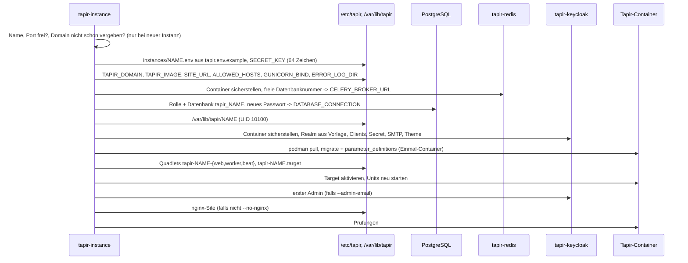
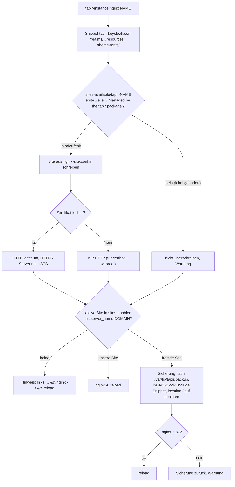

# tapir-instance

> **Abstract:** `tapir-instance` ist das einzige Werkzeug, das Instanzen anlegt, verändert und
> entfernt. Es ist ein Bash-Skript (`packaging/tapir-instance`, installiert nach
> `/usr/sbin`), läuft nur als root und ist **idempotent**: Jeder Befehl stellt einen Zielzustand
> her (Datenbank, Realm, Redis-Nummer, Units, nginx-Site) und legt nichts doppelt an. Ein
> abgebrochener Lauf wird deshalb einfach wiederholt. Fast jeder Befehl endet mit denselben
> Prüfungen wie `status`.

Übersicht: [Betrieb](Betrieb) · Konfiguration: [Betrieb-Konfiguration](Betrieb-Konfiguration) ·
Keycloak: [Betrieb-Keycloak](Betrieb-Keycloak) · Fehler: [Betrieb-Fehlersuche](Betrieb-Fehlersuche)

## Befehle auf einen Blick

| Befehl | Zweck |
|---|---|
| [`create <name> --domain <host> --port <port> […]`](#create) | neue Instanz komplett einrichten |
| [`adopt <name> [--domain <host>] [--admin-email <mail>]`](#adopt) | Installation des früheren nativen Pakets übernehmen |
| [`keycloak <name>`](#keycloak) | Realm, Mailserver, Themes, Redis, Units und nginx auffrischen |
| [`list`](#list) | alle Instanzen |
| [`status <name>`](#status) | Prüfungen |
| [`upgrade <name>…\|--all [--image <image>]`](#upgrade) | Image ziehen, migrieren, neu starten, prüfen |
| [`start\|restart\|stop <name>`](#start-restart-stop) | Instanz starten / neu starten / anhalten |
| [`nginx <name>`](#nginx) | nginx-Site neu schreiben, z. B. HTTPS nach dem Zertifikat |
| [`logs <name> [web\|worker\|beat]`](#logs) | letzte 100 Zeilen des Journals |
| [`manage <name> <argumente>`](#manage) | `manage.py` im Web-Container |
| [`user-add <name> <mail> [--admin] [--first …] [--last …]`](#user-add) | Tapir-Konto mit Keycloak-Login |
| [`theme <name> <theme>`](#theme) | Theme von Tapir, Keycloak-Anmeldeseiten und Mails |
| [`param <name> [--all \| <key> [<value>]]`](#param) | Parameter anzeigen und setzen, auch die in der Oberfläche gesperrten |
| [`remove <name> [--purge]`](#remove) | Instanz entfernen, mit `--purge` samt Daten |
| [`backup <name>\|--shared`](#backup) | Datenbank und Realm nach `/var/backups/tapir/<name>` (Bareos ruft das vor jedem Job) |
| [`restore <name> [--from <dir>] [--no-realm] [--yes]`](#restore) | Sicherung zurückspielen |
| [`bareos <name>\|--shared\|--all [--write <dir>]`](#bareos) | Bareos-FileSet und -Job, einer je Instanz |
| `--help` | Kurzhilfe |

**Namen** von Instanzen und Realms: 2 bis 31 Zeichen, Kleinbuchstaben, Ziffern und `-`, beginnend
mit einem Buchstaben (`^[a-z][a-z0-9-]{1,30}$`). Großbuchstaben werden bei `create`/`adopt` klein
geschrieben. Der Name bestimmt Container (`tapir-<name>-web`), Units, env-Datei, Datenverzeichnis
und die Datenbank `tapir_<name>` (`-` wird dort zu `_`).

## Was ein Befehl berührt

| Schritt | `create` | `adopt` | `keycloak` | `upgrade` | `restart` | `nginx` | `status` |
|---|:-:|:-:|:-:|:-:|:-:|:-:|:-:|
| Redis-Container sicherstellen (gemeinsam) | ✔ | ✔ | | ✔ | ✔ | | |
| Redis-Nummer und `CELERY_*` der Instanz | ✔ | ✔ | ✔ | ✔ | | | |
| Keycloak-Container, `keycloak.env`, DB `keycloak`, Themes (gemeinsam) | ✔ | ✔ | ✔ | | | | |
| Realm: Clients, Secret, `frontendUrl`, SMTP, Theme, Sprache | ✔ | ✔ | ✔ | | | | |
| Image ziehen, `migrate` + `parameter_definitions` | ✔ | ✔ | | ✔ | | | |
| Quadlets und Target neu schreiben | ✔ | ✔ | ✔ | ✔ | | | |
| Instanz neu starten | ✔ | ✔ | ✔ | ✔ | ✔ | | |
| nginx-Snippet und -Site | ✔¹ | ✔ | ✔ | | | ✔ | |
| Prüfungen | ✔ | ✔ | ✔ | ✔ | | | ✔ |

¹ außer mit `--no-nginx`

Wichtig daraus:

- `upgrade` fasst **Keycloak und nginx nicht** an. Wer Mailserver, Domain oder Keycloak-Themes
  geändert hat, ruft `tapir-instance keycloak <name>` auf.
- `create`, `adopt`, `keycloak` und `upgrade` schreiben die Units neu und starten die Instanz neu.
  Kurze Ausfälle von einigen Sekunden sind die Folge.

---

## create

```sh
tapir-instance create <name> --domain <host> --port <port>
    [--admin-email <mail>] [--realm <realm>] [--image <image>]
    [--db-url <url>] [--keycloak-port <port>] [--no-nginx]
```

| Option | Vorgabe | Bedeutung |
|---|---|---|
| `--domain` | – (Pflicht) | öffentlicher Hostname; ergibt `SITE_URL=https://<domain>`, `ALLOWED_HOSTS`, Realm-URLs, nginx-Site |
| `--port` | – (Pflicht) | lokaler Port von gunicorn (`GUNICORN_BIND=127.0.0.1:<port>`) |
| `--admin-email` | – | legt diesen ersten Admin an (wie `user-add --admin`) |
| `--realm` | `<name>` | Name des Keycloak-Realms |
| `--image` | `$TAPIR_IMAGE` oder `ghcr.io/beerlesklopfer/wirgarten-tapir:latest` | Container-Image, wird als `TAPIR_IMAGE` gespeichert |
| `--db-url` | – | fertige Datenbank-URL (z. B. PostgreSQL auf einem anderen Rechner) statt einer lokalen Datenbank |
| `--keycloak-port` | `8800` | Port des gemeinsamen Keycloak – zählt nur, solange `keycloak.env` noch keinen `KC_HTTP_PORT` hat |
| `--no-nginx` | – | keine nginx-Site schreiben (z. B. anderer Reverse-Proxy) |

Ablauf:



Einzelheiten:

- **Wiederholung:** Existiert die env-Datei schon, entfallen die Prüfungen auf freien Port und
  Domain; die übrigen Schritte laufen erneut. Werte aus den Optionen (`--domain`, `--port`,
  `--image`) überschreiben die gespeicherten.
- **Datenbank:** Ohne `--db-url` legt `create` eine lokale Datenbank an, aber nur solange
  `DATABASE_CONNECTION` noch den Platzhalter `CHANGE_ME` enthält. Bei einer Wiederholung bleibt die
  vorhandene Verbindung also erhalten. Gibt es die Rolle schon, bekommt sie ein neues Passwort.
- **PostgreSQL** wird als `postgres` über `runuser -u postgres -- psql` angesprochen; die
  Container verbinden sich per TCP mit `127.0.0.1:5432`.
- **Keycloak:** Der erste Aufruf auf einem Server erzeugt `/etc/tapir/keycloak.env` mit
  zufälligem Datenbank- und Admin-Passwort, die Datenbank `keycloak` und den Container
  `tapir-keycloak`. Der Start dauert beim ersten Mal bis zu einigen Minuten (das Skript wartet bis
  zu 5 Minuten).
- **Realm:** aus `/usr/share/tapir/keycloak/tapir-realm.json.in` mit den Rollen von Tapir, der
  Gruppe `superuser` (alle Rollen) und den Clients `tapir-backend` (mit Service-Account für die
  Admin-API) und `tapir-frontend`. Danach setzt `create` auch für einen schon vorhandenen Realm:
  `frontendUrl`, Redirect-URIs und Web-Origins der Clients, das Client-Secret, den Mailserver und
  das Theme (siehe [keycloak](#keycloak)).
- **Image:** Ist das Image nicht zu ziehen, aber lokal vorhanden (`localhost/tapir:local`), wird
  das lokale genommen.
- **Fehler** brechen sofort ab (`ERROR: …`). Nach Behebung den gleichen Befehl wiederholen.

Beispiel:

```sh
sudo tapir-instance create ackervielfalt --domain ackervielfalt.example.org --port 8000 \
    --admin-email team@example.org
```

## adopt

```sh
tapir-instance adopt [<name>] [--domain <host>] [--admin-email <mail>]
```

Übernimmt eine Installation des früheren **nativen** Pakets (`/etc/tapir/tapir.env`, systemd-Units
`tapir-web`, `tapir-celery`, `tapir-celery-beat`) als Container-Instanz `<name>` (Vorgabe `tapir`).
Die debconf-Frage bei `apt install` ruft genau das auf.

1. Domain aus `--domain`, sonst aus `SITE_URL` der alten Datei. `localhost` gilt nicht.
2. **Datenbank zuerst prüfen:** Die alte `DATABASE_CONNECTION` muss antworten (`psql … SELECT 1`),
   sonst wird nichts verändert. Enthielt sie noch `CHANGE_ME`, bekommt die Instanz eine eigene
   Datenbank.
3. Alte Units stoppen und deaktivieren.
4. `tapir.env` wird zu `/etc/tapir/instances/<name>.env` (die alte Datei bleibt als
   `tapir.env.adopted-by-<name>`), mit `SITE_URL`, `ALLOWED_HOSTS`, `ERROR_LOG_DIR=/data/log` und
   dem gemeinsamen Redis statt des Redis auf dem Host. Der Port (`GUNICORN_BIND`) bleibt.
5. `media`, Uploads, Mail-Ablage und Beat-Zeitplan aus `/var/lib/tapir` wandern nach
   `/var/lib/tapir/<name>/`, Logs aus `/var/log/tapir` werden kopiert.
6. **Keycloak:** Ein bisher genutzter, erreichbarer externer Keycloak bleibt (Warnung mit dem
   Hinweis auf `tapir-instance keycloak <name>`). Sonst kommt der gemeinsame Container mit einem
   Realm `<name>`.
7. Migration, Units, Start, Admin, nginx, Prüfungen wie bei `create`.

Ein abgebrochenes `adopt` wird mit demselben Befehl fortgesetzt (erkannt an
`tapir.env.adopted-by-<name>`).

## keycloak

```sh
tapir-instance keycloak <name>
```

Stellt den gemeinsamen Keycloak sicher und frischt alles auf, was aus der env-Datei der Instanz
in Keycloak und auf den Host übertragen wird. Aufrufen nach:

- Änderung des Mailservers (`EMAIL_*`) – Keycloak verschickt Bestätigungs- und Passwort-Mails
  über denselben Server;
- Änderung der Domain (`TAPIR_DOMAIN`) – `frontendUrl`, Redirect-URIs, nginx;
- `apt upgrade` mit neuen Keycloak-Themes (danach `systemctl restart tapir-keycloak`);
- Umzug von einem externen Keycloak auf den gemeinsamen (nach `adopt`).

Ablauf: Keycloak-Container und Themes, Realm (Name aus `KEYCLOAK_REALM_NAME`; der alte
Standardname `tapir` wird dabei durch den Instanznamen ersetzt), Realm-Einstellungen, Redis,
Units, Neustart, nginx, Prüfungen.

Was im Realm gesetzt wird:

| Einstellung | Quelle |
|---|---|
| `attributes.frontendUrl` | `https://<TAPIR_DOMAIN>` |
| Clients `rootUrl`, `redirectUris`, `webOrigins`, `post.logout.redirect.uris` | `https://<TAPIR_DOMAIN>` |
| Secret von `tapir-backend` | `KEYCLOAK_ADMIN_CLIENT_SECRET_KEY`, neu erzeugt wenn leer oder `**********` |
| `smtpServer.*` | `EMAIL_HOST`, `EMAIL_PORT` (587), `EMAIL_HOST_SENDER` (sonst `EMAIL_HOST_USER`), `EMAIL_HOST_SENDER_NAME`, `EMAIL_USE_TLS`, `EMAIL_USE_SSL`, `EMAIL_HOST_USER`, `EMAIL_HOST_PASSWORD` |
| `loginTheme`, `emailTheme` | `TAPIR_THEME`, falls es dieses Keycloak-Theme gibt, sonst `wirgarten` |
| Sprache | Internationalisierung an, nur Deutsch, Standard `de` |
| `displayName` | `EMAIL_HOST_SENDER_NAME` (erscheint in Mails: „Liebe Grüße, …“) |

In die env-Datei zurück schreibt der Befehl `KEYCLOAK_ADMIN_SERVER_URL`
(`http://127.0.0.1:<KC_HTTP_PORT>`), `KEYCLOAK_PUBLIC_URL`, `KEYCLOAK_REALM_NAME`,
`KEYCLOAK_CLIENT_ID=tapir-backend` und `KEYCLOAK_ADMIN_CLIENT_SECRET_KEY`.

## list

```sh
tapir-instance list
```

```
INSTANCE         DOMAIN                             PORT    REALM            STATE
ackervielfalt    ackervielfalt.example.org          8000    ackervielfalt    active
```

`STATE` ist der Zustand von `tapir-<name>-web.service`.

## status

```sh
tapir-instance status <name>
```

Wartet bis zu 2 Minuten, dass Tapir antwortet, und prüft dann:

| Prüfung | Was genau |
|---|---|
| `tapir-<name>-web/worker/beat running` | `systemctl is-active` der drei Units |
| `Tapir answers on 127.0.0.1:<port>` | HTTP-Abruf von `/` mit `Host: <domain>` und `X-Forwarded-Proto: https` |
| `Keycloak realm …, issuer https://<domain>/realms/<realm>` | der Aussteller in `.well-known/openid-configuration` passt zur Domain |
| `Tapir reaches redis (cache and celery)` | Schreiben und Lesen im Django-Cache aus dem Web-Container |
| `Tapir reaches the Keycloak admin API` | Service-Account von `tapir-backend` liest einen Benutzer |
| `https://<domain>/… through nginx` | nur direkt nach `create`, `adopt`, `keycloak` und nur, wenn die Site aktiv ist |

Rückgabewert 0, wenn alles `ok` ist, sonst 1. Was ein `FAIL` bedeutet:
[Fehlersuche](Betrieb-Fehlersuche#prüfungen).

## upgrade

```sh
tapir-instance upgrade <name> [<name> …] [--image <image>]
tapir-instance upgrade --all [--image <image>]
```

Je Instanz: `--image` speichern (falls angegeben, **dauerhaft** als `TAPIR_IMAGE`), Image ziehen,
Redis sicherstellen (ältere Einrichtungen mit Redis auf dem Host oder je Instanz werden dabei
umgezogen), `migrate` und `parameter_definitions` in einem Einmal-Container, Units neu schreiben,
neu starten, prüfen. Fehlgeschlagene Prüfungen sind hier nur eine Warnung; die übrigen Instanzen
werden trotzdem aktualisiert.

```sh
sudo tapir-instance upgrade ackervielfalt
sudo tapir-instance upgrade ackervielfalt --image ghcr.io/beerlesklopfer/wirgarten-tapir:sha-d737be1
sudo tapir-instance upgrade ackervielfalt --image ghcr.io/beerlesklopfer/wirgarten-tapir:latest   # zurück auf latest
```

Verfügbare Tags: `latest` und `edge` (beide bei jedem Lauf des Workflows), `sha-<7 Zeichen des
Commits>` und Versionsnummern (`<version>`, nur bei Tags `v*`).
Ein Rückschritt auf ein älteres Image ist möglich, solange keine Migration dazwischen liegt, die
das alte Image nicht kennt.

## start, restart, stop

```sh
tapir-instance start <name>      # gleichbedeutend mit restart
tapir-instance restart <name>
tapir-instance stop <name>
```

- `start`/`restart`: Redis sicherstellen, `tapir-<name>.target` aktivieren und neu starten, die
  drei Units neu starten. Nötig nach jeder Änderung der env-Datei.
- `stop`: hält Target und Units an. Das Target bleibt **aktiviert**; nach einem Neustart des Servers
  läuft die Instanz wieder. Dauerhaft abschalten: `systemctl disable --now tapir-<name>.target`.
- Keycloak und Redis sind gemeinsam und laufen weiter: `systemctl restart tapir-keycloak` bzw.
  `tapir-redis`.

## nginx

```sh
tapir-instance nginx <name>
```

Schreibt `/etc/nginx/snippets/tapir-keycloak.conf` und `/etc/nginx/sites-available/tapir-<name>`.



- **Zertifikat:** Vorgabe `/etc/letsencrypt/live/<domain>/fullchain.pem` und `privkey.pem`;
  andere Pfade über `TAPIR_TLS_CERTIFICATE` und `TAPIR_TLS_CERTIFICATE_KEY` in der env-Datei.
- **Aktivieren** ist immer Handarbeit (`ln -s`). Eine schon aktive Site derselben Domain (z. B. von
  certbot oder von Hand) wird nicht ersetzt, sondern ergänzt.
- **Eigene Änderungen behalten:** die erste Zeile der generierten Site löschen. Dann schreibt
  `tapir-instance` sie nie wieder.
- Die Site leitet `/` an gunicorn, `/realms/` und `/resources/` an Keycloak (die Admin-Konsole
  `/admin` gehört hier Tapir), `/theme-fonts/` aus `/var/lib/tapir/theme-fonts/`, erlaubt Uploads
  bis 25 MB und setzt die `X-Forwarded-*`-Header.

## logs

```sh
tapir-instance logs <name> [web|worker|beat]     # Vorgabe web
```

Zeigt die letzten 100 Zeilen von `journalctl -u tapir-<name>-<rolle>`. Fortlaufend:
`journalctl -fu tapir-<name>-web`. Keycloak und Redis: `journalctl -u tapir-keycloak`,
`journalctl -u tapir-redis`. Python-Fehler stehen zusätzlich in `/var/lib/tapir/<name>/log/`.

## manage

```sh
tapir-instance manage <name> <manage.py-argumente>
tapir-manage <name> <manage.py-argumente>          # dasselbe
```

Läuft im Web-Container (`podman exec -it`), falls er existiert, sonst in einem Einmal-Container
des Images. Beispiele:

```sh
sudo tapir-manage ackervielfalt shell
sudo tapir-manage ackervielfalt showmigrations
sudo tapir-manage ackervielfalt send_verify_emails
sudo tapir-manage ackervielfalt import-data …
```

`-it` braucht ein Terminal. In Skripten ohne Terminal direkt
`podman exec tapir-<name>-web python manage.py …` verwenden. Dateien, die ein Befehl lesen soll,
liegen am einfachsten in `/var/lib/tapir/<name>/` und heißen im Container `/data/…`.

## user-add

```sh
tapir-instance user-add <name> <mail> [--admin] [--first <vorname>] [--last <nachname>]
```

Legt ein Tapir-Konto **und** einen Keycloak-Login an. Das ist der Weg für Team-Konten; ein Login,
der nur in Keycloak existiert, öffnet Tapir nicht.

| Fall | Ergebnis |
|---|---|
| neue Adresse | Tapir-Benutzer (Vorname/Nachname aus den Optionen, sonst `Admin Tapir`), Keycloak-Login mit Startpasswort, mit `--admin` in der Gruppe `superuser` |
| Tapir-Benutzer ohne Login | Keycloak-Login wird ergänzt |
| Login existiert schon | nichts Neues; mit `--admin` wird der Benutzer `is_staff`/`is_superuser` und kommt in die Keycloak-Gruppe `superuser` |
| `keycloak_id` zeigt in einen anderen, früheren Keycloak | alte Verknüpfung wird gelöst, neuer Login angelegt |

Das **Startpasswort** (20 Zeichen) steht in `/etc/tapir/initial-passwords/<name>-<mail>` (nur root,
mit URL und Benutzername). Keycloak verlangt bei der ersten Anmeldung ein neues Passwort. Danach
die Datei löschen. Alternativ das Passwort per Mail setzen lassen:
`tapir-kcadm --realm <realm> user reset-mail <mail>`.

**Rechte** kommen in Tapir ausschließlich aus den Keycloak-Rollen des Benutzers. `--admin` gibt
über die Gruppe `superuser` alle Rollen; einzelne Rollen vergibt
`tapir-kcadm --realm <realm> user role <mail> <rolle>` ([Keycloak](Betrieb-Keycloak#rollen)).
Mitglieder legt man nicht hier an, sondern über den Bestell-Wizard oder die Datenübernahme.

## theme

```sh
tapir-instance theme <name> <theme>        # z. B. akv
```

1. Prüft, ob Tapir das Theme kennt (`THEME_OPTIONS`), und setzt den Parameter
   `organisation.theme`.
2. Speichert `TAPIR_THEME=<theme>` in der env-Datei.
3. Gibt dem Realm das Keycloak-Theme gleichen Namens für Anmeldeseiten und Mails (gibt es keins:
   `wirgarten` mit Warnung), Deutsch als Sprache und `EMAIL_HOST_SENDER_NAME` als Anzeigename.
4. Erinnert an `/var/lib/tapir/theme-fonts/<theme>/`, falls dort noch keine Schriften liegen.

Ein Neustart ist nicht nötig. Details zu Themes und lizenzierten Schriften:
[Konfiguration](Betrieb-Konfiguration#theme-und-schriften).

## param

```sh
tapir-instance param <name>                      # die in der Oberfläche gesperrten Parameter
tapir-instance param <name> --all                # alle Parameter
tapir-instance param <name> <key>                # einer, mit Beschreibung und erlaubten Werten
tapir-instance param <name> <key> <value>        # setzen
```

Außerhalb von Debug-Instanzen sperrt Tapir einige Grundeinstellungen in der Weboberfläche. Hier
lassen sie sich trotzdem setzen. Geprüft wird gegen Datentyp, erlaubte Werte und Validatoren der
Parameterdefinition; ungültige Werte werden mit Begründung abgewiesen. Wahrheitswerte als `true`
oder `false`.

```sh
sudo tapir-instance param ackervielfalt wirgarten.coop.share_price
sudo tapir-instance param ackervielfalt wirgarten.coop.share_price 100
sudo tapir-instance param ackervielfalt wirgarten.subscriptions.automatic_renewal false
```

Die gesperrten Schlüssel und ihre Bedeutung: [Konfiguration](Betrieb-Konfiguration#gesperrte-parameter).
Die Werte und Schlüssel werden base64-kodiert in den Container gereicht; Anführungszeichen und
Sonderzeichen sind deshalb unkritisch.

## remove

```sh
tapir-instance remove <name>              # anhalten und abmelden, Daten bleiben
tapir-instance remove <name> --purge      # zusätzlich Realm, Datenbank, Redis-Inhalt, Dateien
```

| | ohne `--purge` | mit `--purge` |
|---|---|---|
| Units, Target | entfernt | entfernt |
| env-Datei | umbenannt in `<name>.env.removed` | gelöscht |
| Keycloak-Realm | bleibt | gelöscht |
| Datenbank `tapir_<name>` und Rolle | bleiben | gelöscht (nur wenn der Name mit `tapir_` beginnt) |
| Redis-Datenbanknummer | wird für neue Instanzen wieder frei, Inhalt bleibt | geleert und frei |
| `/var/lib/tapir/<name>` | bleibt | gelöscht |
| Bareos-Job (nur mit `BAREOS_CONFIG_DIR`) | gelöscht | gelöscht |
| `/var/backups/tapir/<name>` | bleibt | bleibt |
| nginx-Site | bleibt | gelöscht, auch der Link in `sites-enabled` (danach `nginx -t && systemctl reload nginx`) |

`--purge` ist **nicht umkehrbar**. Vorher sichern: `tapir-instance backup <name>` und
`/var/backups/tapir/<name>` wegkopieren, siehe [Datensicherung](Betrieb-Datensicherung).
Wiederherstellen nach einem `remove` ohne `--purge`: `<name>.env.removed` zurück nach
`<name>.env` umbenennen und `tapir-instance upgrade <name>`. Hat inzwischen eine andere Instanz
dieselbe Redis-Nummer bekommen, vorher `TAPIR_REDIS_DB` aus der Datei löschen; `upgrade` vergibt
dann eine freie.

Gemeinsame Teile (Keycloak, Redis, `keycloak.env`) entfernt `tapir-instance` nie. `apt purge tapir`
lässt Instanzen, Datenbanken und Daten ebenfalls stehen.

## backup

```sh
tapir-instance backup <name>      # eine Instanz
tapir-instance backup --shared    # gemeinsame Keycloak-Datenbank
```

Schreibt nach `/var/backups/tapir/<name>/` (root, `0700`, Dateien `0600`):

| Datei | Inhalt |
|---|---|
| `tapir.dump` | `pg_dump -Fc` der Datenbank aus `DATABASE_CONNECTION` (auch eine entfernte; das Passwort geht über `PGPASSWORD`, nicht über die Befehlszeile) |
| `realm.json` | `kc.sh export --realm <realm> --users same_file` im laufenden `tapir-keycloak`: Logins mit Passwort-Hashes, Rollen, Gruppen, Clients, SMTP, Theme. Fehlt bei einem externen Keycloak (Warnung) |
| `backup.info` | Zeitpunkt, Domain, Realm, Image, Image-ID und Digest |

`--shared` schreibt `/var/backups/tapir/_shared/keycloak.dump`. Jede Datei entsteht erst als
`*.tmp`; nur bei Erfolg ersetzt sie die vorige. Exit-Code ≠ 0 bei jedem Fehler, damit Bareos
den Job abbricht. Gedacht als `RunScript` vor dem Bareos-Job, genauso gut aus cron.

## restore

```sh
tapir-instance restore <name> [--from <dir>] [--no-realm] [--yes]
```

Spielt `tapir.dump` (und `realm.json`) aus `/var/backups/tapir/<name>` oder `--from` zurück. Die
env-Datei muss schon da sein, nach einem Totalverlust aus der Bareos-Sicherung. Fragt nach dem
Namen der Instanz, ohne Terminal ist `--yes` Pflicht. Ablauf: Instanz anhalten, Datenbank löschen
und neu anlegen, `pg_restore`; Realm löschen und aus dem Export anlegen, danach wie
[`keycloak`](#keycloak) URLs, Secret, SMTP und Theme setzen; Cache leeren, `migrate`, Units,
Start, Prüfungen. `--no-realm` lässt den Realm unverändert. Einzelheiten:
[Datensicherung](Betrieb-Datensicherung#wiederherstellen).

## bareos

```sh
tapir-instance bareos <name>                              # FileSet und Job auf stdout
tapir-instance bareos --all                               # alle Instanzen und tapir-shared
tapir-instance bareos --all --write /etc/bareos/bareos-dir.d
```

Erzeugt je Instanz ein FileSet und einen Job `tapir-<name>`, der vor dem Lesen
`tapir-instance backup <name>` auf dem Client ausführt. Einstellungen aus `/etc/tapir/bareos.env`
(Client, JobDefs, Zeitplan, Pool, Storage). `--write` legt `job/tapir-<name>.conf` und
`fileset/tapir-<name>.conf` in einem `bareos-dir.d` ab und lädt den Director neu. Mit
`BAREOS_CONFIG_DIR` tun `create` und `adopt` das von selbst, `remove` löscht die Dateien.
Ausführlich: [Datensicherung mit Bareos](Betrieb-Datensicherung).

---

## Umgebungsvariablen von tapir-instance

Für Tests und besondere Einrichtungen lassen sich Pfade und Systembefehle umbiegen:

| Variable | Vorgabe |
|---|---|
| `TAPIR_ETC` | `/etc/tapir` |
| `TAPIR_LIB` | `/var/lib/tapir` |
| `TAPIR_SHARE` | `/usr/share/tapir` |
| `QUADLET_DIR` | `/etc/containers/systemd` |
| `SYSTEMD_DIR` | `/etc/systemd/system` |
| `NGINX_DIR` | `/etc/nginx` |
| `SYSTEMCTL` | `systemctl` (z. B. `systemctl --user` für rootless Tests) |
| `PSQL_ADMIN` | `runuser -u postgres -- psql -X -q -tA` |
| `PG_HOST`, `PG_PORT` | `127.0.0.1`, `5432` |
| `BACKUP_DIR` | `/var/backups/tapir` |
| `BAREOS_ENV` | `/etc/tapir/bareos.env` |
| `PG_DUMP`, `PG_RESTORE` | `pg_dump`, `pg_restore` (Instanz-Datenbank über `DATABASE_CONNECTION`) |
| `PG_DUMP_ADMIN`, `PG_RESTORE_ADMIN` | `runuser -u postgres -- pg_dump`, `… pg_restore` (Keycloak-Datenbank, lokale Wiederherstellung) |
| `CHOWN`, `RM_DATA` | `chown`, `rm -rf` |
| `NGINX_TEST`, `NGINX_RELOAD` | `nginx -t`, `systemctl reload nginx` |
| `TAPIR_IMAGE` | `ghcr.io/beerlesklopfer/wirgarten-tapir:latest` (Vorgabe für `create`/`adopt`) |
| `KEYCLOAK_IMAGE` | `quay.io/keycloak/keycloak:26.8.0` |
| `REDIS_IMAGE`, `REDIS_PORT` | `docker.io/library/redis:7.4-alpine`, `6380` |
| `TAPIR_INSTANCE_TEST` | gesetzt: kein root nötig |

Testläufe nie in einem Container mit systemd und podman darin verschachteln – das hat schon einen
Entwicklungsrechner zum Stehen gebracht. Rootless mit `SYSTEMCTL="systemctl --user"` und eigenen
Verzeichnissen geht.

**Container-Namen sind geschützt:** Existiert ein Container `tapir-keycloak`, `tapir-redis` oder
`tapir-<name>-*`, den nicht die zugehörige Unit gestartet hat, bricht `tapir-instance` ab, statt ihn
zu ersetzen. Entwicklungs-Container deshalb anders benennen (z. B. `tapir-keycloak-dev`).
