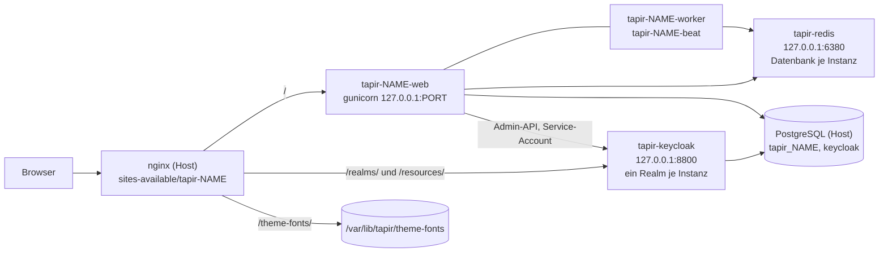
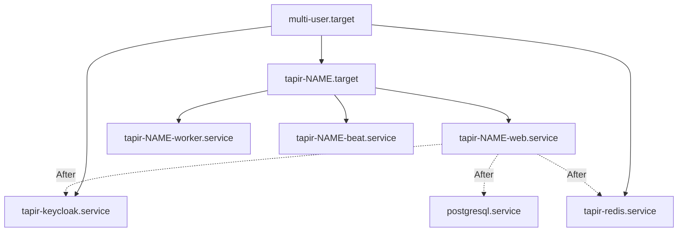
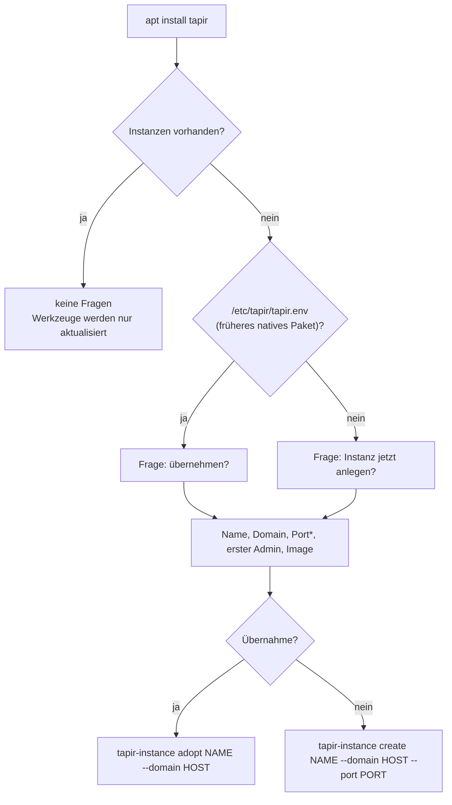

> ⚠️ **Nicht maßgeblich.** Dieses Wiki gehört zu einem abgeschlossenen Proof of Concept für den
> Eigenbetrieb von Tapir und wird nicht gepflegt. Maßgeblich ist die Dokumentation im
> Hauptprojekt: [FoodCoopX/wirgarten-tapir – docs](https://github.com/FoodCoopX/wirgarten-tapir/tree/master/docs),
> Aufbau in Issue [#1300](https://github.com/FoodCoopX/wirgarten-tapir/issues/1300).

# Betrieb

> **Abstract:** Tapir läuft im Betrieb als podman-Container unter systemd, eine **Instanz pro
> Solawi**: Web (gunicorn), Celery-Worker und Celery-Beat aus dem Image
> `ghcr.io/beerlesklopfer/wirgarten-tapir`. Alle Instanzen eines Servers teilen sich einen
> Keycloak-Container (je Instanz ein eigener Realm) und einen Redis-Container (je Instanz eine
> eigene Datenbanknummer). PostgreSQL und nginx laufen direkt auf dem Host. Das Debian-Paket
> `tapir` bringt nur die Werkzeuge mit: **`tapir-instance`** richtet Instanzen ein, aktualisiert
> und entfernt sie, **`tapir-kcadm`** verwaltet Keycloak, **`tapir-manage`** ruft `manage.py` auf.
> Updates kommen über das Image; ein neues Paket ist dafür nicht nötig.

Seiten dieses Abschnitts:

| Seite | Inhalt |
|---|---|
| **Betrieb** (diese Seite) | Aufbau, Installation, erste Schritte, Updates, Dateien |
| [tapir-instance](Betrieb-tapir-instance) | vollständige Befehlsreferenz |
| [Konfiguration](Betrieb-Konfiguration) | env-Datei der Instanz, Mail, gesperrte Parameter, Theme und Schriften |
| [Keycloak und Benutzer](Betrieb-Keycloak) | `tapir-kcadm`, Admin-Konsole, Rollen, Passwörter |
| [Datensicherung (Bareos)](Betrieb-Datensicherung) | eigener Bareos-Job je Instanz, `backup`, `restore`, Wiederherstellung des ganzen Servers |
| [Datenschutz und Löschung](Betrieb-Datenschutz) | welche personenbezogenen Daten Tapir speichert, Rechtslage (DSGVO, GenG), was „Mitglied löschen“ tut und was offen ist |
| [Fehlersuche](Betrieb-Fehlersuche) | Prüfungen, Logs, bekannte Fehler und ihre Behebung |

Für Entwicklerinnen und Entwickler (Image-Bau, CI, APT-Repository):
[Paketierung und Betrieb](Development-Paketierung).

## Aufbau auf dem Server



- Alle Container nutzen das Host-Netz und lauschen nur auf `127.0.0.1`. Von außen erreichbar ist
  nur nginx.
- **Ein Keycloak für alle Domains:** Keycloak hat keinen globalen Hostnamen; jeder Realm trägt
  seine Domain als `frontendUrl`. Der Aussteller (issuer) einer Instanz ist damit
  `https://<domain>/realms/<realm>`, und nginx reicht `/realms/` und `/resources/` der Domain an
  Keycloak weiter. Die Admin-Konsole von Keycloak ist nicht öffentlich.
- **Ein Redis für alle Instanzen:** Celery-Warteschlange und Django-Cache einer Instanz liegen in
  ihrer Datenbanknummer (`TAPIR_REDIS_DB`, 0 bis 63).
- Schreibbare Daten einer Instanz liegen in `/var/lib/tapir/<name>` und sind in den Containern
  als `/data` eingebunden. Die Container laufen als UID/GID 10100.

### Units



Die Container-Units sind **Quadlets** (`/etc/containers/systemd/*.container`); systemd erzeugt
daraus beim `daemon-reload` die `.service`-Units. `tapir-instance` schreibt sie selbst und
überschreibt sie bei jedem `create`, `upgrade` und `keycloak`. Von Hand geänderte Units gehen
dabei verloren.

## Installation

Voraussetzung: Debian 13 (trixie), root-Zugang, ein DNS-Eintrag der Domain auf den Server.

```sh
sudo curl -fsSLo /usr/share/keyrings/tapir-archive-keyring.gpg \
  https://beerlesklopfer.github.io/wirgarten-tapir/tapir-archive-keyring.gpg
gpg --show-keys --with-fingerprint /usr/share/keyrings/tapir-archive-keyring.gpg
# erwartet: 2B97 87BD C831 F2CD 9651  D7EA 341B FAD2 DE6A AC6C
echo "deb [signed-by=/usr/share/keyrings/tapir-archive-keyring.gpg] https://beerlesklopfer.github.io/wirgarten-tapir trixie main" \
  | sudo tee /etc/apt/sources.list.d/tapir.list
sudo apt update
sudo apt install tapir postgresql nginx
```

`tapir` hängt von `podman` ab; `postgresql` und `nginx` sind empfohlen, weil sie auch auf einem
anderen Rechner laufen können (siehe `--db-url`, `--no-nginx`).

### Fragen bei der Installation (debconf)

Die Fragen kommen nur, solange es noch keine Instanz gibt (`/etc/tapir/instances/*.env`).



| Frage | Vorgabe | Bedeutung |
|---|---|---|
| Instanz jetzt anlegen? / Installation übernehmen? | ja | nein: Instanz später von Hand anlegen |
| Name der Instanz | `tapir` | Kurzname, zugleich Realm, Datenbank- und Container-Name; `a-z`, `0-9`, `-` |
| Öffentlicher Hostname | – | z. B. `ackervielfalt.example.org`; daraus folgen nginx-Site, Realm-URLs, `SITE_URL` |
| Lokaler Port | `8000` | gunicorn auf `127.0.0.1:<port>` (*nur bei Neuanlage gefragt) |
| E-Mail des ersten Admins | – | bekommt Tapir-Konto und Keycloak-Login; leer = keiner |
| Container-Image | `ghcr.io/beerlesklopfer/wirgarten-tapir:latest` | Priorität „medium“, erscheint also nur bei `dpkg-reconfigure -p medium` |

Schlägt die Einrichtung fehl, bricht die Paketinstallation **nicht** ab. Die Meldung nennt den
Befehl, der nach Behebung der Ursache von Hand zu wiederholen ist. `create` und `adopt` sind
wiederholbar.

## Erste Schritte nach der Installation

```sh
# 1. Instanz prüfen
sudo tapir-instance status ackervielfalt

# 2. nginx-Site einschalten (wird nie automatisch aktiviert), Zertifikat holen, auf HTTPS umstellen
sudo ln -s /etc/nginx/sites-available/tapir-ackervielfalt /etc/nginx/sites-enabled/
sudo nginx -t && sudo systemctl reload nginx
sudo certbot certonly --webroot -w /var/www/html -d ackervielfalt.example.org
sudo tapir-instance nginx ackervielfalt

# 3. Mailserver eintragen (sonst landen Mails nur als Dateien in /var/lib/tapir/<name>/emails_from_celery)
sudo editor /etc/tapir/instances/ackervielfalt.env     # EMAIL_ENV=prod und EMAIL_* setzen
sudo tapir-instance keycloak ackervielfalt             # Mailserver auch in den Realm übernehmen, neu starten

# 4. Theme, gesperrte Grundeinstellungen
sudo tapir-instance theme ackervielfalt akv
sudo tapir-instance param ackervielfalt

# 5. Weitere Team-Konten
sudo tapir-instance user-add ackervielfalt someone@example.org --admin --first Erika --last Musterfrau
```

Das Startpasswort des ersten Admins steht in `/etc/tapir/initial-passwords/<name>-<mail>`. Nach
der ersten Anmeldung (Keycloak verlangt ein neues Passwort) die Datei löschen.

## Updates

| Was | Wie |
|---|---|
| Tapir selbst (Image) | `sudo tapir-instance upgrade <name>` oder `--all` |
| bestimmte Version | `sudo tapir-instance upgrade <name> --image ghcr.io/beerlesklopfer/wirgarten-tapir:<tag>` (bleibt gespeichert) |
| Werkzeuge, Vorlagen, Keycloak-Themes | `sudo apt upgrade` |
| Keycloak-Themes ausrollen | nach `apt upgrade`: `sudo tapir-instance keycloak <name>`, dann `sudo systemctl restart tapir-keycloak` (Keycloak hält Themes im Cache) |

`apt upgrade` fasst laufende Instanzen nie an. Neue Images entstehen über den Workflow
„Build container image, Debian package and APT repository“ (von Hand auf `master` gestartet oder
bei einem Tag `v*`); jeder Lauf setzt `:latest` neu. Ein `upgrade` zieht es, migriert die Datenbank, schreibt die
Units neu, startet neu und prüft.

## Dateien und Verzeichnisse

| Pfad | Inhalt | Rechte |
|---|---|---|
| `/usr/sbin/tapir-instance` | Instanzen verwalten | root |
| `/usr/sbin/tapir-kcadm` | Keycloak auf der Kommandozeile | `rwxrwx---` root:root |
| `/usr/sbin/tapir-manage` | `manage.py` einer Instanz | root (ruft `tapir-instance manage`) |
| `/usr/share/tapir/tapir.env.example` | Vorlage der env-Datei | |
| `/usr/share/tapir/nginx-site.conf.in` | Vorlage der nginx-Site | |
| `/usr/share/tapir/keycloak/tapir-realm.json.in` | Vorlage des Realms (Rollen, Gruppe `superuser`, Clients) | |
| `/usr/share/tapir/keycloak/themes/` | Keycloak-Themes (`wirgarten`, `akv`) | |
| `/etc/tapir/instances/<name>.env` | Konfiguration der Instanz | `0640` |
| `/etc/tapir/keycloak.env` | Keycloak: Datenbank, Admin-Passwort, Port | `0600` |
| `/etc/tapir/initial-passwords/` | Startpasswörter neuer Konten | `0700` / `0600` |
| `/etc/containers/systemd/tapir-*.container` | Quadlets: `tapir-keycloak`, `tapir-redis`, `tapir-<name>-{web,worker,beat}` | |
| `/etc/systemd/system/tapir-<name>.target` | startet und stoppt eine Instanz | |
| `/etc/nginx/sites-available/tapir-<name>` | nginx-Site der Instanz | |
| `/etc/nginx/snippets/tapir-keycloak.conf` | Keycloak- und Schriften-Pfade für eigene Sites | |
| `/var/lib/tapir/<name>/` | `/data` der Instanz: `media`, `filepond_*`, `emails_from_celery`, `log`, `celerybeat-schedule` | UID 10100 |
| `/var/lib/tapir/keycloak/themes/` | eingebundene Keycloak-Themes (Kopie aus `/usr/share`) | |
| `/var/lib/tapir/redis/` | Append-only-Datei des Redis | UID 999 |
| `/var/lib/tapir/theme-fonts/<theme>/` | lizenzierte Schriften, die nicht veröffentlicht werden dürfen | |
| `/var/lib/tapir/backup/` | Sicherungen von nginx-Sites vor Änderungen | `0700` |
| `/var/backups/tapir/<name>/` | letzte Sicherung der Instanz: `tapir.dump`, `realm.json`, `backup.info` | `0700` / `0600` |
| `/var/backups/tapir/_shared/` | `keycloak.dump` | `0700` / `0600` |
| `/etc/tapir/bareos.env` | Einstellungen der Bareos-Jobs | |
| `/usr/share/tapir/bareos.env.example` | Vorlage dazu | |

## Datensicherung

Jede Instanz hat ihre eigene Bareos-Sicherung (Job `tapir-<name>`): Datenbank-Dump, Export des
Keycloak-Realms mit allen Logins, env-Datei, Dateien und nginx-Site. Der Job `tapir-shared`
sichert einmal je Server die Keycloak-Datenbank, `/etc/tapir` und die lizenzierten Schriften.
Der Redis-Inhalt (Warteschlange, Cache) ist entbehrlich.

```sh
sudo cp /usr/share/tapir/bareos.env.example /etc/tapir/bareos.env    # Client-Name, JobDefs
sudo tapir-instance bareos --all                                    # Konfiguration für den Director
sudo tapir-instance backup ackervielfalt                            # Dumps nach /var/backups/tapir/ackervielfalt
sudo tapir-instance restore ackervielfalt                           # nach dem Restore der Dateien
```

Einrichtung, erzeugte Konfiguration und Wiederherstellung: [Datensicherung mit Bareos](Betrieb-Datensicherung).
Ohne Bareos genügt dasselbe von Hand: `tapir-instance backup <name>` und `backup --shared`, dann
`/var/backups/tapir/`, `/etc/tapir/` und `/var/lib/tapir/` (ohne `redis/`) wegsichern.
