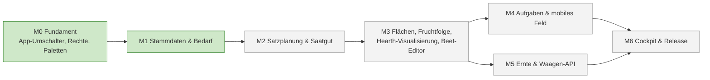
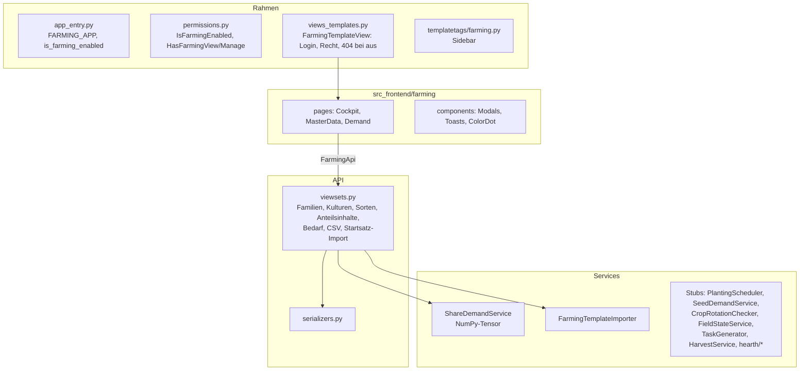
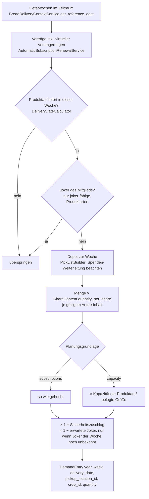
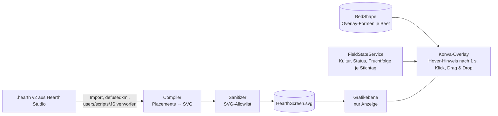

> ⚠️ **Nicht maßgeblich.** Dieses Wiki gehört zu einem abgeschlossenen Proof of Concept für den
> Eigenbetrieb von Tapir und wird nicht gepflegt. Maßgeblich ist die Dokumentation im
> Hauptprojekt: [FoodCoopX/wirgarten-tapir – docs](https://github.com/FoodCoopX/wirgarten-tapir/tree/master/docs),
> Aufbau in Issue [#1300](https://github.com/FoodCoopX/wirgarten-tapir/issues/1300).

# Anbau-App (`tapir.farming`)

> **Abstract:** Die Anbau-App bringt die gärtnerische Planung in Tapir, damit Solawis Anteile,
> Depots und Anbau nicht in zwei Systemen pflegen. Sie erscheint als zweite App mit eigenem
> Umschalter, eigener Sidebar und eigenem Farbakzent, ist per Parameter abschaltbar und über
> die Rollen `farming.view`/`farming.manage` geschützt. Fertig sind Stammdaten (Familien,
> Kulturen, Sorten, Startsatz) und der Wochenbedarf je Kultur und Depot, berechnet aus den
> echten Verträgen. Es folgen Satzplanung, Saatgut, Flächen mit Hearth-Visualisierung und
> Beet-Editor, Aufgaben, Ernte und eine Waagen-API.

## Stand

Details zu Meilensteinen, Arbeitspaketen und Abnahmen: [Roadmap](Development-Anbau-Roadmap).



Offene Teile sind als Stub markiert (`grep -rn "STUB BEGIN" tapir/farming src_frontend/farming`):
Platzhalterseiten nennen ihren Meilenstein, die Waagen-API antwortet mit 501, die
Service-Stubs werfen `NotImplementedError`.

## Aufbau



Datenmodell: [Datenmodell: Anbau](Development-Datenmodell-Anbau).

## Bedarfsrechnung

`ShareDemandService.get_demand(start_date, end_date, cache, pickup_location_id, planning_basis)`
liefert je Lieferwoche, Depot und Kultur eine Menge in der Ernteeinheit der Kultur.

Gerechnet wird mit NumPy als Tensor-Kontraktion über die Achsen Woche w, Depot l, Produkt p
und Kultur c:

```
D[w,l,c] = Σp  N[w,l,p] · f[w,p] · S[w,p,c] · k[w]        (np.einsum("wlp,wp,wpc,w->wlc"))
```

| Matrix | Inhalt | Methode |
|---|---|---|
| `N[w,l,p]` | gelieferte Anteile je Woche, Depot, Produkt | `build_share_matrix` |
| `S[w,p,c]` | Anteilsinhalt: Menge der Kultur je Anteil | `build_content_matrix` |
| `f[w,p]` | Kapazitätsfaktor (nur Grundlage `capacity`, sonst 1) | `build_capacity_matrix` |
| `k[w]` | Sicherheitszuschlag × erwartete Joker | `build_week_factors` |

Das Ergebnis ist ein `DemandTensor` (`services/demand_tensor.py`) mit sortierten
Achsenbeschriftungen; `per_crop()` liefert `D[w,c]` für die Satzplanung, `to_entries()` die
Zeilen für API und CSV. Die Ermittlung von `N` folgt den Regeln der Kommissionierliste:



Parameter (Kategorie „Anbau“):

| Schlüssel | Bedeutung |
|---|---|
| `wirgarten.farming.enabled` | App an/aus |
| `wirgarten.farming.planning_basis` | `subscriptions` (Verträge) oder `capacity` (Soll-Kapazität der Periode) |
| `wirgarten.farming.safety_margin_percent` | Sicherheitszuschlag, Default 10 |
| `wirgarten.farming.expected_joker_percent` | Erwarteter Joker-Anteil, Default 0 |

## API

| Endpunkt | Recht | Inhalt |
|---|---|---|
| `api/plant-families/`, `api/crops/`, `api/varieties/?crop=`, `api/share-contents/` | lesen `view`, schreiben `manage` | CRUD; Löschen eines noch verwendeten Datensatzes → 409 |
| `api/demand/?start_date&end_date&pickup_location_id&planning_basis` | `view` | Bedarf als JSON, max. 400 Tage |
| `api/demand/csv/` | `view` | Gleiches als CSV (Semikolon, Dezimalkomma, BOM) |
| `api/products/`, `api/pickup-locations/` | `view` | Auswahllisten |
| `api/import-templates/?update` | `manage` | Startsatz laden (12 Familien, 47 Kulturen) |
| `api/public/records/inHarvest/<KW-Jahr>`, `api/public/harvests` | – | Stub, 501 (M5: Waagen-API mit `X-API-Key`) |

## Geplant: Hearth-Visualisierung



Ein Hearth-Symbol kann mehrere Beete zusammenfassen; die Beete werden deshalb im Beet-Editor
als eigene Formen auf die Grafik gelegt (Rechteck, Polygon, Teilen N × M, Messer, Boolesche
Operationen, Fang, Maßstab, Undo/Redo). Der Alpha-Regler blendet zwischen Acker-Grafik und
Kulturfarben.

## Erweitern

- Neue Seite: Template von `farming/base_farming.html` ableiten, View von
  `FarmingTemplateView`, Entry mit `mountFarmingPage(Page)`, Eintrag in `vite.config.ts`,
  Link in `templatetags/farming.py`.
- Neue API: ViewSet mit `FARMING_READ_PERMISSIONS` bzw. `FARMING_MANAGE_PERMISSIONS`, danach
  Schema und Client neu erzeugen.
- Beim Ersetzen eines Stubs die Marker entfernen und die Platzhalterseite aus `STUB_PAGES`
  streichen.
