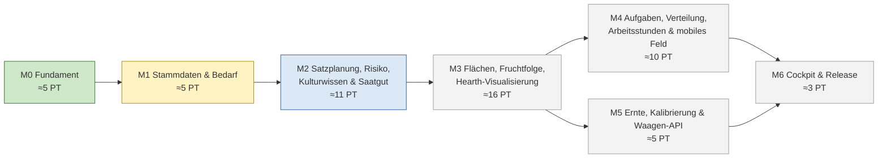
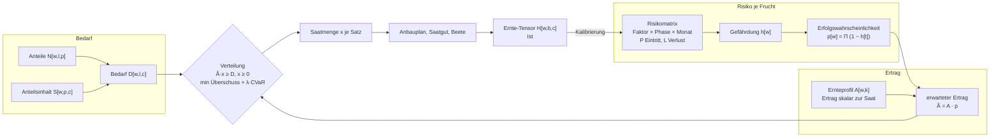
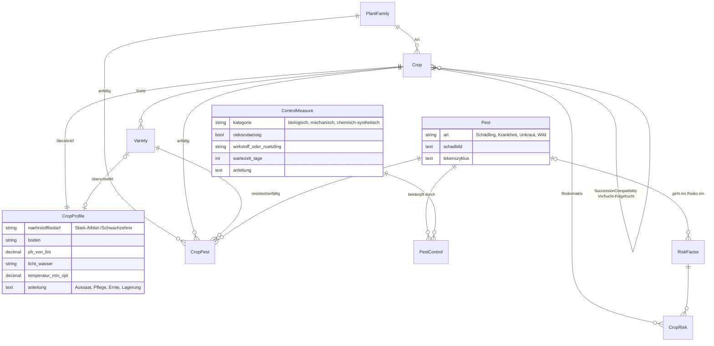
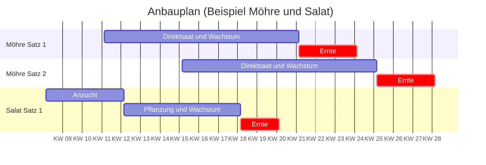
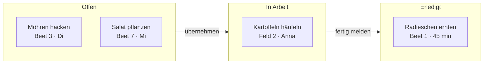
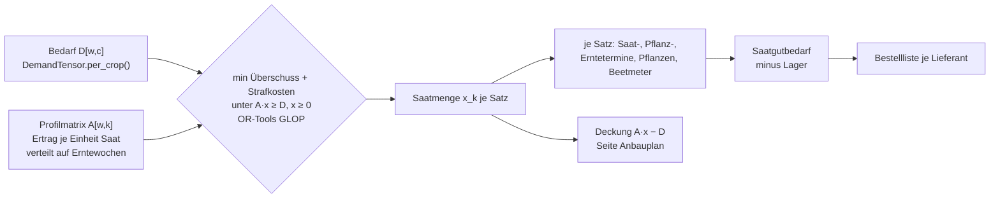
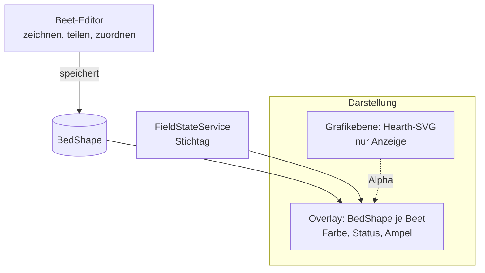
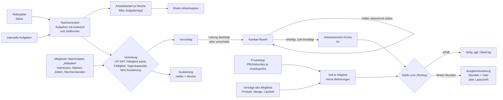

# Roadmap Anbau-App

> **Abstract:** Die Anbau-App entsteht in sieben Meilensteinen mit zusammen rund 55
> Personentagen. Jeder Meilenstein endet mit einer gemeinsamen Abnahme auf einer installierten
> Paket-Instanz. M0 (App-Rahmen) und M1 (Stammdaten und Bedarf) sind umgesetzt und warten auf
> die Abnahme. Danach folgt die Satzplanung (M2). Sie rechnet mit NumPy-Matrizen und bewertet jede
> Frucht mit einer Risikomatrix. Zu jeder Frucht gehört außerdem Kulturwissen für den
> Gärtner: Steckbrief, Nachbarn, Schaderreger, biologische und andere Gegenmaßnahmen. Den größten Block bildet M3 mit Flächen,
> Fruchtfolge und der Visualisierung aus Hearth-Screens samt Beet-Editor. Aufgaben mit ihrer Verteilung auf die Helfer und das
> Arbeitsstunden-Konto der Mitglieder (M4) und
> Ernte mit Waagen-API (M5) bauen darauf auf; mit dem Cockpit und dem Release (M6) ist das MVP
> fertig. Ein Bewässerungs- bzw. SPS-Meilenstein ist bewusst nicht vorgesehen.

## Überblick



| Farbe | Bedeutung |
|---|---|
| grün | umgesetzt |
| gelb | umgesetzt, Abnahme offen |
| blau | als Nächstes |
| grau | geplant |

## Zeitplan in Personentagen

Die Skala zählt Arbeitstage ab Projektstart, es sind keine Kalenderdaten. Der Beet-Editor
(AP3.4) kann parallel zu M4 und M5 weiterlaufen.

```mermaid
gantt
    title Anbau-App – Meilensteine (Personentage)
    dateFormat  X
    axisFormat  %s
    section Fundament
    M0 App-Rahmen, Rechte, Paletten        :done, m0, 0, 5d
    M1 Stammdaten und Bedarf               :active, m1, after m0, 5d
    section Planung
    M2 Satzplanung, Risiko, Wissen       :m2, after m1, 11d
    section Flächen
    M3 Modelle, Fruchtfolge, Hearth-Import :m3a, after m2, 5d
    M3 Anzeige und Overlay                 :m3b, after m3a, 3d
    M3 Beet-Editor                         :m3c, after m3b, 6d
    M3 Flächenplan                         :m3d, after m3b, 2d
    section Feld
    M4 Aufgaben, Verteilung, Stunden      :m4, after m3d, 10d
    M5 Ernte, Kalibrierung, Waagen-API     :m5, after m3d, 5d
    section Abschluss
    M6 Cockpit und Release                 :m6, after m4, 3d
```



## Rechenmodell

Die Anbauplanung ist eine Verteilungsfrage. Gelöst wird sie mit NumPy-Matrizen auf gemeinsamen
Achsen: Woche w, Depot l, Produkt p, Kultur c, Satz k und Beet b. Bedarf, Ertrag und Ernte sind
Tensoren. Das Ganze ist eine Matrixfunktion über die Zeit, bewertet mit dem Risiko je Frucht.



| Baustein | Formel | Meilenstein |
|---|---|---|
| Bedarf | `D[w,l,c] = Σp N[w,l,p] · f[w,p] · S[w,p,c] · k[w]` | M1 ✔ |
| Ertrag eines Satzes | `x_k · A[w,k]`, linear in der Saatmenge | M2 |
| Gefährdung | `h_c[w] = 1 − Π_f (1 − P_f[Phase, Monat] · L_f)` | M2 |
| Erfolgswahrscheinlichkeit | `p_k[w] = Π_{t≤w} (1 − h_c[t])`, über die Zeit integriert | M2 |
| Erwarteter Ertrag | `Ã[w,k] = A[w,k] · p_k[w]` | M2 |
| Verteilung | min Überschuss + λ · CVaR(Unterdeckung) über Szenarien, linear (OR-Tools GLOP) | M2 |
| Ernte | Tensor `H[w,b,c]` aus Erfassung und Waage | M5 |
| Kalibrierung | Bayes-Update von P und L aus `H` gegen `Ã` | M5 |

Die **Risikomatrix** gehört zu jeder Kultur, Sorten können sie abwandeln (z. B. eine resistente
Sorte). Zeilen sind Risikofaktoren wie Frost, Hitze, Trockenheit, Starkregen, Schädlinge,
Krankheit, Wildverbiss oder Arbeitsspitzen. Für jeden Faktor stehen je Kulturphase (Anzucht,
Jungpflanze, Wachstum, Ernte) und Monat die Eintrittswahrscheinlichkeit und der Ertragsverlust.
Aus Ertragsprofil und Erfolgswahrscheinlichkeit ergibt sich für jeden Satz ein erwarteter Ertrag
mit Band. Mehrere kleine Sätze streuen das Risiko; die Optimierung findet das selbst.

### Kulturwissen: Hierarchie und Pflanzenschutz

Früchte folgen einer Hierarchie: Familie → Art → Sorte. Werte und Wissen werden nach unten
vererbt, und die untere Ebene darf überschreiben. Eine resistente Sorte senkt zum Beispiel die
Anfälligkeit für eine Krankheit, die für die ganze Art eingetragen ist.



Der Gärtner sieht dieses Wissen dort, wo er es braucht: auf der Seite „Kulturwissen“, im
Hinweis am Beet, in der mobilen Feldansicht und an der Aufgabe, z. B. „Kulturschutznetz
auflegen“ mit Anleitung. Der Startsatz bringt gängige Schaderreger und Maßnahmen mit, mit
Schwerpunkt auf biologischen und ökozulässigen Mitteln. Chemisch-synthetische Mittel sind
deutlich gekennzeichnet.

### So soll der Anbauplan aussehen (Gantt)



### So soll die Auftragsliste für Helfer aussehen (Kanban)



## M0 – Fundament und App-Rahmen (≈5 PT) · umgesetzt

| AP | Inhalt | Stand |
|---|---|---|
| 0.1 | App-Gerüst, Registrierung, Parameter `farming.*`, Kategorie „Anbau“ | ✔ |
| 0.2 | Rollen `farming.view`/`farming.manage`, Realm, DRF-Permissions, `FarmingTemplateView` | ✔ |
| 0.3 | App-Umschalter (generisch in `tapir/core/app_switcher.py`), eigene Sidebar, Akzentleiste, Cockpit | ✔ |
| 0.4 | Frontend-Gerüst (Entries, `mountFarmingPage`, `FarmingApi`), Test-Gerüst | ✔ |
| 0.5 | Paletten für Farbschemata (`palette.json`, `core/theme.css`), `akv` und `test` umgestellt | ✔ |

**Abnahme:**
- Mit beiden Rechten wechselt der Umschalter zwischen den Apps.
- Nur mit `farming.view` ist nur Anbau sichtbar.
- Ist der Parameter aus, liefert die App 404.
- `akv` sieht aus wie vorher und hat einen eigenen Akzent je App.

## M1 – Stammdaten und Bedarf (≈5 PT) · Abnahme offen

| AP | Inhalt | Stand |
|---|---|---|
| 1.1 | Modelle Pflanzenfamilie, Kultur, Sorte, Anteilsinhalt | ✔ |
| 1.2 | Startsatz: 12 Familien, 47 Kulturen; Befehl und Button | ✔ |
| 1.3 | `ShareDemandService`: Grundlage Verträge oder Kapazität; berücksichtigt Joker, Lieferpausen, Zyklen, Spenden | ✔ |
| 1.4 | API, Seiten „Kulturen & Familien“ und „Anteilsinhalt & Bedarf“, CSV-Export | ✔ |

**Abnahme:**
- Der Wochenbedarf je Kultur und Depot ist mit Ackervielfalt-Daten plausibel.
- Der CSV-Export funktioniert.

## M2 – Satzplanung, Risiko, Kulturwissen und Saatgut (≈11 PT) · als Nächstes

| AP | Inhalt |
|---|---|
| 2.1 | Modelle Satz (`Planting`) und Saatgutposten (`SeedLot`) |
| 2.2 | `PlantingScheduler` als lineares Verteilungsmodell: Der Ertrag ist skalar zur Saatmenge x eines Satzes, die Profilmatrix A verteilt ihn auf die Erntewochen, gesucht ist x mit A·x ≥ Bedarf. LP mit OR-Tools GLOP; daraus Termine, Pflanzen, Beetmeter |
| 2.3 | Seite „Anbauplan“ als **Gantt-Chart**: je Satz ein Balken mit Phasen (Anzucht, Pflanzung, Wachstum, Ernte), Termine per Drag verschieben, darunter Deckung und Ertragsband; Satz-Assistent mit Vorschau |
| 2.4 | `SeedDemandService` (Korn bzw. Gramm über TKG und Keimrate, minus Lager) und Seite „Saatgut“ mit Bestellliste je Lieferant |
| 2.5 | Planübertrag ins Folgejahr |
| 2.7 | **Kulturwissen**: Hierarchie Familie → Art → Sorte mit Vererbung; Steckbrief (Nährstoffbedarf, Boden, pH, Licht, Wasser, Temperatur, Anleitung), gute und schlechte Nachbarn, Schaderreger mit Anfälligkeit, Gegenmaßnahmen nach Kategorie (biologisch, mechanisch, chemisch-synthetisch; ökozulässig ja/nein) |
| 2.6 | Risikomatrix je Frucht (Faktor × Phase × Monat), `CropRiskService`: Erfolgswahrscheinlichkeit über die Zeit integriert, erwarteter Ertrag und Ertragsband, Szenarien für die risikobewusste Planung |

**Abnahme:**
- Für drei Kulturen entstehen aus dem Bedarf automatisch Sätze.
- Die Saatgutliste ist von Hand nachgerechnet.
- Zu jedem Satz werden Erfolgswahrscheinlichkeit und Ertragsband angezeigt; eine Kultur mit
  hohem Frostrisiko bekommt automatisch mehr bzw. spätere Sätze.

Rechenprinzip: Satzplanung ist eine Verteilungsfrage. Sie wird mit NumPy und Matrizen gelöst,
auf denselben Achsen wie der Bedarf.



Weil der Ertrag skalar zur Saat ist, bleibt das Modell linear: Doppelte Saat bringt den
doppelten Ertrag. Jede Spalte k von A ist ein möglicher Satz, zum Beispiel einer pro
Saatwoche. Die Zeilen sind die Lieferwochen, und ein Eintrag gibt an, wie viel eine Einheit
Saat in dieser Woche erntet: Ertrag je Pflanze × Keimrate × (1 − Ausfall), verteilt auf die
Erntedauer.

## M3 – Flächen, Fruchtfolge und Hearth-Visualisierung (≈16 PT)

| AP | Inhalt |
|---|---|
| 3.1 | Modelle Feld, Beet, Beetbelegung; `CropRotationChecker` mit **Folgeanbauten** (Vor-, Haupt- und Nachkultur) und **Warnung bei schädlicher Folgefrucht** (Anbaupause, Verträglichkeit Vorfrucht → Folgefrucht, gemeinsame Schaderreger, Soll-Familien je Feld, Überschneidungen) |
| 3.2 | Import und Compiler für Hearth v2. Der Sanitizer verwirft `<script>`, `on*`-Attribute, `foreignObject` und Benutzer-Hashes. Modelle `HearthProject`, `HearthScreen`, `BedShape` |
| 3.3 | `HearthScreenView`: Grafikebene plus Beet-Overlay (Konva), Zoom und Pan, Alpha-Regler, Hinweis nach 1 s Hover bzw. Long-Press |
| 3.4a | Editor-Kern: Auswahl, Rechteck, Ellipse, Polygon, Linie, Freihand, Text, Transformieren, Undo/Redo, Kopieren und Array, Tastenkürzel, Speichern |
| 3.4b | Geometrie: Knoten-Editor, Teilen N × M, Messer, Vereinigen/Subtrahieren/Schnitt/Inset, Ausrichten, Raster, Fang, Smart Guides, Maßstab, Messwerkzeug |
| 3.4c | Daten-Werkzeuge: Vorschläge aus Symbolen, Beete zuordnen und anlegen, automatische Nummerierung, Eigenschaften-Panel |
| 3.5 | `FieldStateService` und Seite „Flächenplan“: Karte mit KW-Regler, Drag & Drop, Fruchtfolge-Ampel, Tabellen- und Druckansicht |

**Abnahme:**
- Der Screen „Manuelle Bedienung“ aus Ackersteuerung erscheint in Tapir.
- Ein Gewächshaus-Rechteck wird in sechs Beete geteilt.
- Die Beete zeigen die Kulturfarbe der gewählten KW.
- Nach 1 s erscheint der Hinweis.
- Ein Fruchtfolge-Konflikt leuchtet am Beet.



## M4 – Aufgaben, Verteilung, Arbeitsstunden und mobiles Feld (≈10 PT)

Die Anbau-App verwaltet Aufgaben und deren Verteilung. Auch das ist eine Verteilungsfrage:
Aufgaben × Helfer × Tage. Wobei jemand helfen möchte und was seine Stärken sind, legt das
Mitglied selbst in seinen Stammdaten fest (Karte „Mithelfen“ im Mitgliederbereich). Die
Verteilung berücksichtigt das, dazu Verfügbarkeit, offenes Stundensoll und faire Auslastung.




| AP | Inhalt |
|---|---|
| 4.1 | Aufgabentyp und Aufgabe; `TaskGenerator` erzeugt Saat-, Pflanz- und Ernteaufgaben aus den Sätzen (idempotent) |
| 4.2 | Seite „Aufgaben“ als **Kanban-Board** für Helfer: Offen → In Arbeit → Erledigt, Drag & Drop, Helfer übernehmen freigegebene Aufträge selbst; Kalenderansicht für die Planung |
| 4.3 | Mobile Seite „Feld“: „Heute“ abhaken, Zeit erfassen, Beet antippen im Hearth-Ausschnitt |
| 4.4 | **Aufgabenverteilung** auf Basis der erweiterten Mitglieder-Stammdaten „Mithelfen“: Das Mitglied pflegt selbst, wobei es helfen möchte, seine Stärken und Zeiten (Helfer ohne Mitgliedschaft möglich); `TaskDistributionService` schlägt die Zuordnung vor (OR-Tools CP-SAT), die Leitung bestätigt; Auslastungs-Heatmap Helfer × Woche, Warnung bei Überlast; Mail an Helfer bei Zuweisung |
| 4.5 | **Arbeitsstunden-Konto**: Pflichtstunden hängen am **Produkttyp, je Anteilsgröße** (Regel `WorkHourRule` im Farming-Modul, kein Feld im Kern); Soll aus den Verträgen des Mitglieds, anteilig zur Laufzeit, abzüglich Befreiungen; Ist aus erledigten Aufgaben oder manuell; Saldo im Mitgliederbereich, Erinnerung; fehlende Stunden werden zum Stichtag **in bar abgegolten** (Ausgleichszahlung über die normale Lastschrift) |

**Pflichtstunden je Anteilsgröße** (Entscheidung 2026-10-12): Die Pflichtstunden legt das
Team am Produkttyp fest, getrennt nach Anteilsgröße. Standard ist ein Wert je M-Anteil, der mit
der Größe des Produkts skaliert; je Produkt (S, M, L) lässt er sich überschreiben. Ein
Stundensatz am Produkttyp ist optional, sonst gilt der Standard aus der Konfiguration.

```text
Soll(Mitglied, Periode) = Σ Verträge  Menge × Stunden(Produkt) × Laufzeitanteil
Stunden(Produkt)        = Override am Produkt  oder  Stunden je M-Anteil × Größe
```

Beispiel Ernteanteile mit 8 h je M-Anteil: S (0,5) = 4 h, M (1,0) = 8 h, L (1,5) = 12 h.
Ein Mitglied mit einem L-Anteil, das ab Saisonmitte einsteigt, schuldet 6 h. Produkttypen ohne
Regel (z. B. Brot) erzeugen kein Soll.

**Abnahme:**
- Auf dem Handy wird eine Aufgabe am Beet erledigt; sie ist danach im Plan und im Cockpit sichtbar.
- Für eine Woche mit 20 Aufgaben und 4 Helfern entsteht ein Verteilungsvorschlag, der die
  Interessen, Stärken und Verfügbarkeiten einhält und niemanden überlastet.
- Ein L-Ernteanteil (Größe 1,5) bei 8 h je M-Anteil ergibt ein Soll von 12 h; ein Override
  am Produkt L hat Vorrang.
- Ein Mitglied mit 6 von 10 Pflichtstunden erhält zum Stichtag eine Ausgleichszahlung über
  4 × Stundensatz, die in der nächsten Lastschrift erscheint.

## M5 – Ernte, Kalibrierung und Waagen-API (≈5 PT)

| AP | Inhalt |
|---|---|
| 5.1 | Ernteeintrag und API-Schlüssel der Waage; manuelle Erfassung |
| 5.2 | Waagen-API, schnittstellengleich zum Micro Farm Planner: `GET api/public/records/inHarvest/<KW>-<Jahr>`, `POST api/public/harvests`, Header `X-API-Key` |
| 5.3 | `HarvestService` mit Ernte-Tensor H (Ist gegen Plan gegen Bedarf), Seite „Ernte“, Erntefortschritt im Hearth-Screen |
| 5.4 | Kalibrierung: Die Risikomatrix lernt aus den Ernten (Bayes-Update der Wahrscheinlichkeiten und Verluste je Kultur) |

**Abnahme:** `curl` mit API-Schlüssel nach der Doku des Micro Farm Planners funktioniert
unverändert.

## M6 – Cockpit und Release (≈3 PT)

| AP | Inhalt |
|---|---|
| 6.1 | Cockpit: Feldübersicht, Aufgaben der Woche, Bedarf gegen Ernte |
| 6.2 | Debian-Paket und APT-Repo mit allen Entries und Migrationen |
| 6.3 | Doku für Einrichtung, Rollen, Hearth-Import und Waage |
| 6.4 | Pilot mit Ackervielfalt; Upstream-Beitrag an FoodCoopX vorbereiten |

## Spielregeln

- Jeder Meilenstein ist ein Commit-Block auf `feature/farming`; nach der Abnahme wird nach
  `master` gemergt.
- Unfertiges ist im Code als Stub markiert (`STUB BEGIN [Mx/APx.y]` … `STUB END`) und in der
  Oberfläche als Platzhalterseite mit Meilenstein sichtbar.
- Kern-Eingriffe bleiben generisch (App-Umschalter, Paletten), damit das Modul upstream-fähig
  bleibt.
- Clean-Room: Funktionsumfang nach der öffentlichen Feature-Liste des Micro Farm Planners;
  übernommen werden weder Code noch Texte noch Stammdaten.
- Nicht im Umfang: Ansteuerung der Bewässerung bzw. SPS.

Technische Details zum heutigen Stand: [Anbau-App](Development-Anbau-App) ·
[Datenmodell: Anbau](Development-Datenmodell-Anbau)
