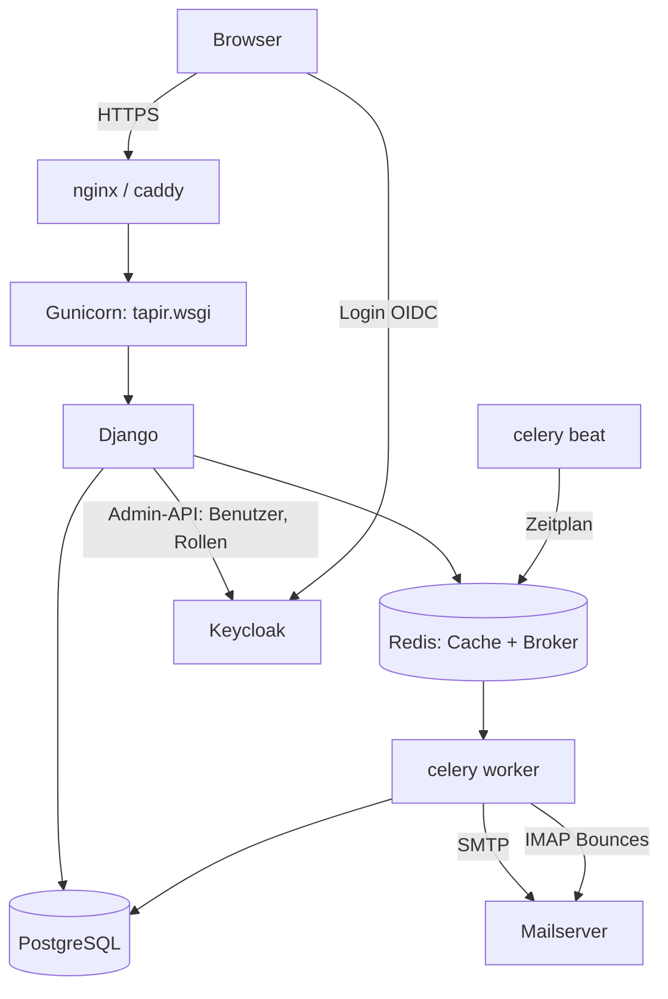
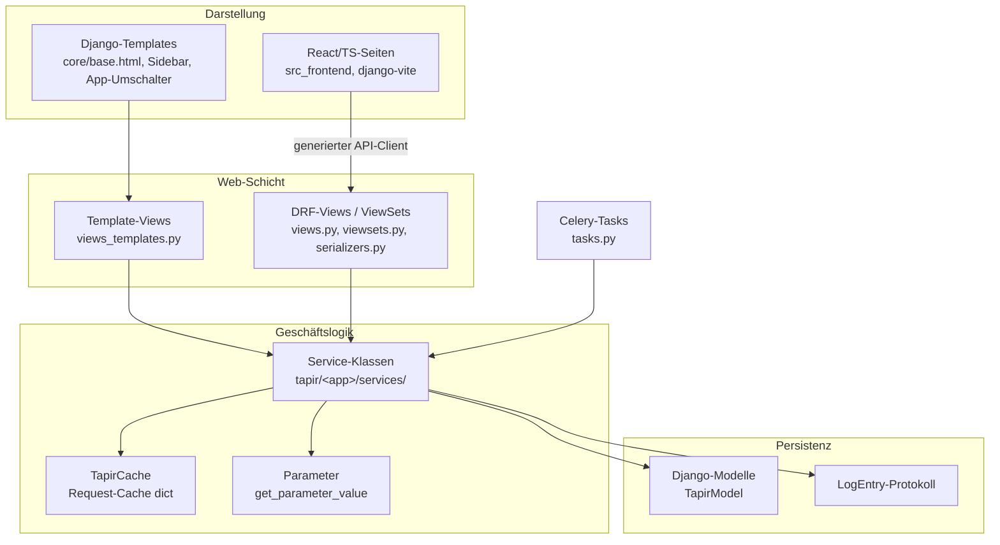
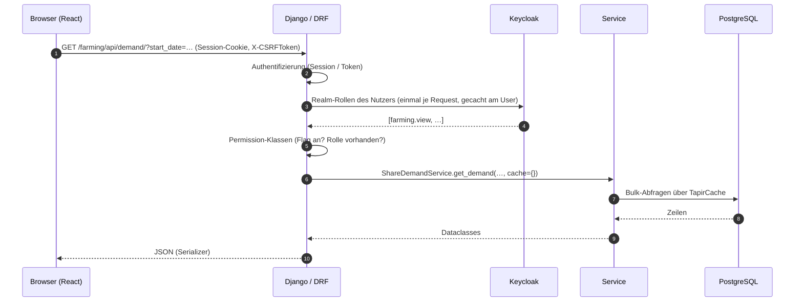
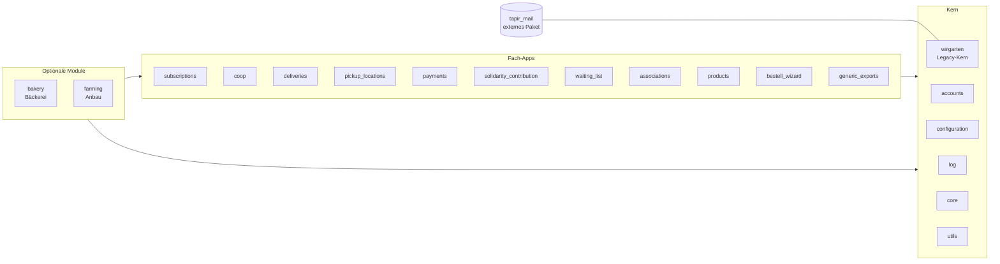

# Architektur

> **Abstract:** Ein klassischer Django-Monolith in Schichten: Templates und React-Seiten oben,
> darunter Django-Views und DRF-APIs, die Geschäftslogik in zustandslosen Service-Klassen und
> ganz unten die Modelle in PostgreSQL. Zeitgesteuerte Arbeit (Zahlungen, Verlängerungen,
> Exporte, Mails) erledigt Celery. Fachlich ist der Code in Django-Apps geschnitten; die
> historische App `wirgarten` hält noch die meisten Kernmodelle und gilt als Legacy, neue Logik
> entsteht in den Fach-Apps.

## Laufzeit-Komponenten

Im Debian-Paket sind das drei systemd-Dienste (`tapir-web`, `tapir-celery`,
`tapir-celery-beat`) unter `tapir.target`, in Docker die Services `web`, `celery`,
`celery-beat`, dazu `db`, `redis`, `keycloak` und `vite` (siehe
[Entwicklungsumgebung](Development-Entwicklungsumgebung)).

## Schichten

Regeln:

- Views sind dünn: sie prüfen Rechte, lesen Eingaben und rufen Services auf.
- Services sind Klassen mit `@classmethod`/`@staticmethod`, ohne Zustand; fast jede Methode
  bekommt einen `cache: dict` (siehe [Konventionen](Development-Konventionen)).
- Modelle enthalten nur ihre Felder und kleine Helfer, die nur die eigenen Felder benutzen.
- Jede fachliche Änderung an einem Mitglied schreibt einen Protokolleintrag (`LogEntry`).

## Lebensweg eines Requests

## Apps

| App | Aufgabe |
|---|---|
| `wirgarten` | Legacy-Kern: fast alle Kernmodelle, alte Funktions-Services in `service/`, Formulare und Views |
| `accounts` | `TapirUser`, Keycloak-Anbindung, E-Mail-Änderung |
| `core` | `TapirModel`, Sidebar, App-Umschalter, Themes, Basis-Templates |
| `configuration` | Parameter-Modell, Konfigurationsseite |
| `log` | Protokolleinträge |
| `utils` | `TapirCache`, `TapirCacheManager`, Shortcuts, Import |
| `subscriptions` | Bestellungen anwenden, Probezeit, Kündigung, Verlängerung, Bestätigung |
| `coop` | Genossenschaftsanteile, Mitgliedsnummern, Austritt |
| `deliveries` | Lieferzyklen, Liefertermine, Joker, Spenden, Kommissionierliste |
| `pickup_locations` | Depot-Zuordnung, Kapazitäten, Liefergebühren |
| `payments` | Monatliche Zahlungen, SEPA-Export, Zahlungsrhythmus, Gutschriften |
| `solidarity_contribution` | Solidarbeiträge |
| `waiting_list` | Warteliste und Bestätigungsablauf |
| `associations` | Vereinsmitgliedschaften |
| `products` | Produktänderungen, Steuersätze (nur Services) |
| `bestell_wizard` | Öffentlicher Anmelde-Assistent |
| `generic_exports` | Konfigurierbare CSV/PDF-Exporte |
| `bakery` | Modul Brotanteile mit Backplan-Solver (OR-Tools) |
| `farming` | Modul Anbauplanung, siehe [Anbau-App](Development-Anbau-App) |

## URL-Struktur

| Präfix | Inhalt |
|---|---|
| `/` | Weiterleitung je nach Rolle (Mitgliederbereich oder Admin-Dashboard) |
| `/accounts/` | Login (leitet auf `/accounts/oidc/keycloak/login`), Logout |
| `/tapir/` | Legacy-Views aus `wirgarten` |
| `/tapirmail/`, `/mailing/` | Mail-Oberfläche aus `tapir_mail` |
| `/config/` | Konfigurationsseite |
| `/<app>/` | Jede Fach-App hat ihren eigenen Präfix (`/subscriptions/`, `/bakery/`, `/farming/` …) |

Ein Schema- oder Swagger-Endpunkt ist nicht veröffentlicht; das OpenAPI-Schema wird offline als
`schema.yml` erzeugt (siehe [Frontend](Development-Frontend)).

## Legacy und Weiterentwicklung

Alles unter `tapir/wirgarten` folgt nicht den heutigen Konventionen. Wer dort etwas ändert,
schreibt den betroffenen Teil möglichst neu und zieht ihn in eine Fach-App. Die Modelle bleiben
vorerst in `wirgarten`, weil Migrationen über App-Grenzen aufwendig sind.
