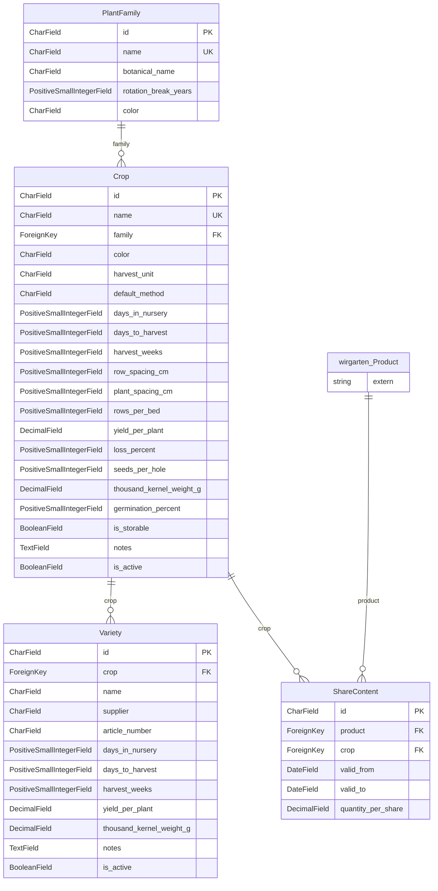

> ⚠️ **Nicht maßgeblich.** Dieses Wiki gehört zu einem abgeschlossenen Proof of Concept für den
> Eigenbetrieb von Tapir und wird nicht gepflegt. Maßgeblich ist die Dokumentation im
> Hauptprojekt: [FoodCoopX/wirgarten-tapir – docs](https://github.com/FoodCoopX/wirgarten-tapir/tree/master/docs),
> Aufbau in Issue [#1300](https://github.com/FoodCoopX/wirgarten-tapir/issues/1300).

<!-- Generiert mit `python manage.py generate_datamodel_docs`. Nicht von Hand bearbeiten, Beschreibungen stehen in tapir/core/services/data_model_docs_descriptions.py -->
# Datenmodell: Anbau (`tapir.farming`)

← [Datenmodell-Übersicht](Development-Datenmodell)

> **Abstract:** Optionale Anbau-App: Pflanzenfamilien, Kulturen und Sorten mit Kulturdaten sowie der Anteilsinhalt, der festlegt, wie viel einer Kultur ein Anteil eines Produkts je Lieferung enthält. Daraus entsteht der Wochenbedarf. Abschaltbar per Parameter.

4 Modelle.

## Beziehungen

## Modelle

### Crop

A crop (Kultur) with the farm-specific default values used for planning.

- Tabelle: `farming_crop`
- Basis: `TapirModel` (nanoid-ID, `created_at`, `updated_at`)
- Sortierung: `name`

| Feld | Typ | Schlüssel | Pflicht | Default | Beschreibung | Beziehung |
|---|---|---|---|---|---|---|
| `id` | CharField(10) | PK | ja | `generate_id()` | ID |  |
| `created_at` | DateTimeField |  | nein | jetzt (beim Anlegen) |  |  |
| `updated_at` | DateTimeField |  | nein | jetzt (bei jedem Speichern) |  |  |
| `name` | CharField(100) | UK | ja |  |  |  |
| `family` | ForeignKey | FK | ja |  |  | n:1 → [farming.PlantFamily](Development-Datenmodell-Anbau#plantfamily) (PROTECT, rückwärts `crops`) |
| `color` | CharField(7) |  | ja | `'#4caf50'` |  |  |
| `harvest_unit` | CharField(2) |  | ja | `HarvestUnit.KILOGRAM` |  Werte: `g` = Gramm, `kg` = Kilogramm, `S` = Stück, `B` = Bund |  |
| `default_method` | CharField(10) |  | ja | `CultivationMethod.TRANSPLANT` |  Werte: `direct` = Direktsaat, `transplant` = Pflanzung (Jungpflanze) |  |
| `days_in_nursery` | PositiveSmallIntegerField |  | ja | `0` |  _Anzuchtdauer bis zur Pflanzung (0 bei Direktsaat)._ |  |
| `days_to_harvest` | PositiveSmallIntegerField |  | ja |  |  _Tage von Pflanzung bzw. Direktsaat bis Erntebeginn._ |  |
| `harvest_weeks` | PositiveSmallIntegerField |  | ja | `1` |  _Wie viele Wochen ein Satz beerntet werden kann._ |  |
| `row_spacing_cm` | PositiveSmallIntegerField |  | ja |  |  |  |
| `plant_spacing_cm` | PositiveSmallIntegerField |  | ja |  |  _Abstand in der Reihe._ |  |
| `rows_per_bed` | PositiveSmallIntegerField |  | ja | `1` |  |  |
| `yield_per_plant` | DecimalField(8,3) |  | ja |  |  _Ertrag je Pflanze (bei Direktsaat je Saatstelle) in der Ernteeinheit._ |  |
| `loss_percent` | PositiveSmallIntegerField |  | ja | `10` |  _Erwarteter Ausfall._ |  |
| `seeds_per_hole` | PositiveSmallIntegerField |  | ja | `1` |  |  |
| `thousand_kernel_weight_g` | DecimalField(8,3) |  | nein |  |  _TKG in Gramm._ |  |
| `germination_percent` | PositiveSmallIntegerField |  | ja | `85` |  |  |
| `is_storable` | BooleanField |  | ja | `False` |  _Lagerkultur: wird nach der Feldernte über weitere Wochen ausgeliefert._ |  |
| `notes` | TextField |  | nein |  |  |  |
| `is_active` | BooleanField |  | ja | `True` |  |  |

Verweise von anderen Modellen: [farming.ShareContent](Development-Datenmodell-Anbau#sharecontent).`crop`, [farming.Variety](Development-Datenmodell-Anbau#variety).`crop`

### PlantFamily

**plant family**

- Tabelle: `farming_plantfamily`
- Basis: `TapirModel` (nanoid-ID, `created_at`, `updated_at`)
- Sortierung: `name`

| Feld | Typ | Schlüssel | Pflicht | Default | Beschreibung | Beziehung |
|---|---|---|---|---|---|---|
| `id` | CharField(10) | PK | ja | `generate_id()` | ID |  |
| `created_at` | DateTimeField |  | nein | jetzt (beim Anlegen) |  |  |
| `updated_at` | DateTimeField |  | nein | jetzt (bei jedem Speichern) |  |  |
| `name` | CharField(100) | UK | ja |  |  |  |
| `botanical_name` | CharField(100) |  | nein |  |  |  |
| `rotation_break_years` | PositiveSmallIntegerField |  | ja | `3` |  _Anbaupause: so viele Jahre soll diese Familie nicht auf demselben Beet stehen._ |  |
| `color` | CharField(7) |  | ja | `'#8bc34a'` |  |  |

Verweise von anderen Modellen: [farming.Crop](Development-Datenmodell-Anbau#crop).`family`

### ShareContent

**share content**

How much of a crop one unit of a product (e.g. "Ernteanteil M") contains per delivery.

- Tabelle: `farming_sharecontent`
- Basis: `TapirModel` (nanoid-ID, `created_at`, `updated_at`)
- Sortierung: `valid_from, crop__name`
- Index `farming_sharecontent_dates`: `valid_from, valid_to`

| Feld | Typ | Schlüssel | Pflicht | Default | Beschreibung | Beziehung |
|---|---|---|---|---|---|---|
| `id` | CharField(10) | PK | ja | `generate_id()` | ID |  |
| `created_at` | DateTimeField |  | nein | jetzt (beim Anlegen) |  |  |
| `updated_at` | DateTimeField |  | nein | jetzt (bei jedem Speichern) |  |  |
| `product` | ForeignKey | FK | ja |  |  | n:1 → [wirgarten.Product](Development-Datenmodell-Kern#product) (CASCADE, rückwärts `farming_share_contents`) |
| `crop` | ForeignKey | FK | ja |  |  | n:1 → [farming.Crop](Development-Datenmodell-Anbau#crop) (CASCADE, rückwärts `share_contents`) |
| `valid_from` | DateField |  | ja |  |  |  |
| `valid_to` | DateField |  | ja |  |  |  |
| `quantity_per_share` | DecimalField(10,3) |  | ja |  |  _Menge je Anteil und Lieferung in der Ernteeinheit der Kultur._ |  |

### Variety

A variety (Sorte). Empty override fields fall back to the crop's values.

- Tabelle: `farming_variety`
- Basis: `TapirModel` (nanoid-ID, `created_at`, `updated_at`)
- Sortierung: `crop__name, name`
- Constraint `farming_unique_variety_per_crop`: eindeutig `crop, name`

| Feld | Typ | Schlüssel | Pflicht | Default | Beschreibung | Beziehung |
|---|---|---|---|---|---|---|
| `id` | CharField(10) | PK | ja | `generate_id()` | ID |  |
| `created_at` | DateTimeField |  | nein | jetzt (beim Anlegen) |  |  |
| `updated_at` | DateTimeField |  | nein | jetzt (bei jedem Speichern) |  |  |
| `crop` | ForeignKey | FK | ja |  |  | n:1 → [farming.Crop](Development-Datenmodell-Anbau#crop) (CASCADE, rückwärts `varieties`) |
| `name` | CharField(100) |  | ja |  |  |  |
| `supplier` | CharField(100) |  | nein |  |  |  |
| `article_number` | CharField(50) |  | nein |  |  |  |
| `days_in_nursery` | PositiveSmallIntegerField |  | nein |  |  |  |
| `days_to_harvest` | PositiveSmallIntegerField |  | nein |  |  |  |
| `harvest_weeks` | PositiveSmallIntegerField |  | nein |  |  |  |
| `yield_per_plant` | DecimalField(8,3) |  | nein |  |  |  |
| `thousand_kernel_weight_g` | DecimalField(8,3) |  | nein |  |  |  |
| `notes` | TextField |  | nein |  |  |  |
| `is_active` | BooleanField |  | ja | `True` |  |  |
