> ⚠️ **Nicht maßgeblich.** Dieses Wiki gehört zu einem abgeschlossenen Proof of Concept für den
> Eigenbetrieb von Tapir und wird nicht gepflegt. Maßgeblich ist die Dokumentation im
> Hauptprojekt: [FoodCoopX/wirgarten-tapir – docs](https://github.com/FoodCoopX/wirgarten-tapir/tree/master/docs),
> Aufbau in Issue [#1300](https://github.com/FoodCoopX/wirgarten-tapir/issues/1300).

<!-- Generiert mit `python manage.py generate_datamodel_docs`. Nicht von Hand bearbeiten, Beschreibungen stehen in tapir/core/services/data_model_docs_descriptions.py -->
# Datenmodell: Bäckerei (`tapir.bakery`)

← [Datenmodell-Übersicht](Development-Datenmodell)

> **Abstract:** Optionales Modul für Brotanteile: Brote mit Zutaten und Kennzeichnungen, Kapazitäten je Verteilstation und Liefertag, Brotwünsche der Mitglieder und der Backplan, der per Solver auf Ofengänge verteilt wird. Abschaltbar per Parameter.

13 Modelle.

## Beziehungen

Wegen der Größe zeigt das Diagramm nur Schlüsselfelder (PK, FK, UK); alle Felder stehen in den Tabellen darunter.

```mermaid
erDiagram
    BreadLabel {
        CharField id PK
        CharField name UK
    }
    Bread {
        CharField id PK
        CharField name UK
    }
    Ingredient {
        CharField id PK
        CharField name UK
    }
    BreadContent {
        CharField id PK
        ForeignKey bread FK
        ForeignKey ingredient FK
    }
    BreadCapacityPickupLocation {
        CharField id PK
        ForeignKey pickup_location FK
        ForeignKey bread FK
    }
    AvailableBreadsForDeliveryDay {
        CharField id PK
        ForeignKey bread FK
    }
    BreadDelivery {
        CharField id PK
        ForeignKey subscription FK
        ForeignKey bread FK
    }
    PreferredBread {
        CharField id PK
        OneToOneField member FK
    }
    BreadsPerPickupLocationPerWeek {
        CharField id PK
        ForeignKey pickup_location FK
        ForeignKey bread FK
    }
    BreadsToBakePerWeek {
        CharField id PK
        ForeignKey bread FK
    }
    StoveSession {
        CharField id PK
        ForeignKey bread FK
    }
    PreferenceSatisfactionLogging {
        CharField id PK
        ForeignKey pickup_location FK
    }
    BreadSpecificsPerDeliveryDay {
        CharField id PK
        ForeignKey bread FK
    }
    wirgarten_Member {
        string extern
    }
    wirgarten_PickupLocation {
        string extern
    }
    wirgarten_Subscription {
        string extern
    }
    BreadLabel }o--o{ Bread : "labels"
    Bread ||--o{ BreadContent : "bread"
    Ingredient ||--o{ BreadContent : "ingredient"
    wirgarten_PickupLocation ||--o{ BreadCapacityPickupLocation : "pickup_location"
    Bread ||--o{ BreadCapacityPickupLocation : "bread"
    Bread ||--o{ AvailableBreadsForDeliveryDay : "bread"
    wirgarten_Subscription ||--o{ BreadDelivery : "subscription"
    Bread |o--o{ BreadDelivery : "bread"
    wirgarten_Member ||--o| PreferredBread : "member"
    Bread }o--o{ PreferredBread : "breads"
    wirgarten_PickupLocation ||--o{ BreadsPerPickupLocationPerWeek : "pickup_location"
    Bread ||--o{ BreadsPerPickupLocationPerWeek : "bread"
    Bread ||--o{ BreadsToBakePerWeek : "bread"
    Bread |o--o{ StoveSession : "bread"
    wirgarten_PickupLocation ||--o{ PreferenceSatisfactionLogging : "pickup_location"
    Bread ||--o{ BreadSpecificsPerDeliveryDay : "bread"
```

## Modelle

### AvailableBreadsForDeliveryDay

**available breads for delivery day**

- Tabelle: `bakery_availablebreadsfordeliveryday`
- Basis: `TapirModel` (nanoid-ID, `created_at`, `updated_at`)
- Eindeutig zusammen: `year, delivery_week, delivery_day, bread`

| Feld | Typ | Schlüssel | Pflicht | Default | Beschreibung | Beziehung |
|---|---|---|---|---|---|---|
| `id` | CharField(10) | PK | ja | `generate_id()` | ID |  |
| `created_at` | DateTimeField |  | nein | jetzt (beim Anlegen) |  |  |
| `updated_at` | DateTimeField |  | nein | jetzt (bei jedem Speichern) |  |  |
| `year` | PositiveIntegerField |  | ja |  |  |  |
| `delivery_week` | PositiveIntegerField |  | ja |  |  |  |
| `delivery_day` | PositiveIntegerField |  | ja |  |  _Day of week for delivery (0=Monday, 6=Sunday)_ |  |
| `bread` | ForeignKey | FK | ja |  |  | n:1 → [bakery.Bread](Development-Datenmodell-Baeckerei#bread) (CASCADE, rückwärts `delivery_days`) |

### Bread

- Tabelle: `bakery_bread`
- Basis: `TapirModel` (nanoid-ID, `created_at`, `updated_at`)

| Feld | Typ | Schlüssel | Pflicht | Default | Beschreibung | Beziehung |
|---|---|---|---|---|---|---|
| `id` | CharField(10) | PK | ja | `generate_id()` | ID |  |
| `created_at` | DateTimeField |  | nein | jetzt (beim Anlegen) |  |  |
| `updated_at` | DateTimeField |  | nein | jetzt (bei jedem Speichern) |  |  |
| `name` | CharField(200) | UK | ja |  |  |  |
| `picture` | ImageField |  | nein |  |  _Image from media library with link_ |  |
| `description` | TextField |  | nein |  |  _Description text for the bread_ |  |
| `weight` | FloatField |  | ja |  |  _Weight in grams_ |  |
| `pieces_per_stove_layer` | JSONField |  | nein | `list()` |  _List of possible pieces per stove layer (e.g., [10, 11, 12] or [22, 24])_ |  |
| `one_batch_can_be_baked_in_more_than_one_stove` | BooleanField |  | ja | `False` |  |  |
| `min_pieces` | PositiveIntegerField |  | nein |  |  _Minimum number of pieces that should be baked for this bread on a baking day (e.g., to ensure that there are enough pieces for walk-in customers)_ |  |
| `max_pieces` | PositiveIntegerField |  | nein |  |  _Maximum number of pieces that should be baked for this bread on a baking day (e.g., to limit the amount of bread that can be ordered for this bread)_ |  |
| `min_remaining_pieces` | PositiveIntegerField |  | nein |  |  _Minimum amount of breads that should remain available for this bread on a baking day (e.g., for walk-in customers)_ |  |
| `is_active` | BooleanField |  | ja | `True` |  |  |
| `labels` | ManyToManyField |  | – |  |  | n:m → [bakery.BreadLabel](Development-Datenmodell-Baeckerei#breadlabel) |

Verweise von anderen Modellen: [bakery.AvailableBreadsForDeliveryDay](Development-Datenmodell-Baeckerei#availablebreadsfordeliveryday).`bread`, [bakery.BreadCapacityPickupLocation](Development-Datenmodell-Baeckerei#breadcapacitypickuplocation).`bread`, [bakery.BreadContent](Development-Datenmodell-Baeckerei#breadcontent).`bread`, [bakery.BreadDelivery](Development-Datenmodell-Baeckerei#breaddelivery).`bread`, [bakery.BreadSpecificsPerDeliveryDay](Development-Datenmodell-Baeckerei#breadspecificsperdeliveryday).`bread`, [bakery.BreadsPerPickupLocationPerWeek](Development-Datenmodell-Baeckerei#breadsperpickuplocationperweek).`bread`, [bakery.BreadsToBakePerWeek](Development-Datenmodell-Baeckerei#breadstobakeperweek).`bread`, [bakery.PreferredBread](Development-Datenmodell-Baeckerei#preferredbread).`breads`, [bakery.StoveSession](Development-Datenmodell-Baeckerei#stovesession).`bread`

### BreadCapacityPickupLocation

**bread capacity pickup location**

- Tabelle: `bakery_breadcapacitypickuplocation`
- Basis: `TapirModel` (nanoid-ID, `created_at`, `updated_at`)
- Eindeutig zusammen: `pickup_location, year, delivery_week, bread`
- Index `bakery_brea_year_630151_idx`: `year, delivery_week`

| Feld | Typ | Schlüssel | Pflicht | Default | Beschreibung | Beziehung |
|---|---|---|---|---|---|---|
| `id` | CharField(10) | PK | ja | `generate_id()` | ID |  |
| `created_at` | DateTimeField |  | nein | jetzt (beim Anlegen) |  |  |
| `updated_at` | DateTimeField |  | nein | jetzt (bei jedem Speichern) |  |  |
| `year` | PositiveIntegerField |  | ja |  |  _Year for which this capacity applies_ |  |
| `delivery_week` | PositiveIntegerField |  | ja |  |  _Delivery week number (1-53)_ |  |
| `pickup_location` | ForeignKey | FK | ja |  |  | n:1 → [wirgarten.PickupLocation](Development-Datenmodell-Kern#pickuplocation) (CASCADE, rückwärts `bread_capacities`) |
| `bread` | ForeignKey | FK | ja |  |  | n:1 → [bakery.Bread](Development-Datenmodell-Baeckerei#bread) (CASCADE, rückwärts `capacity_entries`) |
| `capacity` | PositiveIntegerField |  | ja |  |  _Maximum number of breads of this type that can be delivered to this pickup location on this delivery day_ |  |

### BreadContent

**bread content**

- Tabelle: `bakery_breadcontent`
- Basis: `TapirModel` (nanoid-ID, `created_at`, `updated_at`)
- Eindeutig zusammen: `bread, ingredient`

| Feld | Typ | Schlüssel | Pflicht | Default | Beschreibung | Beziehung |
|---|---|---|---|---|---|---|
| `id` | CharField(10) | PK | ja | `generate_id()` | ID |  |
| `created_at` | DateTimeField |  | nein | jetzt (beim Anlegen) |  |  |
| `updated_at` | DateTimeField |  | nein | jetzt (bei jedem Speichern) |  |  |
| `bread` | ForeignKey | FK | ja |  |  | n:1 → [bakery.Bread](Development-Datenmodell-Baeckerei#bread) (CASCADE, rückwärts `contents`) |
| `ingredient` | ForeignKey | FK | ja |  |  | n:1 → [bakery.Ingredient](Development-Datenmodell-Baeckerei#ingredient) (PROTECT, rückwärts `bread_uses`) |
| `amount` | FloatField |  | ja |  |  _Amount in grams or percentage_ |  |
| `sort_order` | PositiveIntegerField |  | ja | `0` |  |  |

### BreadDelivery

**bread delivery**

- Tabelle: `bakery_breaddelivery`
- Basis: `TapirModel` (nanoid-ID, `created_at`, `updated_at`)
- Sortierung: `year, delivery_week, slot_number`
- Eindeutig zusammen: `subscription, year, delivery_week, slot_number`
- Index `bakery_brea_year_348b02_idx`: `year, delivery_week, bread`

| Feld | Typ | Schlüssel | Pflicht | Default | Beschreibung | Beziehung |
|---|---|---|---|---|---|---|
| `id` | CharField(10) | PK | ja | `generate_id()` | ID |  |
| `created_at` | DateTimeField |  | nein | jetzt (beim Anlegen) |  |  |
| `updated_at` | DateTimeField |  | nein | jetzt (bei jedem Speichern) |  |  |
| `year` | PositiveIntegerField |  | ja |  |  |  |
| `delivery_week` | PositiveIntegerField |  | ja |  |  |  |
| `subscription` | ForeignKey | FK | ja |  |  | n:1 → [wirgarten.Subscription](Development-Datenmodell-Kern#subscription) (CASCADE) |
| `slot_number` | PositiveIntegerField |  | ja | `1` |  |  |
| `bread` | ForeignKey | FK | nein |  |  | n:1 → [bakery.Bread](Development-Datenmodell-Baeckerei#bread) (PROTECT) |

### BreadLabel

**bread label**

- Tabelle: `bakery_breadlabel`
- Basis: `TapirModel` (nanoid-ID, `created_at`, `updated_at`)

| Feld | Typ | Schlüssel | Pflicht | Default | Beschreibung | Beziehung |
|---|---|---|---|---|---|---|
| `id` | CharField(10) | PK | ja | `generate_id()` | ID |  |
| `created_at` | DateTimeField |  | nein | jetzt (beim Anlegen) |  |  |
| `updated_at` | DateTimeField |  | nein | jetzt (bei jedem Speichern) |  |  |
| `is_active` | BooleanField |  | ja | `True` |  |  |
| `name` | CharField(100) | UK | ja |  |  |  |

Verweise von anderen Modellen: [bakery.Bread](Development-Datenmodell-Baeckerei#bread).`labels`

### BreadSpecificsPerDeliveryDay

**bread specifics per delivery day**

- Tabelle: `bakery_breadspecificsperdeliveryday`
- Basis: `TapirModel` (nanoid-ID, `created_at`, `updated_at`)
- Eindeutig zusammen: `year, delivery_week, delivery_day, bread`
- Index `bakery_brea_year_d31e0d_idx`: `year, delivery_week, delivery_day`

| Feld | Typ | Schlüssel | Pflicht | Default | Beschreibung | Beziehung |
|---|---|---|---|---|---|---|
| `id` | CharField(10) | PK | ja | `generate_id()` | ID |  |
| `created_at` | DateTimeField |  | nein | jetzt (beim Anlegen) |  |  |
| `updated_at` | DateTimeField |  | nein | jetzt (bei jedem Speichern) |  |  |
| `year` | PositiveIntegerField |  | ja |  |  |  |
| `delivery_week` | PositiveIntegerField |  | ja |  |  |  |
| `delivery_day` | PositiveIntegerField |  | ja |  |  |  |
| `bread` | ForeignKey | FK | ja |  |  | n:1 → [bakery.Bread](Development-Datenmodell-Baeckerei#bread) (CASCADE, rückwärts `specifics_per_delivery_day`) |
| `min_pieces` | PositiveIntegerField |  | nein |  |  _Minimum number of pieces that should be baked for this bread on this delivery day (e.g., to ensure that there are enough pieces for walk-in customers)_ |  |
| `max_pieces` | PositiveIntegerField |  | nein |  |  _Maximum number of pieces that should be baked for this bread on this delivery day (e.g., to limit the amount of bread that can be ordered for this bread)_ |  |
| `min_remaining_pieces` | PositiveIntegerField |  | nein |  |  _Minimum amount of breads that should remain available for this bread on this delivery day (e.g., for walk-in customers)_ |  |
| `fixed_pieces` | PositiveIntegerField |  | nein |  |  _If set, exactly this number of pieces should be baked for this bread on this delivery day (overrides min/max)_ |  |

### BreadsPerPickupLocationPerWeek

**breads per pickup location per week**

- Tabelle: `bakery_breadsperpickuplocationperweek`
- Basis: `TapirModel` (nanoid-ID, `created_at`, `updated_at`)
- Eindeutig zusammen: `pickup_location, year, delivery_week, bread`
- Index `bakery_brea_year_60db13_idx`: `year, delivery_week`

| Feld | Typ | Schlüssel | Pflicht | Default | Beschreibung | Beziehung |
|---|---|---|---|---|---|---|
| `id` | CharField(10) | PK | ja | `generate_id()` | ID |  |
| `created_at` | DateTimeField |  | nein | jetzt (beim Anlegen) |  |  |
| `updated_at` | DateTimeField |  | nein | jetzt (bei jedem Speichern) |  |  |
| `year` | PositiveIntegerField |  | ja |  |  |  |
| `delivery_week` | PositiveIntegerField |  | ja |  |  |  |
| `pickup_location` | ForeignKey | FK | ja |  |  | n:1 → [wirgarten.PickupLocation](Development-Datenmodell-Kern#pickuplocation) (CASCADE, rückwärts `bread_counts`) |
| `bread` | ForeignKey | FK | ja |  |  | n:1 → [bakery.Bread](Development-Datenmodell-Baeckerei#bread) (CASCADE, rückwärts `pickup_location_counts`) |
| `count` | PositiveIntegerField |  | ja | `0` |  |  |

### BreadsToBakePerWeek

**breads to bake per week**

A bread with fixed_pieces occupies no stove layers, so its quantity cannot be recovered by summing StoveSession.

- Tabelle: `bakery_breadstobakeperweek`
- Basis: `TapirModel` (nanoid-ID, `created_at`, `updated_at`)
- Eindeutig zusammen: `year, delivery_week, delivery_day, bread`
- Constraint `unique_breads_to_bake_per_whole_week`: eindeutig `year, delivery_week, bread` wenn `(AND: ('delivery_day__isnull', True))`
- Index `bakery_brea_year_f9af7b_idx`: `year, delivery_week, delivery_day`

| Feld | Typ | Schlüssel | Pflicht | Default | Beschreibung | Beziehung |
|---|---|---|---|---|---|---|
| `id` | CharField(10) | PK | ja | `generate_id()` | ID |  |
| `created_at` | DateTimeField |  | nein | jetzt (beim Anlegen) |  |  |
| `updated_at` | DateTimeField |  | nein | jetzt (bei jedem Speichern) |  |  |
| `year` | PositiveIntegerField |  | ja |  |  |  |
| `delivery_week` | PositiveIntegerField |  | ja |  |  |  |
| `delivery_day` | PositiveIntegerField |  | nein |  |  |  |
| `bread` | ForeignKey | FK | ja |  |  | n:1 → [bakery.Bread](Development-Datenmodell-Baeckerei#bread) (CASCADE, rückwärts `quantities_to_bake`) |
| `quantity` | PositiveIntegerField |  | ja |  |  _Total pieces to bake_ |  |
| `remaining` | PositiveIntegerField |  | ja | `0` |  _Pieces beyond what the deliveries need_ |  |

### Ingredient

- Tabelle: `bakery_ingredient`
- Basis: `TapirModel` (nanoid-ID, `created_at`, `updated_at`)

| Feld | Typ | Schlüssel | Pflicht | Default | Beschreibung | Beziehung |
|---|---|---|---|---|---|---|
| `id` | CharField(10) | PK | ja | `generate_id()` | ID |  |
| `created_at` | DateTimeField |  | nein | jetzt (beim Anlegen) |  |  |
| `updated_at` | DateTimeField |  | nein | jetzt (bei jedem Speichern) |  |  |
| `is_active` | BooleanField |  | ja | `True` |  |  |
| `name` | CharField(200) | UK | ja |  |  |  |
| `description` | TextField |  | nein |  |  |  |
| `is_organic` | BooleanField |  | ja | `False` |  |  |

Verweise von anderen Modellen: [bakery.BreadContent](Development-Datenmodell-Baeckerei#breadcontent).`ingredient`

### PreferenceSatisfactionLogging

**preference satisfaction logging**

- Tabelle: `bakery_preferencesatisfactionlogging`
- Basis: `TapirModel` (nanoid-ID, `created_at`, `updated_at`)
- Eindeutig zusammen: `year, delivery_week, delivery_day, pickup_location`

| Feld | Typ | Schlüssel | Pflicht | Default | Beschreibung | Beziehung |
|---|---|---|---|---|---|---|
| `id` | CharField(10) | PK | ja | `generate_id()` | ID |  |
| `created_at` | DateTimeField |  | nein | jetzt (beim Anlegen) |  |  |
| `updated_at` | DateTimeField |  | nein | jetzt (bei jedem Speichern) |  |  |
| `year` | PositiveIntegerField |  | ja |  |  |  |
| `delivery_week` | PositiveIntegerField |  | ja |  |  |  |
| `delivery_day` | PositiveIntegerField |  | ja |  |  |  |
| `pickup_location` | ForeignKey | FK | ja |  |  | n:1 → [wirgarten.PickupLocation](Development-Datenmodell-Kern#pickuplocation) (CASCADE, rückwärts `preference_satisfaction_logs`) |
| `percentage_satisfied` | DecimalField(5,2) |  | ja |  |  _Percentage of deliveries that matched at least one preferred bread label_ |  |

### PreferredBread

**preferred bread**

- Tabelle: `bakery_preferredbread`
- Basis: `TapirModel` (nanoid-ID, `created_at`, `updated_at`)

| Feld | Typ | Schlüssel | Pflicht | Default | Beschreibung | Beziehung |
|---|---|---|---|---|---|---|
| `id` | CharField(10) | PK | ja | `generate_id()` | ID |  |
| `created_at` | DateTimeField |  | nein | jetzt (beim Anlegen) |  |  |
| `updated_at` | DateTimeField |  | nein | jetzt (bei jedem Speichern) |  |  |
| `member` | OneToOneField | FK | ja |  |  | 1:1 → [wirgarten.Member](Development-Datenmodell-Kern#member) (CASCADE, rückwärts `preferred_breads`) |
| `breads` | ManyToManyField |  | – |  |  | n:m → [bakery.Bread](Development-Datenmodell-Baeckerei#bread) |

### StoveSession

**stove session**

- Tabelle: `bakery_stovesession`
- Basis: `TapirModel` (nanoid-ID, `created_at`, `updated_at`)
- Sortierung: `session_number, layer_number`
- Eindeutig zusammen: `year, delivery_week, delivery_day, session_number, layer_number`
- Constraint `unique_stove_session_per_whole_week`: eindeutig `year, delivery_week, session_number, layer_number` wenn `(AND: ('delivery_day__isnull', True))`

| Feld | Typ | Schlüssel | Pflicht | Default | Beschreibung | Beziehung |
|---|---|---|---|---|---|---|
| `id` | CharField(10) | PK | ja | `generate_id()` | ID |  |
| `created_at` | DateTimeField |  | nein | jetzt (beim Anlegen) |  |  |
| `updated_at` | DateTimeField |  | nein | jetzt (bei jedem Speichern) |  |  |
| `year` | PositiveIntegerField |  | ja |  |  |  |
| `delivery_week` | PositiveIntegerField |  | ja |  |  |  |
| `delivery_day` | PositiveIntegerField |  | nein |  |  |  |
| `session_number` | PositiveIntegerField |  | ja |  |  |  |
| `layer_number` | PositiveIntegerField |  | ja |  |  |  |
| `bread` | ForeignKey | FK | nein |  |  | n:1 → [bakery.Bread](Development-Datenmodell-Baeckerei#bread) (CASCADE, rückwärts `stove_sessions`) |
| `quantity` | PositiveIntegerField |  | ja | `0` |  |  |
