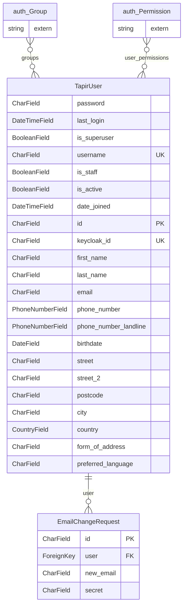

<!-- Generiert mit `python manage.py generate_datamodel_docs`. Nicht von Hand bearbeiten, Beschreibungen stehen in tapir/core/services/data_model_docs_descriptions.py -->
# Datenmodell: Benutzerkonten (`tapir.accounts`)

← [Datenmodell-Übersicht](Development-Datenmodell)

> **Abstract:** Das Benutzerkonto `TapirUser` mit Kontaktdaten und Anmeldung über Keycloak. `wirgarten.Member` erbt davon und ergänzt die Mitgliedsdaten. Dazu kommen Änderungsanfragen für die E-Mail-Adresse.

2 Modelle, 1 Protokolleinträge.

## Beziehungen

## Modelle

### EmailChangeRequest

**email change request**

- Tabelle: `accounts_emailchangerequest`
- Basis: `TapirModel` (nanoid-ID, `created_at`, `updated_at`)

| Feld | Typ | Schlüssel | Pflicht | Default | Beschreibung | Beziehung |
|---|---|---|---|---|---|---|
| `id` | CharField(10) | PK | ja | `generate_id()` | ID |  |
| `created_at` | DateTimeField |  | nein | jetzt (beim Anlegen) |  |  |
| `updated_at` | DateTimeField |  | nein | jetzt (bei jedem Speichern) |  |  |
| `user` | ForeignKey | FK | ja |  |  | n:1 → [accounts.TapirUser](Development-Datenmodell-Benutzerkonten#tapiruser) (DO_NOTHING) |
| `new_email` | CharField(150) |  | ja |  | New Email |  |
| `secret` | CharField(36) |  | ja | `generate_random_secret()` | Secret |  |

### TapirUser

**tapir user**

- Tabelle: `accounts_tapiruser`

| Feld | Typ | Schlüssel | Pflicht | Default | Beschreibung | Beziehung |
|---|---|---|---|---|---|---|
| `password` | CharField(128) |  | ja |  | Passwort |  |
| `last_login` | DateTimeField |  | nein |  | Letzte Anmeldung |  |
| `is_superuser` | BooleanField |  | ja | `False` | Administrator-Status  _Legt fest, dass der Benutzer alle Berechtigungen hat, ohne diese einzeln zuweisen zu müssen._ |  |
| `username` | CharField(150) | UK | ja |  | Benutzername  _Erforderlich. 150 Zeichen oder weniger. Nur Buchstaben, Ziffern und @/./+/-/_._ |  |
| `is_staff` | BooleanField |  | ja | `False` | Mitarbeiter-Status  _Legt fest, ob sich der Benutzer an der Administrationsseite anmelden kann._ |  |
| `is_active` | BooleanField |  | ja | `True` | Aktiv  _Legt fest, ob dieser Benutzer aktiv ist. Kann deaktiviert werden, anstatt Benutzer zu löschen._ |  |
| `date_joined` | DateTimeField |  | ja | `now()` | Mitglied seit |  |
| `id` | CharField(10) | PK | ja | `generate_id()` | ID |  |
| `keycloak_id` | CharField(64) | UK | nein |  |  |  |
| `first_name` | CharField(150) |  | ja |  | First Name |  |
| `last_name` | CharField(150) |  | ja |  | Last Name |  |
| `email` | CharField(150) |  | nein |  | E-Mail-Adresse |  |
| `phone_number` | PhoneNumberField(128) |  | nein |  | Telefonnummer |  |
| `phone_number_landline` | PhoneNumberField(128) |  | nein |  | Phone number (landline) |  |
| `birthdate` | DateField |  | nein |  | Birthdate |  |
| `street` | CharField(150) |  | nein |  | Street and house number |  |
| `street_2` | CharField(150) |  | nein |  | Extra address line |  |
| `postcode` | CharField(32) |  | nein |  | Postcode |  |
| `city` | CharField(50) |  | nein |  | City |  |
| `country` | CountryField(2) |  | nein | `'DE'` | Country  Werte: `AD` = Andorra, `AE` = United Arab Emirates, `AF` = Afghanistan, `AG` = Antigua & Barbuda, `AI` = Anguilla, `AL` = Albania, `AM` = Armenia, `AN` = Netherlands Antilles, `AO` = Angola, `AQ` = Antarctica, `AR` = Argentina, `AS` = American Samoa, `AT` = Austria, `AU` = Australia, `AW` = Aruba, `AZ` = Azerbaijan, `BA` = Bosnia and Herzegovina, `BB` = Barbados, `BD` = Bangladesh, `BE` = Belgium, `BF` = Burkina Faso, `BG` = Bulgaria, `BH` = Bahrain, `BI` = Burundi, `BJ` = Benin, `BM` = Bermuda, `BN` = Brunei Darussalam, `BO` = Bolivia, `BR` = Brazil, `BS` = Bahama, `BT` = Bhutan, `BV` = Bouvet Island, `BW` = Botswana, `BY` = Belarus, `BZ` = Belize, `CA` = Canada, `CC` = Cocos (Keeling) Islands, `CF` = Central African Republic, `CG` = Congo, `CH` = Switzerland, `CI` = Ivory Coast, `CK` = Cook Iislands, `CL` = Chile, `CM` = Cameroon, `CN` = China, `CO` = Colombia, `CR` = Costa Rica, `CU` = Cuba, `CV` = Cape Verde, `CX` = Christmas Island, `CY` = Cyprus, `CZ` = Czech Republic, `DE` = Germany, `DJ` = Djibouti, `DK` = Denmark, `DM` = Dominica, `DO` = Dominican Republic, `DZ` = Algeria, `EC` = Ecuador, `EE` = Estonia, `EG` = Egypt, `EH` = Western Sahara, `ER` = Eritrea, `ES` = Spain, `ET` = Ethiopia, `FI` = Finland, `FJ` = Fiji, `FK` = Falkland Islands (Malvinas), `FM` = Micronesia, `FO` = Faroe Islands, `FR` = France, `FX` = France, Metropolitan, `GA` = Gabon, `GB` = United Kingdom (Great Britain), `GD` = Grenada, `GE` = Georgia, `GF` = French Guiana, `GH` = Ghana, `GI` = Gibraltar, `GL` = Greenland, `GM` = Gambia, `GN` = Guinea, `GP` = Guadeloupe, `GQ` = Equatorial Guinea, `GR` = Greece, `GS` = South Georgia and the South Sandwich Islands, `GT` = Guatemala, `GU` = Guam, `GW` = Guinea-Bissau, `GY` = Guyana, `HK` = Hong Kong, `HM` = Heard & McDonald Islands, `HN` = Honduras, `HR` = Croatia, `HT` = Haiti, `HU` = Hungary, `ID` = Indonesia, `IE` = Ireland, `IL` = Israel, `IN` = India, `IO` = British Indian Ocean Territory, `IQ` = Iraq, `IR` = Islamic Republic of Iran, `IS` = Iceland, `IT` = Italy, `JM` = Jamaica, `JO` = Jordan, `JP` = Japan, `KE` = Kenya, `KG` = Kyrgyzstan, `KH` = Cambodia, `KI` = Kiribati, `KM` = Comoros, `KN` = St. Kitts and Nevis, `KP` = Korea, Democratic People's Republic of, `KR` = Korea, Republic of, `KW` = Kuwait, `KY` = Cayman Islands, `KZ` = Kazakhstan, `LA` = Lao People's Democratic Republic, `LB` = Lebanon, `LC` = Saint Lucia, `LI` = Liechtenstein, `LK` = Sri Lanka, `LR` = Liberia, `LS` = Lesotho, `LT` = Lithuania, `LU` = Luxemburg, `LV` = Latvia, `LY` = Libyan Arab Jamahiriya, `MA` = Morocco, `MC` = Monaco, `MD` = Moldova, Republic of, `MG` = Madagascar, `MH` = Marshall Islands, `ML` = Mali, `MN` = Mongolia, `MM` = Myanmar, `MO` = Macau, `MP` = Northern Mariana Islands, `MQ` = Martinique, `MR` = Mauritania, `MS` = Monserrat, `MT` = Malta, `MU` = Mauritius, `MV` = Maldives, `MW` = Malawi, `MX` = Mexico, `MY` = Malaysia, `MZ` = Mozambique, `NA` = Namibia, `NC` = New Caledonia, `NE` = Niger, `NF` = Norfolk Island, `NG` = Nigeria, `NI` = Nicaragua, `NL` = Netherlands, `NO` = Norway, `NP` = Nepal, `NR` = Nauru, `NU` = Niue, `NZ` = New Zealand, `OM` = Oman, `PA` = Panama, `PE` = Peru, `PF` = French Polynesia, `PG` = Papua New Guinea, `PH` = Philippines, `PK` = Pakistan, `PL` = Poland, `PM` = St. Pierre & Miquelon, `PN` = Pitcairn, `PR` = Puerto Rico, `PT` = Portugal, `PW` = Palau, `PY` = Paraguay, `QA` = Qatar, `RE` = Reunion, `RO` = Romania, `RU` = Russian Federation, `RW` = Rwanda, `SA` = Saudi Arabia, `SB` = Solomon Islands, `SC` = Seychelles, `SD` = Sudan, `SE` = Sweden, `SG` = Singapore, `SH` = St. Helena, `SI` = Slovenia, `SJ` = Svalbard & Jan Mayen Islands, `SK` = Slovakia, `SL` = Sierra Leone, `SM` = San Marino, `SN` = Senegal, `SO` = Somalia, `SR` = Suriname, `ST` = Sao Tome & Principe, `SV` = El Salvador, `SY` = Syrian Arab Republic, `SZ` = Swaziland, `TC` = Turks & Caicos Islands, `TD` = Chad, `TF` = French Southern Territories, `TG` = Togo, `TH` = Thailand, `TJ` = Tajikistan, `TK` = Tokelau, `TM` = Turkmenistan, `TN` = Tunisia, `TO` = Tonga, `TP` = East Timor, `TR` = Turkey, `TT` = Trinidad & Tobago, `TV` = Tuvalu, `TW` = Taiwan, Province of China, `TZ` = Tanzania, United Republic of, `UA` = Ukraine, `UG` = Uganda, `UM` = United States Minor Outlying Islands, `US` = United States of America, `UY` = Uruguay, `UZ` = Uzbekistan, `VA` = Vatican City State (Holy See), `VC` = St. Vincent & the Grenadines, `VE` = Venezuela, `VG` = British Virgin Islands, `VI` = United States Virgin Islands, `VN` = Viet Nam, `VU` = Vanuatu, `WF` = Wallis & Futuna Islands, `WS` = Samoa, `YE` = Yemen, `YT` = Mayotte, `YU` = Yugoslavia, `ZA` = South Africa, `ZM` = Zambia, `ZR` = Zaire, `ZW` = Zimbabwe, `ZZ` = Unknown or unspecified country |  |
| `form_of_address` | CharField(20) |  | nein |  | Liebe/Lieber |  |
| `preferred_language` | CharField(16) |  | ja | `'de'` | Preferred Language  Werte: `de` = 🇩🇪 Deutsch, `en` = 🇬🇧 English |  |
| `groups` | ManyToManyField |  | – |  | Gruppen  _Die Gruppen, denen der Benutzer angehört. Ein Benutzer bekommt alle Berechtigungen dieser Gruppen._ | n:m → `auth.Group` |
| `user_permissions` | ManyToManyField |  | – |  | Berechtigungen  _Spezifische Berechtigungen für diesen Benutzer._ | n:m → `auth.Permission` |

Verweise von anderen Modellen: [accounts.EmailChangeRequest](Development-Datenmodell-Benutzerkonten#emailchangerequest).`user`, [log.LogEntry](Development-Datenmodell-Protokoll#logentry).`user`

## Protokolleinträge

Alle erben von [log.LogEntry](Development-Datenmodell-Protokoll#logentry) und speichern nur ihre zusätzlichen Felder in einer eigenen Tabelle.

### UpdateTapirUserLogEntry

**update tapir user log entry**

- Tabelle: `accounts_updatetapiruserlogentry`
- Erbt von `log.LogEntry` (Multi-Table-Inheritance, eigene Tabelle mit 1:1-Verweis)

| Feld | Typ | Schlüssel | Pflicht | Default | Beschreibung | Beziehung |
|---|---|---|---|---|---|---|
| `old_values` | HStoreField |  | ja |  |  |  |
| `new_values` | HStoreField |  | ja |  |  |  |
