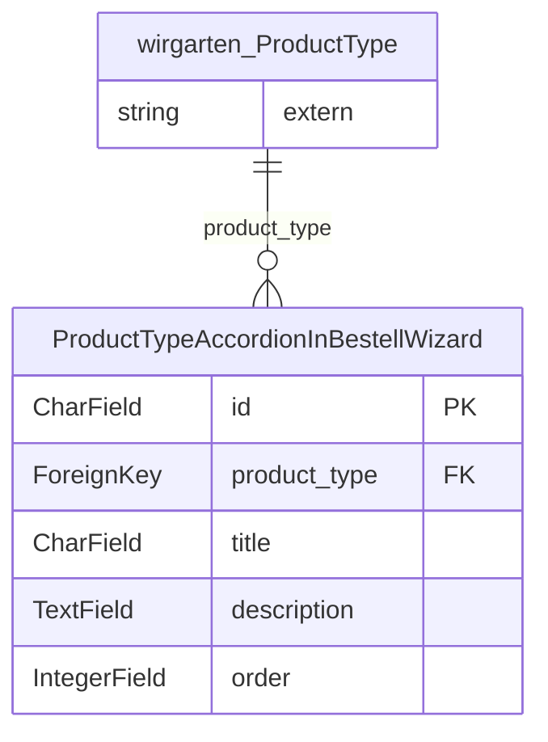

<!-- Generiert mit `python manage.py generate_datamodel_docs`. Nicht von Hand bearbeiten, Beschreibungen stehen in tapir/core/services/data_model_docs_descriptions.py -->
# Datenmodell: Bestell-Wizard (`tapir.bestell_wizard`)

← [Datenmodell-Übersicht](Development-Datenmodell)

> **Abstract:** Darstellungseinstellungen für den öffentlichen Bestell-Wizard, über den sich neue Mitglieder anmelden.

1 Modelle.

## Beziehungen

## Modelle

### ProductTypeAccordionInBestellWizard

**product type accordion in bestell wizard**

- Tabelle: `bestell_wizard_producttypeaccordioninbestellwizard`
- Basis: `TapirModel` (nanoid-ID, `created_at`, `updated_at`)

| Feld | Typ | Schlüssel | Pflicht | Default | Beschreibung | Beziehung |
|---|---|---|---|---|---|---|
| `id` | CharField(10) | PK | ja | `generate_id()` | ID |  |
| `created_at` | DateTimeField |  | nein | jetzt (beim Anlegen) |  |  |
| `updated_at` | DateTimeField |  | nein | jetzt (bei jedem Speichern) |  |  |
| `product_type` | ForeignKey | FK | ja |  |  | n:1 → [wirgarten.ProductType](Development-Datenmodell-Kern#producttype) (CASCADE) |
| `title` | CharField(300) |  | ja |  |  |  |
| `description` | TextField |  | ja |  |  |  |
| `order` | IntegerField |  | ja |  |  |  |
