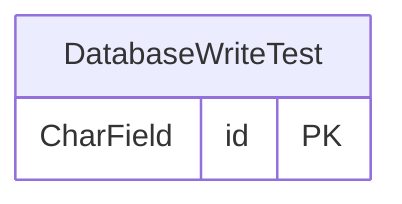

<!-- Generiert mit `python manage.py generate_datamodel_docs`. Nicht von Hand bearbeiten, Beschreibungen stehen in tapir/core/services/data_model_docs_descriptions.py -->
# Datenmodell: Core (`tapir.core`)

← [Datenmodell-Übersicht](Development-Datenmodell)

> **Abstract:** Gemeinsame Basis (`TapirModel`, Sidebar, App-Umschalter, Themes); im Datenmodell nur eine Tabelle für den Health-Check.

1 Modelle.

## Beziehungen

## Modelle

### DatabaseWriteTest

**database write test**

- Tabelle: `core_databasewritetest`
- Basis: `TapirModel` (nanoid-ID, `created_at`, `updated_at`)

| Feld | Typ | Schlüssel | Pflicht | Default | Beschreibung | Beziehung |
|---|---|---|---|---|---|---|
| `id` | CharField(10) | PK | ja | `generate_id()` | ID |  |
| `created_at` | DateTimeField |  | nein | jetzt (beim Anlegen) |  |  |
| `updated_at` | DateTimeField |  | nein | jetzt (bei jedem Speichern) |  |  |
