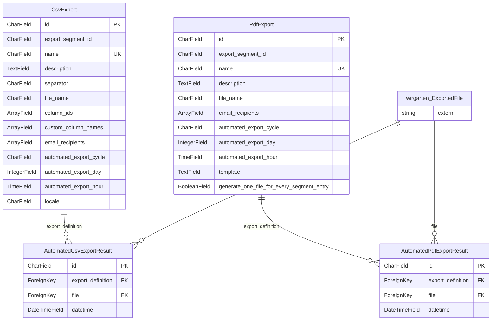

<!-- Generiert mit `python manage.py generate_datamodel_docs`. Nicht von Hand bearbeiten, Beschreibungen stehen in tapir/core/services/data_model_docs_descriptions.py -->
# Datenmodell: Exporte (`tapir.generic_exports`)

← [Datenmodell-Übersicht](Development-Datenmodell)

> **Abstract:** Frei konfigurierbare CSV- und PDF-Exporte und die Ergebnisse ihrer automatischen, zeitgesteuerten Läufe.

4 Modelle.

## Beziehungen

## Modelle

### AutomatedCsvExportResult

**automated csv export result**

- Tabelle: `generic_exports_automatedcsvexportresult`
- Basis: `TapirModel` (nanoid-ID, `created_at`, `updated_at`)

| Feld | Typ | Schlüssel | Pflicht | Default | Beschreibung | Beziehung |
|---|---|---|---|---|---|---|
| `id` | CharField(10) | PK | ja | `generate_id()` | ID |  |
| `created_at` | DateTimeField |  | nein | jetzt (beim Anlegen) |  |  |
| `updated_at` | DateTimeField |  | nein | jetzt (bei jedem Speichern) |  |  |
| `export_definition` | ForeignKey | FK | ja |  |  | n:1 → [generic_exports.CsvExport](Development-Datenmodell-Exporte#csvexport) (CASCADE) |
| `file` | ForeignKey | FK | ja |  |  | n:1 → [wirgarten.ExportedFile](Development-Datenmodell-Kern#exportedfile) (CASCADE) |
| `datetime` | DateTimeField |  | ja |  |  |  |

### AutomatedPdfExportResult

**automated pdf export result**

- Tabelle: `generic_exports_automatedpdfexportresult`
- Basis: `TapirModel` (nanoid-ID, `created_at`, `updated_at`)

| Feld | Typ | Schlüssel | Pflicht | Default | Beschreibung | Beziehung |
|---|---|---|---|---|---|---|
| `id` | CharField(10) | PK | ja | `generate_id()` | ID |  |
| `created_at` | DateTimeField |  | nein | jetzt (beim Anlegen) |  |  |
| `updated_at` | DateTimeField |  | nein | jetzt (bei jedem Speichern) |  |  |
| `export_definition` | ForeignKey | FK | ja |  |  | n:1 → [generic_exports.PdfExport](Development-Datenmodell-Exporte#pdfexport) (CASCADE) |
| `file` | ForeignKey | FK | ja |  |  | n:1 → [wirgarten.ExportedFile](Development-Datenmodell-Kern#exportedfile) (CASCADE) |
| `datetime` | DateTimeField |  | ja |  |  |  |

### CsvExport

**csv export**

- Tabelle: `generic_exports_csvexport`
- Basis: `TapirModel` (nanoid-ID, `created_at`, `updated_at`)

| Feld | Typ | Schlüssel | Pflicht | Default | Beschreibung | Beziehung |
|---|---|---|---|---|---|---|
| `id` | CharField(10) | PK | ja | `generate_id()` | ID |  |
| `created_at` | DateTimeField |  | nein | jetzt (beim Anlegen) |  |  |
| `updated_at` | DateTimeField |  | nein | jetzt (bei jedem Speichern) |  |  |
| `export_segment_id` | CharField(512) |  | ja |  |  |  |
| `name` | CharField(512) | UK | ja |  |  |  |
| `description` | TextField |  | nein |  |  |  |
| `separator` | CharField(1) |  | ja |  |  |  |
| `file_name` | CharField(512) |  | ja |  |  |  |
| `column_ids` | ArrayField |  | nein | `list()` |  |  |
| `custom_column_names` | ArrayField |  | nein | `list()` |  |  |
| `email_recipients` | ArrayField |  | nein | `list()` |  |  |
| `automated_export_cycle` | CharField(512) |  | ja |  |  Werte: `yearly` = Jährlich, `monthly` = Monatlich, `weekly` = Wöchentlich, `daily` = Täglich, `after_pickup_location_change_deadline` = Nach letztmöglicher Änderung der Verteilstation, `never` = Nie |  |
| `automated_export_day` | IntegerField |  | ja |  |  |  |
| `automated_export_hour` | TimeField |  | ja |  |  |  |
| `locale` | CharField(512) |  | ja | `LocaleChoices.DE` |  Werte: `de_DE.utf-8` = Deutsch (DE), `en_US.utf-8` = English (US) |  |

Verweise von anderen Modellen: [generic_exports.AutomatedCsvExportResult](Development-Datenmodell-Exporte#automatedcsvexportresult).`export_definition`

### PdfExport

**pdf export**

- Tabelle: `generic_exports_pdfexport`
- Basis: `TapirModel` (nanoid-ID, `created_at`, `updated_at`)

| Feld | Typ | Schlüssel | Pflicht | Default | Beschreibung | Beziehung |
|---|---|---|---|---|---|---|
| `id` | CharField(10) | PK | ja | `generate_id()` | ID |  |
| `created_at` | DateTimeField |  | nein | jetzt (beim Anlegen) |  |  |
| `updated_at` | DateTimeField |  | nein | jetzt (bei jedem Speichern) |  |  |
| `export_segment_id` | CharField(512) |  | ja |  |  |  |
| `name` | CharField(512) | UK | ja |  |  |  |
| `description` | TextField |  | nein |  |  |  |
| `file_name` | CharField(512) |  | ja |  |  |  |
| `email_recipients` | ArrayField |  | nein | `list()` |  |  |
| `automated_export_cycle` | CharField(512) |  | ja |  |  Werte: `yearly` = Jährlich, `monthly` = Monatlich, `weekly` = Wöchentlich, `daily` = Täglich, `after_pickup_location_change_deadline` = Nach letztmöglicher Änderung der Verteilstation, `never` = Nie |  |
| `automated_export_day` | IntegerField |  | ja |  |  |  |
| `automated_export_hour` | TimeField |  | ja |  |  |  |
| `template` | TextField |  | ja |  |  |  |
| `generate_one_file_for_every_segment_entry` | BooleanField |  | ja |  |  |  |

Verweise von anderen Modellen: [generic_exports.AutomatedPdfExportResult](Development-Datenmodell-Exporte#automatedpdfexportresult).`export_definition`
