<!-- Generiert mit `python manage.py generate_datamodel_docs`. Nicht von Hand bearbeiten, Beschreibungen stehen in tapir/core/services/data_model_docs_descriptions.py -->
# Datenmodell: Kern (`tapir.wirgarten`)

← [Datenmodell-Übersicht](Development-Datenmodell)

> **Abstract:** Der historisch gewachsene Kern von Tapir: Mitglieder, Verträge, Genossenschaftsanteile, Produkte mit Preisen und Kapazitäten, Anbauperioden, Verteilstationen, Zahlungen mit SEPA-Mandaten, Warteliste und Fragebögen. Der Code in `tapir/wirgarten` gilt als Legacy, neue Logik entsteht in den Fach-Apps, die Modelle bleiben aber hier und sind die Basis fast aller anderen Apps.

29 Modelle, 8 Protokolleinträge.

## Beziehungen

Wegen der Größe zeigt das Diagramm nur Schlüsselfelder (PK, FK, UK); alle Felder stehen in den Tabellen darunter.

```mermaid
erDiagram
    LocationRoute {
        CharField id PK
        TextField name UK
    }
    PickupLocation {
        CharField id PK
        ForeignKey location_route FK
    }
    PickupLocationOpeningTime {
        CharField id PK
        ForeignKey pickup_location FK
    }
    GrowingPeriod {
        CharField id PK
    }
    ProductType {
        CharField id PK
    }
    PickupLocationCapability {
        CharField id PK
        ForeignKey product_type FK
        ForeignKey pickup_location FK
    }
    DeliveryExceptionPeriod {
        CharField id PK
        ForeignKey product_type FK
    }
    ProductCapacity {
        CharField id PK
        ForeignKey period FK
        ForeignKey product_type FK
    }
    Member {
        IntegerField member_no UK
    }
    MemberPickupLocation {
        CharField id PK
        ForeignKey member FK
        ForeignKey pickup_location FK
    }
    Product {
        CharField id PK
        ForeignKey type FK
    }
    ProductPrice {
        CharField id PK
        ForeignKey product FK
    }
    MandateReference {
        CharField ref PK
        ForeignKey member FK
    }
    Subscription {
        CharField id PK
        ForeignKey member FK
        ForeignKey product FK
        ForeignKey period FK
        ForeignKey mandate_ref FK
    }
    ExportedFile {
        CharField id PK
    }
    PaymentTransaction {
        CharField id PK
        ForeignKey csv_file FK
        ForeignKey xml_file FK
    }
    Payment {
        CharField id PK
        ForeignKey mandate_ref FK
        ForeignKey transaction FK
        ForeignKey pickup_location FK
    }
    CoopShareTransaction {
        CharField id PK
        ForeignKey member FK
        ForeignKey mandate_ref FK
        ForeignKey transfer_member FK
        ForeignKey payment FK
    }
    Deliveries {
        CharField id PK
        ForeignKey member FK
        ForeignKey pickup_location FK
    }
    TaxRate {
        CharField id PK
        ForeignKey product_type FK
    }
    WaitingListEntry {
        CharField id PK
        ForeignKey member FK
    }
    WaitingListPickupLocationWish {
        CharField id PK
        ForeignKey waiting_list_entry FK
        ForeignKey pickup_location FK
    }
    WaitingListProductWish {
        CharField id PK
        ForeignKey waiting_list_entry FK
        ForeignKey product FK
    }
    QuestionaireTrafficSourceOption {
        CharField id PK
    }
    QuestionaireTrafficSourceResponse {
        CharField id PK
        ForeignKey member FK
    }
    QuestionaireCancellationReasonResponse {
        CharField id PK
        ForeignKey member FK
    }
    ScheduledTask {
        CharField id PK
    }
    MemberExtraEmail {
        CharField id PK
        ForeignKey member FK
    }
    OrderFeedback {
        CharField id PK
        ForeignKey member FK
        ForeignKey waiting_list_entry FK
    }
    accounts_TapirUser {
        string extern
    }
    auth_Group {
        string extern
    }
    auth_Permission {
        string extern
    }
    LocationRoute |o--o{ PickupLocation : "location_route"
    PickupLocation ||--o{ PickupLocationOpeningTime : "pickup_location"
    ProductType ||--o{ PickupLocationCapability : "product_type"
    PickupLocation ||--o{ PickupLocationCapability : "pickup_location"
    ProductType |o--o{ DeliveryExceptionPeriod : "product_type"
    GrowingPeriod ||--o{ ProductCapacity : "period"
    ProductType ||--o{ ProductCapacity : "product_type"
    auth_Group }o--o{ accounts_TapirUser : "groups"
    auth_Permission }o--o{ accounts_TapirUser : "user_permissions"
    accounts_TapirUser ||--o| Member : "erbt von"
    Member ||--o{ MemberPickupLocation : "member"
    PickupLocation |o--o{ MemberPickupLocation : "pickup_location"
    ProductType ||--o{ Product : "type"
    Product ||--o{ ProductPrice : "product"
    Member ||--o{ MandateReference : "member"
    Member ||--o{ Subscription : "member"
    Product ||--o{ Subscription : "product"
    GrowingPeriod |o--o{ Subscription : "period"
    MandateReference ||--o{ Subscription : "mandate_ref"
    ExportedFile ||--o{ PaymentTransaction : "csv_file"
    ExportedFile |o--o{ PaymentTransaction : "xml_file"
    MandateReference ||--o{ Payment : "mandate_ref"
    PaymentTransaction |o--o{ Payment : "transaction"
    PickupLocation |o--o{ Payment : "pickup_location"
    Member ||--o{ CoopShareTransaction : "member"
    MandateReference |o--o{ CoopShareTransaction : "mandate_ref"
    Member |o--o{ CoopShareTransaction : "transfer_member"
    Payment |o--o{ CoopShareTransaction : "payment"
    Member ||--o{ Deliveries : "member"
    PickupLocation ||--o{ Deliveries : "pickup_location"
    ProductType ||--o{ TaxRate : "product_type"
    Member |o--o{ WaitingListEntry : "member"
    WaitingListEntry ||--o{ WaitingListPickupLocationWish : "waiting_list_entry"
    PickupLocation ||--o{ WaitingListPickupLocationWish : "pickup_location"
    WaitingListEntry ||--o{ WaitingListProductWish : "waiting_list_entry"
    Product ||--o{ WaitingListProductWish : "product"
    Member |o--o{ QuestionaireTrafficSourceResponse : "member"
    QuestionaireTrafficSourceOption }o--o{ QuestionaireTrafficSourceResponse : "sources"
    Member |o--o{ QuestionaireCancellationReasonResponse : "member"
    Member ||--o{ MemberExtraEmail : "member"
    Member |o--o{ OrderFeedback : "member"
    WaitingListEntry |o--o{ OrderFeedback : "waiting_list_entry"
```

## Modelle

### CoopShareTransaction

**coop share transaction**

The CoopShareTransaction model represents a transaction related to cooperative shares. It provides a way to track various types of transactions that can occur within a cooperative, such as purchasing, canceling, transferring out, and transferring in shares. Attributes: transaction_type (CharField): The type of transaction (PURCHASE, CANCELLATION, TRANSFER_OUT, TRANSFER_IN). member (ForeignKey): The member associated with the transaction. quantity (SmallIntegerField): The quantity of shares involved in the transaction. Must be positive for PURCHASE and TRANSFER_IN, and negative for CANCELLATION and TRANSFER_OUT. share_price (DecimalField): The price of a single share at the time of the transaction. timestamp (DateTimeField): The date and time when the transaction was created. valid_at (DateField): The date when the transaction becomes valid. mandate_ref (ForeignKey): The reference to a mandate associated with the transaction (optional). transfer_member (ForeignKey): The member associated with the share transfer (TRANSFER_OUT, TRANSFER_IN transactions only).

- Tabelle: `wirgarten_coopsharetransaction`
- Basis: `TapirModel` (nanoid-ID, `created_at`, `updated_at`)

| Feld | Typ | Schlüssel | Pflicht | Default | Beschreibung | Beziehung |
|---|---|---|---|---|---|---|
| `id` | CharField(10) | PK | ja | `generate_id()` | ID |  |
| `created_at` | DateTimeField |  | nein | jetzt (beim Anlegen) |  |  |
| `updated_at` | DateTimeField |  | nein | jetzt (bei jedem Speichern) |  |  |
| `admin_confirmed` | DateTimeField |  | nein |  |  |  |
| `auto_confirmed` | DateTimeField |  | nein |  |  |  |
| `transaction_type` | CharField(30) |  | ja |  |  Werte: `purchase` = Zeichnung von Anteilen, `cancellation` = Kündigung von Anteilen, `transfer_out` = Abgabe von Anteilen, `transfer_in` = Empfang von Anteilen |  |
| `member` | ForeignKey | FK | ja |  |  | n:1 → [wirgarten.Member](Development-Datenmodell-Kern#member) (DO_NOTHING) |
| `quantity` | SmallIntegerField |  | ja |  |  |  |
| `share_price` | DecimalField(5,2) |  | ja |  |  |  |
| `timestamp` | DateTimeField |  | ja | `now()` |  |  |
| `valid_at` | DateField |  | ja |  |  |  |
| `mandate_ref` | ForeignKey | FK | nein |  |  | n:1 → [wirgarten.MandateReference](Development-Datenmodell-Kern#mandatereference) (DO_NOTHING) |
| `transfer_member` | ForeignKey | FK | nein |  |  | n:1 → [wirgarten.Member](Development-Datenmodell-Kern#member) (DO_NOTHING, rückwärts `transfer_member`) |
| `payment` | ForeignKey | FK | nein |  |  | n:1 → [wirgarten.Payment](Development-Datenmodell-Kern#payment) (DO_NOTHING, rückwärts `payment`) |

### Deliveries

History of deliveries.

- Tabelle: `wirgarten_deliveries`
- Basis: `TapirModel` (nanoid-ID, `created_at`, `updated_at`)

| Feld | Typ | Schlüssel | Pflicht | Default | Beschreibung | Beziehung |
|---|---|---|---|---|---|---|
| `id` | CharField(10) | PK | ja | `generate_id()` | ID |  |
| `created_at` | DateTimeField |  | nein | jetzt (beim Anlegen) |  |  |
| `updated_at` | DateTimeField |  | nein | jetzt (bei jedem Speichern) |  |  |
| `member` | ForeignKey | FK | ja |  |  | n:1 → [wirgarten.Member](Development-Datenmodell-Kern#member) (DO_NOTHING) |
| `delivery_date` | DateField |  | ja |  |  |  |
| `pickup_location` | ForeignKey | FK | ja |  |  | n:1 → [wirgarten.PickupLocation](Development-Datenmodell-Kern#pickuplocation) (DO_NOTHING) |

### DeliveryExceptionPeriod

**delivery exception period**

Defines a period in which no delivery of a certain product takes place.

- Tabelle: `wirgarten_deliveryexceptionperiod`
- Basis: `TapirModel` (nanoid-ID, `created_at`, `updated_at`)

| Feld | Typ | Schlüssel | Pflicht | Default | Beschreibung | Beziehung |
|---|---|---|---|---|---|---|
| `id` | CharField(10) | PK | ja | `generate_id()` | ID |  |
| `created_at` | DateTimeField |  | nein | jetzt (beim Anlegen) |  |  |
| `updated_at` | DateTimeField |  | nein | jetzt (bei jedem Speichern) |  |  |
| `start_date` | DateField |  | ja |  |  |  |
| `end_date` | DateField |  | ja |  |  |  |
| `product_type` | ForeignKey | FK | nein |  |  | n:1 → [wirgarten.ProductType](Development-Datenmodell-Kern#producttype) (CASCADE) |
| `comment` | CharField(128) |  | ja | `''` |  |  |

### ExportedFile

**exported file**

An exported file (blob in DB).

- Tabelle: `wirgarten_exportedfile`
- Basis: `TapirModel` (nanoid-ID, `created_at`, `updated_at`)

| Feld | Typ | Schlüssel | Pflicht | Default | Beschreibung | Beziehung |
|---|---|---|---|---|---|---|
| `id` | CharField(10) | PK | ja | `generate_id()` | ID |  |
| `created_at` | DateTimeField |  | nein | jetzt (beim Anlegen) |  |  |
| `updated_at` | DateTimeField |  | nein | jetzt (bei jedem Speichern) |  |  |
| `name` | CharField(256) |  | ja |  |  |  |
| `type` | CharField(8) |  | ja |  |  Werte: `csv` = CSV, `pdf` = PDF, `xml` = XML |  |
| `file` | BinaryField |  | ja |  |  |  |

Verweise von anderen Modellen: [generic_exports.AutomatedCsvExportResult](Development-Datenmodell-Exporte#automatedcsvexportresult).`file`, [generic_exports.AutomatedPdfExportResult](Development-Datenmodell-Exporte#automatedpdfexportresult).`file`, [wirgarten.PaymentTransaction](Development-Datenmodell-Kern#paymenttransaction).`csv_file`, [wirgarten.PaymentTransaction](Development-Datenmodell-Kern#paymenttransaction).`xml_file`

### GrowingPeriod

**growing period**

The growing period for the WirGarten site. Usually the growing period starts on 1st of March, and ends in the end of next February.

- Tabelle: `wirgarten_growingperiod`
- Basis: `TapirModel` (nanoid-ID, `created_at`, `updated_at`)

| Feld | Typ | Schlüssel | Pflicht | Default | Beschreibung | Beziehung |
|---|---|---|---|---|---|---|
| `id` | CharField(10) | PK | ja | `generate_id()` | ID |  |
| `created_at` | DateTimeField |  | nein | jetzt (beim Anlegen) |  |  |
| `updated_at` | DateTimeField |  | nein | jetzt (bei jedem Speichern) |  |  |
| `start_date` | DateField |  | ja |  |  |  |
| `end_date` | DateField |  | ja |  |  |  |
| `weeks_without_delivery` | ArrayField |  | nein | `list()` |  |  |
| `max_jokers_per_member` | IntegerField |  | ja | `4` |  |  |
| `joker_restrictions` | CharField(1024) |  | ja | `'disabled'` |  |  |
| `is_available_in_bestell_wizard` | BooleanField |  | ja | `True` |  |  |

Verweise von anderen Modellen: [deliveries.CustomCycleScheduledDeliveryWeek](Development-Datenmodell-Lieferungen#customcyclescheduleddeliveryweek).`growing_period`, [deliveries.DeliveryDayAdjustment](Development-Datenmodell-Lieferungen#deliverydayadjustment).`growing_period`, [subscriptions.NoticePeriod](Development-Datenmodell-Vertraege#noticeperiod).`growing_period`, [wirgarten.ProductCapacity](Development-Datenmodell-Kern#productcapacity).`period`, [wirgarten.Subscription](Development-Datenmodell-Kern#subscription).`period`

### LocationRoute

**location route**

Groups pickup locations that are supplied together.

- Tabelle: `wirgarten_locationroute`
- Basis: `TapirModel` (nanoid-ID, `created_at`, `updated_at`)

| Feld | Typ | Schlüssel | Pflicht | Default | Beschreibung | Beziehung |
|---|---|---|---|---|---|---|
| `id` | CharField(10) | PK | ja | `generate_id()` | ID |  |
| `created_at` | DateTimeField |  | nein | jetzt (beim Anlegen) |  |  |
| `updated_at` | DateTimeField |  | nein | jetzt (bei jedem Speichern) |  |  |
| `name` | TextField | UK | ja |  | Name |  |

Verweise von anderen Modellen: [wirgarten.PickupLocation](Development-Datenmodell-Kern#pickuplocation).`location_route`

### MandateReference

**mandate reference**

The mandate reference is generated for the SEPA payments.

- Tabelle: `wirgarten_mandatereference`
- Index `idx_mandatereference_mamber`: `member`

| Feld | Typ | Schlüssel | Pflicht | Default | Beschreibung | Beziehung |
|---|---|---|---|---|---|---|
| `ref` | CharField(35) | PK | ja |  |  |  |
| `member` | ForeignKey | FK | ja |  |  | n:1 → [wirgarten.Member](Development-Datenmodell-Kern#member) (DO_NOTHING) |
| `start_ts` | DateTimeField |  | ja |  |  |  |
| `created_at` | DateTimeField |  | nein | jetzt (beim Anlegen) |  |  |
| `updated_at` | DateTimeField |  | nein | jetzt (bei jedem Speichern) |  |  |

Verweise von anderen Modellen: [wirgarten.CoopShareTransaction](Development-Datenmodell-Kern#coopsharetransaction).`mandate_ref`, [wirgarten.Payment](Development-Datenmodell-Kern#payment).`mandate_ref`, [wirgarten.Subscription](Development-Datenmodell-Kern#subscription).`mandate_ref`

### Member

A member of WirGarten. Usually a member has coop shares and optionally other subscriptions.

- Tabelle: `wirgarten_member`
- Erbt von `accounts.TapirUser` (Multi-Table-Inheritance, eigene Tabelle mit 1:1-Verweis)

| Feld | Typ | Schlüssel | Pflicht | Default | Beschreibung | Beziehung |
|---|---|---|---|---|---|---|
| `groups` | ManyToManyField |  | – |  | Gruppen  _Die Gruppen, denen der Benutzer angehört. Ein Benutzer bekommt alle Berechtigungen dieser Gruppen._ | n:m → `auth.Group` |
| `user_permissions` | ManyToManyField |  | – |  | Berechtigungen  _Spezifische Berechtigungen für diesen Benutzer._ | n:m → `auth.Permission` |
| `account_owner` | CharField(150) |  | nein |  | Account owner |  |
| `iban` | IBANField(34) |  | nein |  | IBAN |  |
| `sepa_consent` | DateTimeField |  | nein |  | SEPA Consent |  |
| `withdrawal_consent` | DateTimeField |  | nein |  | Right of withdrawal consent |  |
| `privacy_consent` | DateTimeField |  | nein |  | Privacy consent |  |
| `created_at` | DateTimeField |  | nein | jetzt (beim Anlegen) |  |  |
| `member_no` | IntegerField | UK | nein |  | Mitgliedsnummer |  |
| `is_student` | BooleanField |  | ja | `False` | Student*in |  |
| `pseudonym` | CharField(150) |  | nein |  | Pseudonym |  |
| `has_received_membership_started_mail` | BooleanField |  | ja | `False` |  |  |

Verweise von anderen Modellen: [accounts.EmailChangeRequest](Development-Datenmodell-Benutzerkonten#emailchangerequest).`user`, [associations.AssociationMembership](Development-Datenmodell-Vereinsmitgliedschaften#associationmembership).`member`, [bakery.PreferredBread](Development-Datenmodell-Baeckerei#preferredbread).`member`, [deliveries.DeliveryDonation](Development-Datenmodell-Lieferungen#deliverydonation).`member`, [deliveries.Joker](Development-Datenmodell-Lieferungen#joker).`member`, [log.LogEntry](Development-Datenmodell-Protokoll#logentry).`user`, [payments.MemberCredit](Development-Datenmodell-Zahlungen#membercredit).`member`, [payments.MemberPaymentRhythm](Development-Datenmodell-Zahlungen#memberpaymentrhythm).`member`, [solidarity_contribution.SolidarityContribution](Development-Datenmodell-Solidarbeitrag#solidaritycontribution).`member`, [wirgarten.CoopShareTransaction](Development-Datenmodell-Kern#coopsharetransaction).`member`, [wirgarten.CoopShareTransaction](Development-Datenmodell-Kern#coopsharetransaction).`transfer_member`, [wirgarten.Deliveries](Development-Datenmodell-Kern#deliveries).`member`, [wirgarten.MandateReference](Development-Datenmodell-Kern#mandatereference).`member`, [wirgarten.MemberExtraEmail](Development-Datenmodell-Kern#memberextraemail).`member`, [wirgarten.MemberPickupLocation](Development-Datenmodell-Kern#memberpickuplocation).`member`, [wirgarten.OrderFeedback](Development-Datenmodell-Kern#orderfeedback).`member`, [wirgarten.QuestionaireCancellationReasonResponse](Development-Datenmodell-Kern#questionairecancellationreasonresponse).`member`, [wirgarten.QuestionaireTrafficSourceResponse](Development-Datenmodell-Kern#questionairetrafficsourceresponse).`member`, [wirgarten.Subscription](Development-Datenmodell-Kern#subscription).`member`, [wirgarten.WaitingListEntry](Development-Datenmodell-Kern#waitinglistentry).`member`

### MemberExtraEmail

**member extra email**

- Tabelle: `wirgarten_memberextraemail`
- Basis: `TapirModel` (nanoid-ID, `created_at`, `updated_at`)
- Constraint `unique_extra_email`: eindeutig `member, email`

| Feld | Typ | Schlüssel | Pflicht | Default | Beschreibung | Beziehung |
|---|---|---|---|---|---|---|
| `id` | CharField(10) | PK | ja | `generate_id()` | ID |  |
| `created_at` | DateTimeField |  | nein | jetzt (beim Anlegen) |  |  |
| `updated_at` | DateTimeField |  | nein | jetzt (bei jedem Speichern) |  |  |
| `member` | ForeignKey | FK | ja |  |  | n:1 → [wirgarten.Member](Development-Datenmodell-Kern#member) (CASCADE) |
| `email` | EmailField(254) |  | ja |  |  |  |
| `first_name` | CharField(100) |  | ja |  |  |  |
| `last_name` | CharField(100) |  | ja |  |  |  |
| `confirmed_on` | DateTimeField |  | nein |  |  |  |
| `secret` | UUIDField |  | ja | `uuid4()` |  |  |

### MemberPickupLocation

**member pickup location**

- Tabelle: `wirgarten_memberpickuplocation`
- Basis: `TapirModel` (nanoid-ID, `created_at`, `updated_at`)
- Eindeutig zusammen: `member, valid_from`

| Feld | Typ | Schlüssel | Pflicht | Default | Beschreibung | Beziehung |
|---|---|---|---|---|---|---|
| `id` | CharField(10) | PK | ja | `generate_id()` | ID |  |
| `created_at` | DateTimeField |  | nein | jetzt (beim Anlegen) |  |  |
| `updated_at` | DateTimeField |  | nein | jetzt (bei jedem Speichern) |  |  |
| `member` | ForeignKey | FK | ja |  |  | n:1 → [wirgarten.Member](Development-Datenmodell-Kern#member) (CASCADE) |
| `pickup_location` | ForeignKey | FK | nein |  |  | n:1 → [wirgarten.PickupLocation](Development-Datenmodell-Kern#pickuplocation) (PROTECT) |
| `valid_from` | DateField |  | ja |  |  |  |

### OrderFeedback

**order feedback**

- Tabelle: `wirgarten_orderfeedback`
- Basis: `TapirModel` (nanoid-ID, `created_at`, `updated_at`)

| Feld | Typ | Schlüssel | Pflicht | Default | Beschreibung | Beziehung |
|---|---|---|---|---|---|---|
| `id` | CharField(10) | PK | ja | `generate_id()` | ID |  |
| `created_at` | DateTimeField |  | nein | jetzt (beim Anlegen) |  |  |
| `updated_at` | DateTimeField |  | nein | jetzt (bei jedem Speichern) |  |  |
| `member` | ForeignKey | FK | nein |  |  | n:1 → [wirgarten.Member](Development-Datenmodell-Kern#member) (CASCADE) |
| `waiting_list_entry` | ForeignKey | FK | nein |  |  | n:1 → [wirgarten.WaitingListEntry](Development-Datenmodell-Kern#waitinglistentry) (CASCADE) |
| `feedback_text` | TextField |  | ja |  |  |  |

### Payment

A payment. Usually payments are created in DB when they are due, but also when the admin edits a future payment. If the sepa_payments reference is set, the payment cannot be changed anymore, because it was exported for the bank already.

- Tabelle: `wirgarten_payment`
- Basis: `TapirModel` (nanoid-ID, `created_at`, `updated_at`)
- Index `idx_payment_mandate_ref`: `mandate_ref`
- Index `idx_payment_due_date`: `due_date`

| Feld | Typ | Schlüssel | Pflicht | Default | Beschreibung | Beziehung |
|---|---|---|---|---|---|---|
| `id` | CharField(10) | PK | ja | `generate_id()` | ID |  |
| `created_at` | DateTimeField |  | nein | jetzt (beim Anlegen) |  |  |
| `updated_at` | DateTimeField |  | nein | jetzt (bei jedem Speichern) |  |  |
| `due_date` | DateField |  | ja |  |  |  |
| `mandate_ref` | ForeignKey | FK | ja |  |  | n:1 → [wirgarten.MandateReference](Development-Datenmodell-Kern#mandatereference) (DO_NOTHING) |
| `amount` | DecimalField(8,2) |  | ja |  |  |  |
| `status` | CharField(8) |  | ja | `Payment.PaymentStatus.DUE` |  Werte: `PAID` = Bezahlt, `DUE` = Offen |  |
| `edited` | BooleanField |  | ja | `False` |  |  |
| `transaction` | ForeignKey | FK | nein |  |  | n:1 → [wirgarten.PaymentTransaction](Development-Datenmodell-Kern#paymenttransaction) (DO_NOTHING) |
| `type` | CharField(64) |  | ja |  |  |  |
| `subscription_payment_range_start` | DateField |  | nein |  |  |  |
| `subscription_payment_range_end` | DateField |  | nein |  |  |  |
| `pickup_location` | ForeignKey | FK | nein |  |  | n:1 → [wirgarten.PickupLocation](Development-Datenmodell-Kern#pickuplocation) (DO_NOTHING) |

Verweise von anderen Modellen: [wirgarten.CoopShareTransaction](Development-Datenmodell-Kern#coopsharetransaction).`payment`

### PaymentTransaction

**payment transaction**

A payment transaction. This is usually created once a month by a task, when the payments are due. The relevant payments must reference the transaction in the same step.

- Tabelle: `wirgarten_paymenttransaction`
- Basis: `TapirModel` (nanoid-ID, `created_at`, `updated_at`)

| Feld | Typ | Schlüssel | Pflicht | Default | Beschreibung | Beziehung |
|---|---|---|---|---|---|---|
| `id` | CharField(10) | PK | ja | `generate_id()` | ID |  |
| `created_at` | DateTimeField |  | nein | jetzt (beim Anlegen) |  |  |
| `updated_at` | DateTimeField |  | nein | jetzt (bei jedem Speichern) |  |  |
| `csv_file` | ForeignKey | FK | ja |  |  | n:1 → [wirgarten.ExportedFile](Development-Datenmodell-Kern#exportedfile) (PROTECT, rückwärts `transaction_csv`) |
| `xml_file` | ForeignKey | FK | nein |  |  | n:1 → [wirgarten.ExportedFile](Development-Datenmodell-Kern#exportedfile) (PROTECT, rückwärts `transaction_xml`) |
| `type` | CharField(100) |  | ja |  |  |  |
| `month` | DateField |  | ja |  |  |  |

Verweise von anderen Modellen: [wirgarten.Payment](Development-Datenmodell-Kern#payment).`transaction`

### PickupLocation

**pickup location**

This is a place where a Member can pick up his/her products.

- Tabelle: `wirgarten_pickuplocation`
- Basis: `TapirModel` (nanoid-ID, `created_at`, `updated_at`)
- Constraint `unique_location`: eindeutig `name, coords_lat, coords_lon`

| Feld | Typ | Schlüssel | Pflicht | Default | Beschreibung | Beziehung |
|---|---|---|---|---|---|---|
| `id` | CharField(10) | PK | ja | `generate_id()` | ID |  |
| `created_at` | DateTimeField |  | nein | jetzt (beim Anlegen) |  |  |
| `updated_at` | DateTimeField |  | nein | jetzt (bei jedem Speichern) |  |  |
| `name` | TextField |  | ja |  | Name |  |
| `coords_lon` | DecimalField(12,10) |  | ja |  | Coordinates Longitude |  |
| `coords_lat` | DecimalField(12,10) |  | ja |  | Coordinates Latitude |  |
| `street` | CharField(150) |  | ja |  | Street and house number |  |
| `street_2` | CharField(150) |  | nein |  | Extra address line |  |
| `postcode` | CharField(32) |  | ja |  | Postcode |  |
| `city` | CharField(50) |  | ja |  | City |  |
| `info` | CharField(3000) |  | nein |  | Additional info |  |
| `access_code` | CharField(20) |  | nein |  | Access Code |  |
| `messenger_group_link` | CharField(150) |  | nein |  | Messenger Group Link |  |
| `contact_name` | CharField(150) |  | nein |  | Name of the contact |  |
| `photo_link` | CharField(512) |  | nein |  | Photo Link |  |
| `location_route` | ForeignKey | FK | nein |  |  | n:1 → [wirgarten.LocationRoute](Development-Datenmodell-Kern#locationroute) (SET_NULL) |
| `show_details_in_basket_totals_export` | BooleanField |  | ja | `False` | Im Gesamtkistenanzahls-Zettel Details anzeigen |  |
| `route_info` | CharField(3000) |  | nein |  | Driver/Route info |  |

Verweise von anderen Modellen: [bakery.BreadCapacityPickupLocation](Development-Datenmodell-Baeckerei#breadcapacitypickuplocation).`pickup_location`, [bakery.BreadsPerPickupLocationPerWeek](Development-Datenmodell-Baeckerei#breadsperpickuplocationperweek).`pickup_location`, [bakery.PreferenceSatisfactionLogging](Development-Datenmodell-Baeckerei#preferencesatisfactionlogging).`pickup_location`, [payments.MemberCredit](Development-Datenmodell-Zahlungen#membercredit).`pickup_location`, [pickup_locations.PickupLocationBasketCapacity](Development-Datenmodell-Verteilstationen#pickuplocationbasketcapacity).`pickup_location`, [pickup_locations.PickupLocationDeliveryCharge](Development-Datenmodell-Verteilstationen#pickuplocationdeliverycharge).`pickup_location`, [wirgarten.Deliveries](Development-Datenmodell-Kern#deliveries).`pickup_location`, [wirgarten.MemberPickupLocation](Development-Datenmodell-Kern#memberpickuplocation).`pickup_location`, [wirgarten.Payment](Development-Datenmodell-Kern#payment).`pickup_location`, [wirgarten.PickupLocationCapability](Development-Datenmodell-Kern#pickuplocationcapability).`pickup_location`, [wirgarten.PickupLocationOpeningTime](Development-Datenmodell-Kern#pickuplocationopeningtime).`pickup_location`, [wirgarten.WaitingListPickupLocationWish](Development-Datenmodell-Kern#waitinglistpickuplocationwish).`pickup_location`

### PickupLocationCapability

**pickup location capability**

The availability of a product at a certain pickup location.

- Tabelle: `wirgarten_pickuplocationcapability`
- Basis: `TapirModel` (nanoid-ID, `created_at`, `updated_at`)

| Feld | Typ | Schlüssel | Pflicht | Default | Beschreibung | Beziehung |
|---|---|---|---|---|---|---|
| `id` | CharField(10) | PK | ja | `generate_id()` | ID |  |
| `created_at` | DateTimeField |  | nein | jetzt (beim Anlegen) |  |  |
| `updated_at` | DateTimeField |  | nein | jetzt (bei jedem Speichern) |  |  |
| `product_type` | ForeignKey | FK | ja |  |  | n:1 → [wirgarten.ProductType](Development-Datenmodell-Kern#producttype) (CASCADE) |
| `max_capacity` | PositiveSmallIntegerField |  | nein |  |  |  |
| `pickup_location` | ForeignKey | FK | ja |  |  | n:1 → [wirgarten.PickupLocation](Development-Datenmodell-Kern#pickuplocation) (CASCADE) |

### PickupLocationOpeningTime

**pickup location opening time**

- Tabelle: `wirgarten_pickuplocationopeningtime`
- Basis: `TapirModel` (nanoid-ID, `created_at`, `updated_at`)

| Feld | Typ | Schlüssel | Pflicht | Default | Beschreibung | Beziehung |
|---|---|---|---|---|---|---|
| `id` | CharField(10) | PK | ja | `generate_id()` | ID |  |
| `created_at` | DateTimeField |  | nein | jetzt (beim Anlegen) |  |  |
| `updated_at` | DateTimeField |  | nein | jetzt (bei jedem Speichern) |  |  |
| `pickup_location` | ForeignKey | FK | ja |  |  | n:1 → [wirgarten.PickupLocation](Development-Datenmodell-Kern#pickuplocation) (CASCADE, rückwärts `opening_times`) |
| `day_of_week` | PositiveSmallIntegerField |  | ja |  |  Werte: `0` = Montag, `1` = Dienstag, `2` = Mittwoch, `3` = Donnerstag, `4` = Freitag, `5` = Samstag, `6` = Sonntag |  |
| `open_time` | TimeField |  | ja |  |  |  |
| `close_time` | TimeField |  | ja |  |  |  |

### Product

This is a specific product variation, like "Harvest Shares - M".

- Tabelle: `wirgarten_product`
- Basis: `TapirModel` (nanoid-ID, `created_at`, `updated_at`)
- Index `idx_product_type`: `type`

| Feld | Typ | Schlüssel | Pflicht | Default | Beschreibung | Beziehung |
|---|---|---|---|---|---|---|
| `id` | CharField(10) | PK | ja | `generate_id()` | ID |  |
| `created_at` | DateTimeField |  | nein | jetzt (beim Anlegen) |  |  |
| `updated_at` | DateTimeField |  | nein | jetzt (bei jedem Speichern) |  |  |
| `type` | ForeignKey | FK | ja |  |  | n:1 → [wirgarten.ProductType](Development-Datenmodell-Kern#producttype) (DO_NOTHING) |
| `name` | CharField(128) |  | ja |  |  |  |
| `deleted` | BooleanField |  | ja | `False` |  |  |
| `base` | BooleanField |  | nein | `False` |  |  |
| `description_in_bestellwizard` | TextField |  | nein | `''` |  |  |
| `url_of_image_in_bestellwizard` | URLField(200) |  | nein | `''` |  |  |
| `capacity` | PositiveIntegerField |  | nein |  |  |  |
| `min_coop_shares` | IntegerField |  | ja | `0` |  |  |
| `hidden_in_bestell_wizard` | BooleanField |  | ja | `False` |  |  |

Verweise von anderen Modellen: [farming.ShareContent](Development-Datenmodell-Anbau#sharecontent).`product`, [pickup_locations.ProductBasketSizeEquivalence](Development-Datenmodell-Verteilstationen#productbasketsizeequivalence).`product`, [wirgarten.ProductPrice](Development-Datenmodell-Kern#productprice).`product`, [wirgarten.Subscription](Development-Datenmodell-Kern#subscription).`product`, [wirgarten.WaitingListProductWish](Development-Datenmodell-Kern#waitinglistproductwish).`product`

### ProductCapacity

**product capacity**

This is used to configure how much of a ProductType can be sold in a growing period.

- Tabelle: `wirgarten_productcapacity`
- Basis: `TapirModel` (nanoid-ID, `created_at`, `updated_at`)
- Constraint `unique_period_type`: eindeutig `period, product_type`

| Feld | Typ | Schlüssel | Pflicht | Default | Beschreibung | Beziehung |
|---|---|---|---|---|---|---|
| `id` | CharField(10) | PK | ja | `generate_id()` | ID |  |
| `created_at` | DateTimeField |  | nein | jetzt (beim Anlegen) |  |  |
| `updated_at` | DateTimeField |  | nein | jetzt (bei jedem Speichern) |  |  |
| `period` | ForeignKey | FK | ja |  |  | n:1 → [wirgarten.GrowingPeriod](Development-Datenmodell-Kern#growingperiod) (CASCADE) |
| `product_type` | ForeignKey | FK | ja |  |  | n:1 → [wirgarten.ProductType](Development-Datenmodell-Kern#producttype) (CASCADE) |
| `capacity` | DecimalField(20,4) |  | ja |  |  |  |

### ProductPrice

**product price**

Price for a product. A product is only valid to use if it has a price.

- Tabelle: `wirgarten_productprice`
- Basis: `TapirModel` (nanoid-ID, `created_at`, `updated_at`)
- Constraint `unique_product_price_date`: eindeutig `product, valid_from`
- Index `idx_productprice_product`: `product`
- Index `idx_productprice_valid_from`: `-valid_from`

| Feld | Typ | Schlüssel | Pflicht | Default | Beschreibung | Beziehung |
|---|---|---|---|---|---|---|
| `id` | CharField(10) | PK | ja | `generate_id()` | ID |  |
| `created_at` | DateTimeField |  | nein | jetzt (beim Anlegen) |  |  |
| `updated_at` | DateTimeField |  | nein | jetzt (bei jedem Speichern) |  |  |
| `product` | ForeignKey | FK | ja |  |  | n:1 → [wirgarten.Product](Development-Datenmodell-Kern#product) (DO_NOTHING) |
| `price` | DecimalField(8,2) |  | ja |  |  |  |
| `size` | DecimalField(8,4) |  | ja |  |  |  |
| `valid_from` | DateField |  | ja |  |  |  |

### ProductType

**product type**

This is the type of the product, e.g. harvest share, chicken share, ...

- Tabelle: `wirgarten_producttype`
- Basis: `TapirModel` (nanoid-ID, `created_at`, `updated_at`)
- Constraint `unique_product_Type`: eindeutig `name`

| Feld | Typ | Schlüssel | Pflicht | Default | Beschreibung | Beziehung |
|---|---|---|---|---|---|---|
| `id` | CharField(10) | PK | ja | `generate_id()` | ID |  |
| `created_at` | DateTimeField |  | nein | jetzt (beim Anlegen) |  |  |
| `updated_at` | DateTimeField |  | nein | jetzt (bei jedem Speichern) |  |  |
| `name` | CharField(128) |  | ja |  | Produkt Name |  |
| `delivery_cycle` | CharField(16) |  | ja | `'no_delivery'` | Lieferzyklus  Werte: `no_delivery` = Keine Lieferung/Abholung, `weekly` = 1x pro Woche, `odd_weeks` = Jede 2. Woche (ungerade KW), `even_weeks` = Jede 2. Woche (gerade KW), `every_four_weeks` = Jede 4. Woche, `custom` = Benutzerdefinierte Lieferwochen |  |
| `contract_link` | CharField(512) |  | nein |  | Link zu den Vertragsgrundsätzen |  |
| `icon_link` | CharField(512) |  | nein |  | Link zum Icon |  |
| `single_subscription_only` | BooleanField |  | ja | `False` | Nur Einzelabonnement erlaubt |  |
| `is_affected_by_jokers` | BooleanField |  | ja | `True` | Nimmt am Joker-Verfahren teil |  |
| `subscriptions_have_end_dates` | BooleanField |  | ja | `True` | Verträge haben ein End-Datum  _Bestimmte Produkte wie Vereinsmitgliedschaften laufen permanent bis sie gekündigt werden und haben nicht zwangsläufig ein End-Datum. Solche Produkte sind nicht mit Vertragsperiode verbunden._ |  |
| `must_be_subscribed_to` | BooleanField |  | ja | `False` | Muss gezeichnet werden  _Ob es Pflicht ist, ein Abonnement an dieses Produkt zu zu zeichnen._ |  |
| `description_bestellwizard_short` | TextField |  | ja | `''` | Beschreibung im Bestellwizard bei der erste Seite (Produkt-Typ Auswahl) |  |
| `description_bestellwizard_long` | TextField |  | ja | `''` | Beschreibung im Bestellwizard bei der Produkt-Spezifische Seite |  |
| `order_in_bestellwizard` | IntegerField |  | ja | `1` | Reihenfolge im BestellWizard (kleiner ist früher) |  |
| `force_waiting_list` | BooleanField |  | ja | `False` |  |  |
| `title_bestellwizard_intro` | CharField(512) |  | ja | `''` |  |  |
| `title_bestellwizard_product_choice` | CharField(512) |  | ja | `''` |  |  |
| `background_image_in_bestellwizard` | CharField(512) |  | ja | `''` |  |  |

Verweise von anderen Modellen: [bestell_wizard.ProductTypeAccordionInBestellWizard](Development-Datenmodell-Bestell-Wizard#producttypeaccordioninbestellwizard).`product_type`, [deliveries.CustomCycleScheduledDeliveryWeek](Development-Datenmodell-Lieferungen#customcyclescheduleddeliveryweek).`product_type`, [subscriptions.NoticePeriod](Development-Datenmodell-Vertraege#noticeperiod).`product_type`, [wirgarten.DeliveryExceptionPeriod](Development-Datenmodell-Kern#deliveryexceptionperiod).`product_type`, [wirgarten.PickupLocationCapability](Development-Datenmodell-Kern#pickuplocationcapability).`product_type`, [wirgarten.ProductCapacity](Development-Datenmodell-Kern#productcapacity).`product_type`, [wirgarten.Product](Development-Datenmodell-Kern#product).`type`, [wirgarten.TaxRate](Development-Datenmodell-Kern#taxrate).`product_type`

### QuestionaireCancellationReasonResponse

**questionaire cancellation reason response**

- Tabelle: `wirgarten_questionairecancellationreasonresponse`
- Basis: `TapirModel` (nanoid-ID, `created_at`, `updated_at`)

| Feld | Typ | Schlüssel | Pflicht | Default | Beschreibung | Beziehung |
|---|---|---|---|---|---|---|
| `id` | CharField(10) | PK | ja | `generate_id()` | ID |  |
| `created_at` | DateTimeField |  | nein | jetzt (beim Anlegen) |  |  |
| `updated_at` | DateTimeField |  | nein | jetzt (bei jedem Speichern) |  |  |
| `member` | ForeignKey | FK | nein |  |  | n:1 → [wirgarten.Member](Development-Datenmodell-Kern#member) (DO_NOTHING) |
| `reason` | CharField(1000) |  | ja |  |  |  |
| `custom` | BooleanField |  | ja | `False` |  |  |
| `timestamp` | DateTimeField |  | nein | jetzt (beim Anlegen) |  |  |

### QuestionaireTrafficSourceOption

**questionaire traffic source option**

- Tabelle: `wirgarten_questionairetrafficsourceoption`
- Basis: `TapirModel` (nanoid-ID, `created_at`, `updated_at`)

| Feld | Typ | Schlüssel | Pflicht | Default | Beschreibung | Beziehung |
|---|---|---|---|---|---|---|
| `id` | CharField(10) | PK | ja | `generate_id()` | ID |  |
| `created_at` | DateTimeField |  | nein | jetzt (beim Anlegen) |  |  |
| `updated_at` | DateTimeField |  | nein | jetzt (bei jedem Speichern) |  |  |
| `name` | CharField(100) |  | ja |  |  |  |

Verweise von anderen Modellen: [wirgarten.QuestionaireTrafficSourceResponse](Development-Datenmodell-Kern#questionairetrafficsourceresponse).`sources`

### QuestionaireTrafficSourceResponse

**questionaire traffic source response**

- Tabelle: `wirgarten_questionairetrafficsourceresponse`
- Basis: `TapirModel` (nanoid-ID, `created_at`, `updated_at`)

| Feld | Typ | Schlüssel | Pflicht | Default | Beschreibung | Beziehung |
|---|---|---|---|---|---|---|
| `id` | CharField(10) | PK | ja | `generate_id()` | ID |  |
| `created_at` | DateTimeField |  | nein | jetzt (beim Anlegen) |  |  |
| `updated_at` | DateTimeField |  | nein | jetzt (bei jedem Speichern) |  |  |
| `member` | ForeignKey | FK | nein |  |  | n:1 → [wirgarten.Member](Development-Datenmodell-Kern#member) (DO_NOTHING) |
| `timestamp` | DateTimeField |  | nein | jetzt (beim Anlegen) |  |  |
| `sources` | ManyToManyField |  | – |  |  | n:m → [wirgarten.QuestionaireTrafficSourceOption](Development-Datenmodell-Kern#questionairetrafficsourceoption) |

### ScheduledTask

**scheduled task**

A scheduled task is being executed at the given eta by celery

- Tabelle: `wirgarten_scheduledtask`
- Basis: `TapirModel` (nanoid-ID, `created_at`, `updated_at`)

| Feld | Typ | Schlüssel | Pflicht | Default | Beschreibung | Beziehung |
|---|---|---|---|---|---|---|
| `id` | CharField(10) | PK | ja | `generate_id()` | ID |  |
| `created_at` | DateTimeField |  | nein | jetzt (beim Anlegen) |  |  |
| `updated_at` | DateTimeField |  | nein | jetzt (bei jedem Speichern) |  |  |
| `task_function` | CharField(255) |  | ja |  |  |  |
| `task_args` | JSONField |  | nein | `list()` |  |  |
| `task_kwargs` | JSONField |  | nein | `dict()` |  |  |
| `eta` | DateTimeField |  | ja |  |  |  |
| `status` | CharField(20) |  | ja | `'PENDING'` |  Werte: `PENDING` = Pending, `IN_PROGRESS` = In Progress, `DONE` = Done, `FAILED` = Failed |  |
| `error_message` | TextField |  | nein |  |  |  |

### Subscription

A subscription for a member.

- Tabelle: `wirgarten_subscription`
- Basis: `TapirModel` (nanoid-ID, `created_at`, `updated_at`)
- Index `wirgarten_s_period__601d6c_idx`: `period_id`
- Index `wirgarten_s_created_09bef9_idx`: `-created_at`
- Index `wirgarten_s_start_d_63691a_idx`: `start_date`
- Index `wirgarten_s_end_dat_14a132_idx`: `end_date`
- Index `wirgarten_s_member__2ed1a9_idx`: `member`

| Feld | Typ | Schlüssel | Pflicht | Default | Beschreibung | Beziehung |
|---|---|---|---|---|---|---|
| `id` | CharField(10) | PK | ja | `generate_id()` | ID |  |
| `created_at` | DateTimeField |  | nein | jetzt (beim Anlegen) |  |  |
| `updated_at` | DateTimeField |  | nein | jetzt (bei jedem Speichern) |  |  |
| `admin_confirmed` | DateTimeField |  | nein |  |  |  |
| `auto_confirmed` | DateTimeField |  | nein |  |  |  |
| `member` | ForeignKey | FK | ja |  |  | n:1 → [wirgarten.Member](Development-Datenmodell-Kern#member) (DO_NOTHING) |
| `product` | ForeignKey | FK | ja |  |  | n:1 → [wirgarten.Product](Development-Datenmodell-Kern#product) (DO_NOTHING) |
| `period` | ForeignKey | FK | nein |  |  | n:1 → [wirgarten.GrowingPeriod](Development-Datenmodell-Kern#growingperiod) (DO_NOTHING) |
| `quantity` | PositiveSmallIntegerField |  | ja |  |  |  |
| `start_date` | DateField |  | ja |  |  |  |
| `end_date` | DateField |  | ja |  |  |  |
| `cancellation_ts` | DateTimeField |  | nein |  |  |  |
| `mandate_ref` | ForeignKey | FK | ja |  |  | n:1 → [wirgarten.MandateReference](Development-Datenmodell-Kern#mandatereference) (DO_NOTHING) |
| `consent_ts` | DateTimeField |  | nein |  |  |  |
| `withdrawal_consent_ts` | DateTimeField |  | nein |  |  |  |
| `trial_disabled` | BooleanField |  | ja | `False` |  |  |
| `trial_end_date_override` | DateField |  | nein |  |  |  |
| `price_override` | DecimalField(8,2) |  | nein |  |  |  |
| `notice_period_duration` | IntegerField |  | ja |  |  |  |
| `notice_period_unit` | CharField(20) |  | ja |  |  Werte: `months` = Monate, `weeks` = Wochen |  |
| `cancellation_admin_confirmed` | DateTimeField |  | nein |  |  |  |

Verweise von anderen Modellen: [bakery.BreadDelivery](Development-Datenmodell-Baeckerei#breaddelivery).`subscription`

### TaxRate

**tax rate**

Tax rates per product type. This has no influence on the gross price, it is only used to calculate the tax amount from the gross price.

- Tabelle: `wirgarten_taxrate`
- Basis: `TapirModel` (nanoid-ID, `created_at`, `updated_at`)
- Constraint `unique_tax_rate_product_type_valid_from`: eindeutig `product_type, valid_from`
- Index `idx_tax_rate_product_type`: `product_type`

| Feld | Typ | Schlüssel | Pflicht | Default | Beschreibung | Beziehung |
|---|---|---|---|---|---|---|
| `id` | CharField(10) | PK | ja | `generate_id()` | ID |  |
| `created_at` | DateTimeField |  | nein | jetzt (beim Anlegen) |  |  |
| `updated_at` | DateTimeField |  | nein | jetzt (bei jedem Speichern) |  |  |
| `product_type` | ForeignKey | FK | ja |  |  | n:1 → [wirgarten.ProductType](Development-Datenmodell-Kern#producttype) (CASCADE) |
| `tax_rate` | FloatField |  | ja |  |  |  |
| `valid_from` | DateField |  | ja | `today()` |  |  |

### WaitingListEntry

**waiting list entry**

- Tabelle: `wirgarten_waitinglistentry`
- Basis: `TapirModel` (nanoid-ID, `created_at`, `updated_at`)

| Feld | Typ | Schlüssel | Pflicht | Default | Beschreibung | Beziehung |
|---|---|---|---|---|---|---|
| `id` | CharField(10) | PK | ja | `generate_id()` | ID |  |
| `created_at` | DateTimeField |  | nein | jetzt (beim Anlegen) |  |  |
| `updated_at` | DateTimeField |  | nein | jetzt (bei jedem Speichern) |  |  |
| `member` | ForeignKey | FK | nein |  |  | n:1 → [wirgarten.Member](Development-Datenmodell-Kern#member) (PROTECT) |
| `first_name` | CharField(256) |  | ja |  |  |  |
| `last_name` | CharField(256) |  | ja |  |  |  |
| `phone_number` | PhoneNumberField(128) |  | ja |  | Telefonnummer |  |
| `email` | CharField(256) |  | ja |  |  |  |
| `street` | CharField(150) |  | nein |  | Street and house number |  |
| `street_2` | CharField(150) |  | nein |  | Extra address line |  |
| `postcode` | CharField(32) |  | nein |  | Postcode |  |
| `city` | CharField(50) |  | nein |  | City |  |
| `country` | CountryField(2) |  | nein | `'DE'` | Country  Werte: `AD` = Andorra, `AE` = United Arab Emirates, `AF` = Afghanistan, `AG` = Antigua & Barbuda, `AI` = Anguilla, `AL` = Albania, `AM` = Armenia, `AN` = Netherlands Antilles, `AO` = Angola, `AQ` = Antarctica, `AR` = Argentina, `AS` = American Samoa, `AT` = Austria, `AU` = Australia, `AW` = Aruba, `AZ` = Azerbaijan, `BA` = Bosnia and Herzegovina, `BB` = Barbados, `BD` = Bangladesh, `BE` = Belgium, `BF` = Burkina Faso, `BG` = Bulgaria, `BH` = Bahrain, `BI` = Burundi, `BJ` = Benin, `BM` = Bermuda, `BN` = Brunei Darussalam, `BO` = Bolivia, `BR` = Brazil, `BS` = Bahama, `BT` = Bhutan, `BV` = Bouvet Island, `BW` = Botswana, `BY` = Belarus, `BZ` = Belize, `CA` = Canada, `CC` = Cocos (Keeling) Islands, `CF` = Central African Republic, `CG` = Congo, `CH` = Switzerland, `CI` = Ivory Coast, `CK` = Cook Iislands, `CL` = Chile, `CM` = Cameroon, `CN` = China, `CO` = Colombia, `CR` = Costa Rica, `CU` = Cuba, `CV` = Cape Verde, `CX` = Christmas Island, `CY` = Cyprus, `CZ` = Czech Republic, `DE` = Germany, `DJ` = Djibouti, `DK` = Denmark, `DM` = Dominica, `DO` = Dominican Republic, `DZ` = Algeria, `EC` = Ecuador, `EE` = Estonia, `EG` = Egypt, `EH` = Western Sahara, `ER` = Eritrea, `ES` = Spain, `ET` = Ethiopia, `FI` = Finland, `FJ` = Fiji, `FK` = Falkland Islands (Malvinas), `FM` = Micronesia, `FO` = Faroe Islands, `FR` = France, `FX` = France, Metropolitan, `GA` = Gabon, `GB` = United Kingdom (Great Britain), `GD` = Grenada, `GE` = Georgia, `GF` = French Guiana, `GH` = Ghana, `GI` = Gibraltar, `GL` = Greenland, `GM` = Gambia, `GN` = Guinea, `GP` = Guadeloupe, `GQ` = Equatorial Guinea, `GR` = Greece, `GS` = South Georgia and the South Sandwich Islands, `GT` = Guatemala, `GU` = Guam, `GW` = Guinea-Bissau, `GY` = Guyana, `HK` = Hong Kong, `HM` = Heard & McDonald Islands, `HN` = Honduras, `HR` = Croatia, `HT` = Haiti, `HU` = Hungary, `ID` = Indonesia, `IE` = Ireland, `IL` = Israel, `IN` = India, `IO` = British Indian Ocean Territory, `IQ` = Iraq, `IR` = Islamic Republic of Iran, `IS` = Iceland, `IT` = Italy, `JM` = Jamaica, `JO` = Jordan, `JP` = Japan, `KE` = Kenya, `KG` = Kyrgyzstan, `KH` = Cambodia, `KI` = Kiribati, `KM` = Comoros, `KN` = St. Kitts and Nevis, `KP` = Korea, Democratic People's Republic of, `KR` = Korea, Republic of, `KW` = Kuwait, `KY` = Cayman Islands, `KZ` = Kazakhstan, `LA` = Lao People's Democratic Republic, `LB` = Lebanon, `LC` = Saint Lucia, `LI` = Liechtenstein, `LK` = Sri Lanka, `LR` = Liberia, `LS` = Lesotho, `LT` = Lithuania, `LU` = Luxemburg, `LV` = Latvia, `LY` = Libyan Arab Jamahiriya, `MA` = Morocco, `MC` = Monaco, `MD` = Moldova, Republic of, `MG` = Madagascar, `MH` = Marshall Islands, `ML` = Mali, `MN` = Mongolia, `MM` = Myanmar, `MO` = Macau, `MP` = Northern Mariana Islands, `MQ` = Martinique, `MR` = Mauritania, `MS` = Monserrat, `MT` = Malta, `MU` = Mauritius, `MV` = Maldives, `MW` = Malawi, `MX` = Mexico, `MY` = Malaysia, `MZ` = Mozambique, `NA` = Namibia, `NC` = New Caledonia, `NE` = Niger, `NF` = Norfolk Island, `NG` = Nigeria, `NI` = Nicaragua, `NL` = Netherlands, `NO` = Norway, `NP` = Nepal, `NR` = Nauru, `NU` = Niue, `NZ` = New Zealand, `OM` = Oman, `PA` = Panama, `PE` = Peru, `PF` = French Polynesia, `PG` = Papua New Guinea, `PH` = Philippines, `PK` = Pakistan, `PL` = Poland, `PM` = St. Pierre & Miquelon, `PN` = Pitcairn, `PR` = Puerto Rico, `PT` = Portugal, `PW` = Palau, `PY` = Paraguay, `QA` = Qatar, `RE` = Reunion, `RO` = Romania, `RU` = Russian Federation, `RW` = Rwanda, `SA` = Saudi Arabia, `SB` = Solomon Islands, `SC` = Seychelles, `SD` = Sudan, `SE` = Sweden, `SG` = Singapore, `SH` = St. Helena, `SI` = Slovenia, `SJ` = Svalbard & Jan Mayen Islands, `SK` = Slovakia, `SL` = Sierra Leone, `SM` = San Marino, `SN` = Senegal, `SO` = Somalia, `SR` = Suriname, `ST` = Sao Tome & Principe, `SV` = El Salvador, `SY` = Syrian Arab Republic, `SZ` = Swaziland, `TC` = Turks & Caicos Islands, `TD` = Chad, `TF` = French Southern Territories, `TG` = Togo, `TH` = Thailand, `TJ` = Tajikistan, `TK` = Tokelau, `TM` = Turkmenistan, `TN` = Tunisia, `TO` = Tonga, `TP` = East Timor, `TR` = Turkey, `TT` = Trinidad & Tobago, `TV` = Tuvalu, `TW` = Taiwan, Province of China, `TZ` = Tanzania, United Republic of, `UA` = Ukraine, `UG` = Uganda, `UM` = United States Minor Outlying Islands, `US` = United States of America, `UY` = Uruguay, `UZ` = Uzbekistan, `VA` = Vatican City State (Holy See), `VC` = St. Vincent & the Grenadines, `VE` = Venezuela, `VG` = British Virgin Islands, `VI` = United States Virgin Islands, `VN` = Viet Nam, `VU` = Vanuatu, `WF` = Wallis & Futuna Islands, `WS` = Samoa, `YE` = Yemen, `YT` = Mayotte, `YU` = Yugoslavia, `ZA` = South Africa, `ZM` = Zambia, `ZR` = Zaire, `ZW` = Zimbabwe, `ZZ` = Unknown or unspecified country |  |
| `privacy_consent` | DateTimeField |  | ja |  |  |  |
| `number_of_coop_shares` | PositiveSmallIntegerField |  | ja |  |  |  |
| `desired_start_date` | DateField |  | nein |  |  |  |
| `comment` | TextField |  | nein |  |  |  |
| `category` | CharField(100) |  | nein |  |  |  |
| `confirmation_link_key` | UUIDField |  | nein |  |  |  |
| `link_sent_date` | DateTimeField |  | nein |  |  |  |

Verweise von anderen Modellen: [wirgarten.OrderFeedback](Development-Datenmodell-Kern#orderfeedback).`waiting_list_entry`, [wirgarten.WaitingListPickupLocationWish](Development-Datenmodell-Kern#waitinglistpickuplocationwish).`waiting_list_entry`, [wirgarten.WaitingListProductWish](Development-Datenmodell-Kern#waitinglistproductwish).`waiting_list_entry`

### WaitingListPickupLocationWish

**waiting list pickup location wish**

- Tabelle: `wirgarten_waitinglistpickuplocationwish`
- Basis: `TapirModel` (nanoid-ID, `created_at`, `updated_at`)
- Constraint `unique_waiting_list_priority`: eindeutig `waiting_list_entry, priority`
- Constraint `unique_waiting_list_location`: eindeutig `waiting_list_entry, pickup_location`

| Feld | Typ | Schlüssel | Pflicht | Default | Beschreibung | Beziehung |
|---|---|---|---|---|---|---|
| `id` | CharField(10) | PK | ja | `generate_id()` | ID |  |
| `created_at` | DateTimeField |  | nein | jetzt (beim Anlegen) |  |  |
| `updated_at` | DateTimeField |  | nein | jetzt (bei jedem Speichern) |  |  |
| `waiting_list_entry` | ForeignKey | FK | ja |  |  | n:1 → [wirgarten.WaitingListEntry](Development-Datenmodell-Kern#waitinglistentry) (CASCADE, rückwärts `pickup_location_wishes`) |
| `pickup_location` | ForeignKey | FK | ja |  |  | n:1 → [wirgarten.PickupLocation](Development-Datenmodell-Kern#pickuplocation) (DO_NOTHING) |
| `priority` | PositiveSmallIntegerField |  | ja |  |  |  |

### WaitingListProductWish

**waiting list product wish**

- Tabelle: `wirgarten_waitinglistproductwish`
- Basis: `TapirModel` (nanoid-ID, `created_at`, `updated_at`)

| Feld | Typ | Schlüssel | Pflicht | Default | Beschreibung | Beziehung |
|---|---|---|---|---|---|---|
| `id` | CharField(10) | PK | ja | `generate_id()` | ID |  |
| `created_at` | DateTimeField |  | nein | jetzt (beim Anlegen) |  |  |
| `updated_at` | DateTimeField |  | nein | jetzt (bei jedem Speichern) |  |  |
| `waiting_list_entry` | ForeignKey | FK | ja |  |  | n:1 → [wirgarten.WaitingListEntry](Development-Datenmodell-Kern#waitinglistentry) (CASCADE, rückwärts `product_wishes`) |
| `product` | ForeignKey | FK | ja |  |  | n:1 → [wirgarten.Product](Development-Datenmodell-Kern#product) (DO_NOTHING) |
| `quantity` | PositiveSmallIntegerField |  | ja |  |  |  |

## Protokolleinträge

Alle erben von [log.LogEntry](Development-Datenmodell-Protokoll#logentry) und speichern nur ihre zusätzlichen Felder in einer eigenen Tabelle.

### EditFuturePaymentLogEntry

**edit future payment log entry**

This log entry is created whenever an admin manually changes the amount of a future payment.

- Tabelle: `wirgarten_editfuturepaymentlogentry`
- Erbt von `log.LogEntry` (Multi-Table-Inheritance, eigene Tabelle mit 1:1-Verweis)

| Feld | Typ | Schlüssel | Pflicht | Default | Beschreibung | Beziehung |
|---|---|---|---|---|---|---|
| `old_values` | HStoreField |  | ja |  |  |  |
| `new_values` | HStoreField |  | ja |  |  |  |
| `comment` | CharField(256) |  | ja |  |  |  |

### MemberExtraEmailConfirmedLogEntry

**member extra email confirmed log entry**

- Tabelle: `wirgarten_memberextraemailconfirmedlogentry`
- Erbt von `log.LogEntry` (Multi-Table-Inheritance, eigene Tabelle mit 1:1-Verweis)

| Feld | Typ | Schlüssel | Pflicht | Default | Beschreibung | Beziehung |
|---|---|---|---|---|---|---|
| `email` | EmailField(1024) |  | ja |  |  |  |

### MemberExtraEmailCreatedLogEntry

**member extra email created log entry**

- Tabelle: `wirgarten_memberextraemailcreatedlogentry`
- Erbt von `log.LogEntry` (Multi-Table-Inheritance, eigene Tabelle mit 1:1-Verweis)

| Feld | Typ | Schlüssel | Pflicht | Default | Beschreibung | Beziehung |
|---|---|---|---|---|---|---|
| `email` | EmailField(1024) |  | ja |  |  |  |
| `first_name` | CharField(100) |  | ja |  |  |  |
| `last_name` | CharField(100) |  | ja |  |  |  |

### MemberExtraEmailDeletedLogEntry

**member extra email deleted log entry**

- Tabelle: `wirgarten_memberextraemaildeletedlogentry`
- Erbt von `log.LogEntry` (Multi-Table-Inheritance, eigene Tabelle mit 1:1-Verweis)

| Feld | Typ | Schlüssel | Pflicht | Default | Beschreibung | Beziehung |
|---|---|---|---|---|---|---|
| `email` | EmailField(1024) |  | ja |  |  |  |

### MemberExtraEmailUpdatedLogEntry

**member extra email updated log entry**

- Tabelle: `wirgarten_memberextraemailupdatedlogentry`
- Erbt von `log.LogEntry` (Multi-Table-Inheritance, eigene Tabelle mit 1:1-Verweis)

| Feld | Typ | Schlüssel | Pflicht | Default | Beschreibung | Beziehung |
|---|---|---|---|---|---|---|
| `old_values` | HStoreField |  | ja |  |  |  |
| `new_values` | HStoreField |  | ja |  |  |  |

### ReceivedCoopSharesLogEntry

**received coop shares log entry**

Same as TransferCoopSharesLogEntry, but user and target_member are switched. Then you have a log entry for both sides of the transaction.

- Tabelle: `wirgarten_receivedcoopshareslogentry`
- Erbt von `wirgarten.TransferCoopSharesLogEntry` (Multi-Table-Inheritance, eigene Tabelle mit 1:1-Verweis)

| Feld | Typ | Schlüssel | Pflicht | Default | Beschreibung | Beziehung |
|---|---|---|---|---|---|---|

### SubscriptionChangeLogEntry

**subscription change log entry**

This log entry is created whenever a Subscription is created or cancelled.

- Tabelle: `wirgarten_subscriptionchangelogentry`
- Erbt von `log.LogEntry` (Multi-Table-Inheritance, eigene Tabelle mit 1:1-Verweis)

| Feld | Typ | Schlüssel | Pflicht | Default | Beschreibung | Beziehung |
|---|---|---|---|---|---|---|
| `change_type` | CharField(32) |  | ja |  |  Werte: `ADDED` = Vertragsabschluss, `CANCELLED` = Kündigung, `RENEWED` = Verlängerung, `NOT_RENEWED` = Keine Verlängerung |  |
| `subscriptions` | CharField(1024) |  | ja |  |  |  |
| `admin_confirmed` | DateTimeField |  | nein |  |  |  |

### TransferCoopSharesLogEntry

**transfer coop shares log entry**

Documents the transfer of coop shares from 'user' to 'target_member'.

- Tabelle: `wirgarten_transfercoopshareslogentry`
- Erbt von `log.LogEntry` (Multi-Table-Inheritance, eigene Tabelle mit 1:1-Verweis)

| Feld | Typ | Schlüssel | Pflicht | Default | Beschreibung | Beziehung |
|---|---|---|---|---|---|---|
| `target_member` | ForeignKey | FK | ja |  |  | n:1 → [wirgarten.Member](Development-Datenmodell-Kern#member) (DO_NOTHING) |
| `quantity` | PositiveSmallIntegerField |  | ja |  |  |  |
