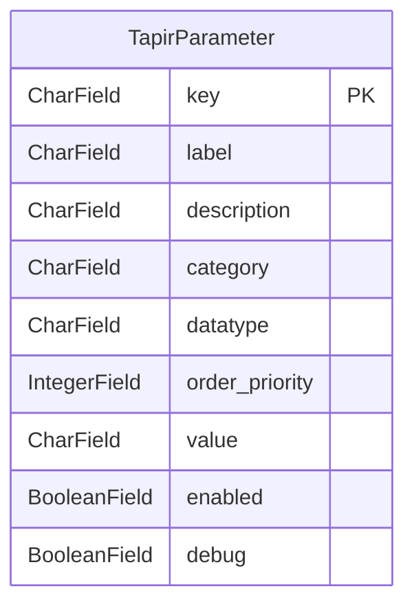

<!-- Generiert mit `python manage.py generate_datamodel_docs`. Nicht von Hand bearbeiten, Beschreibungen stehen in tapir/core/services/data_model_docs_descriptions.py -->
# Datenmodell: Konfiguration (`tapir.configuration`)

← [Datenmodell-Übersicht](Development-Datenmodell)

> **Abstract:** Alle Einstellungen einer Instanz als typisierte Schlüssel/Wert-Paare. Definiert werden sie im Code (`parameter_definitions`), gepflegt über die Konfigurationsseite.

1 Modelle.

## Beziehungen

## Modelle

### TapirParameter

**tapir parameter**

- Tabelle: `configuration_tapirparameter`

| Feld | Typ | Schlüssel | Pflicht | Default | Beschreibung | Beziehung |
|---|---|---|---|---|---|---|
| `key` | CharField(256) | PK | ja |  |  |  |
| `label` | CharField(256) |  | ja |  |  |  |
| `description` | CharField(512) |  | ja |  |  |  |
| `category` | CharField(256) |  | ja |  |  |  |
| `datatype` | CharField(8) |  | ja |  |  |  |
| `order_priority` | IntegerField |  | ja | `-1` |  |  |
| `value` | CharField(4096) |  | nein |  |  |  |
| `enabled` | BooleanField |  | ja | `True` |  |  |
| `debug` | BooleanField |  | ja | `False` |  |  |
