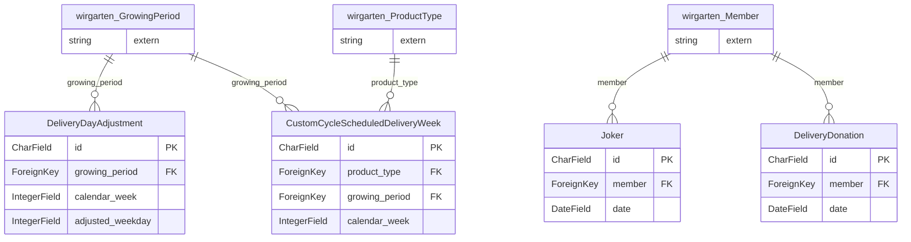

> ⚠️ **Nicht maßgeblich.** Dieses Wiki gehört zu einem abgeschlossenen Proof of Concept für den
> Eigenbetrieb von Tapir und wird nicht gepflegt. Maßgeblich ist die Dokumentation im
> Hauptprojekt: [FoodCoopX/wirgarten-tapir – docs](https://github.com/FoodCoopX/wirgarten-tapir/tree/master/docs),
> Aufbau in Issue [#1300](https://github.com/FoodCoopX/wirgarten-tapir/issues/1300).

<!-- Generiert mit `python manage.py generate_datamodel_docs`. Nicht von Hand bearbeiten, Beschreibungen stehen in tapir/core/services/data_model_docs_descriptions.py -->
# Datenmodell: Lieferungen (`tapir.deliveries`)

← [Datenmodell-Übersicht](Development-Datenmodell)

> **Abstract:** Ausnahmen vom regulären Lieferrhythmus: Joker (Lieferpause eines Mitglieds), gespendete Lieferungen, verschobene Liefertage und eigene Lieferzyklen.

4 Modelle, 4 Protokolleinträge.

## Beziehungen

## Modelle

### CustomCycleScheduledDeliveryWeek

**custom cycle scheduled delivery week**

- Tabelle: `deliveries_customcyclescheduleddeliveryweek`
- Basis: `TapirModel` (nanoid-ID, `created_at`, `updated_at`)

| Feld | Typ | Schlüssel | Pflicht | Default | Beschreibung | Beziehung |
|---|---|---|---|---|---|---|
| `id` | CharField(10) | PK | ja | `generate_id()` | ID |  |
| `created_at` | DateTimeField |  | nein | jetzt (beim Anlegen) |  |  |
| `updated_at` | DateTimeField |  | nein | jetzt (bei jedem Speichern) |  |  |
| `product_type` | ForeignKey | FK | ja |  |  | n:1 → [wirgarten.ProductType](Development-Datenmodell-Kern#producttype) (CASCADE) |
| `growing_period` | ForeignKey | FK | ja |  |  | n:1 → [wirgarten.GrowingPeriod](Development-Datenmodell-Kern#growingperiod) (CASCADE) |
| `calendar_week` | IntegerField |  | ja |  |  |  |

### DeliveryDayAdjustment

**delivery day adjustment**

- Tabelle: `deliveries_deliverydayadjustment`
- Basis: `TapirModel` (nanoid-ID, `created_at`, `updated_at`)
- Constraint `no_duplicate_week_by_growing_period`: eindeutig `growing_period, calendar_week`

| Feld | Typ | Schlüssel | Pflicht | Default | Beschreibung | Beziehung |
|---|---|---|---|---|---|---|
| `id` | CharField(10) | PK | ja | `generate_id()` | ID |  |
| `created_at` | DateTimeField |  | nein | jetzt (beim Anlegen) |  |  |
| `updated_at` | DateTimeField |  | nein | jetzt (bei jedem Speichern) |  |  |
| `growing_period` | ForeignKey | FK | ja |  |  | n:1 → [wirgarten.GrowingPeriod](Development-Datenmodell-Kern#growingperiod) (CASCADE) |
| `calendar_week` | IntegerField |  | ja |  |  |  |
| `adjusted_weekday` | IntegerField |  | ja |  |  |  |

### DeliveryDonation

**delivery donation**

- Tabelle: `deliveries_deliverydonation`
- Basis: `TapirModel` (nanoid-ID, `created_at`, `updated_at`)
- Index `deliveries__date_55f39c_idx`: `date`

| Feld | Typ | Schlüssel | Pflicht | Default | Beschreibung | Beziehung |
|---|---|---|---|---|---|---|
| `id` | CharField(10) | PK | ja | `generate_id()` | ID |  |
| `created_at` | DateTimeField |  | nein | jetzt (beim Anlegen) |  |  |
| `updated_at` | DateTimeField |  | nein | jetzt (bei jedem Speichern) |  |  |
| `member` | ForeignKey | FK | ja |  |  | n:1 → [wirgarten.Member](Development-Datenmodell-Kern#member) (CASCADE) |
| `date` | DateField |  | ja |  |  |  |

### Joker

- Tabelle: `deliveries_joker`
- Basis: `TapirModel` (nanoid-ID, `created_at`, `updated_at`)
- Index `deliveries__date_43072a_idx`: `date`

| Feld | Typ | Schlüssel | Pflicht | Default | Beschreibung | Beziehung |
|---|---|---|---|---|---|---|
| `id` | CharField(10) | PK | ja | `generate_id()` | ID |  |
| `created_at` | DateTimeField |  | nein | jetzt (beim Anlegen) |  |  |
| `updated_at` | DateTimeField |  | nein | jetzt (bei jedem Speichern) |  |  |
| `member` | ForeignKey | FK | ja |  |  | n:1 → [wirgarten.Member](Development-Datenmodell-Kern#member) (CASCADE) |
| `date` | DateField |  | ja |  |  |  |

Verweise von anderen Modellen: [payments.MemberCredit](Development-Datenmodell-Zahlungen#membercredit).`joker`

## Protokolleinträge

Alle erben von [log.LogEntry](Development-Datenmodell-Protokoll#logentry) und speichern nur ihre zusätzlichen Felder in einer eigenen Tabelle.

### DeliveryDonationCancelledLogEntry

**delivery donation cancelled log entry**

- Tabelle: `deliveries_deliverydonationcancelledlogentry`
- Erbt von `log.LogEntry` (Multi-Table-Inheritance, eigene Tabelle mit 1:1-Verweis)

| Feld | Typ | Schlüssel | Pflicht | Default | Beschreibung | Beziehung |
|---|---|---|---|---|---|---|
| `date` | DateField |  | ja |  |  |  |

### DeliveryDonationUsedLogEntry

**delivery donation used log entry**

- Tabelle: `deliveries_deliverydonationusedlogentry`
- Erbt von `log.LogEntry` (Multi-Table-Inheritance, eigene Tabelle mit 1:1-Verweis)

| Feld | Typ | Schlüssel | Pflicht | Default | Beschreibung | Beziehung |
|---|---|---|---|---|---|---|
| `delivery_donation` | ForeignKey | FK | nein |  |  | n:1 → [deliveries.DeliveryDonation](Development-Datenmodell-Lieferungen#deliverydonation) (SET_NULL) |
| `date` | DateField |  | ja |  |  |  |

### JokerCancelledLogEntry

**joker cancelled log entry**

- Tabelle: `deliveries_jokercancelledlogentry`
- Erbt von `log.LogEntry` (Multi-Table-Inheritance, eigene Tabelle mit 1:1-Verweis)

| Feld | Typ | Schlüssel | Pflicht | Default | Beschreibung | Beziehung |
|---|---|---|---|---|---|---|
| `date` | DateField |  | ja |  |  |  |

### JokerUsedLogEntry

**joker used log entry**

- Tabelle: `deliveries_jokerusedlogentry`
- Erbt von `log.LogEntry` (Multi-Table-Inheritance, eigene Tabelle mit 1:1-Verweis)

| Feld | Typ | Schlüssel | Pflicht | Default | Beschreibung | Beziehung |
|---|---|---|---|---|---|---|
| `joker` | ForeignKey | FK | nein |  |  | n:1 → [deliveries.Joker](Development-Datenmodell-Lieferungen#joker) (SET_NULL) |
| `date` | DateField |  | ja |  |  |  |
