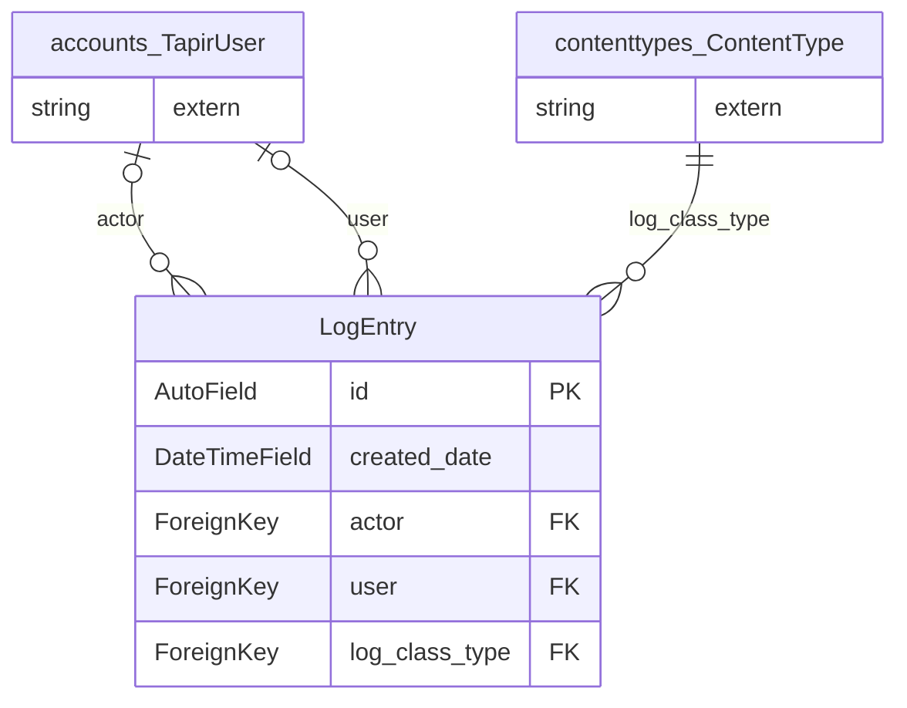

> ⚠️ **Nicht maßgeblich.** Dieses Wiki gehört zu einem abgeschlossenen Proof of Concept für den
> Eigenbetrieb von Tapir und wird nicht gepflegt. Maßgeblich ist die Dokumentation im
> Hauptprojekt: [FoodCoopX/wirgarten-tapir – docs](https://github.com/FoodCoopX/wirgarten-tapir/tree/master/docs),
> Aufbau in Issue [#1300](https://github.com/FoodCoopX/wirgarten-tapir/issues/1300).

<!-- Generiert mit `python manage.py generate_datamodel_docs`. Nicht von Hand bearbeiten, Beschreibungen stehen in tapir/core/services/data_model_docs_descriptions.py -->
# Datenmodell: Protokoll (`tapir.log`)

← [Datenmodell-Übersicht](Development-Datenmodell)

> **Abstract:** Basis aller Protokolleinträge: wer hat wann was für welches Mitglied geändert. Die Apps leiten davon eigene Eintragstypen ab.

1 Modelle, 2 Protokolleinträge.

## Beziehungen

## Modelle

### LogEntry

**log entry**

- Tabelle: `log_logentry`

| Feld | Typ | Schlüssel | Pflicht | Default | Beschreibung | Beziehung |
|---|---|---|---|---|---|---|
| `id` | AutoField | PK | nein |  | ID |  |
| `created_date` | DateTimeField |  | nein | jetzt (beim Anlegen) | Creation Date |  |
| `actor` | ForeignKey | FK | nein |  |  | n:1 → [accounts.TapirUser](Development-Datenmodell-Benutzerkonten#tapiruser) (CASCADE, rückwärts `+`) |
| `user` | ForeignKey | FK | nein |  |  | n:1 → [accounts.TapirUser](Development-Datenmodell-Benutzerkonten#tapiruser) (PROTECT, rückwärts `log_entries`) |
| `log_class_type` | ForeignKey | FK | ja |  |  | n:1 → `contenttypes.ContentType` (PROTECT, rückwärts `+`) |

## Protokolleinträge

Alle erben von [log.LogEntry](Development-Datenmodell-Protokoll#logentry) und speichern nur ihre zusätzlichen Felder in einer eigenen Tabelle.

### EmailLogEntry

**email log entry**

EmailLogEntry logs a sent email message.

- Tabelle: `log_emaillogentry`
- Erbt von `log.LogEntry` (Multi-Table-Inheritance, eigene Tabelle mit 1:1-Verweis)

| Feld | Typ | Schlüssel | Pflicht | Default | Beschreibung | Beziehung |
|---|---|---|---|---|---|---|
| `subject` | CharField(128) |  | ja |  |  |  |
| `email_content` | BinaryField |  | ja |  |  |  |

### TextLogEntry

**text log entry**

TextLogEntry logs a manual textual notes. This entry type should only be used for manual, user-entered text. For log entries created as a side-effect of another action, please create an event-specific LogEntry.

- Tabelle: `log_textlogentry`
- Erbt von `log.LogEntry` (Multi-Table-Inheritance, eigene Tabelle mit 1:1-Verweis)

| Feld | Typ | Schlüssel | Pflicht | Default | Beschreibung | Beziehung |
|---|---|---|---|---|---|---|
| `text` | TextField |  | ja |  |  |  |
