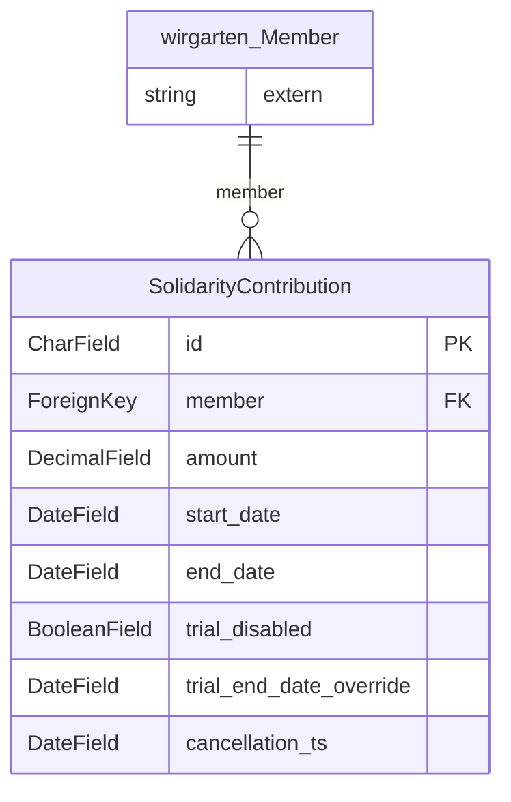

> ⚠️ **Nicht maßgeblich.** Dieses Wiki gehört zu einem abgeschlossenen Proof of Concept für den
> Eigenbetrieb von Tapir und wird nicht gepflegt. Maßgeblich ist die Dokumentation im
> Hauptprojekt: [FoodCoopX/wirgarten-tapir – docs](https://github.com/FoodCoopX/wirgarten-tapir/tree/master/docs),
> Aufbau in Issue [#1300](https://github.com/FoodCoopX/wirgarten-tapir/issues/1300).

<!-- Generiert mit `python manage.py generate_datamodel_docs`. Nicht von Hand bearbeiten, Beschreibungen stehen in tapir/core/services/data_model_docs_descriptions.py -->
# Datenmodell: Solidarbeitrag (`tapir.solidarity_contribution`)

← [Datenmodell-Übersicht](Development-Datenmodell)

> **Abstract:** Freiwillige Solidarbeiträge der Mitglieder mit Gültigkeitszeitraum, die auf den Anteilspreis aufgeschlagen oder abgezogen werden.

1 Modelle, 1 Protokolleinträge.

## Beziehungen

## Modelle

### SolidarityContribution

**solidarity contribution**

- Tabelle: `solidarity_contribution_solidaritycontribution`
- Basis: `TapirModel` (nanoid-ID, `created_at`, `updated_at`)

| Feld | Typ | Schlüssel | Pflicht | Default | Beschreibung | Beziehung |
|---|---|---|---|---|---|---|
| `id` | CharField(10) | PK | ja | `generate_id()` | ID |  |
| `created_at` | DateTimeField |  | nein | jetzt (beim Anlegen) |  |  |
| `updated_at` | DateTimeField |  | nein | jetzt (bei jedem Speichern) |  |  |
| `member` | ForeignKey | FK | ja |  |  | n:1 → [wirgarten.Member](Development-Datenmodell-Kern#member) (CASCADE) |
| `amount` | DecimalField(12,2) |  | ja |  |  |  |
| `start_date` | DateField |  | ja |  |  |  |
| `end_date` | DateField |  | ja |  |  |  |
| `trial_disabled` | BooleanField |  | ja | `False` |  |  |
| `trial_end_date_override` | DateField |  | nein |  |  |  |
| `cancellation_ts` | DateField |  | nein |  |  |  |

## Protokolleinträge

Alle erben von [log.LogEntry](Development-Datenmodell-Protokoll#logentry) und speichern nur ihre zusätzlichen Felder in einer eigenen Tabelle.

### SolidarityContributionChangedLogEntry

**solidarity contribution changed log entry**

- Tabelle: `solidarity_contribution_solidaritycontributionchangedlogentry`
- Erbt von `log.LogEntry` (Multi-Table-Inheritance, eigene Tabelle mit 1:1-Verweis)

| Feld | Typ | Schlüssel | Pflicht | Default | Beschreibung | Beziehung |
|---|---|---|---|---|---|---|
| `old_contribution_amount` | DecimalField(12,2) |  | ja |  |  |  |
| `old_contribution_end_date` | DateField |  | nein |  |  |  |
| `new_contribution_amount` | DecimalField(12,2) |  | ja |  |  |  |
| `new_contribution_start_date` | DateField |  | nein |  |  |  |
| `old_contribution` | ForeignKey | FK | nein |  |  | n:1 → [solidarity_contribution.SolidarityContribution](Development-Datenmodell-Solidarbeitrag#solidaritycontribution) (SET_NULL, rückwärts `changed_logs_old_contribution`) |
| `new_contribution` | ForeignKey | FK | nein |  |  | n:1 → [solidarity_contribution.SolidarityContribution](Development-Datenmodell-Solidarbeitrag#solidaritycontribution) (SET_NULL, rückwärts `changed_logs_new_contribution`) |
