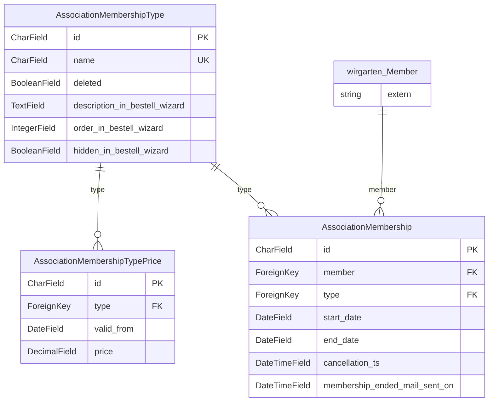

<!-- Generiert mit `python manage.py generate_datamodel_docs`. Nicht von Hand bearbeiten, Beschreibungen stehen in tapir/core/services/data_model_docs_descriptions.py -->
# Datenmodell: Vereinsmitgliedschaften (`tapir.associations`)

← [Datenmodell-Übersicht](Development-Datenmodell)

> **Abstract:** Zusätzliche Mitgliedschaften (z. B. in einem Förderverein) mit eigenen Typen und Preisen je Zeitraum.

3 Modelle, 3 Protokolleinträge.

## Beziehungen

## Modelle

### AssociationMembership

**association membership**

- Tabelle: `associations_associationmembership`
- Basis: `TapirModel` (nanoid-ID, `created_at`, `updated_at`)

| Feld | Typ | Schlüssel | Pflicht | Default | Beschreibung | Beziehung |
|---|---|---|---|---|---|---|
| `id` | CharField(10) | PK | ja | `generate_id()` | ID |  |
| `created_at` | DateTimeField |  | nein | jetzt (beim Anlegen) |  |  |
| `updated_at` | DateTimeField |  | nein | jetzt (bei jedem Speichern) |  |  |
| `member` | ForeignKey | FK | ja |  |  | n:1 → [wirgarten.Member](Development-Datenmodell-Kern#member) (CASCADE) |
| `type` | ForeignKey | FK | ja |  |  | n:1 → [associations.AssociationMembershipType](Development-Datenmodell-Vereinsmitgliedschaften#associationmembershiptype) (PROTECT) |
| `start_date` | DateField |  | ja |  |  |  |
| `end_date` | DateField |  | nein |  |  |  |
| `cancellation_ts` | DateTimeField |  | nein |  |  |  |
| `membership_ended_mail_sent_on` | DateTimeField |  | nein | `None` |  |  |

### AssociationMembershipType

**association membership type**

- Tabelle: `associations_associationmembershiptype`
- Basis: `TapirModel` (nanoid-ID, `created_at`, `updated_at`)

| Feld | Typ | Schlüssel | Pflicht | Default | Beschreibung | Beziehung |
|---|---|---|---|---|---|---|
| `id` | CharField(10) | PK | ja | `generate_id()` | ID |  |
| `created_at` | DateTimeField |  | nein | jetzt (beim Anlegen) |  |  |
| `updated_at` | DateTimeField |  | nein | jetzt (bei jedem Speichern) |  |  |
| `name` | CharField(100) | UK | ja |  |  |  |
| `deleted` | BooleanField |  | ja | `False` |  |  |
| `description_in_bestell_wizard` | TextField |  | ja |  |  |  |
| `order_in_bestell_wizard` | IntegerField |  | ja |  |  |  |
| `hidden_in_bestell_wizard` | BooleanField |  | ja | `False` |  |  |

Verweise von anderen Modellen: [associations.AssociationMembershipTypePrice](Development-Datenmodell-Vereinsmitgliedschaften#associationmembershiptypeprice).`type`, [associations.AssociationMembership](Development-Datenmodell-Vereinsmitgliedschaften#associationmembership).`type`

### AssociationMembershipTypePrice

**association membership type price**

- Tabelle: `associations_associationmembershiptypeprice`
- Basis: `TapirModel` (nanoid-ID, `created_at`, `updated_at`)
- Constraint `unique_date`: eindeutig `type, valid_from`

| Feld | Typ | Schlüssel | Pflicht | Default | Beschreibung | Beziehung |
|---|---|---|---|---|---|---|
| `id` | CharField(10) | PK | ja | `generate_id()` | ID |  |
| `created_at` | DateTimeField |  | nein | jetzt (beim Anlegen) |  |  |
| `updated_at` | DateTimeField |  | nein | jetzt (bei jedem Speichern) |  |  |
| `type` | ForeignKey | FK | ja |  |  | n:1 → [associations.AssociationMembershipType](Development-Datenmodell-Vereinsmitgliedschaften#associationmembershiptype) (CASCADE) |
| `valid_from` | DateField |  | ja |  |  |  |
| `price` | DecimalField(8,2) |  | ja |  |  |  |

## Protokolleinträge

Alle erben von [log.LogEntry](Development-Datenmodell-Protokoll#logentry) und speichern nur ihre zusätzlichen Felder in einer eigenen Tabelle.

### AssociationMembershipCreatedLogEntry

**association membership created log entry**

- Tabelle: `associations_associationmembershipcreatedlogentry`
- Erbt von `log.LogEntry` (Multi-Table-Inheritance, eigene Tabelle mit 1:1-Verweis)

| Feld | Typ | Schlüssel | Pflicht | Default | Beschreibung | Beziehung |
|---|---|---|---|---|---|---|
| `values` | HStoreField |  | ja |  |  |  |
| `type_name` | CharField(100) |  | ja |  |  |  |

### AssociationMembershipDeletedLogEntry

**association membership deleted log entry**

- Tabelle: `associations_associationmembershipdeletedlogentry`
- Erbt von `log.LogEntry` (Multi-Table-Inheritance, eigene Tabelle mit 1:1-Verweis)

| Feld | Typ | Schlüssel | Pflicht | Default | Beschreibung | Beziehung |
|---|---|---|---|---|---|---|
| `type_name` | CharField(100) |  | ja |  |  |  |
| `start_date` | DateField |  | ja |  |  |  |
| `end_date` | DateField |  | nein |  |  |  |

### AssociationMembershipUpdatedLogEntry

**association membership updated log entry**

- Tabelle: `associations_associationmembershipupdatedlogentry`
- Erbt von `log.LogEntry` (Multi-Table-Inheritance, eigene Tabelle mit 1:1-Verweis)

| Feld | Typ | Schlüssel | Pflicht | Default | Beschreibung | Beziehung |
|---|---|---|---|---|---|---|
| `old_values` | HStoreField |  | ja |  |  |  |
| `new_values` | HStoreField |  | ja |  |  |  |
