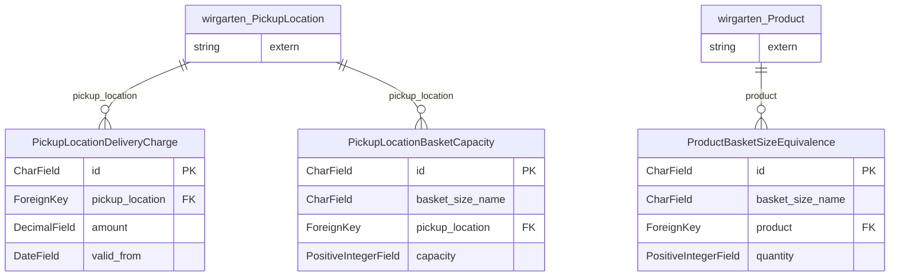

<!-- Generiert mit `python manage.py generate_datamodel_docs`. Nicht von Hand bearbeiten, Beschreibungen stehen in tapir/core/services/data_model_docs_descriptions.py -->
# Datenmodell: Verteilstationen (`tapir.pickup_locations`)

← [Datenmodell-Übersicht](Development-Datenmodell)

> **Abstract:** Ergänzungen zu den Verteilstationen aus dem Kern: Kapazitäten in Kistengrößen, Äquivalenzen zwischen Produktgrößen und Kistengröße sowie Liefergebühren.

3 Modelle, 1 Protokolleinträge.

## Beziehungen

## Modelle

### PickupLocationBasketCapacity

**pickup location basket capacity**

- Tabelle: `pickup_locations_pickuplocationbasketcapacity`
- Basis: `TapirModel` (nanoid-ID, `created_at`, `updated_at`)

| Feld | Typ | Schlüssel | Pflicht | Default | Beschreibung | Beziehung |
|---|---|---|---|---|---|---|
| `id` | CharField(10) | PK | ja | `generate_id()` | ID |  |
| `created_at` | DateTimeField |  | nein | jetzt (beim Anlegen) |  |  |
| `updated_at` | DateTimeField |  | nein | jetzt (bei jedem Speichern) |  |  |
| `basket_size_name` | CharField(128) |  | ja |  |  |  |
| `pickup_location` | ForeignKey | FK | ja |  |  | n:1 → [wirgarten.PickupLocation](Development-Datenmodell-Kern#pickuplocation) (CASCADE) |
| `capacity` | PositiveIntegerField |  | nein |  |  |  |

### PickupLocationDeliveryCharge

**pickup location delivery charge**

Time-dependent extra charge that applies once per delivery for members assigned to this pickup location.

- Tabelle: `pickup_locations_pickuplocationdeliverycharge`
- Basis: `TapirModel` (nanoid-ID, `created_at`, `updated_at`)
- Constraint `unique_pickup_location_delivery_charge_date`: eindeutig `pickup_location, valid_from`

| Feld | Typ | Schlüssel | Pflicht | Default | Beschreibung | Beziehung |
|---|---|---|---|---|---|---|
| `id` | CharField(10) | PK | ja | `generate_id()` | ID |  |
| `created_at` | DateTimeField |  | nein | jetzt (beim Anlegen) |  |  |
| `updated_at` | DateTimeField |  | nein | jetzt (bei jedem Speichern) |  |  |
| `pickup_location` | ForeignKey | FK | ja |  |  | n:1 → [wirgarten.PickupLocation](Development-Datenmodell-Kern#pickuplocation) (CASCADE) |
| `amount` | DecimalField(8,2) |  | ja |  |  |  |
| `valid_from` | DateField |  | ja |  |  |  |

### ProductBasketSizeEquivalence

**product basket size equivalence**

- Tabelle: `pickup_locations_productbasketsizeequivalence`
- Basis: `TapirModel` (nanoid-ID, `created_at`, `updated_at`)

| Feld | Typ | Schlüssel | Pflicht | Default | Beschreibung | Beziehung |
|---|---|---|---|---|---|---|
| `id` | CharField(10) | PK | ja | `generate_id()` | ID |  |
| `created_at` | DateTimeField |  | nein | jetzt (beim Anlegen) |  |  |
| `updated_at` | DateTimeField |  | nein | jetzt (bei jedem Speichern) |  |  |
| `basket_size_name` | CharField(128) |  | ja |  |  |  |
| `product` | ForeignKey | FK | ja |  |  | n:1 → [wirgarten.Product](Development-Datenmodell-Kern#product) (CASCADE) |
| `quantity` | PositiveIntegerField |  | ja |  |  |  |

## Protokolleinträge

Alle erben von [log.LogEntry](Development-Datenmodell-Protokoll#logentry) und speichern nur ihre zusätzlichen Felder in einer eigenen Tabelle.

### PickupLocationChangedLogEntry

**pickup location changed log entry**

This log entry is created whenever a member changes their pickup location

- Tabelle: `pickup_locations_pickuplocationchangedlogentry`
- Erbt von `log.LogEntry` (Multi-Table-Inheritance, eigene Tabelle mit 1:1-Verweis)

| Feld | Typ | Schlüssel | Pflicht | Default | Beschreibung | Beziehung |
|---|---|---|---|---|---|---|
| `new_pickup_location_name` | CharField(150) |  | ja |  |  |  |
| `old_pickup_location_name` | CharField(150) |  | ja |  |  |  |
| `valid_from` | DateField |  | ja |  |  |  |
