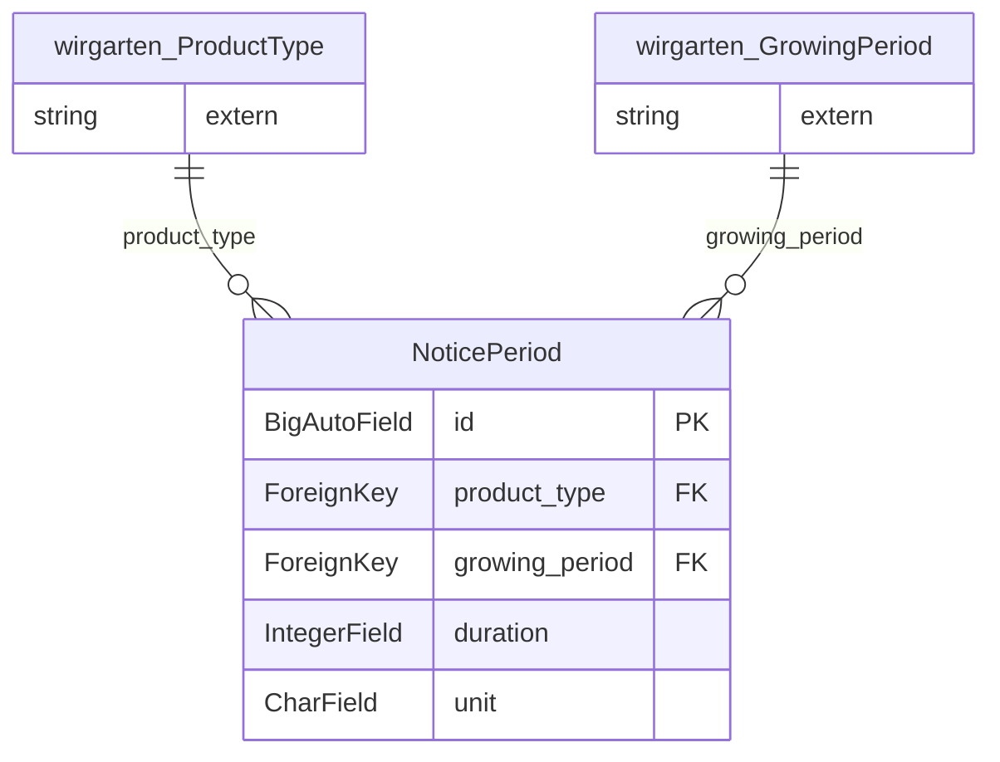

<!-- Generiert mit `python manage.py generate_datamodel_docs`. Nicht von Hand bearbeiten, Beschreibungen stehen in tapir/core/services/data_model_docs_descriptions.py -->
# Datenmodell: Verträge (`tapir.subscriptions`)

← [Datenmodell-Übersicht](Development-Datenmodell)

> **Abstract:** Ergänzungen zu den Verträgen aus dem Kern: Kündigungsfristen je Produktart und Anbauperiode sowie die Protokolleinträge für Vertragsänderungen und Widerrufe.

1 Modelle, 3 Protokolleinträge.

## Beziehungen

## Modelle

### NoticePeriod

**notice period**

- Tabelle: `subscriptions_noticeperiod`

| Feld | Typ | Schlüssel | Pflicht | Default | Beschreibung | Beziehung |
|---|---|---|---|---|---|---|
| `id` | BigAutoField | PK | nein |  | ID |  |
| `product_type` | ForeignKey | FK | ja |  |  | n:1 → [wirgarten.ProductType](Development-Datenmodell-Kern#producttype) (CASCADE) |
| `growing_period` | ForeignKey | FK | ja |  |  | n:1 → [wirgarten.GrowingPeriod](Development-Datenmodell-Kern#growingperiod) (CASCADE) |
| `duration` | IntegerField |  | ja |  |  |  |
| `unit` | CharField(20) |  | ja |  |  Werte: `months` = Monate, `weeks` = Wochen |  |

## Protokolleinträge

Alle erben von [log.LogEntry](Development-Datenmodell-Protokoll#logentry) und speichern nur ihre zusätzlichen Felder in einer eigenen Tabelle.

### SubscriptionChangedLogEntry

**subscription changed log entry**

- Tabelle: `subscriptions_subscriptionchangedlogentry`
- Erbt von `log.LogEntry` (Multi-Table-Inheritance, eigene Tabelle mit 1:1-Verweis)

| Feld | Typ | Schlüssel | Pflicht | Default | Beschreibung | Beziehung |
|---|---|---|---|---|---|---|
| `old_values` | HStoreField |  | ja |  |  |  |
| `new_values` | HStoreField |  | ja |  |  |  |

### SubscriptionPriceChangedLogEntry

**subscription price changed log entry**

- Tabelle: `subscriptions_subscriptionpricechangedlogentry`
- Erbt von `log.LogEntry` (Multi-Table-Inheritance, eigene Tabelle mit 1:1-Verweis)

| Feld | Typ | Schlüssel | Pflicht | Default | Beschreibung | Beziehung |
|---|---|---|---|---|---|---|
| `old_values` | HStoreField |  | ja |  |  |  |
| `new_values` | HStoreField |  | ja |  |  |  |
| `subscription` | ForeignKey | FK | nein |  |  | n:1 → [wirgarten.Subscription](Development-Datenmodell-Kern#subscription) (SET_NULL) |
| `subscription_formatted` | CharField(200) |  | ja |  |  |  |
| `price_before` | DecimalField(8,2) |  | nein |  |  |  |
| `price_after` | DecimalField(8,2) |  | nein |  |  |  |

### SubscriptionsRevokedLogEntry

**subscriptions revoked log entry**

- Tabelle: `subscriptions_subscriptionsrevokedlogentry`
- Erbt von `log.LogEntry` (Multi-Table-Inheritance, eigene Tabelle mit 1:1-Verweis)

| Feld | Typ | Schlüssel | Pflicht | Default | Beschreibung | Beziehung |
|---|---|---|---|---|---|---|
| `subscriptions` | CharField(10000) |  | ja |  |  |  |
