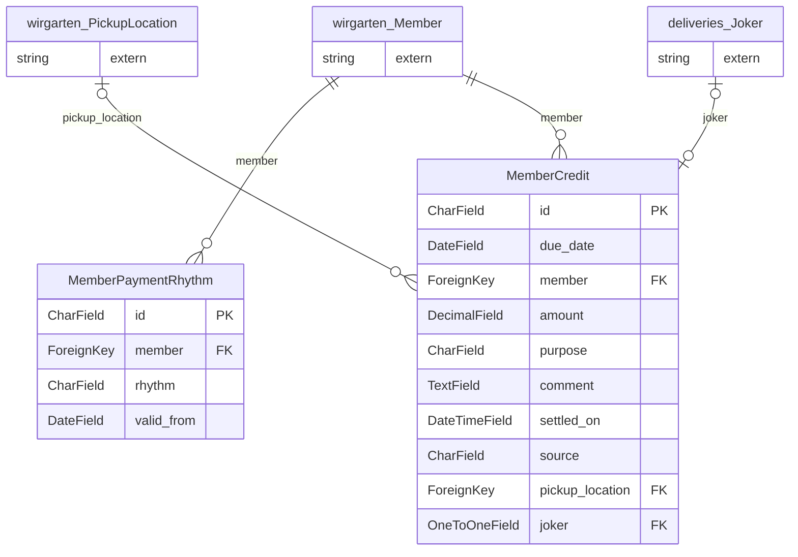

> ⚠️ **Nicht maßgeblich.** Dieses Wiki gehört zu einem abgeschlossenen Proof of Concept für den
> Eigenbetrieb von Tapir und wird nicht gepflegt. Maßgeblich ist die Dokumentation im
> Hauptprojekt: [FoodCoopX/wirgarten-tapir – docs](https://github.com/FoodCoopX/wirgarten-tapir/tree/master/docs),
> Aufbau in Issue [#1300](https://github.com/FoodCoopX/wirgarten-tapir/issues/1300).

<!-- Generiert mit `python manage.py generate_datamodel_docs`. Nicht von Hand bearbeiten, Beschreibungen stehen in tapir/core/services/data_model_docs_descriptions.py -->
# Datenmodell: Zahlungen (`tapir.payments`)

← [Datenmodell-Übersicht](Development-Datenmodell)

> **Abstract:** Zahlungsrhythmus je Mitglied und Gutschriften. Die eigentlichen Zahlungen und SEPA-Mandate liegen in `wirgarten.Payment` und `wirgarten.MandateReference`.

2 Modelle, 3 Protokolleinträge.

## Beziehungen

## Modelle

### MemberCredit

**member credit**

- Tabelle: `payments_membercredit`
- Basis: `TapirModel` (nanoid-ID, `created_at`, `updated_at`)

| Feld | Typ | Schlüssel | Pflicht | Default | Beschreibung | Beziehung |
|---|---|---|---|---|---|---|
| `id` | CharField(10) | PK | ja | `generate_id()` | ID |  |
| `created_at` | DateTimeField |  | nein | jetzt (beim Anlegen) |  |  |
| `updated_at` | DateTimeField |  | nein | jetzt (bei jedem Speichern) |  |  |
| `due_date` | DateField |  | ja |  |  |  |
| `member` | ForeignKey | FK | ja |  |  | n:1 → [wirgarten.Member](Development-Datenmodell-Kern#member) (CASCADE) |
| `amount` | DecimalField(8,2) |  | ja |  |  |  |
| `purpose` | CharField(1024) |  | ja |  |  |  |
| `comment` | TextField |  | ja |  |  |  |
| `settled_on` | DateTimeField |  | nein | `None` |  |  |
| `source` | CharField(1024) |  | ja |  |  |  |
| `pickup_location` | ForeignKey | FK | nein |  |  | n:1 → [wirgarten.PickupLocation](Development-Datenmodell-Kern#pickuplocation) (PROTECT) |
| `joker` | OneToOneField | FK | nein |  |  | 1:1 → [deliveries.Joker](Development-Datenmodell-Lieferungen#joker) (PROTECT) |

### MemberPaymentRhythm

**member payment rhythm**

- Tabelle: `payments_memberpaymentrhythm`
- Basis: `TapirModel` (nanoid-ID, `created_at`, `updated_at`)

| Feld | Typ | Schlüssel | Pflicht | Default | Beschreibung | Beziehung |
|---|---|---|---|---|---|---|
| `id` | CharField(10) | PK | ja | `generate_id()` | ID |  |
| `created_at` | DateTimeField |  | nein | jetzt (beim Anlegen) |  |  |
| `updated_at` | DateTimeField |  | nein | jetzt (bei jedem Speichern) |  |  |
| `member` | ForeignKey | FK | ja |  |  | n:1 → [wirgarten.Member](Development-Datenmodell-Kern#member) (CASCADE) |
| `rhythm` | CharField(20) |  | ja |  |  Werte: `monthly` = Monatlich, `quarterly` = Vierteljährlich, `semiannually` = Halbjährlich, `yearly` = Jährlich |  |
| `valid_from` | DateField |  | ja |  |  |  |

## Protokolleinträge

Alle erben von [log.LogEntry](Development-Datenmodell-Protokoll#logentry) und speichern nur ihre zusätzlichen Felder in einer eigenen Tabelle.

### MemberCreditCreatedLogEntry

**member credit created log entry**

- Tabelle: `payments_membercreditcreatedlogentry`
- Erbt von `log.LogEntry` (Multi-Table-Inheritance, eigene Tabelle mit 1:1-Verweis)

| Feld | Typ | Schlüssel | Pflicht | Default | Beschreibung | Beziehung |
|---|---|---|---|---|---|---|
| `values` | HStoreField |  | ja |  |  |  |

### MemberCreditSettledLogEntry

**member credit settled log entry**

- Tabelle: `payments_membercreditsettledlogentry`
- Erbt von `log.LogEntry` (Multi-Table-Inheritance, eigene Tabelle mit 1:1-Verweis)

| Feld | Typ | Schlüssel | Pflicht | Default | Beschreibung | Beziehung |
|---|---|---|---|---|---|---|
| `values` | HStoreField |  | ja |  |  |  |

### MemberPaymentRhythmChangeLogEntry

**member payment rhythm change log entry**

- Tabelle: `payments_memberpaymentrhythmchangelogentry`
- Erbt von `log.LogEntry` (Multi-Table-Inheritance, eigene Tabelle mit 1:1-Verweis)

| Feld | Typ | Schlüssel | Pflicht | Default | Beschreibung | Beziehung |
|---|---|---|---|---|---|---|
| `old_rhythm` | CharField |  | ja |  |  |  |
| `new_rhythm` | CharField |  | ja |  |  |  |
| `valid_from` | DateField |  | ja |  |  |  |
