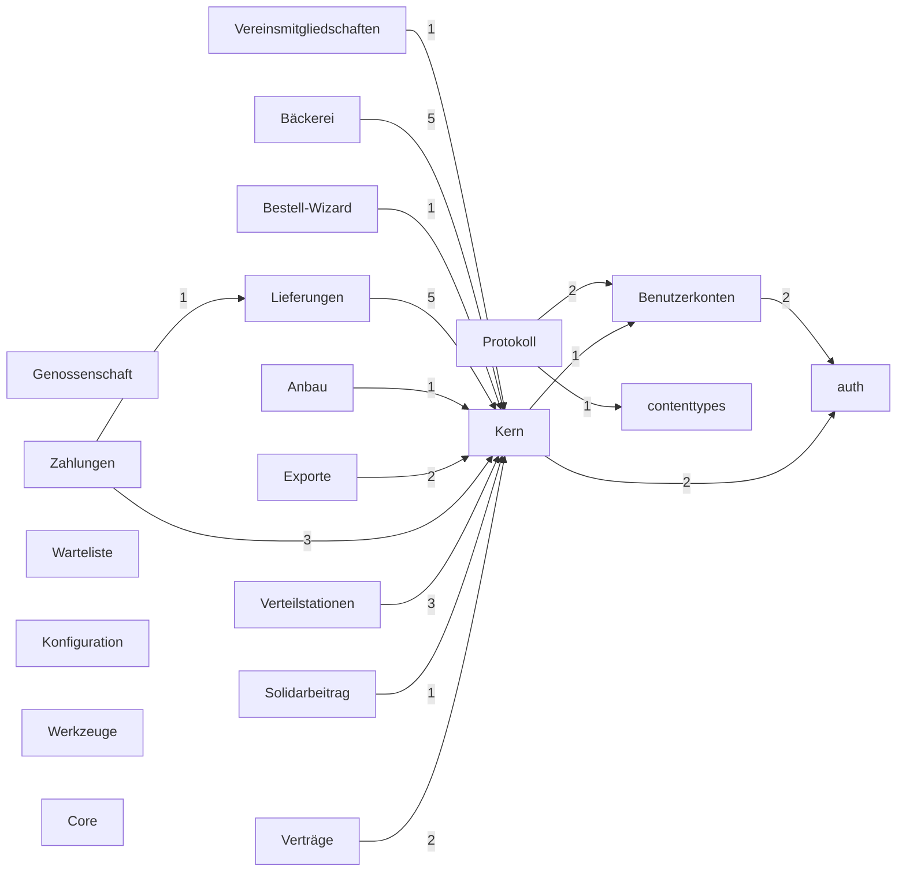

> ⚠️ **Nicht maßgeblich.** Dieses Wiki gehört zu einem abgeschlossenen Proof of Concept für den
> Eigenbetrieb von Tapir und wird nicht gepflegt. Maßgeblich ist die Dokumentation im
> Hauptprojekt: [FoodCoopX/wirgarten-tapir – docs](https://github.com/FoodCoopX/wirgarten-tapir/tree/master/docs),
> Aufbau in Issue [#1300](https://github.com/FoodCoopX/wirgarten-tapir/issues/1300).

<!-- Generiert mit `python manage.py generate_datamodel_docs`. Nicht von Hand bearbeiten, Beschreibungen stehen in tapir/core/services/data_model_docs_descriptions.py -->
# Datenmodell

> **Abstract:** Tapir speichert alles in einer PostgreSQL-Datenbank, verteilt auf 18 Django-Apps mit 70 Modellen und 32 Protokolleintrags-Typen. Im Zentrum stehen das Mitglied (`wirgarten.Member`, erbt von `accounts.TapirUser`), seine Verträge (`wirgarten.Subscription`) und Genossenschaftsanteile, die Produkte mit Preisen und Kapazitäten sowie die Verteilstationen. Neuere Apps hängen sich per Fremdschlüssel an diesen Kern an. Diese Seiten werden aus dem Code erzeugt und sind damit immer vollständig.

## Konventionen

- Neue Modelle erben von `tapir.core.models.TapirModel`: Primärschlüssel ist eine 10-stellige nanoid-Zeichenkette (`id`), dazu `created_at` und `updated_at`. Ältere Modelle in `tapir.wirgarten` nutzen teils noch Integer-IDs.
- Geschäftslogik liegt nicht in den Modellen, sondern in Service-Klassen (`tapir/<app>/services/`).
- Änderungen an Mitgliedern werden als Protokolleinträge ([log.LogEntry](Development-Datenmodell-Protokoll#logentry)) gespeichert; jede App definiert dafür eigene Unterklassen.
- Konfiguration liegt nicht in Modellen pro Thema, sondern als Schlüssel/Wert in [configuration.TapirParameter](Development-Datenmodell-Konfiguration#tapirparameter).

## Abhängigkeiten zwischen den Apps

Pfeil = Fremdschlüssel oder Vererbung von → nach, Zahl = Anzahl der Verweise.



## Apps

| App | Modelle | Protokoll | Inhalt |
|---|---|---|---|
| [Kern](Development-Datenmodell-Kern) (`wirgarten`) | 29 | 8 | Der historisch gewachsene Kern von Tapir: Mitglieder, Verträge, Genossenschaftsanteile, Produkte mit Preisen und Kapazitäten, Anbauperioden, Verteilstationen, Zahlungen mit SEPA-Mandaten, Warteliste und Fragebögen |
| [Benutzerkonten](Development-Datenmodell-Benutzerkonten) (`accounts`) | 2 | 1 | Das Benutzerkonto `TapirUser` mit Kontaktdaten und Anmeldung über Keycloak |
| [Verträge](Development-Datenmodell-Vertraege) (`subscriptions`) | 1 | 3 | Ergänzungen zu den Verträgen aus dem Kern: Kündigungsfristen je Produktart und Anbauperiode sowie die Protokolleinträge für Vertragsänderungen und Widerrufe |
| [Genossenschaft](Development-Datenmodell-Genossenschaft) (`coop`) | 0 | 4 | Protokolleinträge rund um Genossenschaftsanteile (Zeichnung, Kündigung, Widerruf) |
| [Lieferungen](Development-Datenmodell-Lieferungen) (`deliveries`) | 4 | 4 | Ausnahmen vom regulären Lieferrhythmus: Joker (Lieferpause eines Mitglieds), gespendete Lieferungen, verschobene Liefertage und eigene Lieferzyklen |
| [Verteilstationen](Development-Datenmodell-Verteilstationen) (`pickup_locations`) | 3 | 1 | Ergänzungen zu den Verteilstationen aus dem Kern: Kapazitäten in Kistengrößen, Äquivalenzen zwischen Produktgrößen und Kistengröße sowie Liefergebühren |
| [Zahlungen](Development-Datenmodell-Zahlungen) (`payments`) | 2 | 3 | Zahlungsrhythmus je Mitglied und Gutschriften |
| [Solidarbeitrag](Development-Datenmodell-Solidarbeitrag) (`solidarity_contribution`) | 1 | 1 | Freiwillige Solidarbeiträge der Mitglieder mit Gültigkeitszeitraum, die auf den Anteilspreis aufgeschlagen oder abgezogen werden |
| [Warteliste](Development-Datenmodell-Warteliste) (`waiting_list`) | 0 | 1 | Protokolleinträge für bestätigte Wechsel von der Warteliste |
| [Bestell-Wizard](Development-Datenmodell-Bestell-Wizard) (`bestell_wizard`) | 1 | 0 | Darstellungseinstellungen für den öffentlichen Bestell-Wizard, über den sich neue Mitglieder anmelden |
| [Vereinsmitgliedschaften](Development-Datenmodell-Vereinsmitgliedschaften) (`associations`) | 3 | 3 | Zusätzliche Mitgliedschaften (z |
| [Bäckerei](Development-Datenmodell-Baeckerei) (`bakery`) | 13 | 0 | Optionales Modul für Brotanteile: Brote mit Zutaten und Kennzeichnungen, Kapazitäten je Verteilstation und Liefertag, Brotwünsche der Mitglieder und der Backplan, der per Solver auf Ofengänge verteilt wird |
| [Anbau](Development-Datenmodell-Anbau) (`farming`) | 4 | 0 | Optionale Anbau-App: Pflanzenfamilien, Kulturen und Sorten mit Kulturdaten sowie der Anteilsinhalt, der festlegt, wie viel einer Kultur ein Anteil eines Produkts je Lieferung enthält |
| [Exporte](Development-Datenmodell-Exporte) (`generic_exports`) | 4 | 0 | Frei konfigurierbare CSV- und PDF-Exporte und die Ergebnisse ihrer automatischen, zeitgesteuerten Läufe |
| [Konfiguration](Development-Datenmodell-Konfiguration) (`configuration`) | 1 | 0 | Alle Einstellungen einer Instanz als typisierte Schlüssel/Wert-Paare |
| [Protokoll](Development-Datenmodell-Protokoll) (`log`) | 1 | 2 | Basis aller Protokolleinträge: wer hat wann was für welches Mitglied geändert |
| [Werkzeuge](Development-Datenmodell-Werkzeuge) (`utils`) | 0 | 1 | Hilfsfunktionen; im Datenmodell nur der Protokolleintrag für importierte Mitglieder |
| [Core](Development-Datenmodell-Core) (`core`) | 1 | 0 | Gemeinsame Basis (`TapirModel`, Sidebar, App-Umschalter, Themes); im Datenmodell nur eine Tabelle für den Health-Check |

## Neu erzeugen

```sh
python manage.py generate_datamodel_docs --output docs/wiki
```

Die kurzen Beschreibungen je App stehen in `tapir/core/services/data_model_docs_descriptions.py`, Feldbeschreibungen kommen aus `verbose_name`, `help_text` und `choices` der Modelle, Modellbeschreibungen aus deren Docstring.
