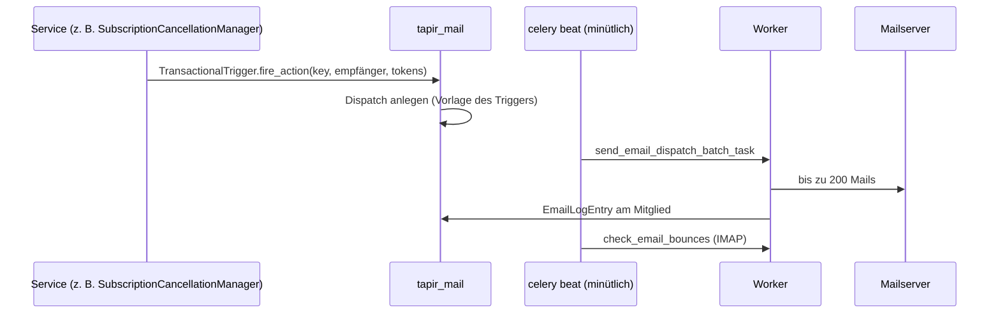

# E-Mails

> **Abstract:** Mitglieder-Mails laufen über das externe Paket `tapir_mail` (eigene Oberfläche
> unter `/tapirmail`, MJML-Vorlagen, Segmente, Versand in Batches per Celery). Tapir meldet
> dort Trigger an und feuert sie an fachlichen Stellen (Anmeldung, Kündigung, Depotwechsel …).
> Admins können die Texte jedes Triggers in der Oberfläche anpassen. Nur wenige technische
> Mails (Exporte, SEPA, Fehler) gehen direkt über Djangos Mail-API.

## Ablauf

## Anmeldung der Trigger

`configure_mail_module()` in `tapir/wirgarten/tapirmail.py` (aufgerufen aus
`WirgartenConfig.ready()`):

- Basissegment: alle Mitglieder.
- Tokens: Platzhalter wie Name, Vertragsdaten, Depot.
- Rund 20 transaktionale Trigger plus `OnboardingTrigger`. Pflicht-Trigger bringen ihre
  Standardvorlage aus `tapir/wirgarten/email_drafts/<key>.mjml` mit.
- Statisches Segment „Warteliste“, synchron gehalten über Signale auf `WaitingListEntry`.

Die Ereignisschlüssel stehen in `tapir/wirgarten/mail_events.py` (`Events`), z. B.
`register_membership_and_subscription`, `contract_canceled`, `trial_cancellation`,
`memberarea_change_pickup_location`, `waiting_list_order_confirmation`. Weitere Apps
definieren eigene `MAIL_TRIGGER_*`-Schlüssel (Joker, Spenden, Vereinsmitgliedschaften).

## Neuen Mail-Anlass einbauen

1. Schlüssel in `Events` oder app-eigener Konstante.
2. Trigger in `configure_mail_module()` registrieren, ggf. MJML-Standardvorlage ablegen.
3. An der fachlichen Stelle `TransactionalTrigger.fire_action(...)` aufrufen – im Service,
   nicht in der View.

## Backends

| `EMAIL_ENV` | Backend |
|---|---|
| `dev` | Dateien in `../emails_from_celery` |
| `test` | SMTP |
| `prod` | `SmtpBackendWithDsn` aus tapir_mail |

Zugriff auf `/tapirmail` erfordert die Rolle `email.manage`
(`TapirMailPermissionMiddleware`).
