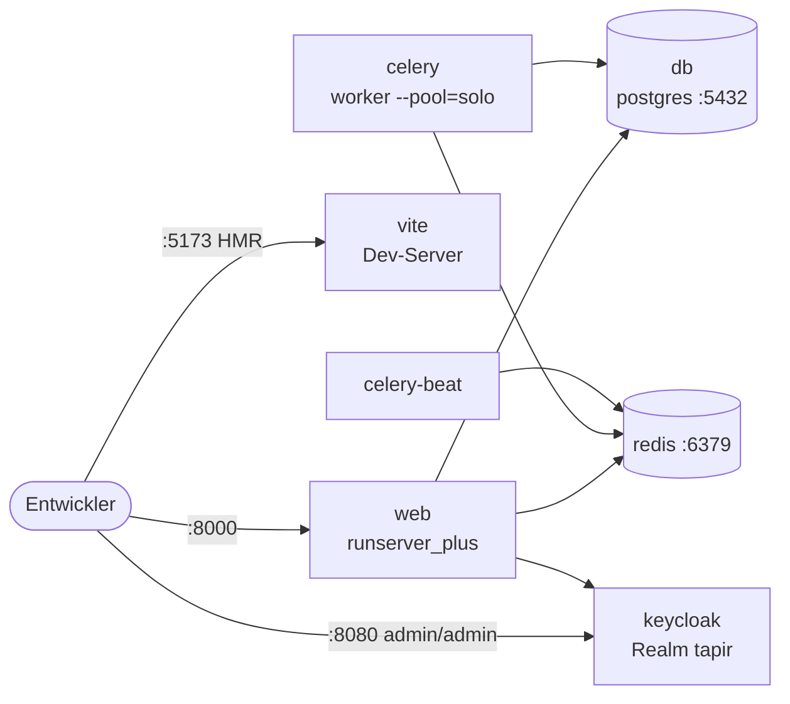
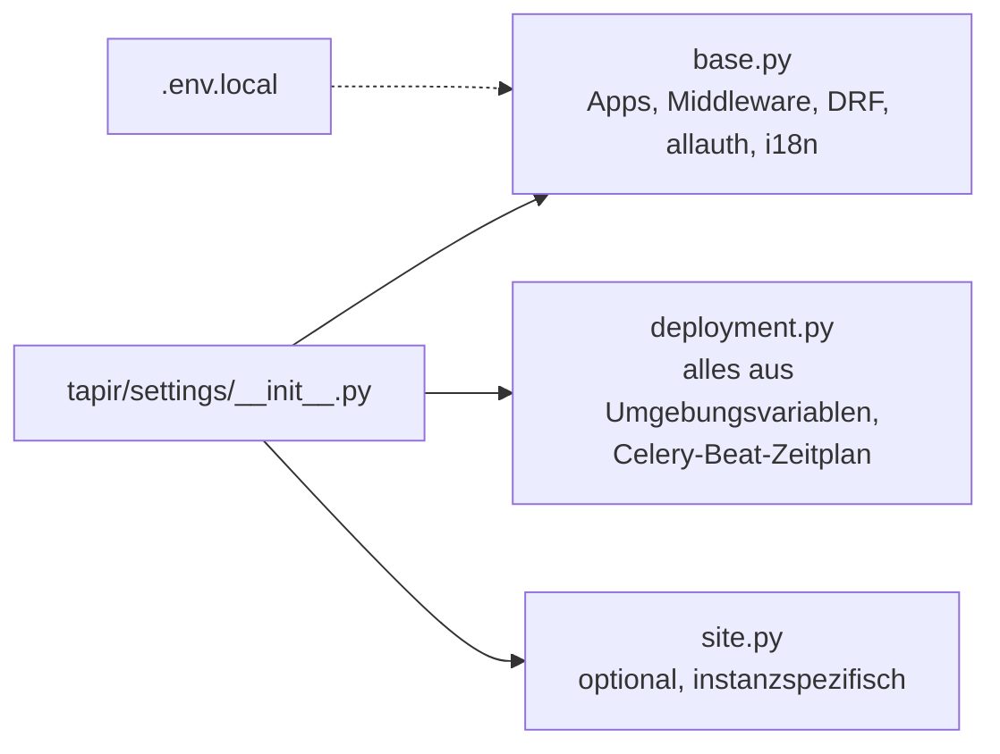

# Entwicklungsumgebung

> **Abstract:** `docker compose up -d`, dann Migrationen, Parameter-Definitionen und Testdaten
> einspielen – danach läuft Tapir auf http://localhost:8000 mit Keycloak, PostgreSQL, Redis,
> Celery und Vite-Dev-Server. Wer debuggen oder Tests aus der IDE starten will, lässt nur
> `db`, `redis` und `keycloak` in Docker laufen und startet Django und Vite lokal.

## Container



## Start mit Docker

```sh
docker compose up -d
docker compose exec web poetry run python manage.py migrate
docker compose exec web poetry run python manage.py parameter_definitions
docker compose exec web poetry run python manage.py populate --reset_all
```

Oder in einem Schritt: `./scripts/reset_all_containers.sh`.

- Login als Admin: `roberto.cortes@example.com` / `roberto.cortes`; jedes Testmitglied nach dem
  Muster `<name>@example.com` / `<name>`.
- Bäckerei mit Testdaten: `populate --reset_all --org=bakery`.
- Mails landen im Dev-Modus als Dateien in `../emails_from_celery`.

## Django außerhalb von Docker

1. `.env.local.disabled` nach `.env.local` kopieren (wird von `tapir/settings/base.py` gelesen).
2. `docker compose up -d keycloak db redis` (für reine Tests reichen `db redis`).
3. `poetry install --extras bakery`, dann `poetry run python manage.py runserver`.
4. `pnpm install && pnpm run dev` für den Vite-Server.

Komplett frisch, z. B. nach Branch-Wechsel: `./scripts/reset_and_start_local_server.sh`.

## Wichtige Umgebungsvariablen

| Variable | Zweck |
|---|---|
| `DATABASE_CONNECTION` | PostgreSQL-URL, Default `postgresql://tapir:tapir@db:5432/tapir` |
| `CELERY_BROKER_URL`, `CELERY_RESULT_BACKEND` | Redis, Default `redis://redis:6379` |
| `SECRET_KEY`, `DEBUG`, `ALLOWED_HOSTS`, `SITE_URL` | Django-Grundeinstellungen |
| `KEYCLOAK_ADMIN_SERVER_URL`, `KEYCLOAK_PUBLIC_URL`, `KEYCLOAK_REALM_NAME`, `KEYCLOAK_CLIENT_ID`, `KEYCLOAK_ADMIN_CLIENT_SECRET_KEY` | Keycloak |
| `KEYCLOAK_SKIP_VERIFICATION_EMAIL` | Lokal keine Verifizierungsmails |
| `DJANGO_VITE_DEBUG` | `True`: Assets vom Vite-Dev-Server statt aus `dist/manifest.json` |
| `EMAIL_ENV` | `dev` (Dateien), `test` (SMTP), `prod` (SMTP mit DSN) |
| `MAILING_LISTS_ENABLED`, `MAILMAN_*` | Optionale Mailman-Anbindung |

## Settings-Aufbau



## Nützliche Befehle

| Befehl | Wirkung |
|---|---|
| `manage.py parameter_definitions` | Parameter aus dem Code in die DB übernehmen |
| `manage.py populate --reset_all` | Testdaten neu erzeugen |
| `manage.py spectacular --file schema.yml` | OpenAPI-Schema erzeugen |
| `manage.py generate_datamodel_docs` | Datenmodell-Seiten dieses Wikis erzeugen |
| `manage.py farming_import_templates` | Stammdaten-Startsatz der Anbau-App laden |
| `manage.py health_status` | Health-Check als JSON |
