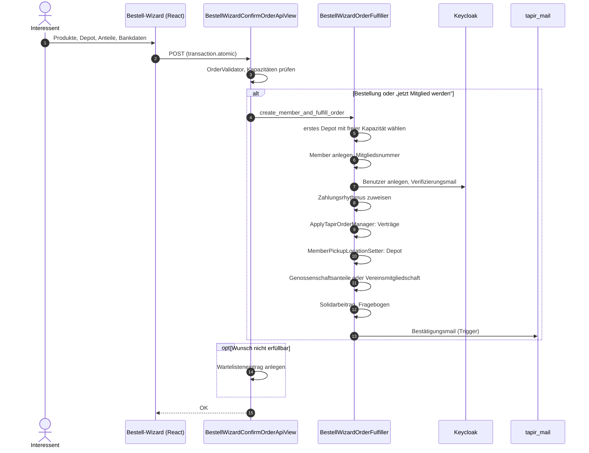
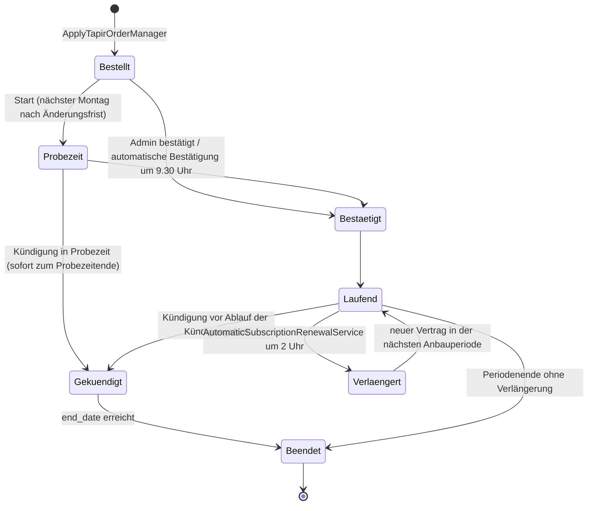
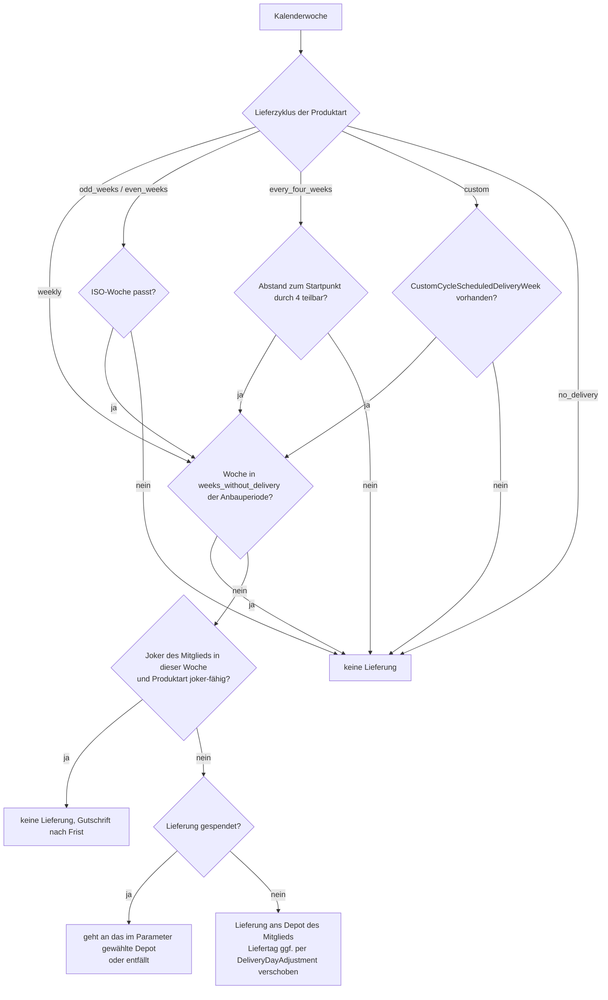
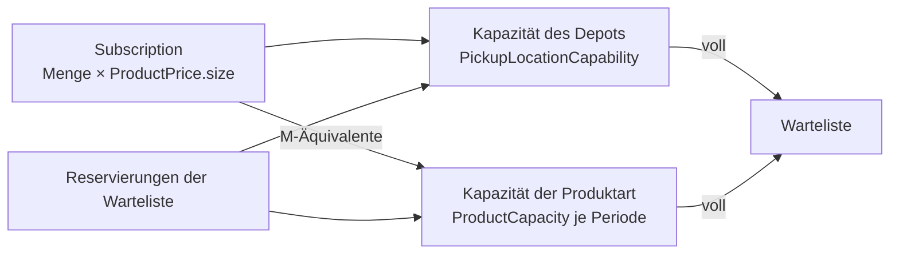
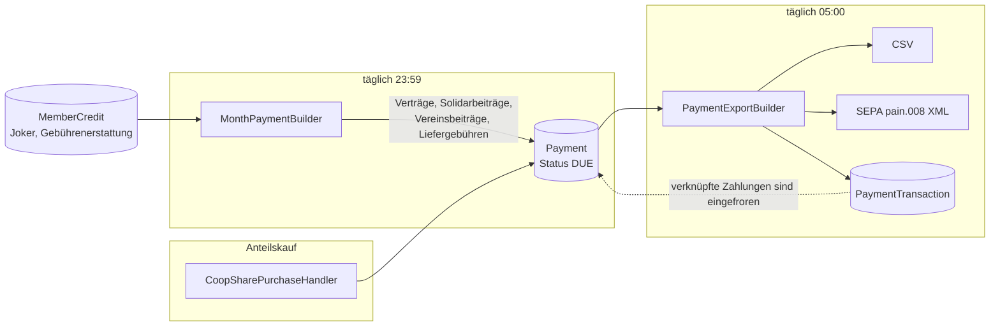
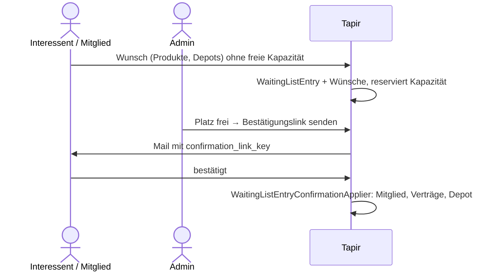

> ⚠️ **Nicht maßgeblich.** Dieses Wiki gehört zu einem abgeschlossenen Proof of Concept für den
> Eigenbetrieb von Tapir und wird nicht gepflegt. Maßgeblich ist die Dokumentation im
> Hauptprojekt: [FoodCoopX/wirgarten-tapir – docs](https://github.com/FoodCoopX/wirgarten-tapir/tree/master/docs),
> Aufbau in Issue [#1300](https://github.com/FoodCoopX/wirgarten-tapir/issues/1300).

# Fachliche Abläufe

> **Abstract:** Ein Interessent meldet sich über den Bestell-Wizard an. Daraus entstehen in
> einer Transaktion Mitglied, Keycloak-Konto, Verträge, Depot-Zuordnung, Genossenschaftsanteile
> bzw. Vereinsmitgliedschaft und Solidarbeitrag. Ab dann arbeiten nächtliche Celery-Jobs:
> Bestätigung nach Fristablauf, monatliche Zahlungen mit SEPA-Export, Kommissionierlisten vor
> jeder Lieferung und automatische Verlängerung in die nächste Anbauperiode. Fast jede Regel
> (Probezeit, Fristen, Joker, Zyklen) ist per Parameter einstellbar und hängt an „heute“ –
> deshalb immer `get_today(cache)` verwenden.

## Anmeldung über den Bestell-Wizard

Wichtige Klassen: `tapir/bestell_wizard/views.py` (`BestellWizardConfirmOrderApiView`),
`tapir/bestell_wizard/services/bestell_wizard_order_fulfiller.py`,
`tapir/subscriptions/services/apply_tapir_order_manager.py`.

## Lebenszyklus eines Vertrags

| Schritt | Logik | Ort |
|---|---|---|
| Startdatum | nächster Montag, dessen Lieferänderungs-Frist minus Puffer noch nicht vorbei ist | `ContractStartDateCalculator` |
| Probezeit | Start + `TRIAL_PERIOD_DURATION` Wochen − 1 Tag, oder Override am Vertrag; bei gelieferten Produkten ab Montag der ersten Lieferwoche | `TrialPeriodManager` |
| Kündigung | in der Probezeit zum Probezeitende, sonst nur bei aktiver Verlängerung; künftige Verträge werden gelöscht, laufende bekommen `cancellation_ts` und gekürztes `end_date` | `SubscriptionCancellationManager` |
| Kündigungsfrist | `end_date` minus N Wochen/Monate je Produktart und Periode (`NoticePeriod`) | `NoticePeriodManager` |
| Verlängerung | Parameter an, nicht gekündigt, Folgeperiode existiert, Frist abgelaufen, Produkt nicht gelöscht, Kapazität frei | `AutomaticSubscriptionRenewalService` |
| Bestätigung | automatisch nach Ablauf der Änderungsfrist, mit Mail | `AutomaticConfirmationManager` |

Prognosen (z. B. Bedarf der Anbau-App, Kapazitätsplanung) arbeiten mit „virtuellen“, noch nicht
gespeicherten Verlängerungen: `AutomaticSubscriptionRenewalService.get_subscriptions_and_renewals`.

## Lieferungen, Zyklen und Joker

- Liefertermine: `DeliveryDateCalculator`, `DeliveryCycleService`, `WeeksWithoutDeliveryService`.
- Joker-Regeln: `JokerManagementService.can_joker_be_used_in_week` (Jokers an, max. je Periode,
  Einschränkungen, Frist, keine Spende in derselben Woche).
- Gutschrift für Joker: `JokerCreditCreator` (täglich 06:00) erzeugt `payments.MemberCredit`.
- Kommissionierliste: `PickListBuilder`; CSV-Export am Tag nach der Depot-Änderungsfrist.

## Depot und Kapazität

- Die Depot-Zuordnung ist zeitlich versioniert (`MemberPickupLocation.valid_from`); lesen mit
  `MemberPickupLocationGetter`, schreiben nur über `MemberPickupLocationSetter`.
- Kommissioniermodus (`PICKING_MODE`): nach Anteilen (M-Äquivalente) oder nach Kisten
  (`ProductBasketSizeEquivalence`, `PickupLocationBasketCapacity`).

## Zahlungen

- Abgerechnet wird je Mitglied × Produktart im Zahlungsrhythmus des Mitglieds
  (`MemberPaymentRhythm`: monatlich bis jährlich).
- Verträge in der Probezeit werden nachträglich für den Vormonat abgerechnet.
- Jede Lastschrift braucht ein `MandateReference` (SEPA-Mandat).
- Künftige Zahlungen neu berechnen: `SubscriptionPaymentsRebuilder`.

## Genossenschaftsanteile

| Buchungstyp | Wirkung |
|---|---|
| `PURCHASE` | Zeichnung, positiv; erzeugt Zahlung über `CoopSharePurchaseHandler` |
| `CANCELLATION` | Kündigung, negativ |
| `TRANSFER_OUT` / `TRANSFER_IN` | Übertragung zwischen Mitgliedern |

Bestand = Summe der Mengen mit `valid_at <= heute`. Ob Anteile oder Vereinsmitgliedschaften
gelten, entscheidet die Rechtsform der Instanz (`legal_status_is_cooperative()` u. a. in
`tapir/wirgarten/utils.py`).

## Warteliste

## Wo die Zeit herkommt

Alle Abläufe hängen am Stichtag. `get_today(cache)` und `get_now(cache)` (Europe/Berlin) aus
`tapir/wirgarten/utils.py` sind Pflicht. Auf Debug-Instanzen lässt sich die Zeit über den
Parameter `TESTS_OVERRIDE_DATE_PRESET` verstellen; in Tests gibt es `mock_timezone`.
