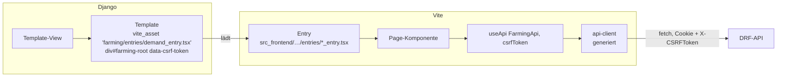
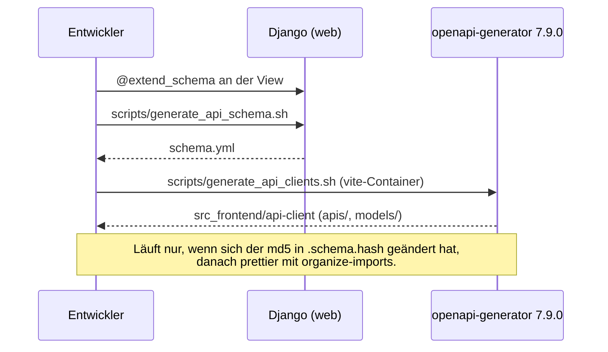
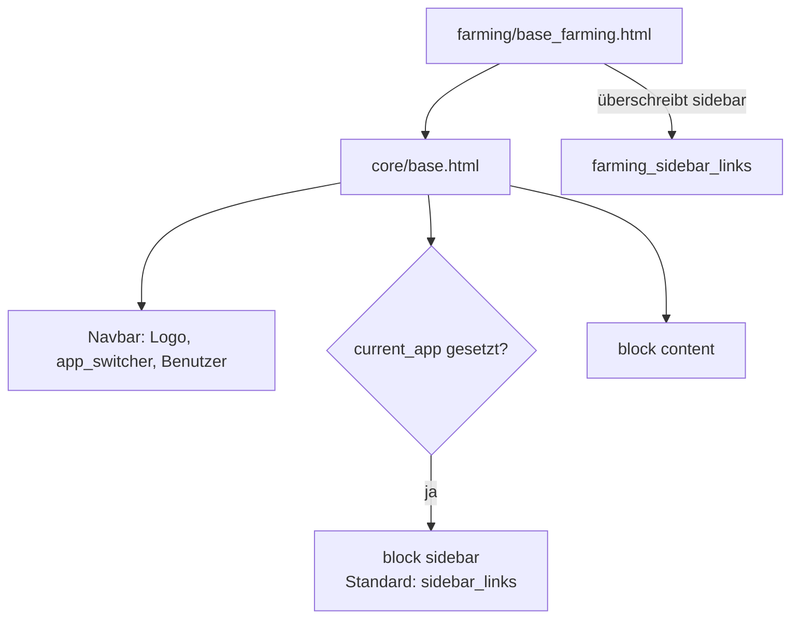

# Frontend

> **Abstract:** Die Seiten sind Django-Templates auf Basis von `core/base.html` (Bootstrap 5).
> Interaktive Teile sind React-19/TypeScript-Inseln, die per django-vite in ein Template
> eingehängt werden und über einen aus dem OpenAPI-Schema generierten `typescript-fetch`-Client
> mit den DRF-APIs sprechen. Ein neuer API-Endpunkt bedeutet also: View annotieren, Schema
> erzeugen, Client erzeugen, im React-Code die neue Methode verwenden.

## Wie eine React-Seite entsteht



- Dev: `DJANGO_VITE_DEBUG=True`, Assets kommen vom Vite-Server (:5173) mit Hot Reload.
- Prod: `pnpm run build` schreibt `dist/` mit `manifest.json`; django-vite löst daraus die
  gehashten Dateinamen auf.
- Werte aus Django gelangen über `data-*`-Attribute ins React (Booleans kommen als
  `"True"`/`"False"`), globale Werte über `window._env_` (`REACT_APP_API_ROOT` …).

## Neue Seite anlegen

1. Template erweitert `core/base.html` (oder z. B. `farming/base_farming.html`) und setzt im
   `head`-Block ``.
2. Entry-Datei mountet die Seite (`createRoot(container).render(...)`; in der Anbau-App
   `mountFarmingPage(Page)`).
3. Eintrag in `vite.config.ts` → `build.rollupOptions.input` ergänzen. **Ohne diesen Eintrag
   fehlt die Seite im Produktions-Build.**
4. Template-View mit Rechteprüfung und URL anlegen.

## API-Client erzeugen



```sh
docker compose exec web ./scripts/generate_api_schema.sh && \
docker compose exec vite ./scripts/generate_api_clients.sh
```

Hinweise:

- `COMPONENT_SPLIT_REQUEST=True`: zu jedem Modell gibt es `Xxx` (Antwort) und `XxxRequest`.
- Der Client serialisiert Datumswerte mit `toISOString()`. Datumsangaben daher als
  UTC-Mitternacht erzeugen, sonst rutscht ein Tag (Beispiel: `src_frontend/farming/utils/dates.ts`).
- `schema.yml`, `.schema.hash` und `src_frontend/api-client` werden mit eingecheckt.

## Verzeichnisse

| Pfad | Inhalt |
|---|---|
| `src_frontend/<feature>/` | Ältere Features: `<feature>_entry.tsx` plus Komponenten |
| `src_frontend/bakery/`, `src_frontend/farming/` | Neuere Module: `entries/`, `pages/`, `components/`, `utils/` |
| `src_frontend/components/` | Gemeinsame Bausteine: `TapirButton`, `TapirDateInput`, `ConfirmModal`, `ConfirmDeleteModal`, `PlaceholderTableRows`, Pagination … |
| `src_frontend/hooks/useApi.ts` | Erzeugt den API-Client mit Basis-URL, CSRF-Header und Cookies |
| `src_frontend/utils/` | Formatierer, `handleRequestError`, Toasts, CSRF-Helfer |
| `src_frontend/api-client/` | Generiert, nicht von Hand ändern |

Bibliotheken: react-bootstrap, bootstrap 5.3, dayjs, react-select, chart.js, leaflet.
Es gibt kein i18n im Frontend; Texte sind deutsch.

## Templates und Navigation



- **App-Umschalter** (`tapir/core/app_switcher.py`): Apps registrieren sich in
  `AppConfig.ready()` mit `register_app(AppSwitcherEntry(...))`. Aktiv ist die App mit dem
  längsten passenden URL-Präfix; der Umschalter erscheint nur bei mehr als einer verfügbaren
  App. `<body data-app="…">` steuert die Akzentfarbe.
- **Sidebar**: `SidebarLinkGroup(name).add_link(text, material_icon, url)`, gebaut in
  `tapir/core/templatetags/core.py` bzw. app-eigenen Template-Tags.
- Formatierung: Templates mit djhtml, TS/TSX mit Prettier.
