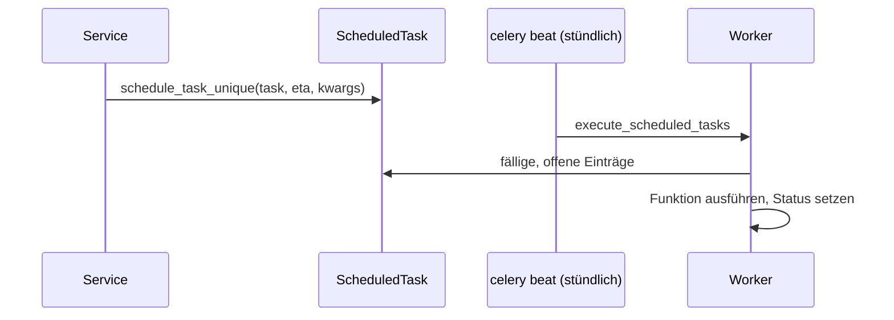

> ⚠️ **Nicht maßgeblich.** Dieses Wiki gehört zu einem abgeschlossenen Proof of Concept für den
> Eigenbetrieb von Tapir und wird nicht gepflegt. Maßgeblich ist die Dokumentation im
> Hauptprojekt: [FoodCoopX/wirgarten-tapir – docs](https://github.com/FoodCoopX/wirgarten-tapir/tree/master/docs),
> Aufbau in Issue [#1300](https://github.com/FoodCoopX/wirgarten-tapir/issues/1300).

# Hintergrundjobs

> **Abstract:** Celery (Broker und Result-Backend Redis) führt alles Zeitgesteuerte aus. Der
> Zeitplan steht fest in `tapir/settings/deployment.py` (`CELERY_BEAT_SCHEDULE`). Die Nacht gehört
> Verlängerungen und Aufräumen, der frühe Morgen Exporten und Gutschriften, der Vormittag
> Bestätigungen und Mails, kurz vor Mitternacht entstehen die Zahlungen. Mail-Versand und
> automatische Exporte laufen minütlich. Schlägt ein Task fehl, geht eine Mail an die Admins.

## Tagesablauf

```mermaid
gantt
    title Periodische Jobs (Uhrzeit Europe/Berlin)
    dateFormat HH:mm
    axisFormat %H:%M
    section Verträge
    Verlängerung Verträge            :02:00, 10m
    Verlängerung Solidarbeiträge     :02:10, 10m
    Automatische Bestätigung         :09:30, 10m
    section Zahlungen
    SEPA-Export                      :05:00, 10m
    Joker-Gutschriften               :06:00, 10m
    Zahlungen des Monats erzeugen    :23:49, 10m
    section Lieferung
    Depot-Zuordnungen aufräumen      :03:00, 10m
    Lieferantenliste CSV             :06:15, 10m
    Kommissionierliste CSV           :06:30, 10m
    section Mitglieder
    Mitgliedsnummern vergeben        :09:00, 10m
    Eintrittsmails                   :10:00, 10m
    Ende Vereinsmitgliedschaft Mails :13:00, 10m
```

(Der Balken „Zahlungen des Monats erzeugen“ endet um 23:59, dem tatsächlichen Startzeitpunkt.)

## Alle Jobs

| Name | Zeitplan | Aufgabe |
|---|---|---|
| `execute_scheduled_tasks` | stündlich :05 | Fällige `ScheduledTask`-Zeilen ausführen (aufgeschobene Funktionsaufrufe) |
| `automatic_subscription_renewal` | 02:00 | Verträge in die nächste Anbauperiode verlängern |
| `automatic_solidarity_contribution_renewal` | 02:10 | Solidarbeiträge verlängern |
| `clean_members_without_subscription_task` | 03:00 | Depot-Zuordnung von Mitgliedern ohne Vertrag entfernen |
| `export_payments_for_this_month` | 05:00 | CSV + SEPA pain.008 erzeugen, `PaymentTransaction`, Mail |
| `create_credits_for_jokers` | 06:00 | Gutschriften für genutzte Joker |
| `export_supplier_list_csv` | 06:15 | Summierte Lieferantenliste je Produktart |
| `export_pick_list_csv` | 06:30 | Kommissionierliste der nächsten Lieferung |
| `assign_member_numbers` | 09:00 | Mitgliedsnummern vergeben |
| `automatic_confirmation` | 09:30 | Verträge und Anteilskäufe nach Fristablauf bestätigen, Mails |
| `send_membership_entry_mails` | 10:00 | Mail zum Eintrittsdatum (Genossenschaft/Verein) |
| `trigger_association_membership_ends_today_mails` | 13:00 | Mail zum Ende einer Vereinsmitgliedschaft |
| `create_payments_for_this_month` | 23:59 | Monatliche Zahlungen aufbauen |
| `resolve_segment_and_create_email_dispatches_task` | minütlich | tapir_mail: Empfänger auflösen |
| `send_email_dispatch_batch_task` | minütlich | tapir_mail: bis zu 200 Mails senden |
| `check_email_bounces` | minütlich | tapir_mail: Bounces per IMAP |
| `do_automated_exports` | minütlich | Automatische CSV/PDF-Exporte |

## Aufgeschobene Aufgaben

## Hinweise für Entwickler

- Tasks erzeugen ihren eigenen `cache = {}` und rufen Services auf; Logik gehört nicht in
  `tasks.py`.
- Neue periodische Tasks in `CELERY_BEAT_SCHEDULE` eintragen; Tasks werden per
  `autodiscover_tasks()` gefunden.
- `tapir/coop/tasks.py` enthält Kopien einiger Export-Tasks aus `tapir/wirgarten/tasks.py`;
  geplant sind nur die Versionen aus `wirgarten.tasks`.
- Lokal: Container `celery` (`--pool=solo`) und `celery-beat`; im Paket die Dienste
  `tapir-celery` und `tapir-celery-beat`.
