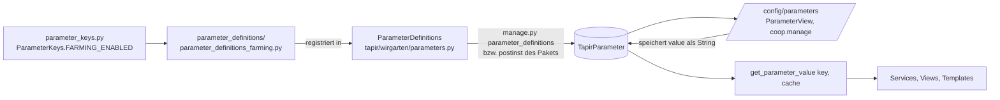

> ⚠️ **Nicht maßgeblich.** Dieses Wiki gehört zu einem abgeschlossenen Proof of Concept für den
> Eigenbetrieb von Tapir und wird nicht gepflegt. Maßgeblich ist die Dokumentation im
> Hauptprojekt: [FoodCoopX/wirgarten-tapir – docs](https://github.com/FoodCoopX/wirgarten-tapir/tree/master/docs),
> Aufbau in Issue [#1300](https://github.com/FoodCoopX/wirgarten-tapir/issues/1300).

# Konfiguration

> **Abstract:** Instanzabhängiges Verhalten steht nicht in Settings-Dateien, sondern in rund
> 180 typisierten Parametern in der Tabelle `TapirParameter`. Definiert werden sie im Code
> (Schlüssel, Typ, Default, Kategorie, Optionen, Validatoren); `manage.py parameter_definitions`
> gleicht die Datenbank ab, Admins pflegen die Werte unter `/config/parameters`. Gelesen wird
> immer über `get_parameter_value(key, cache)`.

## Vom Code zur Oberfläche



## Lesen

```python
from tapir.configuration.parameter import get_parameter_value
from tapir.wirgarten.parameter_keys import ParameterKeys

enabled = get_parameter_value(ParameterKeys.FARMING_ENABLED, cache)
```

- Beim ersten Aufruf werden **alle** Parameter in den Cache geladen; ohne Cache-Dict geht jeder
  Aufruf an die Datenbank.
- Unbekannter Schlüssel → `KeyError`. Code, der vor dem ersten `parameter_definitions` laufen
  kann (z. B. Sidebar, App-Umschalter), fängt das ab.
- Im Template: ``.

## Neuen Parameter anlegen

1. Schlüssel in `tapir/wirgarten/parameter_keys.py`: `MY_KEY = f"{PREFIX}.bereich.name"`.
2. Definition in passender Datei unter `tapir/wirgarten/parameter_definitions/`
   (Klasse mit `define_all_parameters_<bereich>(cls, importer)`):
   ```python
   importer.parameter_definition(
       key=ParameterKeys.MY_KEY,
       label="Anzeigename",
       datatype=TapirParameterDatatype.INTEGER,
       initial_value=10,
       description="Hilfetext für Admins",
       category=ParameterCategory.FARMING,
       order_priority=500,
   )
   ```
3. Neue Datei? In `ParameterDefinitions.define_all_parameters` registrieren.
4. `manage.py parameter_definitions` ausführen. Der gespeicherte Wert wird nur zurückgesetzt,
   wenn sich der Datentyp ändert.

| Option von `ParameterMeta` | Wirkung |
|---|---|
| `options` / `options_callable` | Auswahlliste |
| `validators` | Django-Validatoren |
| `textarea` | Mehrzeiliges Feld |
| `vars_hint` | Platzhalter-Hinweis, prüft automatisch Format-Strings |
| `show_only_when` | Nur anzeigen, wenn eine Bedingung (z. B. Modul an) erfüllt ist |

Datentypen: `integer`, `decimal`, `boolean`, `string`, `date`. Parameter mit `debug=True`
erscheinen nur auf Debug-Instanzen.

## Kategorien

BestellWizard, Rechtsform (`{{legal_status}}`), Lieferung, Joker, E-Mails, Mitgliederbereich,
Organisation, Zahlungen, Kommissionierung, Standort, Solidarbeitrag, Verträge,
Lieferantenliste, Tests, Probezeit, Bäckerei, Anbau – definiert in `ParameterCategory`
(`tapir/wirgarten/constants.py`).

## Modul-Schalter

Optionale Module hängen an einem Boolean-Parameter und liefern bei „aus“ 404 bzw. 403:

| Modul | Parameter |
|---|---|
| Bäckerei | `wirgarten.bakery.enabled` |
| Anbau | `wirgarten.farming.enabled` |
