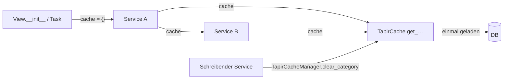

> ⚠️ **Nicht maßgeblich.** Dieses Wiki gehört zu einem abgeschlossenen Proof of Concept für den
> Eigenbetrieb von Tapir und wird nicht gepflegt. Maßgeblich ist die Dokumentation im
> Hauptprojekt: [FoodCoopX/wirgarten-tapir – docs](https://github.com/FoodCoopX/wirgarten-tapir/tree/master/docs),
> Aufbau in Issue [#1300](https://github.com/FoodCoopX/wirgarten-tapir/issues/1300).

# Konventionen

> **Abstract:** Neue Modelle erben von `TapirModel` (nanoid-IDs), Logik gehört in zustandslose
> Service-Klassen, und jede Kette von Service-Aufrufen teilt sich ein Request-Cache-Dict, das
> doppelte DB-Abfragen vermeidet. „Heute“ kommt immer aus `get_today(cache)`. Commits folgen
> Conventional Commits. Code unter `tapir/wirgarten` ist Legacy und wird beim Anfassen in
> Fach-Apps verlagert. Unfertige Teile sind mit `STUB BEGIN`/`STUB END` markiert.

## Modelle

- Basis `tapir.core.models.TapirModel`: 10-stellige nanoid als `id` (verhindert, dass in Tests
  versehentlich die ID eines anderen Modells passt), `created_at`, `updated_at`.
- Modelle enthalten nur eigene Felder und Helfer, die nur diese Felder benutzen.
- Zeitlich gültige Daten werden versioniert statt überschrieben (`valid_from`, z. B. Preise,
  Depot-Zuordnung, Zahlungsrhythmus).

## Services und Cache



- Services: Klassen mit `@classmethod`/`@staticmethod` in `tapir/<app>/services/`, eine
  Aufgabe je Klasse (`…Calculator`, `…Checker`, `…Manager`, `…Builder`).
- Der `cache` ist ein normales `dict`, erzeugt am Einstiegspunkt (View, Command, Task) und lebt
  nur für diesen Durchlauf. Neue Funktionen nehmen ihn als Pflichtparameter.
- `TapirCache` (`tapir/utils/services/tapir_cache.py`) bietet gebündelte Abfragen
  (`get_all_subscriptions`, `get_product_type_capacity_at_date` …); `get_from_cache_or_compute`
  für eigene Einträge.
- Wer schreibt und danach im selben Durchlauf weiterliest, leert die betroffene Kategorie mit
  `TapirCacheManager.clear_category` (`subscriptions`, `member_pickup_locations`,
  `payment_rhythms`).

## Zeit

- `get_today(cache)` / `get_now(cache)` aus `tapir/wirgarten/utils.py`, niemals
  `date.today()` oder `timezone.now()` direkt.
- Helfer: `get_monday`, `get_last_day_of_month`.

## Protokoll

Fachliche Änderungen an Mitgliedern schreiben einen `LogEntry`-Untertyp der jeweiligen App
(`actor` = wer, `user` = betroffenes Mitglied).

## Commits und Branches

- [Conventional Commits](https://www.conventionalcommits.org/): `feat(farming): …`,
  `fix(payments): …`, mit Issue-Nummer, wenn vorhanden.
- Je Meilenstein bzw. Feature ein Branch (`feature/<name>`), Merge nach `master` nach Abnahme.

## Legacy

`tapir/wirgarten` enthält Kernmodelle und alten Code (Funktions-Services in `service/`,
Formulare, Views). Beim Ändern den betroffenen Teil neu schreiben und in eine Fach-App ziehen.

## Stubs

Noch nicht umgesetzte Teile sind im Quelltext markiert, mit Meilenstein und Arbeitspaket:

```python
# STUB BEGIN [M2/AP2.2] PlantingScheduler
...
# STUB END [M2/AP2.2]
```

In Templates `{# STUB BEGIN … #}`, in TypeScript `// STUB BEGIN …`. Übersicht:

```sh
grep -rn "STUB BEGIN" tapir src_frontend
```

Beim Umsetzen werden die Marker entfernt.

## Sprache

Code, Bezeichner und Commit-Nachrichten auf Englisch; Oberflächentexte auf Deutsch (es gibt
Übersetzungen über Django-i18n, im Frontend keine).
