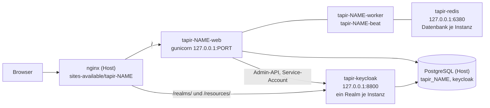
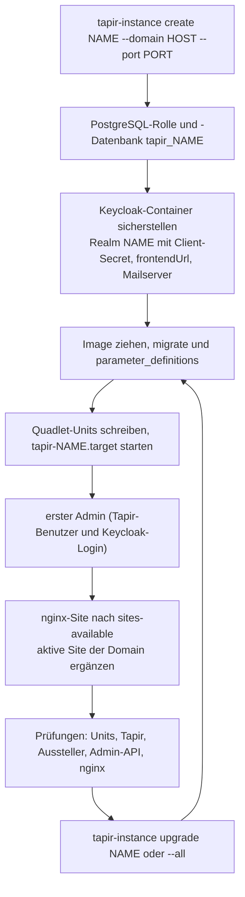
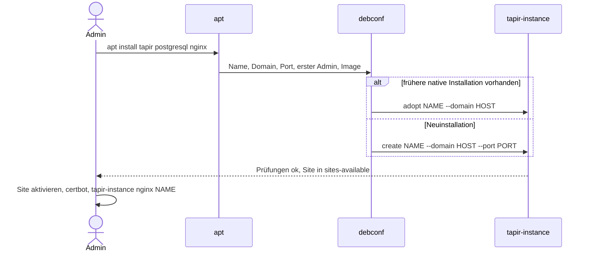
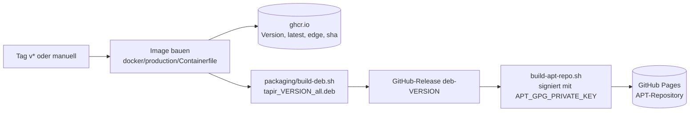

> ⚠️ **Nicht maßgeblich.** Dieses Wiki gehört zu einem abgeschlossenen Proof of Concept für den
> Eigenbetrieb von Tapir und wird nicht gepflegt. Maßgeblich ist die Dokumentation im
> Hauptprojekt: [FoodCoopX/wirgarten-tapir – docs](https://github.com/FoodCoopX/wirgarten-tapir/tree/master/docs),
> Aufbau in Issue [#1300](https://github.com/FoodCoopX/wirgarten-tapir/issues/1300).

# Paketierung und Betrieb

> **Abstract:** Im Betrieb läuft jede Tapir-Instanz (eine pro Solawi) als podman-Container unter
> systemd: Web (gunicorn), Celery-Worker und Celery-Beat aus dem Produktions-Image
> `ghcr.io/beerlesklopfer/wirgarten-tapir`. Ein gemeinsamer Keycloak-Container bedient alle
> Instanzen mit je einem eigenen Realm, ein gemeinsamer Redis-Container hält Warteschlangen und
> Caches aller Instanzen, jede in einer eigenen Datenbanknummer; PostgreSQL und nginx laufen auf dem Host. Das Debian-Paket
> `tapir` (`Architecture: all`, rund 400 KB) bringt nur die Werkzeuge `tapir-instance`,
> `tapir-kcadm` und `tapir-manage` sowie Vorlagen mit. Ein GitHub-Workflow baut bei Tags Image und
> Paket und veröffentlicht ein signiertes APT-Repository auf GitHub Pages.

## Aufbau auf dem Server

- Alle Container nutzen das Host-Netz und lauschen nur auf `127.0.0.1`.
- **Ein Keycloak für alle Domains:** Keycloak hat keinen globalen Hostnamen
  (`KC_HOSTNAME_STRICT=false`); jeder Realm setzt seine Domain über `frontendUrl`. Damit lautet der
  Aussteller (issuer) je Instanz `https://<domain>/realms/<realm>`.
- Schreibbare Daten liegen in `/var/lib/tapir/<name>` und sind im Container unter `/data`
  eingebunden: Medien, Uploads, Mail-Ablage, Fehlerprotokolle, Beat-Zeitplan. Die Container laufen
  als UID 10100.

## Produktions-Image

`docker/production/Containerfile` baut in drei Stufen:

1. **frontend:** `node:24-slim`, `pnpm run build` → `dist/`
2. **build:** `python:3.14-slim-trixie`, Abhängigkeiten aus `poetry.lock` mit uv (gehasht),
   `compilemessages`, `collectstatic`
3. **Laufzeit:** schlankes Python mit mjml und den Bibliotheken für weasyprint

Der Einstiegspunkt kennt die Rollen `web`, `worker`, `beat`, `migrate`, `manage <args>`. Die
Konfiguration kommt ausschließlich aus Umgebungsvariablen, also aus der env-Datei der Instanz.

## Lebenszyklus einer Instanz

Vollständige Befehlsreferenz für den Betrieb: [tapir-instance](Betrieb-tapir-instance).

| Befehl | Zweck |
|---|---|
| `tapir-instance create` | neue Instanz, wiederholbar ohne doppelte Anlagen |
| `tapir-instance adopt <name>` | Installation des früheren nativen Pakets übernehmen (Datenbank, Dateien, Port bleiben) |
| `tapir-instance list`, `status` | Übersicht, Prüfungen |
| `tapir-instance upgrade <name>\|--all [--image]` | Image ziehen, migrieren, neu starten, prüfen |
| `tapir-instance user-add <name> <mail> [--admin]` | Tapir-Benutzer mit Keycloak-Login |
| `tapir-instance nginx <name>` | Site neu schreiben, z. B. HTTPS nach dem Zertifikat |
| `tapir-instance keycloak <name>` | Realm, Mailserver, Themes, Units und nginx auffrischen |
| `tapir-instance theme <name> <theme>` | Theme von Tapir und Keycloak |
| `tapir-instance param <name> [<key> [<value>]]` | in der Oberfläche gesperrte Parameter setzen |
| `tapir-instance remove <name> [--purge]` | entfernen, mit `--purge` auch Datenbank, Realm und Daten |
| `tapir-manage <name> <args>` | `manage.py` im laufenden Web-Container |
| `tapir-kcadm --realm <realm> …` | Keycloak auf der Kommandozeile, Realm immer ausdrücklich; nur root (`rwxrwx---`) |

## Debian-Paket und Installation

- `apt upgrade` aktualisiert nur die Werkzeuge. Instanzen werden ausdrücklich mit
  `tapir-instance upgrade` aktualisiert.
- Die nginx-Site wird nie automatisch aktiviert. Eine schon aktive Site der Domain bekommt die
  Keycloak-Pfade per `include` (mit Sicherung, `nginx -t` und Rücksicherung bei Fehler).
- **Testbarkeit:** Alle Pfade und Systembefehle in `tapir-instance` lassen sich per Umgebungsvariable
  umbiegen (`TAPIR_ETC`, `TAPIR_LIB`, `QUADLET_DIR`, `SYSTEMCTL`, `PSQL_ADMIN`, …). So läuft der
  komplette Ablauf auch rootless mit systemd-Benutzerdiensten. Container mit systemd und podman
  darin bitte nicht verschachteln: Das hat einen Entwicklungsrechner zum Stehen gebracht.

## Bau und Veröffentlichung

Einmalige Einrichtung (Pages-Quelle, Signaturschlüssel als Secret) und lokale Builds:
[packaging/README.md](https://github.com/Beerlesklopfer/wirgarten-tapir/blob/master/packaging/README.md).
