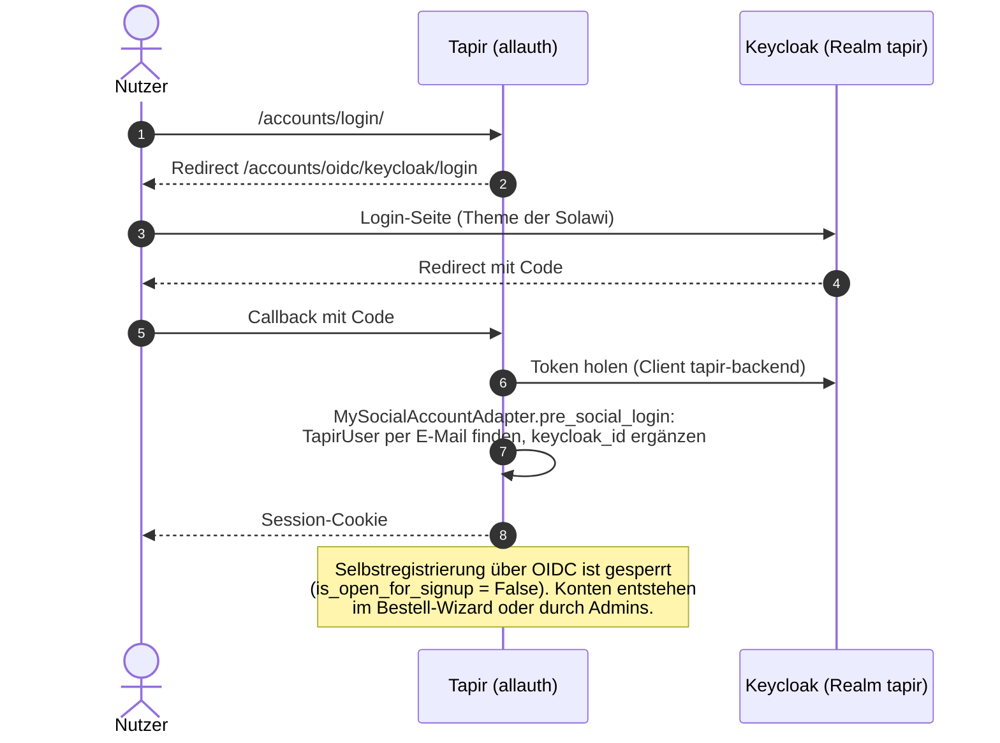
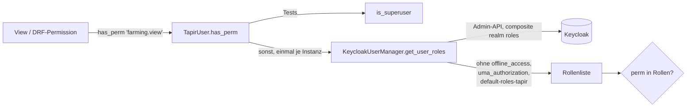

> ⚠️ **Nicht maßgeblich.** Dieses Wiki gehört zu einem abgeschlossenen Proof of Concept für den
> Eigenbetrieb von Tapir und wird nicht gepflegt. Maßgeblich ist die Dokumentation im
> Hauptprojekt: [FoodCoopX/wirgarten-tapir – docs](https://github.com/FoodCoopX/wirgarten-tapir/tree/master/docs),
> Aufbau in Issue [#1300](https://github.com/FoodCoopX/wirgarten-tapir/issues/1300).

# Rechte und Anmeldung

> **Abstract:** Tapir hat keine eigenen Passwörter und nutzt keine Django-Gruppen. Die Anmeldung
> läuft per OpenID Connect über Keycloak (django-allauth, nur Social-Login). Ein Recht ist
> schlicht der Name einer Keycloak-Realm-Rolle: `user.has_perm("coop.manage")` fragt die Rollen
> des Nutzers über die Keycloak-Admin-API ab. Neue Rechte entstehen also als Konstante in
> `Permission` plus Rolle im Realm.

## Login

Logout meldet den Nutzer zusätzlich in Keycloak ab (`user_logged_out`-Receiver in
`tapir/accounts/models.py`).

## Rechteprüfung

- Die Rollen werden am User-Objekt zwischengespeichert, also einmal je Request abgefragt.
- `has_perm(perm, obj)` mit `obj` prüft die Rollen von `obj`, nicht die des angemeldeten
  Nutzers.
- **In Tests liefert `has_perm` einfach `is_superuser`.** Tests für einzelne Rollen patchen
  `TapirUser.has_perm` (Beispiel: `grant_only()` in `tapir/farming/tests/test_navigation.py`).

## Rollen

Konstanten in `tapir/wirgarten/constants.py`, Klasse `Permission`:

| Rolle | Bedeutung |
|---|---|
| `coop.view` / `coop.manage` | Admin-Bereich sehen / Mitglieder, Verträge, Konfiguration bearbeiten |
| `accounts.view` / `accounts.manage` | Benutzerkonten |
| `payments.view` / `payments.manage` | Zahlungen, SEPA-Exporte |
| `products.view` / `products.manage` | Produkte, Preise, Kapazitäten |
| `email.manage` | Mail-Oberfläche `/tapirmail` (erzwungen per `TapirMailPermissionMiddleware`) |
| `farming.view` / `farming.manage` | Anbau-App sehen / planen und Stammdaten pflegen |

Die Gruppe `superuser` im Realm enthält alle Tapir-Rollen. Realm-Export für die lokale
Entwicklung: `docker/keycloak/import/tapir-realm.json` (Clients `tapir-backend` mit
Service-Account und `tapir-frontend`).

## Konten anlegen

`KeycloakUserManager.create_keycloak_user_if_necessary` legt den Keycloak-Benutzer an
(Benutzername = E-Mail). Ohne Passwort setzt es die Pflichtaktionen `VERIFY_EMAIL` und
`UPDATE_PASSWORD`; Superuser kommen in die Gruppe `superuser`.

## Neues Recht einführen

1. Konstante in `Permission` ergänzen (z. B. `class Farming: VIEW = "farming.view"`).
2. Rolle in `tapir-realm.json` anlegen und der Gruppe `superuser` geben.
3. Auf bestehenden Instanzen die Rolle per Keycloak-Admin anlegen und zuweisen.
4. In Views `PermissionRequiredMixin`/`permission_required`, in DRF eine Permission-Klasse mit
   `request.user.has_perm(...)` verwenden.

## API-Authentifizierung

DRF akzeptiert Token, Session und `DrfForwardAuthentication` (übernimmt den Session-User);
Default-Permission ist `IsAuthenticated`. Das React-Frontend schickt Session-Cookie und
`X-CSRFToken`.
