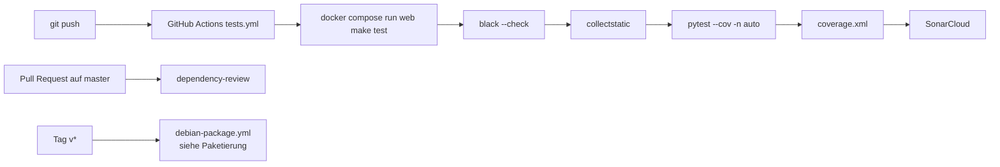

> ⚠️ **Nicht maßgeblich.** Dieses Wiki gehört zu einem abgeschlossenen Proof of Concept für den
> Eigenbetrieb von Tapir und wird nicht gepflegt. Maßgeblich ist die Dokumentation im
> Hauptprojekt: [FoodCoopX/wirgarten-tapir – docs](https://github.com/FoodCoopX/wirgarten-tapir/tree/master/docs),
> Aufbau in Issue [#1300](https://github.com/FoodCoopX/wirgarten-tapir/issues/1300).

# Tests und Qualität

> **Abstract:** Backend-Tests laufen mit pytest (parallel mit `-n auto`) gegen eine echte
> PostgreSQL; Keycloak ist in Integrationstests gemockt. Jeder Push startet in GitHub Actions
> `make test` (Black-Check, collectstatic, pytest mit Coverage) und danach SonarCloud. Für das
> Frontend ist `pnpm run build` (TypeScript-Check + Vite) die Prüfung. Formatiert wird mit
> Black, Prettier und djhtml, abgesichert über pre-commit.

## Pipeline



## Testarten

| Basisklasse | Wofür | DB |
|---|---|---|
| `TapirUnitTest` (`SimpleTestCase`) | Reine Logik, Services mit gemockten Abhängigkeiten | nein |
| `TapirIntegrationTest` (`TestCase`) | Views, APIs, Services mit Datenbank | ja |

Beide liegen in `tapir/wirgarten/tests/test_utils.py`. Testdaten entstehen mit factory_boy
(`tapir/wirgarten/tests/factories.py`, app-eigene `tests/factories.py`).

Hilfen in `TapirIntegrationTest`:

- `_login_as_admin()` – Superuser anlegen und einloggen.
- `_set_parameter(key, value)` – Parameterwert setzen.
- `assertStatusCode(response, code)`.
- `mock_keycloak` wird in `setUp` aktiv. Deshalb **keine Benutzer in `setUpTestData`
  anlegen** – das läuft vor `setUp`.
- Parameter existieren nur, wenn der Test sie anlegt, z. B.
  `ParameterDefinitions().import_definitions(bulk_create=True)` in `setUpTestData`.

Weitere Werkzeuge:

| Werkzeug | Zweck |
|---|---|
| `mock_timezone(test, now)` | „Heute“ festlegen |
| `mock_parameter_value(cache, key, value)` | Parameter im Cache überschreiben (Unit-Tests) |
| `patch.object(TapirUser, "has_perm", …)` | Einzelne Rollen testen (in Tests gilt sonst `has_perm = is_superuser`) |

## Ausführen

```sh
# im Container
docker compose exec web poetry run pytest --reuse-db -n auto
# eine App
docker compose exec web poetry run pytest tapir/farming
```

Außerhalb von Docker braucht es eine PostgreSQL und Redis sowie `DATABASE_CONNECTION`,
`CELERY_BROKER_URL`, `SECRET_KEY` und `DJANGO_VITE_DEBUG=True` (sonst fehlt das Vite-Manifest);
einmal `manage.py collectstatic` vorher.

Bekannt: Einzelne Tests in `generic_exports` (`JokerCreditValue`) und
`test_pickup_location_capacity_evolution_view` schlagen bei parallelen Läufen gelegentlich fehl
und laufen einzeln grün.

## Testaufbau (Beispiel)

```python
class TestDemandApi(FarmingApiTestCase):
    def test_demand_missingDates_returns400(self):
        self._login_as_admin()

        response = self.client.get(reverse("farming:api-demand"))

        self.assertStatusCode(response, 400)
```

Namensschema `test_<einheit>_<situation>_<erwartung>`, Arrange/Act/Assert durch Leerzeilen
getrennt.

## Formatierung

| Sprache | Werkzeug |
|---|---|
| Python | Black |
| TS/TSX/JS | Prettier |
| Django-Templates | djhtml (auch `djcss` für CSS-Templates) |

`poetry run pre-commit install` richtet die Hooks ein.
