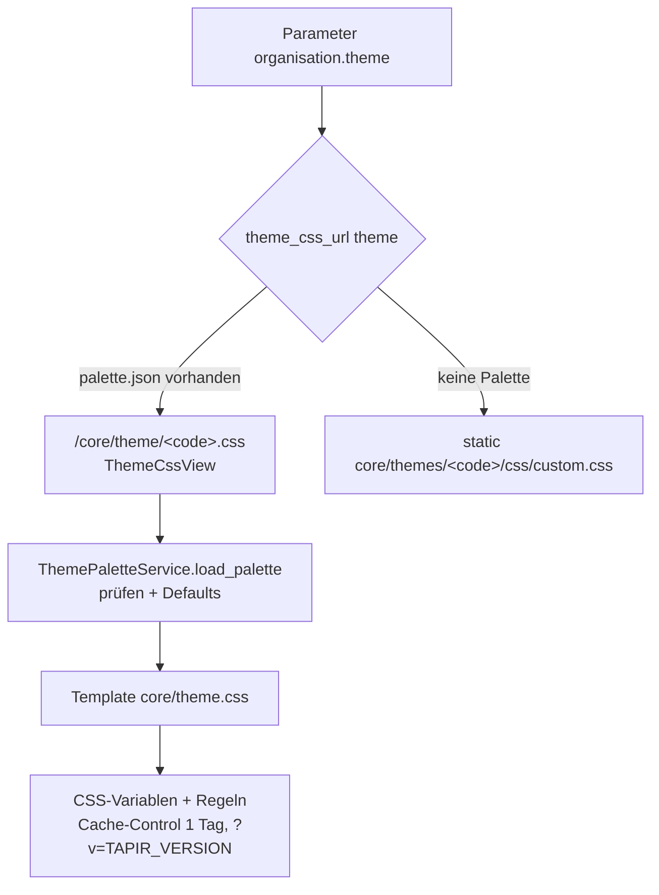

# Themes und Farbschemata

> **Abstract:** Jede Solawi wählt im Parameter `organisation.theme` eines von 23 Themes (Logo,
> Favicon, Farben). Bisher war jedes Theme eine kopierte `custom.css`. Neu beschreibt eine kleine
> `palette.json` nur die Farben und Schalter; eine gemeinsame Vorlage `core/theme.css` erzeugt
> daraus das Stylesheet, inklusive einer Akzentfarbe je App (Mitglieder / Anbau). Themes ohne
> Palette nutzen weiter ihre `custom.css`, die Umstellung geht also Theme für Theme.

## Auflösung



## palette.json

Beispiel `akv` (Ackervielfalt), ergänzt um das optionale `font_family`:

```json
{
  "colors": {
    "primary": "#267c1d",
    "secondary": "#bd4a55",
    "platinum": "#e9e7e5",
    "active": "#cfe8c9",
    "text": "#000000",
    "step": "#006633"
  },
  "apps": {
    "members": { "accent": "#bd4a55" },
    "farming": { "accent": "#267c1d" }
  },
  "font_family": "Open Sans, sans-serif",
  "features": { "typography": true, "buttons": true, "tables": true, "widgets": true }
}
```

- Farben müssen Hex-Werte sein, `font_family` wird per Regex geprüft, unbekannte Schlüssel
  führen zu `ThemePaletteError`. Fehlende Werte kommen aus den Defaults.
- `features` schaltet ganze Regelblöcke der Vorlage zu (Typografie, Buttons, Tabellen,
  Widgets).
- `--app-accent` wird über `body[data-app="members|farming"]` gesetzt und färbt die Leiste
  unter der Navbar und aktive Elemente der jeweiligen App.

## Neues Theme oder Theme umstellen

1. Ordner `tapir/core/static/core/themes/<code>/` mit `favicon.ico` und
   `images/Logo_white.webp`.
2. `palette.json` anlegen (Farben aus der alten `custom.css` übernehmen), alte `custom.css`
   entfernen.
3. Neues Theme zusätzlich in `THEME_OPTIONS` (`tapir/core/config.py`) eintragen; nur dort
   gelistete Codes werden ausgeliefert (Schutz gegen Pfad-Tricks).
4. Tests: `tapir/core/tests/test_theme_palette.py`.

Umgestellt sind bisher `akv` (Ackervielfalt) und `test`.
