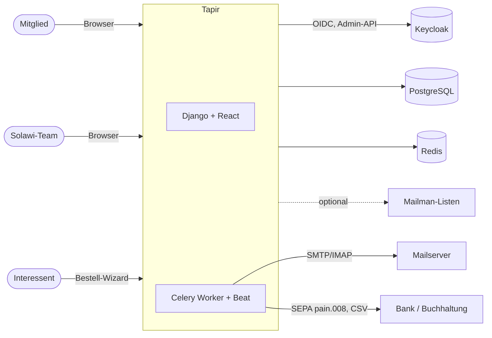

# Development

> **Abstract:** Tapir ist eine Django-Anwendung (Python 3.14, PostgreSQL, Redis, Celery) mit
> React/TypeScript-Oberflächen, die Verträge, Mitglieder, Lieferungen und Zahlungen einer
> Solawi verwaltet. Die Anmeldung läuft über Keycloak. Ausgeliefert wird Tapir als
> Container (eine Instanz je Solawi), eingerichtet über das Debian-Paket. Dieser Abschnitt ist der Fundort für Entwicklerinnen und
> Entwickler: Jede Seite beginnt mit einer Kurzfassung für erfahrene Leser; Diagramme zeigen
> die Zusammenhänge, die Details folgen darunter.

## Wegweiser

| Thema | Wofür |
|---|---|
| [Architektur](Development-Architektur) | Systemlandschaft, Schichten, Apps, Lebensweg eines Requests |
| [Fachliche Abläufe](Development-Fachliche-Ablaeufe) | Mitglied, Vertrag, Lieferung, Joker, Zahlung, Warteliste |
| [Datenmodell](Development-Datenmodell) | Alle Modelle mit Feldern, Beziehungen und ER-Diagrammen (generiert) |
| [Entwicklungsumgebung](Development-Entwicklungsumgebung) | Lokal starten mit und ohne Docker, Testdaten |
| [Rechte und Anmeldung](Development-Rechte-und-Anmeldung) | Keycloak, OIDC, Rollen, `has_perm` |
| [Konfiguration](Development-Konfiguration) | Parameter-System, neue Einstellungen anlegen |
| [Frontend](Development-Frontend) | Django-Templates, React über django-vite, generierter API-Client |
| [Hintergrundjobs](Development-Hintergrundjobs) | Celery und der Tagesablauf der periodischen Jobs |
| [E-Mails](Development-E-Mails) | tapir_mail, Trigger, Versand |
| [Themes und Farbschemata](Development-Themes) | Paletten, Theme-Vorlage, App-Akzente |
| [Tests und Qualität](Development-Tests-und-Qualitaet) | pytest, Integrationstests, Formatierung, CI |
| [Paketierung und Betrieb](Development-Paketierung) | Container je Solawi, gemeinsamer Keycloak, tapir-instance, Debian-Paket, APT-Repository |
| [Betrieb](Betrieb) | Server einrichten und betreiben: Befehlsreferenz `tapir-instance`, Konfiguration, Keycloak, Datensicherung, Fehlersuche |
| [Konventionen](Development-Konventionen) | Services, Cache, Zeit, Commits, Legacy, Stubs |
| [Anbau-App](Development-Anbau-App) | Architektur und Stand der App `farming` |
| [Roadmap Anbau-App](Development-Anbau-Roadmap) | Meilensteine, Arbeitspakete, Abnahmekriterien |

## Tapir auf einen Blick

## Grundbegriffe

| Begriff | Bedeutung im Code |
|---|---|
| Mitglied | `wirgarten.Member`, erbt von `accounts.TapirUser` |
| Vertrag / Anteil | `wirgarten.Subscription` über ein `Product` (z. B. Ernteanteil M) einer `ProductType` |
| Anbauperiode | `wirgarten.GrowingPeriod`, meist ein Jahr; Verträge gelten je Periode |
| Verteilstation (Depot) | `wirgarten.PickupLocation`, Zuordnung zeitlich versioniert über `MemberPickupLocation` |
| Genossenschaftsanteil | Buchungen in `wirgarten.CoopShareTransaction` |
| Joker | Lieferpause eines Mitglieds in einer Woche, `deliveries.Joker` |
| M-Äquivalent | Größe eines Produkts relativ zum Basisprodukt (`ProductPrice.size`), Grundlage aller Kapazitäten |
| Parameter | Einstellung einer Instanz, `configuration.TapirParameter` |

## Wo die Doku liegt

Die Seiten werden im Code-Repository unter `docs/wiki/` gepflegt und ins Wiki übertragen. Die
Datenmodell-Seiten werden mit `python manage.py generate_datamodel_docs` erzeugt; bitte dort
nichts von Hand ändern.
