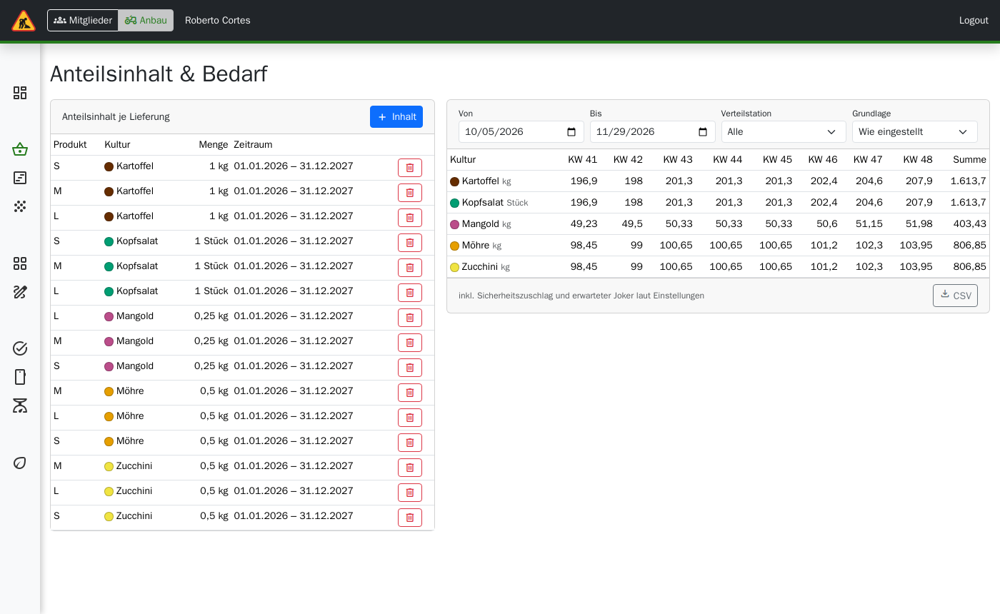
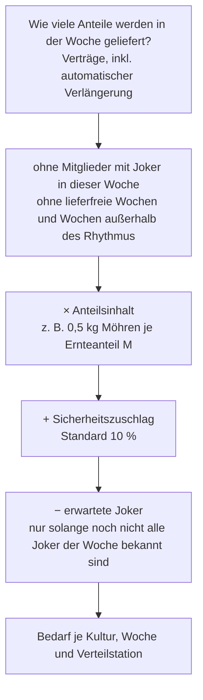
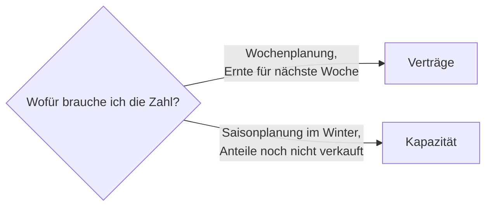

# Anbau: Anteilsinhalt & Bedarf

> **Kurz gesagt:** Links legen Sie fest, was in einem Anteil steckt – etwa „Ernteanteil M:
> 0,5 kg Möhren pro Lieferung von Juni bis Oktober“. Rechts rechnet Tapir daraus für jede Woche
> aus, wie viel jede Kultur insgesamt gebraucht wird, auf Wunsch je Verteilstation. Grundlage
> sind die echten Verträge inklusive Lieferpausen (Joker), lieferfreier Wochen und
> Lieferrhythmus. Die Tabelle lässt sich als CSV für Excel/LibreOffice herunterladen.

Menü: **Anbau → Planung → Anteilsinhalt & Bedarf**.

## So entsteht die Zahl in der Tabelle

Gespendete Lieferungen zählen mit, denn das Gemüse wird trotzdem gebraucht.

## Anteilsinhalt pflegen (linke Seite)

1. **+ Inhalt** klicken.
2. **Produkt (Anteil)** wählen, z. B. *Ernteanteil M*.
3. **Kultur** und **Menge je Anteil und Lieferung** eintragen – in der Ernteeinheit der Kultur.
4. **Gültig ab** und optional **Gültig bis** setzen; so bilden Sie die Saison ab
   (Frühjahr Radieschen, Sommer Tomaten …).
5. **Speichern.**

Tipp: Für dieselbe Kultur können Sie mehrere Zeiträume mit unterschiedlichen Mengen anlegen.

## Bedarf ansehen (rechte Seite)

| Einstellung | Wirkung |
|---|---|
| **Von / Bis** | Zeitraum, höchstens gut ein Jahr |
| **Verteilstation** | *Alle* oder eine einzelne Station |
| **Grundlage** | *Wie eingestellt* (aus der Konfiguration), *Verträge* (tatsächlich abgeschlossen) oder *Kapazität* (so, als wären alle geplanten Anteile der Saison verkauft) |

Die Tabelle zeigt Kulturen in Zeilen und Kalenderwochen in Spalten, rechts die Summe. Darunter
steht zur Erinnerung, dass Sicherheitszuschlag und erwartete Joker eingerechnet sind.

**CSV** lädt dieselben Zahlen als Datei mit Jahr, KW, Liefertag, Verteilstation, Kultur, Menge
und Einheit herunter (Semikolon und Dezimalkomma, passt direkt in deutsche Tabellenprogramme).

## Grundlage: Verträge oder Kapazität?

## Einstellungen (Konfiguration → Anbau)

| Einstellung | Bedeutung |
|---|---|
| Planungsgrundlage für den Bedarf | Voreinstellung für „Wie eingestellt“ |
| Sicherheitszuschlag auf den Bedarf (%) | Aufschlag auf jeden Bedarf, Standard 10 |
| Erwartete Joker-Quote (%) | Abzug für Wochen, in denen noch nicht alle Joker eingetragen sind, Standard 0 |

## Zahlen prüfen

Vergleichen Sie eine Woche mit der Kommissionierliste derselben Woche. Unterschiede entstehen
gewollt durch den Sicherheitszuschlag und durch gespendete Lieferungen.
