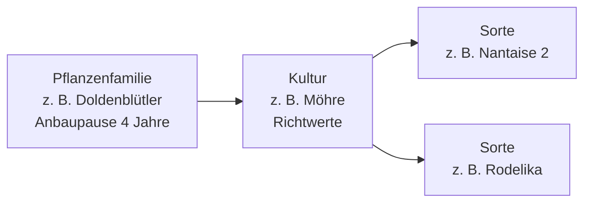
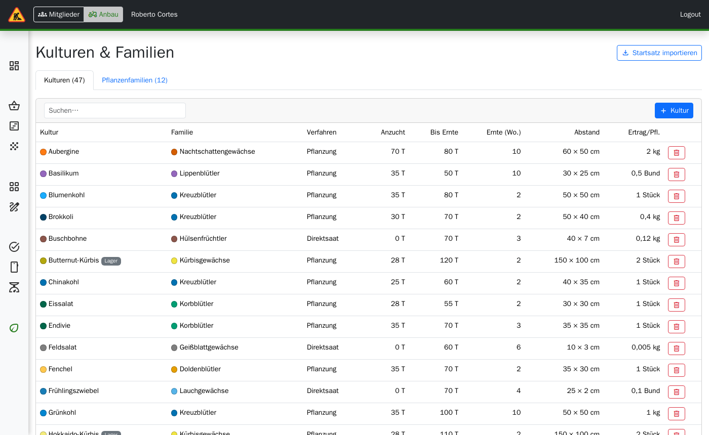
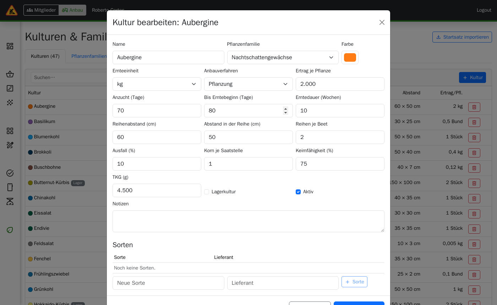
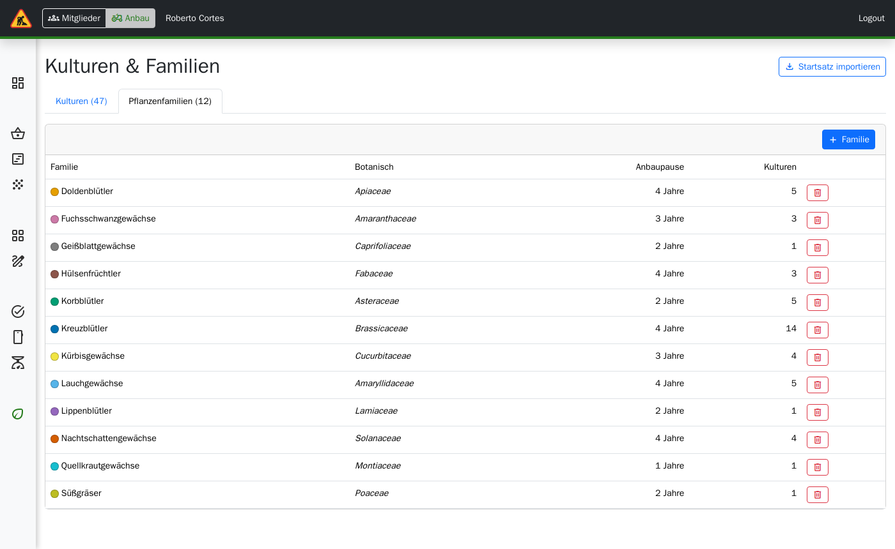
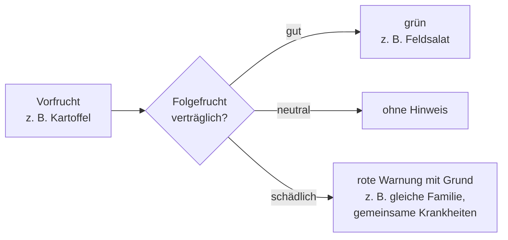

> ⚠️ **Nicht maßgeblich.** Dieses Wiki gehört zu einem abgeschlossenen Proof of Concept für den
> Eigenbetrieb von Tapir und wird nicht gepflegt. Maßgeblich ist die Dokumentation im
> Hauptprojekt: [FoodCoopX/wirgarten-tapir – docs](https://github.com/FoodCoopX/wirgarten-tapir/tree/master/docs),
> Aufbau in Issue [#1300](https://github.com/FoodCoopX/wirgarten-tapir/issues/1300).

# Anbau: Kulturen & Familien

> **Kurz gesagt:** Hier steht, welches Gemüse Sie anbauen und mit welchen Richtwerten:
> Kulturzeit, Abstände, Ertrag je Pflanze, Ausfall, Saatgutdaten. Mit **Startsatz importieren**
> bekommen Sie auf einen Klick 12 Pflanzenfamilien und 47 gängige Kulturen, die Sie dann an Ihren
> Betrieb anpassen. Die App unterstützt Folgeanbauten und warnt, wenn eine Folgefrucht
> schädlich ist.

Menü: **Anbau → Stammdaten → Kulturen & Familien**. Bearbeiten erfordert die Rolle
*farming.manage*.

## Aufbau

## Startsatz importieren

Die Schaltfläche **Startsatz importieren** legt fehlende Familien und Kulturen an.
Bereits vorhandene Einträge mit gleichem Namen bleiben unverändert – eigene Änderungen gehen
also nicht verloren. Sie können den Import gefahrlos mehrfach ausführen.

## Reiter „Kulturen“

Die Tabelle zeigt Farbe, Name, Familie, Anbauverfahren, Anzucht, Zeit bis zur Ernte,
Erntedauer, Abstände und Ertrag. Über **Suchen…** filtern Sie nach Namen.

**Kultur anlegen oder bearbeiten:** Schaltfläche **+ Kultur** bzw. Klick auf eine Zeile.

| Feld | Bedeutung | Beispiel Möhre |
|---|---|---|
| Name, Pflanzenfamilie, Farbe | Farbe erscheint später in Plänen und auf der Acker-Grafik | Möhre, Doldenblütler |
| Ernteeinheit | Gramm, Kilogramm, Stück oder Bund – in dieser Einheit wird der Bedarf gerechnet | kg |
| Anbauverfahren | Direktsaat oder Pflanzung (Jungpflanze) | Direktsaat |
| Anzucht (Tage) | Zeit in der Anzucht bis zum Pflanzen; 0 bei Direktsaat | 0 |
| Bis Erntebeginn (Tage) | Ab Pflanzung bzw. Saat | 100 |
| Erntedauer (Wochen) | Wie lange ein Satz beerntet werden kann | 3 |
| Reihenabstand, Abstand in der Reihe (cm), Reihen je Beet | Daraus ergeben sich später die Beetmeter | 30 / 3 / 4 |
| Ertrag je Pflanze | In der Ernteeinheit; bei Direktsaat je Saatstelle | 0,08 |
| Ausfall (%) | Wird beim Planen aufgeschlagen | 10 |
| Korn je Saatstelle, TKG (g), Keimfähigkeit (%) | Für die Saatgutmenge | 1 / 1,2 / 80 |
| Lagerkultur | Wird nach der Ernte noch wochenlang ausgeliefert (z. B. Kartoffeln) | nein |
| Aktiv | Inaktive Kulturen tauchen in Auswahllisten nicht mehr auf | ja |

**Sorten:** Im selben Fenster, unten, nach dem ersten Speichern. Name und Lieferant eintragen,
**+ Sorte** klicken.

## Reiter „Familien“

Name, botanischer Name, Anbaupause in Jahren und Farbe. Die Anbaupause sagt, wie viele Jahre
auf einem Beet keine Kultur derselben Familie stehen soll.

## Folgeanbau und Fruchtfolge

Auf einem Beet können in einer Saison mehrere Kulturen nacheinander stehen (Vor-, Haupt- und
Nachkultur). Die App prüft jede Folge und warnt:

Geprüft werden die Anbaupause der Familie, die Verträglichkeit von Vorfrucht und Folgefrucht
(z. B. gemeinsame Schaderreger, Nährstoffbedarf) und Überschneidungen auf demselben Beet. Die
Verträglichkeit wird bei Familien oder einzelnen Kulturen gepflegt. Pflege und Prüfung kommen
mit der Anbauplanung und dem Flächenplan (siehe [Roadmap](Development-Anbau-Roadmap)).

## Löschen

Eine Familie, zu der noch Kulturen gehören, oder eine Kultur, die noch in einem Anteilsinhalt
steckt, lässt sich nicht löschen – Tapir meldet das. Setzen Sie solche Kulturen stattdessen auf
*inaktiv*.
