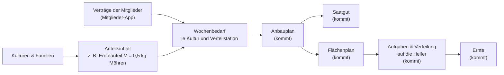
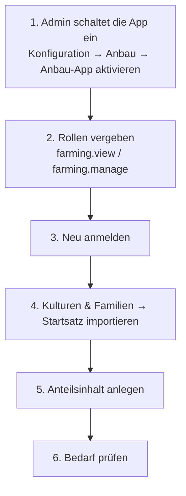
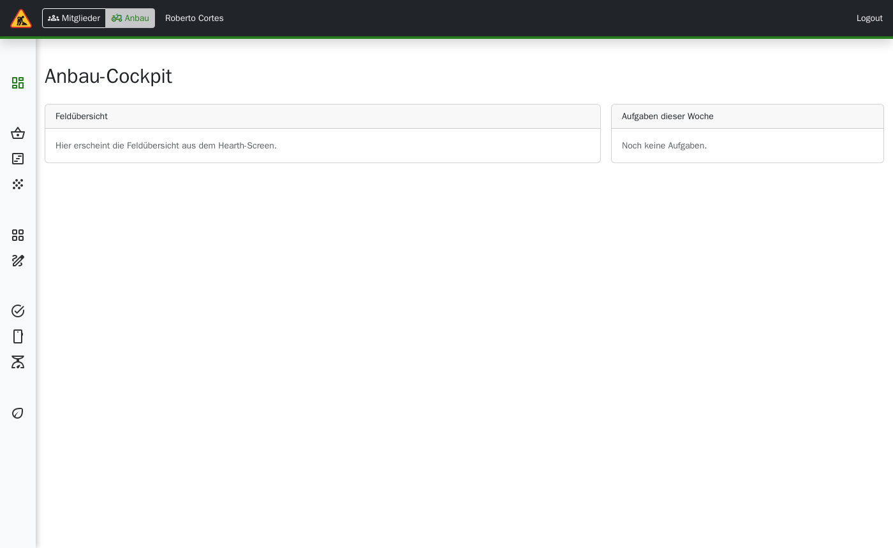

# Anbau-App

> **Kurz gesagt:** Die Anbau-App ist der Arbeitsbereich für das Gärtnerei-Team. Sie zeigt, wie
> viel Gemüse jede Woche für die Anteile gebraucht wird – direkt aus den Verträgen in Tapir,
> ohne Listen abzutippen. Außerdem verwaltet sie die Aufgaben und deren Verteilung auf die
> Helfer – nach dem, was die Mitglieder selbst als Interessen und Stärken angeben – und führt das
> Arbeitsstunden-Konto. Oben links wechseln Sie zwischen „Mitglieder“ und „Anbau“. Heute
> nutzbar: Kulturen und Familien pflegen und den Wochenbedarf ansehen. Weitere Teile (Anbauplan,
> Saatgut, Flächen, Aufgaben, Ernte) kommen Schritt für Schritt dazu.

## Wie die Teile zusammenhängen

## Seiten

| Bereich | Seite | Was Sie dort tun | Verfügbar |
|---|---|---|---|
| Übersicht | Cockpit | Startseite der Anbau-App | ja (noch einfach) |
| Planung | [Anteilsinhalt & Bedarf](Handbuch-Anbau-Bedarf) | Festlegen, was in einem Anteil steckt; Bedarf je Woche ansehen und exportieren | ja |
| Planung | Anbauplan, Saatgut | Sätze im Gantt-Diagramm planen und verschieben, Saatgut bestellen | später |
| Flächen | Flächenplan, Visualisierung | Beete belegen, Acker-Grafik | später |
| Feld | Aufgaben, Feld (mobil), Ernte | Aufgaben anlegen und verteilen (Vorschlag nach Interessen und Stärken der Mitglieder, Verfügbarkeit und Auslastung), Arbeitsstunden-Konto, Aufträge für Helfer als Kanban-Board (Offen → In Arbeit → Erledigt), Ernte erfassen | später |
| Stammdaten | [Kulturen & Familien](Handbuch-Anbau-Stammdaten) | Gemüsearten, Sorten und Pflanzenfamilien pflegen | ja |

Seiten, die noch nicht fertig sind, zeigen den Hinweis „In Arbeit“ mit dem geplanten
Meilenstein. Den Zeitplan finden Sie in der [Roadmap](Development-Anbau-Roadmap).

## Erste Schritte

1. **Einschalten:** Unter *Konfiguration*, Kategorie *Anbau*, den Schalter *Anbau-App
   aktivieren* setzen. Dort stehen auch Sicherheitszuschlag, erwartete Joker und die
   Planungsgrundlage (siehe [Bedarf](Handbuch-Anbau-Bedarf)).
2. **Rechte:** Die Rollen werden in der Benutzerverwaltung (Keycloak) vergeben:
   - *farming.view* – alles ansehen, Bedarf exportieren.
   - *farming.manage* – zusätzlich Kulturen, Sorten und Anteilsinhalte bearbeiten.
3. Nach dem Vergeben einer Rolle einmal ab- und wieder anmelden.
4. Wer nur Anbau-Rechte hat, sieht nur die Anbau-App; der Umschalter erscheint erst, wenn
   jemand beide Bereiche nutzen darf.

## Wechseln zwischen den Apps

Oben links neben dem Logo sitzt der Umschalter **Mitglieder | Anbau**. Jede App hat ihr eigenes
Menü links und eine eigene Farbe in der Leiste unter der Kopfzeile – so sehen Sie immer, wo
Sie gerade sind.
