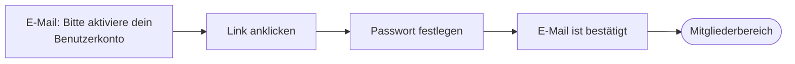
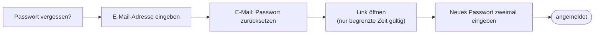

> ⚠️ **Nicht maßgeblich.** Dieses Wiki gehört zu einem abgeschlossenen Proof of Concept für den
> Eigenbetrieb von Tapir und wird nicht gepflegt. Maßgeblich ist die Dokumentation im
> Hauptprojekt: [FoodCoopX/wirgarten-tapir – docs](https://github.com/FoodCoopX/wirgarten-tapir/tree/master/docs),
> Aufbau in Issue [#1300](https://github.com/FoodCoopX/wirgarten-tapir/issues/1300).

# Anmelden und Passwort

> **Kurz gesagt:** Du meldest dich mit deiner E-Mail-Adresse und deinem Passwort an. Das
> Passwort legst du beim ersten Mal über den Link in der Aktivierungs-E-Mail fest. Vergessen?
> Auf der Anmeldeseite „Passwort vergessen?“ klicken, du bekommst einen Link per E-Mail.

## Erste Anmeldung

## Anmeldung

Auf der Anmeldeseite **Benutzername oder E-Mail** und **Passwort** eingeben, auf Wunsch
**Angemeldet bleiben** ankreuzen, **Anmelden**.

## Passwort vergessen

## Passwort ändern

Im Mitgliederbereich in der Karte **Persönliche Daten** auf **Passwort ändern** klicken. Nach dem
Speichern kommst du zurück und siehst „Das hat geklappt!“. Zusätzlich bekommst du eine E-Mail.

## E-Mail-Adresse ändern

Siehe [Mitgliederbereich](Handbuch-Mitgliederbereich#persönliche-daten-und-e-mail). Die
Anmeldung funktioniert danach mit der neuen Adresse.
