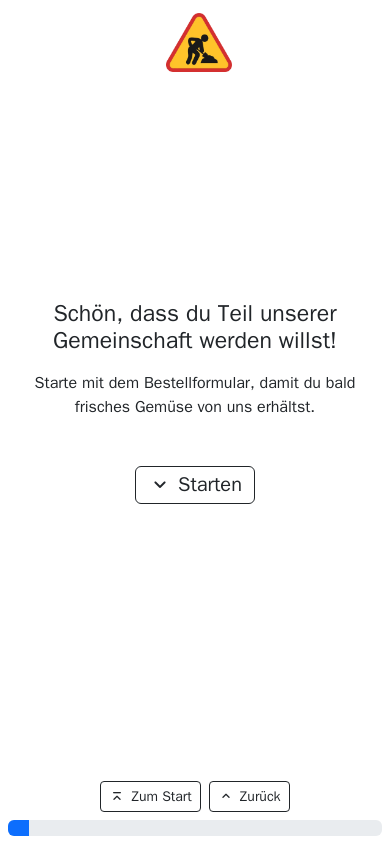
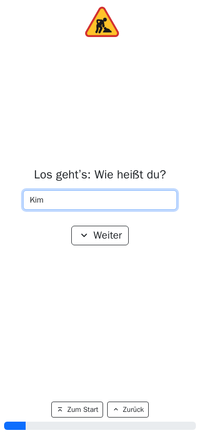
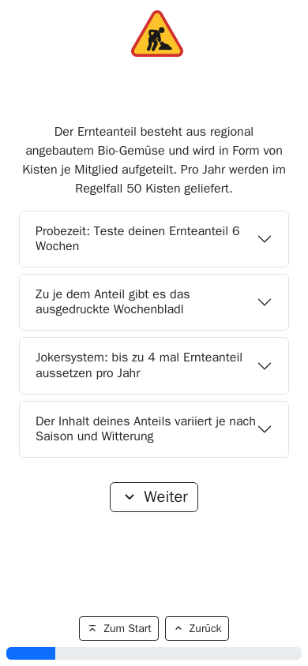
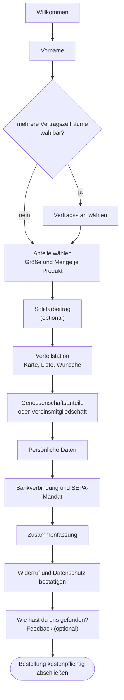
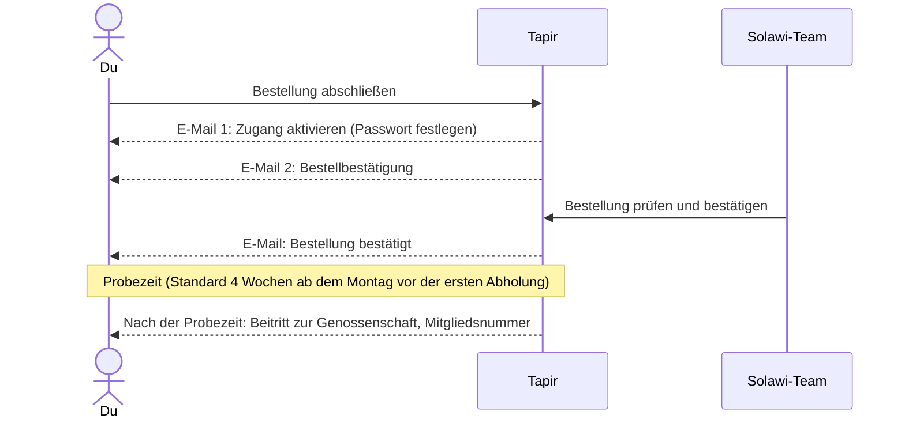

> ⚠️ **Nicht maßgeblich.** Dieses Wiki gehört zu einem abgeschlossenen Proof of Concept für den
> Eigenbetrieb von Tapir und wird nicht gepflegt. Maßgeblich ist die Dokumentation im
> Hauptprojekt: [FoodCoopX/wirgarten-tapir – docs](https://github.com/FoodCoopX/wirgarten-tapir/tree/master/docs),
> Aufbau in Issue [#1300](https://github.com/FoodCoopX/wirgarten-tapir/issues/1300).

# Mitglied werden (Bestell-Wizard)

> **Kurz gesagt:** Über den Bestell-Wizard meldest du dich in einem Rutsch an: Anteile wählen,
> Verteilstation aussuchen, Genossenschaftsanteile zeichnen, Daten und Bankverbindung angeben,
> abschicken. Danach bekommst du zwei E-Mails – eine zum Aktivieren deines Zugangs und eine
> Bestellbestätigung. Die ersten Wochen sind Probezeit, in der du flexibel kündigen kannst. Ist
> etwas ausgebucht, landest du auf der Warteliste.

Hinweis: Viele Texte und Zahlen (Mindestanteile, Preise, Probezeit, Fristen) stellt deine Solawi
selbst ein. Hier stehen die Standardwerte.

## Der Weg durch den Wizard

  

_Der Bestell-Wizard auf dem Handy: Start, Vorname, Vorstellung eines Anteils._

Über den Warenkorb oben kannst du jederzeit zurückspringen („Bestellung anpassen“,
„Anteile anpassen“, „Mitgliedschaft anpassen“).

## Die Schritte im Einzelnen

| Schritt | Was du tust | Gut zu wissen |
|---|---|---|
| Vertragsstart | Zeitraum wählen | Erscheint nur kurz vor Beginn einer neuen Saison; Start ist immer der Montag der ersten Lieferwoche |
| Anteile | Je Produkt Größe und Menge wählen | Preis pro Monat oder pro Lieferung; ist ein Produkt voll, steht dort „nur Warteliste-Eintrag möglich“ |
| Solidarbeitrag | Betrag pro Monat wählen oder „Ich möchte einen anderen Betrag zahlen“ | Positiv = du unterstützt andere, negativ = du wirst unterstützt |
| Verteilstation | Station auf der Karte oder in der Liste wählen | „Kapazität frei“ zeigt freie Plätze; mit „Weiterer Wunsch“ kannst du Ausweichstationen angeben |
| Genossenschaftsanteile | Anzahl mit + und − wählen, Satzung und Einzahlungspflicht bestätigen | Standard: mindestens 2 Anteile à 50 €; Studierende können ggf. ohne Anteile bestellen |
| Persönliche Daten | Name, E-Mail (zweimal), Adresse, Telefon | Ist die E-Mail schon vergeben, meldet der Wizard das |
| Bankverbindung | Kontoinhaber, IBAN, Zahlungsintervall, SEPA-Zustimmung | Das Intervall erscheint nur, wenn deine Solawi mehrere anbietet |
| Zusammenfassung | Alles prüfen | Jeder Teil lässt sich noch anpassen |
| Rechtliches | Widerrufsbelehrung und Datenschutz bestätigen | Widerruf: zwei Wochen in Textform |

## Nach dem Abschicken

- **Keine E-Mail bekommen?** Schau in den Spam-Ordner. Kommt innerhalb von 24 Stunden nichts,
  melde dich bei deiner Solawi.
- **Probezeit:** In dieser Zeit kannst du flexibel kündigen. Die Genossenschaftsanteile werden
  erst nach der Probezeit wirksam.
- **Zahlungen:** Lieferungen in der Probezeit werden nachträglich abgebucht, danach im Voraus –
  im Übergangsmonat werden deshalb zwei Beträge eingezogen.

## Warteliste

Ist ein Anteil oder deine Wunschstation voll, kommst du auf die Warteliste und bekommst eine
Bestätigung per E-Mail. Wird ein Platz frei, schickt dir deine Solawi einen persönlichen Link.
Er öffnet den Wizard mit deinen Wünschen schon ausgefüllt – du musst nur noch bestätigen.
