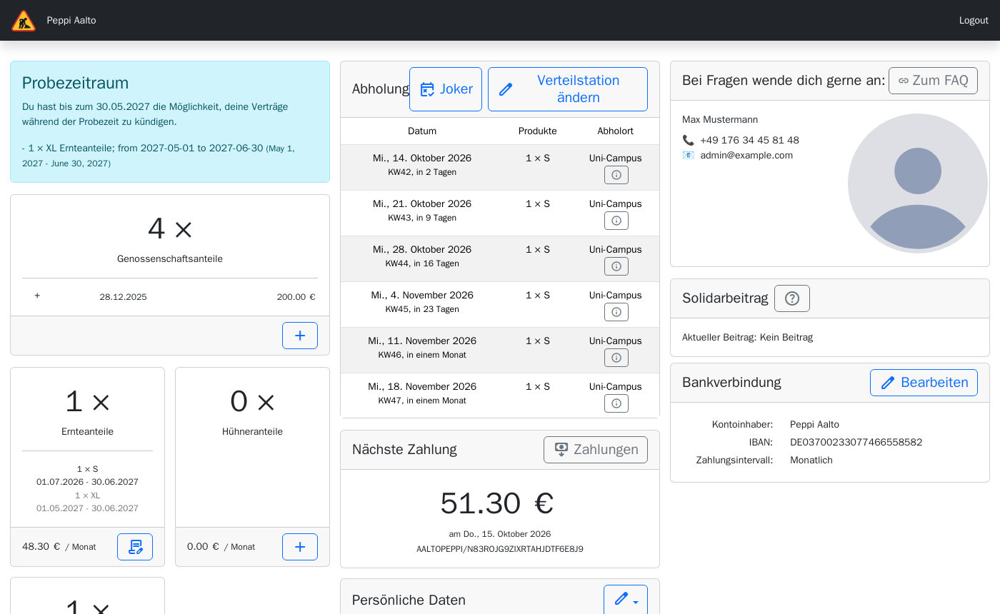
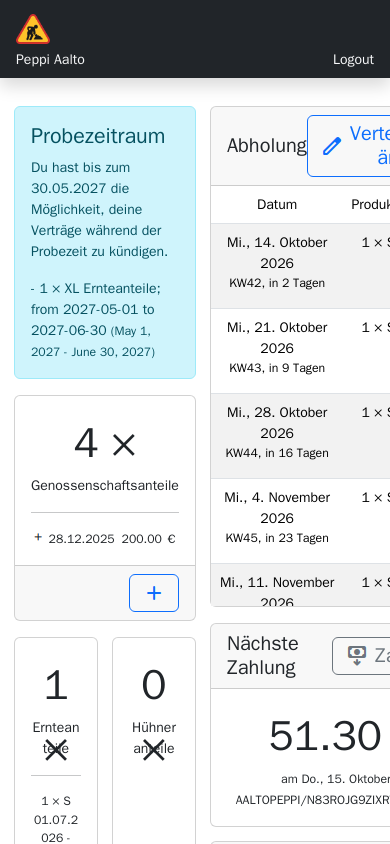
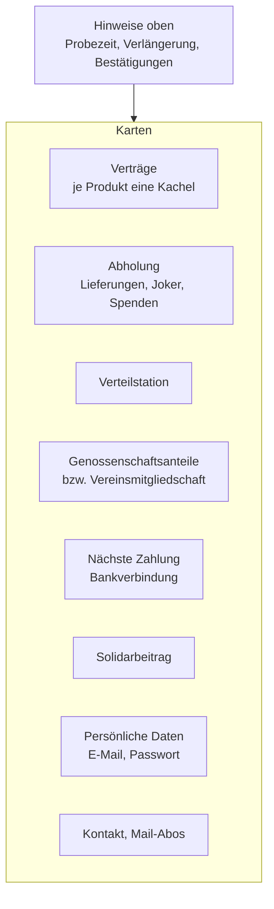
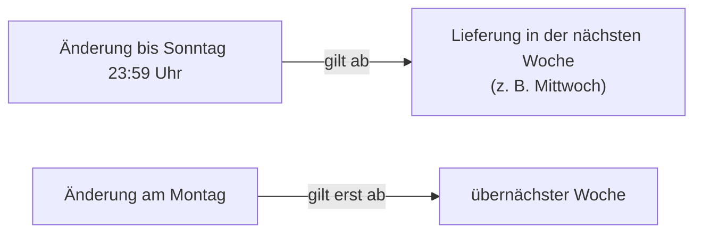
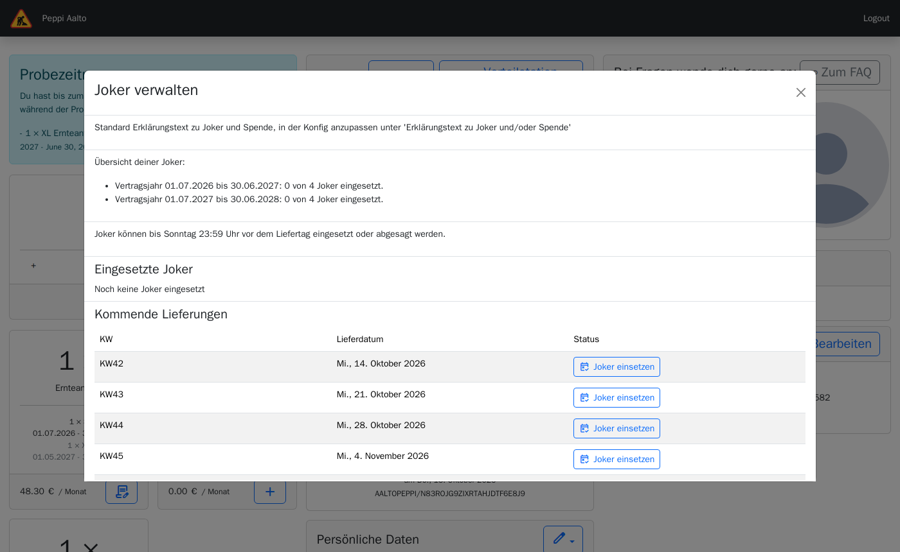
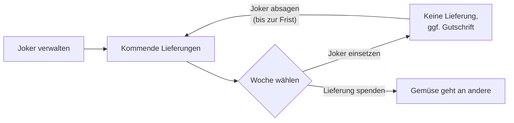
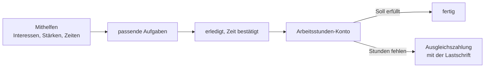

> ⚠️ **Nicht maßgeblich.** Dieses Wiki gehört zu einem abgeschlossenen Proof of Concept für den
> Eigenbetrieb von Tapir und wird nicht gepflegt. Maßgeblich ist die Dokumentation im
> Hauptprojekt: [FoodCoopX/wirgarten-tapir – docs](https://github.com/FoodCoopX/wirgarten-tapir/tree/master/docs),
> Aufbau in Issue [#1300](https://github.com/FoodCoopX/wirgarten-tapir/issues/1300).

# Mitgliederbereich

> **Kurz gesagt:** Nach der Anmeldung siehst du alles auf einer Seite: deine Verträge, die
> nächsten Abholungen, Joker, Genossenschaftsanteile, Zahlungen und deine Daten. Vieles kannst
> du selbst ändern – Anteile erhöhen, Verteilstation wechseln, Joker setzen, Bankdaten pflegen.
> Änderungen gelten ab der nächsten Lieferwoche, wenn du sie bis zur Frist (Standard: Sonntag
> 23:59 Uhr) machst.

Welche Karten und Knöpfe du siehst, hängt von den Einstellungen deiner Solawi ab.

## Die Seite im Überblick

## Die Frist

Die Frist gilt für Joker, Spenden, Stationswechsel und den Start neuer Verträge. Wochentag und
Liefertag stellt deine Solawi ein.

## Verträge

- Jede Kachel zeigt Produkt, Menge, Laufzeit und Preis.
- **Ändern** (Stift) bzw. **+** öffnet einen kleinen Bestellassistenten. Während ein Vertrag
  läuft, kannst du die Anteilsgröße nur **erhöhen**. Zusatzprodukte setzen das Basisprodukt
  voraus.
- Kündigen, Verlängern und Probezeit: siehe [Verträge und Kündigung](Handbuch-Vertraege).

## Abholung, Joker und Spenden

- **Abholung** listet die nächsten Lieferungen mit Datum, Produkten und Abholort.
- Ein **Joker** setzt eine Lieferung aus (z. B. im Urlaub). Standard: bis zu 4 Joker pro Jahr.
  Je nach Solawi bekommst du dafür eine Gutschrift.
- Statt eines Jokers kannst du eine Lieferung **spenden**, wenn deine Solawi das anbietet.

## Verteilstation wechseln

**Verteilstation ändern** → Liefertag wählen → neue Station wählen → **Wechsel bestätigen**. Ist
die Station voll, kannst du dich für bis zu drei Stationen auf die Warteliste setzen. Du bekommst
eine E-Mail mit Adresse, Zugangscode und Abholzeiten.

## Genossenschaftsanteile

Die Karte zeigt deine Anteile und alle Buchungen. Mit **+** zeichnest du weitere Anteile – das
geht erst, wenn du formal Mitglied geworden bist (nach der Probezeit). Anteile kündigen kannst du
hier nicht; wende dich dafür an deine Solawi.

## Zahlungen und Bankverbindung

- **Nächste Zahlung** zeigt Betrag und Mandatsreferenz; **Zahlungen** öffnet die Liste aller
  geplanten und vergangenen Abbuchungen (mit Gutschriften und Liefergebühren).
- Abgebucht wird standardmäßig zum 15. des Monats.
- **Bankverbindung → Bearbeiten**: Kontoinhaber und IBAN ändern, SEPA-Mandat bestätigen. Das
  Zahlungsintervall ändert nur das Solawi-Team.

## Solidarbeitrag

Zeigt deinen aktuellen Beitrag. Wenn deine Solawi es erlaubt, kannst du ihn mit **Beitrag
anpassen** erhöhen. Senken geht nur über das Team.

## Persönliche Daten und E-Mail

- Telefon und Adresse änderst du selbst. Name und Mitgliedsnummer ändert das Team.
- **E-Mail-Adresse ändern:** neue Adresse zweimal eingeben. Der Bestätigungslink geht an die
  **alte** Adresse und ist 24 Stunden gültig. Bis dahin steht bei der neuen Adresse „Nicht
  verifiziert“.
- **Zusätzliche E-Mail-Adressen** (falls freigeschaltet): weitere Personen bekommen nach ihrer
  Bestätigung alle Mails mit.
- **Mail-Abos** und **Mailing-Listen**: Newsletter an- und abbestellen.

## Mithelfen und Arbeitsstunden (geplant)

Wenn deine Solawi die Anbau-App nutzt, bekommt der Mitgliederbereich eine Karte **Mithelfen**:

- Du legst selbst fest, **wobei du helfen möchtest** (z. B. Ernte, Pflanzen, Verteilung) und
  **was deine Stärken sind**, dazu, wann du Zeit hast.
- Passende Aufgaben werden dir vorgeschlagen oder zugewiesen; du kannst freigegebene Aufgaben
  auch selbst übernehmen.
- Gibt es bei deiner Solawi Pflichtstunden, siehst du dein **Arbeitsstunden-Konto**: Soll,
  geleistete Stunden und Rest. Wie viele Stunden du leistest, hängt von deinen Anteilen ab:
  ein großer Anteil bringt mehr Pflichtstunden als ein kleiner. Steigst du während der Saison
  ein, zählt nur deine Laufzeit. Fehlende Stunden werden zum Stichtag **in bar abgegolten**; der
  Betrag erscheint dann in deinen Zahlungen.

## Warteliste und Brot

- Stehst du auf der Warteliste, zeigt eine Karte deine Wünsche. Ändern geht per E-Mail an das
  Team.
- Bietet deine Solawi Brot an, führt **Zu den Broten** zur Brotauswahl: Lieblingsbrote festlegen
  oder Brote für einzelne Wochen wählen.
