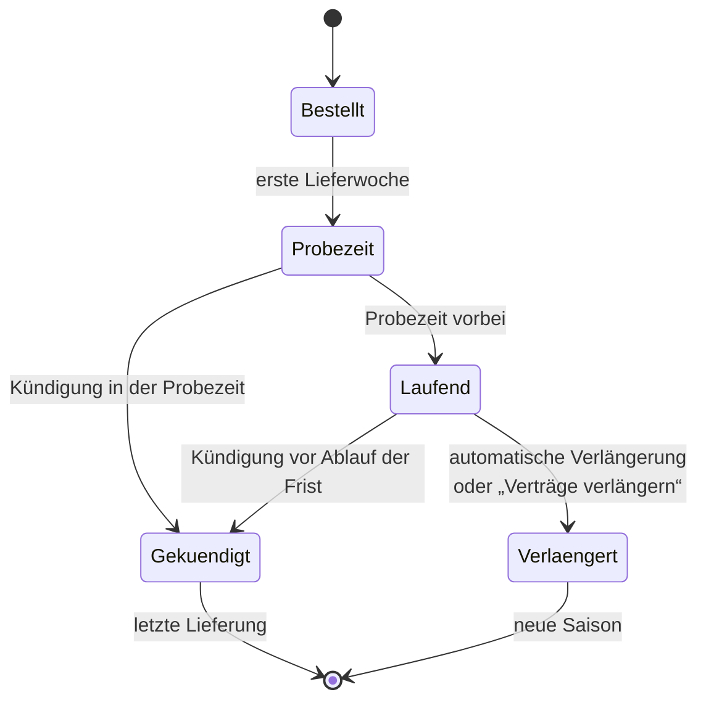

> ⚠️ **Nicht maßgeblich.** Dieses Wiki gehört zu einem abgeschlossenen Proof of Concept für den
> Eigenbetrieb von Tapir und wird nicht gepflegt. Maßgeblich ist die Dokumentation im
> Hauptprojekt: [FoodCoopX/wirgarten-tapir – docs](https://github.com/FoodCoopX/wirgarten-tapir/tree/master/docs),
> Aufbau in Issue [#1300](https://github.com/FoodCoopX/wirgarten-tapir/issues/1300).

# Verträge und Kündigung

> **Kurz gesagt:** Ein Vertrag läuft eine Saison. Am Anfang steht eine Probezeit (Standard
> 4 Wochen), in der du einfach kündigen kannst. Danach gilt eine Kündigungsfrist (Standard
> 2 Monate). Je nach Solawi verlängert sich der Vertrag automatisch – dann kündigst du über
> **Kündigen** – oder du wirst rechtzeitig gefragt, ob du verlängern möchtest.

## Ablauf einer Saison

## Kündigen (bei automatischer Verlängerung)

Karte **Einzelne oder alle Verträge kündigen** → **Kündigen**:

1. **Welche Verträge möchtest du kündigen?** – einzeln ankreuzen. Kündigst du alles, kannst du
   in der Probezeit auch den Beitritt zur Genossenschaft bzw. zum Verein widerrufen und den
   Solidarbeitrag beenden.
2. **Warum möchtest du deinen Vertrag kündigen?** – Gründe ankreuzen (freiwillig, hilft der
   Solawi).
3. **Kündigung bestätigen.** Du bekommst eine E-Mail.

| Situation | Wann endet der Vertrag? |
|---|---|
| In der Probezeit | Zum Ende der Probezeit, wenn du bis zum angezeigten Datum 23:59 Uhr kündigst |
| Nach der Probezeit | Zum Ende der Saison, wenn du die Kündigungsfrist einhältst |
| Frist verpasst | Der Vertrag verlängert sich um ein weiteres Jahr |

Die Probezeit zählt ab dem Montag vor deiner ersten Abholung, nicht ab dem Vertragsdatum.

## Verlängern (ohne automatische Verlängerung)

Etwa drei Monate vor Saisonende erscheint oben ein Hinweis, z. B. „Dein Ernteanteil läuft bald
aus!“:

- **Jetzt Ernteanteil verlängern** → Auswahl prüfen → **Verträge verlängern**.
- **Ernteanteil nicht verlängern** → Bestätigung per E-Mail.

## Anteile ändern

Während der Saison kannst du die Anteilsgröße erhöhen oder Zusatzprodukte dazunehmen (Stift
bzw. + an der Vertragskachel). Verkleinern geht erst zur nächsten Saison. Neue oder geänderte
Verträge prüft das Solawi-Team; du bekommst eine Bestätigung per E-Mail.
