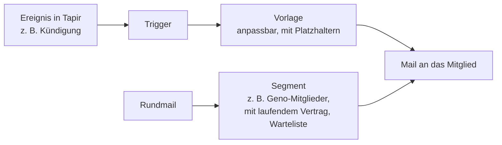
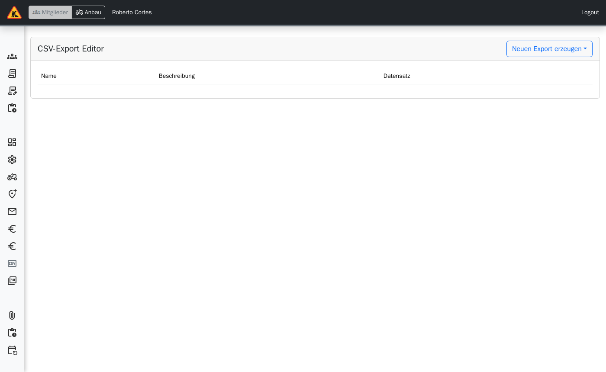
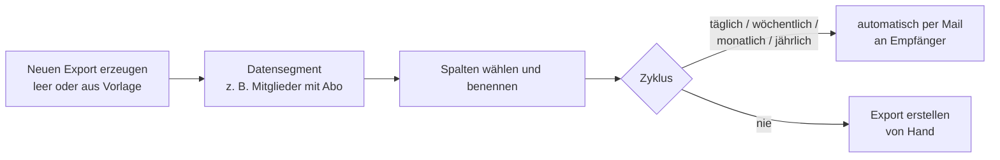

> ⚠️ **Nicht maßgeblich.** Dieses Wiki gehört zu einem abgeschlossenen Proof of Concept für den
> Eigenbetrieb von Tapir und wird nicht gepflegt. Maßgeblich ist die Dokumentation im
> Hauptprojekt: [FoodCoopX/wirgarten-tapir – docs](https://github.com/FoodCoopX/wirgarten-tapir/tree/master/docs),
> Aufbau in Issue [#1300](https://github.com/FoodCoopX/wirgarten-tapir/issues/1300).

# Verwaltung: Kommunikation und Exporte

> **Kurz gesagt:** Alle automatischen Mails (Bestellbestätigung, Kündigung, Abholortwechsel …)
> haben Vorlagen, die Sie unter **E-Mail** anpassen; dort schreiben Sie auch Rundmails an
> Gruppen von Mitgliedern. Wiederkehrende Listen (Abhakzettel, Kommissionierliste, Mitglieder mit
> Joker …) richten Sie einmal als CSV- oder PDF-Export ein und lassen sie automatisch per Mail
> verschicken.

## E-Mail

**Administration → E-Mail** (Rolle `email.manage`):

Wichtige automatische Mails: Bestell-Wizard (Mitgliedschaft + Ernteanteile), Vertragsänderungen
im Mitgliederbereich, Abholortänderung, E-Mail-Änderung, Kündigung in der Probezeit, Vertrag
gekündigt bzw. nicht verlängert, Beitritt zur Genossenschaft, Vertrags-/Lieferende, Warteliste
(Eintrag, Link, Abschluss), Bestellung bestätigt bzw. widerrufen.

Platzhalter wie Vorname, Abholort oder Vertragsdaten setzt Tapir beim Versand ein.

## Mailing-Listen

Nur wenn eingerichtet (**Mailing-Listen**): Liste erzeugen (Name, Beschreibung, „Mitglieder
können sich selber ein- und austragen“), Empfänger verwalten, externe Empfänger hinzufügen.

## CSV- und PDF-Exporte

**Administration → CSV-Exports / PDF-Exports**:

- Felder: Name, Datensegment, Beschreibung, Trennzeichen, Dateiname, Empfänger, Sprache,
  Spalten, Zyklus mit Tag und Uhrzeit.
- Datensegmente: Alle Mitglieder, Mitglieder mit Abo, Mitglieder mit Joker, Mitglieder mit
  gekündigten Anteilen im Vorjahr, Alle Zahlungen des Monats.
- PDF-Vorlagen: Abhakzettel, Kommissionierliste pro Abholort, Kistenzahl pro Ausfahrrunde.

Lieferanten- und Kommissionierliste als CSV erzeugt Tapir zusätzlich jeden Morgen; sie liegen
unter **Debug → Exportierte Dateien**.
