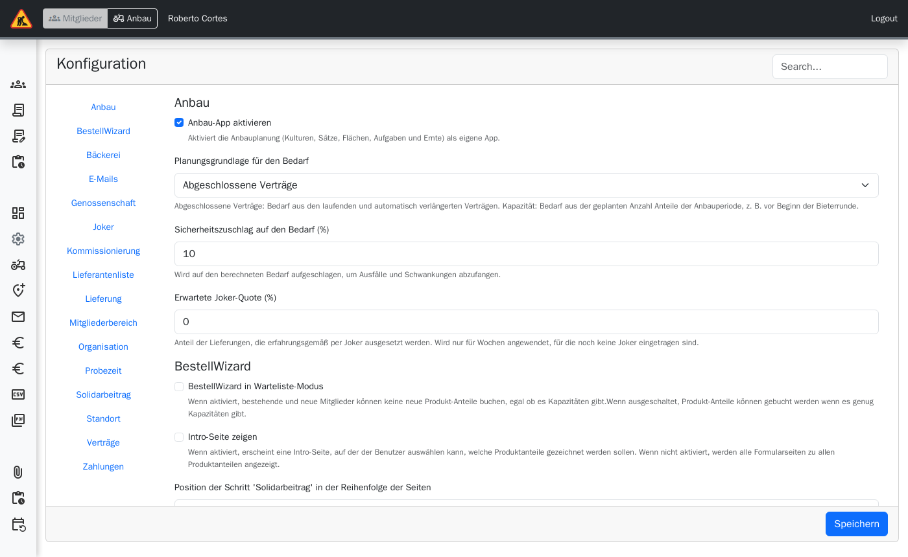
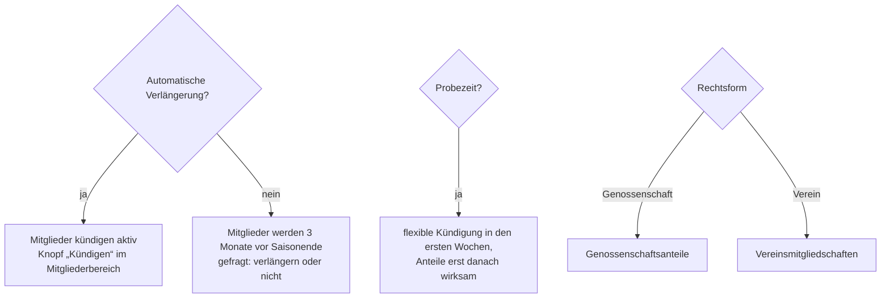

> ⚠️ **Nicht maßgeblich.** Dieses Wiki gehört zu einem abgeschlossenen Proof of Concept für den
> Eigenbetrieb von Tapir und wird nicht gepflegt. Maßgeblich ist die Dokumentation im
> Hauptprojekt: [FoodCoopX/wirgarten-tapir – docs](https://github.com/FoodCoopX/wirgarten-tapir/tree/master/docs),
> Aufbau in Issue [#1300](https://github.com/FoodCoopX/wirgarten-tapir/issues/1300).

# Verwaltung: Konfiguration

> **Kurz gesagt:** Unter **Administration → Konfiguration** stellen Sie Ihre Solawi ein:
> Rechtsform, Probezeit, Kündigungsfrist, automatische Verlängerung, Joker, Fristen,
> Zahlungsdaten, die Texte des Bestell-Wizards und optionale Module wie Bäckerei und Anbau.
> Die Einstellungen sind nach Kategorien sortiert; oben gibt es eine Suche. Erst **Speichern**
> übernimmt die Änderungen.

## Kategorien

| Kategorie | Typische Einstellungen |
|---|---|
| BestellWizard | Warteliste-Modus, Texte und Bilder je Seite |
| Genossenschaft / Verein | Mindestanzahl Anteile, Preis je Anteil, Satzung, Fördermitgliedschaft |
| Lieferung | Liefer-Wochentag, Lieferzuschlag je Verteilstation |
| Joker | Joker an/aus, Gutschriften für Joker, Spenden-Modus |
| E-Mails | Zusätzliche Adressen, BCC |
| Mitgliederbereich | Was Mitglieder selbst dürfen (Verträge, Abholort, Zahlungen sehen), Kündigungsgründe, Präfix der Mitgliedsnummer |
| Organisation | Rechtsform, Vertriebskanäle, Studierende |
| Zahlungen | Fälligkeitstag, Intervalle, IBAN/BIC, Gläubiger-ID, Mandatsreferenz, Verwendungszwecke |
| Kommissionierung | Kommissioniermodus, Frist für Änderungen |
| Standort | Name, Kontakt, Links (FAQ, Datenschutz) |
| Solidarbeitrag | Vorgeschlagene Werte, Mindestwert, Änderbarkeit |
| Verträge | Automatische Verlängerung, Kündigungsfrist, Vorlaufzeit, Warteliste-Kategorien |
| Probezeit | An/aus, Wochen, flexibel kündbar |
| Bäckerei | Modul an/aus, Backtag, Auswahlfristen |
| Anbau | Anbau-App an/aus, Planungsgrundlage, Sicherheitszuschlag, Joker-Quote |

## Entscheidungen mit großer Wirkung

Ändern Sie diese Punkte möglichst vor Saisonbeginn und informieren Sie die Mitglieder.

## Optionale Module

- **Bäckerei** (Kategorie Bäckerei): Menü Bäckerei mit Wochenplan Brote, Berichten (Backliste,
  Verteilliste, Abholliste) und Zutaten, Labels und Broten. Mitglieder wählen ihre Brote im
  Mitgliederbereich.
- **Anbau** (Kategorie Anbau): eigene App für das Gärtnerei-Team, siehe
  [Anbau-App](Handbuch-Anbau).

## Debug-Bereich

Für Fehlersuche: **Exportierte Dateien** (erzeugte Listen herunterladen), **Geplante Tasks**,
**Jobs** (Hintergrundjobs von Hand starten – nur, wenn Sie wissen, was der Job tut).
