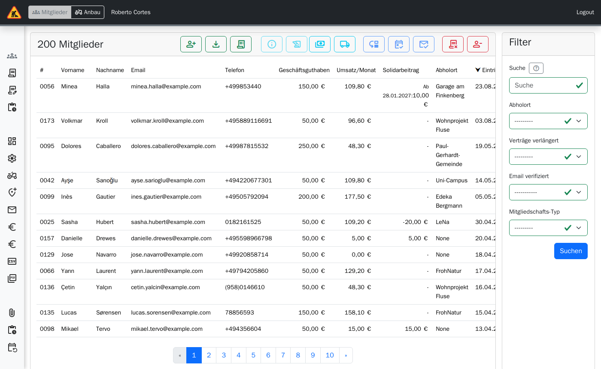
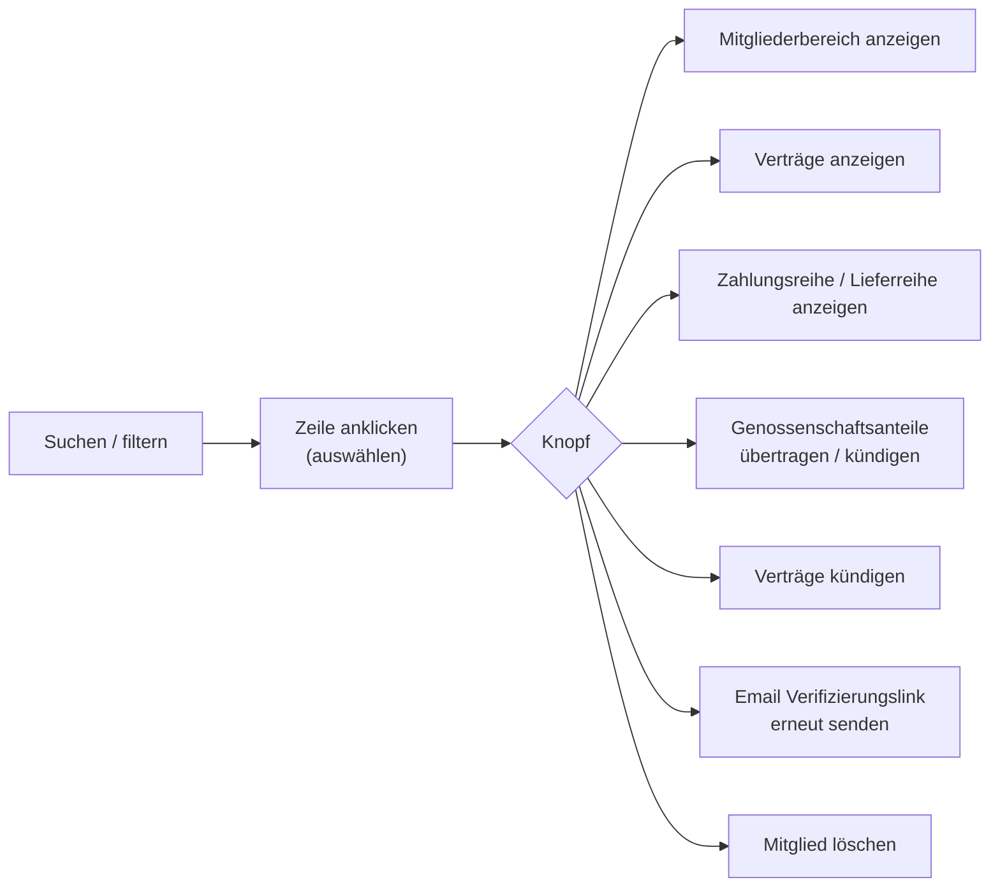
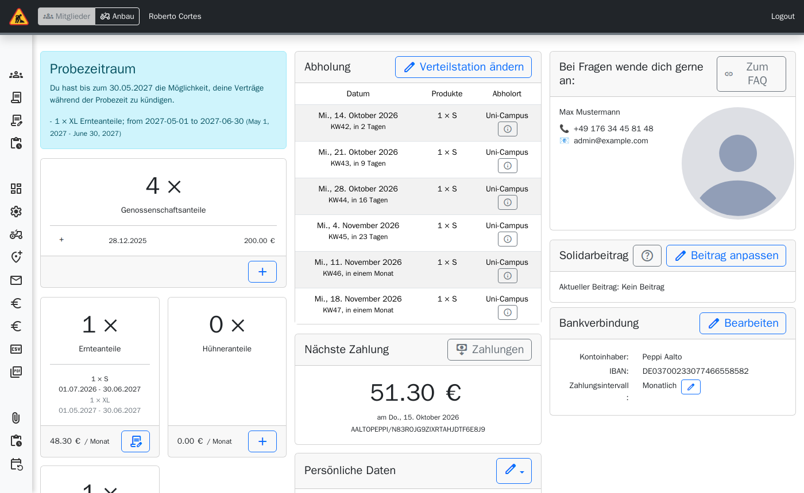

> ⚠️ **Nicht maßgeblich.** Dieses Wiki gehört zu einem abgeschlossenen Proof of Concept für den
> Eigenbetrieb von Tapir und wird nicht gepflegt. Maßgeblich ist die Dokumentation im
> Hauptprojekt: [FoodCoopX/wirgarten-tapir – docs](https://github.com/FoodCoopX/wirgarten-tapir/tree/master/docs),
> Aufbau in Issue [#1300](https://github.com/FoodCoopX/wirgarten-tapir/issues/1300).

# Verwaltung: Mitglieder

> **Kurz gesagt:** In **Mitglieder** finden Sie jedes Mitglied über Name, E-Mail oder
> Mitgliedsnummer. Ein Klick wählt die Zeile aus, die Knöpfe darüber wirken auf die Auswahl;
> ein zweiter Klick öffnet den Mitgliederbereich, so wie das Mitglied ihn sieht – mit
> zusätzlichen Admin-Funktionen. Mitglied löschen ist nur für Fehlerkorrekturen gedacht.

## Mitgliederliste

**Filter:** Suche (Vorname, Nachname, E-Mail, Mitgliedsnummer – auch „0017“; mehrere Wörter
müssen alle passen), Abholort, Verträge verlängert, Email verifiziert, Mitgliedschafts-Typ,
Sortierung.

**Spalten:** Nummer, Name, E-Mail (Warnsymbol „Nicht verifiziert!“), Telefon,
Geschäftsguthaben, Umsatz/Monat, Solidarbeitrag, Abholort, Eintritt, Ausstieg.

| Knopf | Wirkung |
|---|---|
| **Mitglied anlegen** | Neues Mitglied ohne Bestell-Wizard (Rolle `accounts.manage`) |
| **Gefilterte Liste exportieren** | CSV der aktuellen Auswahl |
| **Mitgliederliste nach GenG exportieren** | Gesetzliche Mitgliederliste (bei Vereinen: „Mitgliederliste exportieren“) |
| **Genossenschaftsanteile übertragen** | Von einem Mitglied auf ein anderes, mit Sicherheitsabfrage |
| **Genossenschaftsanteile kündigen** | Kündigungsdatum, gültig zum, Anzahl |
| **Vereinsmitgliedschaft anpassen / kündigen** | Bei Vereinen statt Anteilen |
| **Email Verifizierungslink erneut senden** | Wenn das Mitglied die Aktivierungsmail nicht findet; falsche Adresse vorher im Mitgliederbereich korrigieren |
| **Verträge kündigen** | Derselbe Kündigungsassistent wie für Mitglieder |
| **Mitglied löschen** | Löscht auch Verträge, Zahlungen und Historie – nur bei Fehlern |

## Mitgliederbereich als Admin

Sie sehen dieselben Karten wie das Mitglied (siehe
[Mitgliederbereich](Handbuch-Mitgliederbereich)), dazu:

- **Genossenschaftsanteile +**: Hat das Mitglied noch keine Anteile, wählen Sie zwischen
  „Zeichnungen in der Vergangenheit eintragen“ (Wirksamkeitsdatum = Zustimmung durch Vorstand
  bzw. Generalversammlung) und einer aktuellen Zeichnung über den Bestell-Wizard.
- **Verträge bearbeiten** (Stift/+ an der Vertragskachel), auch wenn Mitglieder selbst das
  nicht dürfen.
- **Verteilstation ändern** ist für Admins immer möglich.
- **Zahlungsintervall bearbeiten** (nur Admins).
- **Als verifiziert markieren** bei offener E-Mail-Änderung.
- **Historie** unten: alle Änderungen und versendeten Mails, Mails mit Vorschau.
