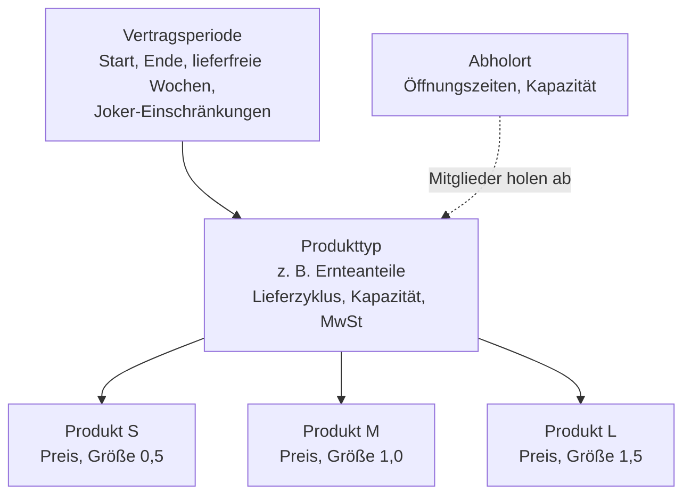
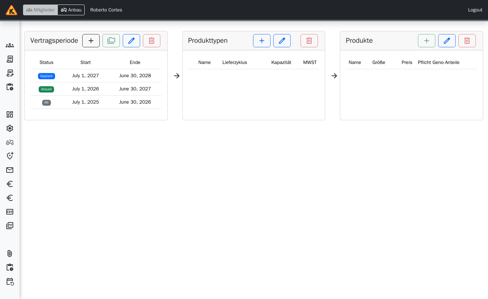
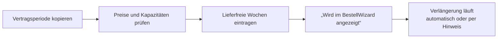
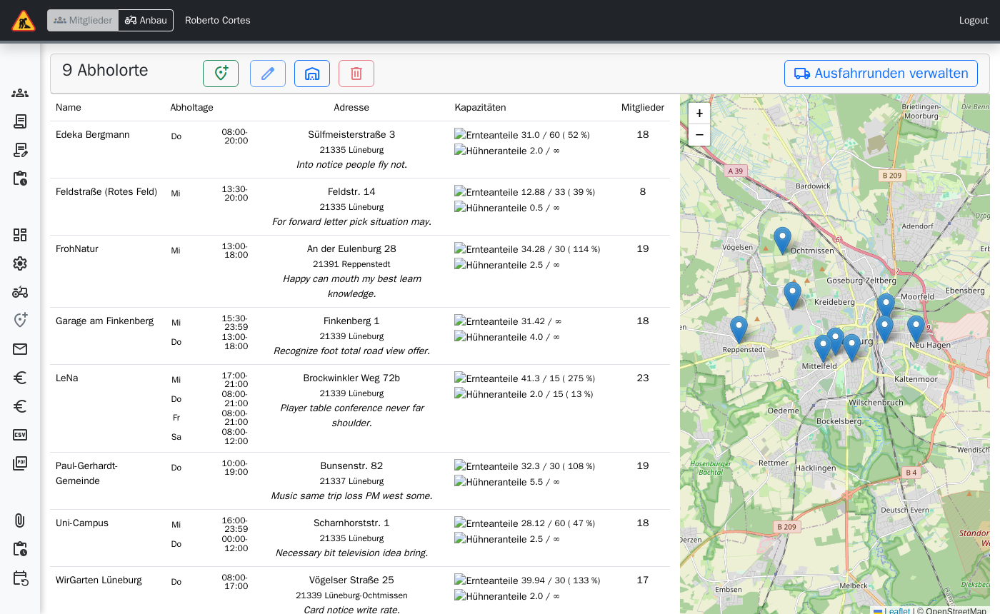

# Verwaltung: Produkte und Abholorte

> **Kurz gesagt:** Eine Saison heißt in Tapir **Vertragsperiode**. Darin gibt es
> **Produkttypen** (z. B. Ernteanteile) mit Lieferrhythmus und Kapazität und darunter
> **Produkte** (S, M, L) mit Preis und Größe in M-Äquivalenten. Für eine neue Saison kopieren Sie
> die alte. **Abholorte** haben Adresse, Öffnungszeiten und eine eigene Kapazität.

## Zusammenhang

Die **Größe** (M-Anteil-Äquivalent) ist die Währung aller Kapazitäten: Ein L-Anteil mit Größe
1,5 belegt anderthalb Plätze.

## Vertragsperiode

**Administration → Vertragsperiode & Produkte**, Bereich Vertragsperiode:

| Aktion | Hinweis |
|---|---|
| **Hinzufügen** | Anfangs- und Enddatum, „Wird im BestellWizard angezeigt“ |
| **Kopieren** | Übernimmt die Kapazitäten der Quellperiode – der schnelle Weg zur neuen Saison |
| **Bearbeiten** | Joker-Einschränkungen, lieferfreie Wochen (KW), abweichende Ausliefertage |
| **Löschen** | Nur ohne Verträge sinnvoll |

## Produkttypen

Name, Kapazität, „Nimmt am Joker- und Spende-Verfahren teil“, Liefer-/Abholzyklus
(1× pro Woche, jede 2. Woche gerade/ungerade KW, jede 4. Woche, benutzerdefinierte Lieferwochen),
eigene Kündigungsfrist, Mehrwertsteuersatz mit Gültigkeitsdatum, „Nur Einzelabonnement
möglich“, „Ist Pflicht“, „Warteliste-Modus“, Texte und Bild für den Bestell-Wizard.

**Pflichtstunden (geplant, mit der Anbau-App):** Am Produkttyp legen Sie fest, wie viele
Arbeitsstunden ein Anteil je Saison mit sich bringt – als Stunden je M-Anteil, die mit der
Größe skalieren (z. B. 8 h je M: S = 4 h, M = 8 h, L = 12 h), auf Wunsch je Produkt
überschrieben, dazu optional ein eigener Stundensatz für nicht geleistete Stunden. Ohne Angabe
entsteht kein Soll.

## Produkte

Name, Preis (monatlich oder pro Lieferung), Pflicht-Genossenschaftsanteile, Beschreibung und
Bild im Wizard, „Wird in BestellWizard versteckt“, Größe, Kapazität.

## Neue Saison vorbereiten

## Abholorte

**Administration → Abholorte**:

- **Abholort hinzufügen / bearbeiten / löschen**: Name, Adresse, Koordinaten (für die Karte im
  Wizard), Ausfahrrunde, Zugangscode, Messenger-Gruppe, Abholort-Pat\*innen, Foto,
  Zusatzinfos, Information für Fahrer, Öffnungszeiten Mo–So.
- Je Zeile **Kapazitäten bearbeiten** und **Lieferzuschlag verwalten** (aktueller Zuschlag,
  neuen Zuschlag ab Datum planen, Verlauf).
- **Ausfahrrunden verwalten** gruppiert Abholorte für die Kistenliste.

Zugangscode und Öffnungszeiten stehen in der Mail, die Mitglieder beim Wechsel bekommen.
