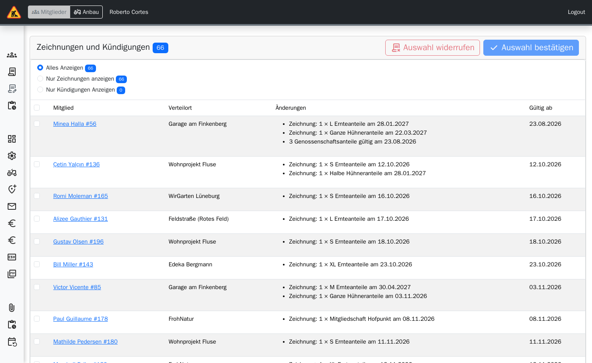
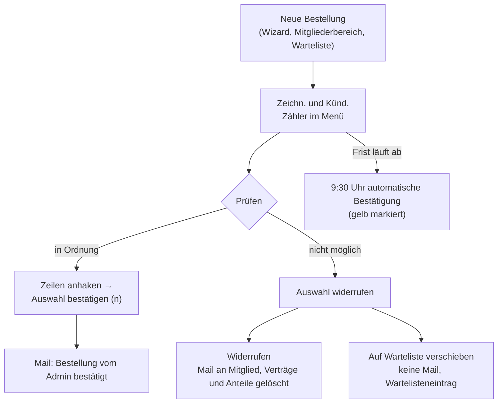
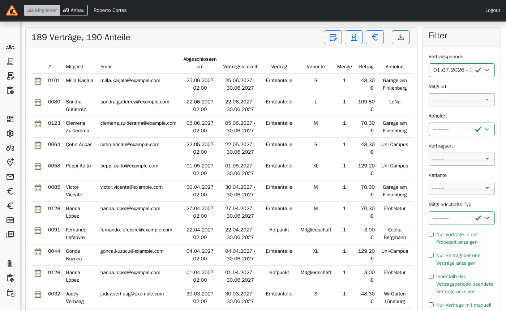
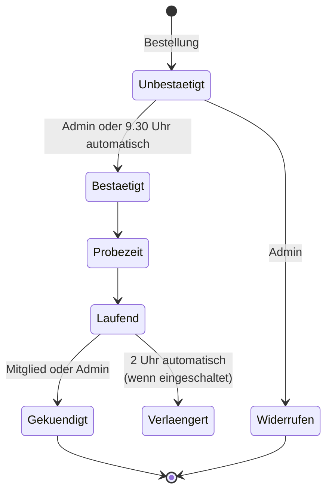

> ⚠️ **Nicht maßgeblich.** Dieses Wiki gehört zu einem abgeschlossenen Proof of Concept für den
> Eigenbetrieb von Tapir und wird nicht gepflegt. Maßgeblich ist die Dokumentation im
> Hauptprojekt: [FoodCoopX/wirgarten-tapir – docs](https://github.com/FoodCoopX/wirgarten-tapir/tree/master/docs),
> Aufbau in Issue [#1300](https://github.com/FoodCoopX/wirgarten-tapir/issues/1300).

# Verwaltung: Verträge

> **Kurz gesagt:** Neue Bestellungen und Kündigungen landen in **Zeichn. und Künd.**. Dort
> bestätigen Sie sie mit **Auswahl bestätigen** – das Mitglied bekommt eine Mail. Was Sie nicht
> bis zur Frist vor der ersten Lieferung bestätigen, bestätigt Tapir um 9:30 Uhr automatisch.
> In **Verträge** passen Sie einzelne Verträge an: Sonderkündigung, Probezeit, Preis.

## Zeichnungen und Kündigungen bestätigen

- Filter: **Alles Anzeigen**, **Nur Zeichnungen anzeigen**, **Nur Kündigungen Anzeigen**.
- Spalten: Mitglied, Verteilort, Änderungen (Zeichnung, Kündigung, Produktwechsel alt → neu,
  Anteile „gültig am“), Gültig ab.
- Widerrufen geht nur für künftige Zeichnungen; Kündigungen lassen sich nicht widerrufen.

## Vertragsliste

**Filter:** Vertragsperiode, Mitglied, Abholort, Vertragsart, Variante, Mitgliedschafts-Typ,
dazu „Nur Verträge in der Probezeit“, „Nur beitragsbefreite Verträge“, „Innerhalb der
Vertragsperiode beendete Verträge“, „manuell geänderte Probezeit“.

**Symbole:** gekündigt, Probezeit, Probezeit manuell deaktiviert, Laufzeitende, Betrag
„Manuell editiert!“.

| Knopf (Vertrag auswählen) | Wofür | Achtung |
|---|---|---|
| **Vertragsstart-anpassen/Sonderkündigung** | Kulanz, Umzug, Härtefall | Neues Ende muss ein Sonntag sein; spätere Verträge und Solidarbeiträge werden angepasst bzw. gelöscht; ggf. Gutschriften; **keine** automatische Mail an das Mitglied |
| **Probezeit aktivieren/deaktivieren** | Keine Probezeit oder eigenes Probezeit-Ende (Sonntag) | |
| **Betrag ändern** | Standardbetrag, personalisierter Betrag oder beitragsbefreit | |
| **Gefilterte Liste exportieren** | CSV | |

## Lebenslauf eines Vertrags

