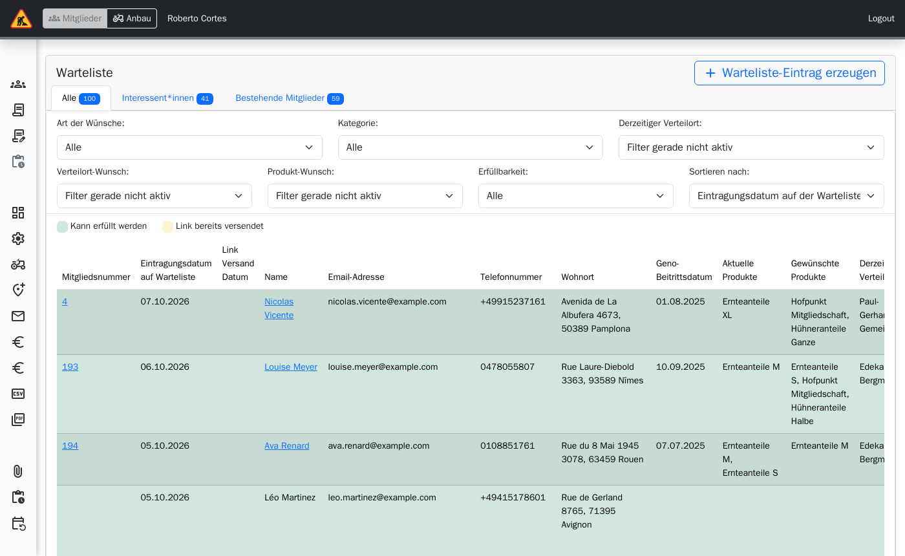
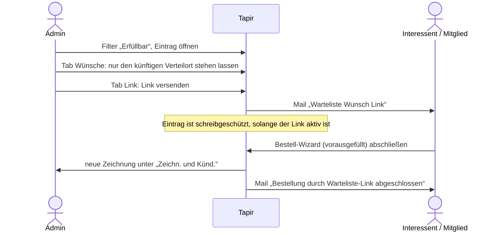

> ⚠️ **Nicht maßgeblich.** Dieses Wiki gehört zu einem abgeschlossenen Proof of Concept für den
> Eigenbetrieb von Tapir und wird nicht gepflegt. Maßgeblich ist die Dokumentation im
> Hauptprojekt: [FoodCoopX/wirgarten-tapir – docs](https://github.com/FoodCoopX/wirgarten-tapir/tree/master/docs),
> Aufbau in Issue [#1300](https://github.com/FoodCoopX/wirgarten-tapir/issues/1300).

# Verwaltung: Warteliste

> **Kurz gesagt:** Wer nichts mehr bekommt, steht auf der Warteliste – Interessenten und
> bestehende Mitglieder mit Wechselwünschen. Wird ein Platz frei, bereinigen Sie die Wünsche des
> Eintrags und schicken mit **Link versenden** einen persönlichen Bestelllink. Das Mitglied
> schließt im vorausgefüllten Bestell-Wizard ab.

## Ansicht

- Knopf **Warteliste-Eintrag erzeugen** für Anfragen per Telefon oder Mail.
- Reiter: **Alle**, **Interessent\*innen**, **Bestehende Mitglieder**.
- Filter: Art der Wünsche, Kategorie, derzeitiger Verteilort, Verteilort-Wunsch,
  Produkt-Wunsch, **Erfüllbarkeit** (Erfüllbar / Nicht erfüllbar), Sortierung nach
  Eintragungsdatum oder Geno-Eintritt.

Tipp: Der Filter **Erfüllbar** zeigt sofort, wem Sie jetzt einen Platz anbieten können.

## Platz vergeben

- **Link erneut versenden** bzw. **Link ausschalten** im selben Tab.
- Ein Eintrag hat die Tabs **Persönliche Daten**, **Wünsche** (Abholort-Wünsche nach Priorität,
  Produkte mit Menge, gewünschtes Anfangsdatum, Kategorie) und **Link**.

Wartelisteneinträge reservieren Kapazität: Tapir rechnet sie bei der Kapazitätsprüfung mit ein.
